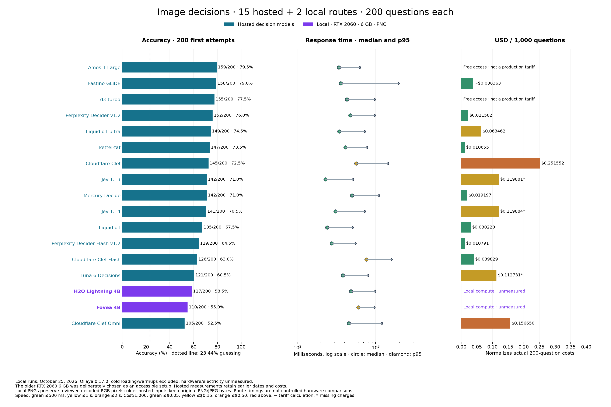
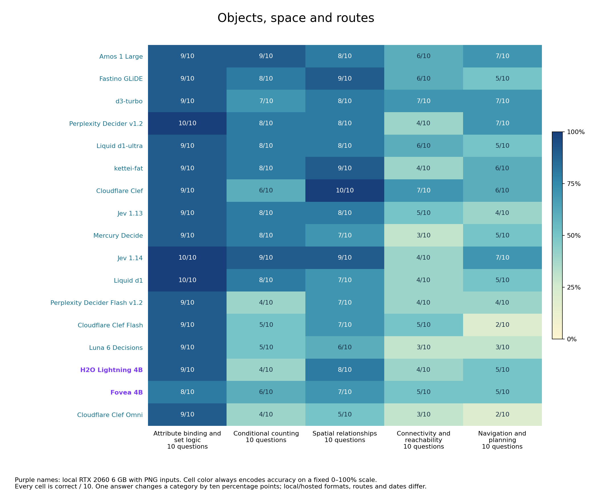
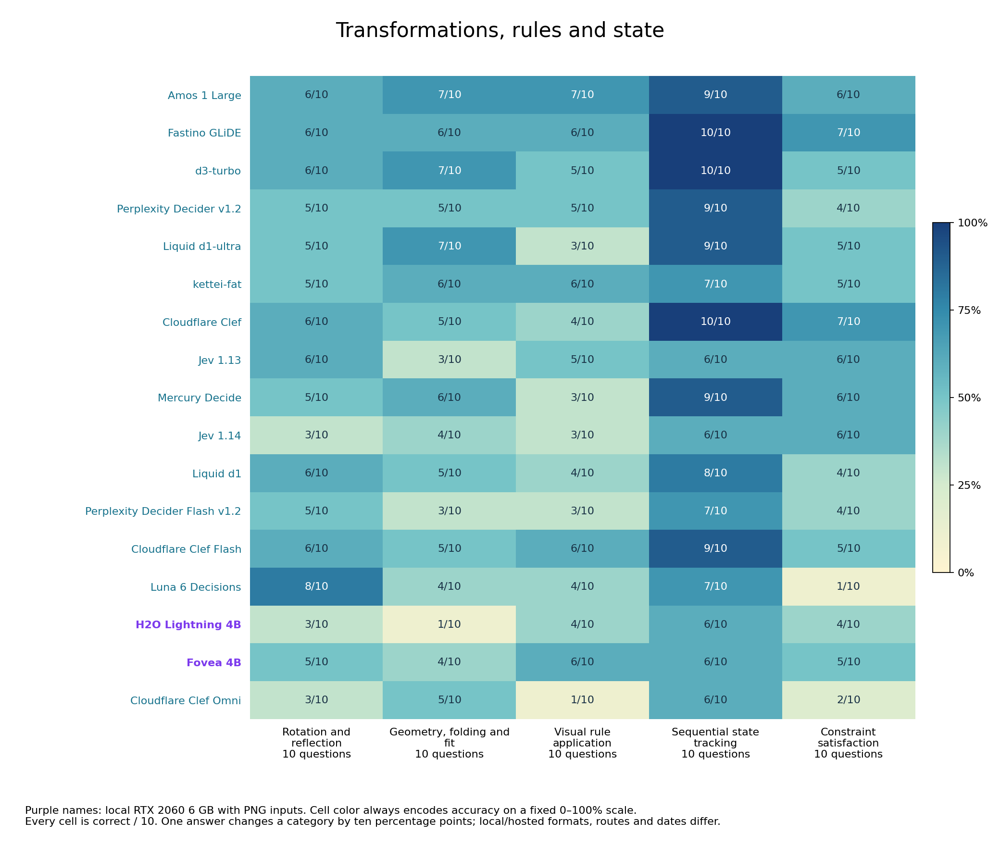
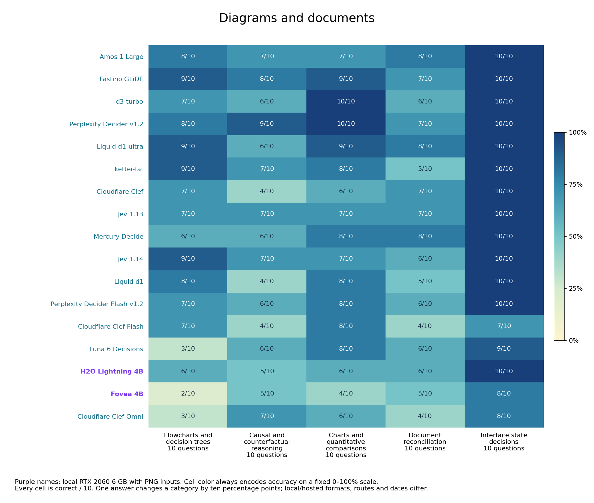
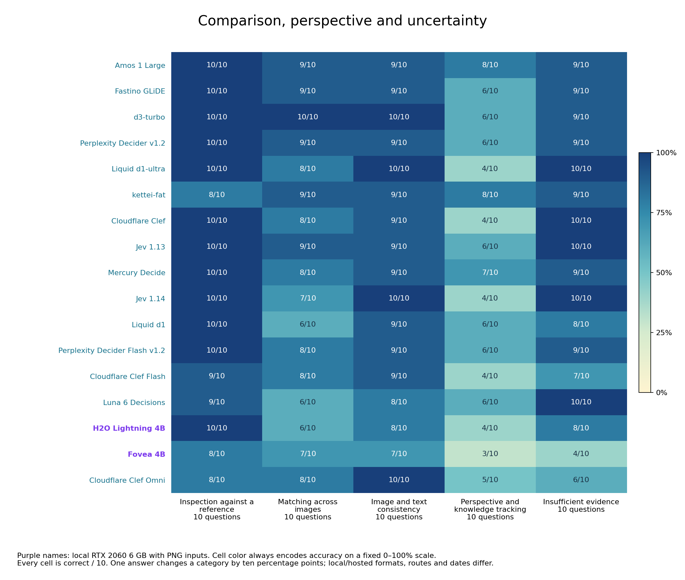

# Image-grounded System 1 decision benchmark

The comparison now contains **17 complete decision routes: 15 hosted models and two local models**. Each completed route has 200 first attempts on the same questions and choices. Local models use a separately recorded PNG input variant. Earlier hosted measurements remain unchanged.

**H2O Lightning 4B scored 117/200 (58.5%) at 560/484/988 ms mean/median/p95. Fovea 4B scored 110/200 (55.0%) at 658/602/962 ms.** Both returned 200 usable typed choices, with no scored retries, on a user-reported NVIDIA RTX 2060 with 6 GB VRAM. This older GPU was chosen deliberately to examine a more accessible local setup.

Amos 1 Large remains the highest-scoring hosted route at **159/200 (79.5%)**, followed by Fastino GLiDE at **158/200 (79.0%)** and hosted d3-turbo at **155/200 (77.5%)**. The one-answer Amos/Fastino gap remains statistically unresolved. These results cover immediate fixed-choice decisions without tools or iterative reasoning.

[Open the colour-coded report](https://etsabary.github.io/visual-decision-benchmark/report.html)

**Hosting colours:** purple `#7c3aed` = local RTX 2060 6 GB; blue `#16728c` = hosted decisions. Accuracy cells keep the fixed 0–100% scale. Speed bands: ≤500 ms, ≤1 s, ≤2 s, above. Cost/1,000 bands: ≤$0.05, ≤$0.15, ≤$0.50, above.

## Overall results

| Decision model | Hosting / inputs | Correct / 200 | Accuracy | Usable | Mean | Median | p95 | Actual 200 cost | Cost / 1,000 | Test date |
| --- | --- | ---: | ---: | ---: | ---: | ---: | ---: | --- | --- | --- |
| Amos 1 Large | Hosted · original mixed images | 159/200 | 79.5% | 200/200 | 381 ms | 340 ms | 630 ms | Free access† | Free access† | 2026-10-20 |
| Fastino GLiDE | Hosted · original mixed images | 158/200 | 79.0% | 200/200 | 719 ms | 359 ms | 1950 ms | ~$0.007673 | ~$0.038363 | 2026-10-23 |
| d3-turbo | Hosted · original mixed images | 155/200 | 77.5% | 200/200 | 510 ms | 431 ms | 975 ms | Free access† | Free access† | 2026-10-20 |
| Perplexity Decider v1.2 | Hosted · original mixed images | 152/200 | 76.0% | 200/200 | 573 ms | 476 ms | 970 ms | $0.004316 | $0.021582 | 2026-10-20 |
| Liquid d1-ultra | Hosted · original mixed images | 149/200 | 74.5% | 200/200 | 393 ms | 343 ms | 727 ms | $0.012692 | $0.063462 | 2026-10-20 |
| kettei-fat | Hosted · original mixed images | 147/200 | 73.5% | 200/200 | 467 ms | 410 ms | 775 ms | $0.002131 | $0.010655 | 2026-10-20 |
| Cloudflare Clef | Hosted · original mixed images | 145/200 | 72.5% | 200/200 | 685 ms | 567 ms | 1440 ms | $0.050310 | $0.251552 | 2026-10-20 |
| Jev 1.13 | Hosted · original mixed images | 142/200 | 71.0% | 195/200 | 270 ms | 229 ms | 515 ms | $0.023976* | $0.119881* | 2026-10-20 |
| Mercury Decide | Hosted · original mixed images | 142/200 | 71.0% | 200/200 | 575 ms | 498 ms | 1100 ms | $0.003839 | $0.019197 | 2026-10-20 |
| Jev 1.14 | Hosted · original mixed images | 141/200 | 70.5% | 195/200 | 358 ms | 307 ms | 724 ms | $0.023977* | $0.119884* | 2026-10-15 (reused) |
| Liquid d1 | Hosted · original mixed images | 135/200 | 67.5% | 200/200 | 277 ms | 240 ms | 509 ms | $0.006044 | $0.030220 | 2026-10-20 |
| Perplexity Decider Flash v1.2 | Hosted · original mixed images | 129/200 | 64.5% | 200/200 | 303 ms | 275 ms | 552 ms | $0.002158 | $0.010791 | 2026-10-20 |
| Cloudflare Clef Flash | Hosted · original mixed images | 126/200 | 63.0% | 200/200 | 827 ms | 761 ms | 1595 ms | $0.007966 | $0.039829 | 2026-10-20 |
| Luna 6 Decisions | Hosted · original mixed images | 121/200 | 60.5% | 198/200 | 479 ms | 383 ms | 799 ms | $0.022546* | $0.112731* | 2026-10-15 (reused) |
| H2O Lightning 4B | Local RTX 2060 6 GB · PNG | 117/200 | 58.5% | 200/200 | 560 ms | 484 ms | 988 ms | Unmeasured local compute | Unmeasured local compute | 2026-10-25 |
| Fovea 4B | Local RTX 2060 6 GB · PNG | 110/200 | 55.0% | 200/200 | 658 ms | 602 ms | 962 ms | Unmeasured local compute | Unmeasured local compute | 2026-10-25 |
| Cloudflare Clef Omni | Hosted · original mixed images | 105/200 | 52.5% | 200/200 | 562 ms | 455 ms | 1202 ms | $0.031330 | $0.156650 | 2026-10-20 |

## Local hosting: useful speed, lower accuracy

H2O answered seven more questions correctly than Fovea and had lower mean and median latency. Their p95 values were both close to one second; Fovea's was slightly lower. This two-model comparison does not establish a general model ordering.

The exact local routes were `h2o-lightning:4b` at **Q8_0** and `fovea:4b` at **NF4 with FP16 compute and FP32 readout**, served by Ollaya 0.17.0 on `cuda:0`. Both reported an 8,192-token context. Serving digests are captured in the metadata export; these routes did not report immutable upstream weight revisions.

H2O's strongest categories were **interface-state decisions and inspection against a reference, both 10/10**, followed by attribute/set filtering at 9/10. Spatial relationships, image/text consistency and recognizing insufficient evidence were 8/10. Its weakest categories were geometry/folding/fit at 1/10 and rotation/reflection at 3/10. Counting, connectivity, visual rules, constraint satisfaction and perspective/knowledge tracking were each 4/10.

Fovea scored **8/10 on attribute/set filtering, interface-state decisions and inspection against a reference**. Spatial relationships, matching across images and image/text consistency were 7/10. Flowcharts were 2/10 and perspective/knowledge tracking 3/10. Fovea exceeded H2O on counting (6 vs 4), rotation/reflection (5 vs 3), geometric fit (4 vs 1), visual rules (6 vs 4) and cross-image matching (7 vs 6). Each category has ten questions: one answer is ten percentage points.

The strongest practical candidate in this tested local shortlist is H2O, but its 58.5% accuracy is a material limitation. The hosted leader answered 42 more questions correctly; differences in weights, precision, image preprocessing, serving hardware and dates prevent attributing that gap to local hosting itself. Local execution provides control over deployment; it did not match the leading hosted accuracy in this run.

## What the PNG conversion changes

The local input variant is **PNG-lossless-from-reviewed-decoded-RGB-v1**. Exactly 47 original JPEG assets were decoded with **Pillow 12.3.0** and saved as PNG; all 180 original PNG assets retained their exact bytes. Independent checks confirmed identical decoded RGB pixels and dimensions for all 227 source files. No resizing, rotation, compositing, OCR, captions, sharpening or replacement download was used.

Questions, rules, option IDs, option order and image order stayed fixed. The local cohort also retained the original 200-question execution order. Older hosted measurements used the original mixed PNG/JPEG file bytes and were not repeated. The local PNG uploads are a distinct recorded format variant; their byte sizes and route timings must not be treated as a controlled hardware-only comparison.

The public image-variant manifest records both original and PNG hashes plus decoded RGB hashes. The answer-free reproduction tool can rebuild the 221 publicly available inputs with the captured Pillow version; six source-rights exclusions remain withheld. Derivative PNG files are generated on demand, keeping the public source repository small.

## Speed gate, loading and usability

Each local route first received two unscored admission/warmup probes: one converted single PNG and one three-image PNG input. Qualifying routes then received 20 scored questions. Continuation required a cumulative median at or below **2,000 ms** and fewer than **5% unusable outputs**, checked after every subsequent first attempt. There was no accuracy-only stop rule. Two further unscored warmups preceded continuation.

H2O's 20-question screen median was **493 ms**; Fovea's was **587 ms**. Both remained within the speed gate through all 200 questions. Cold loading and all warmups are recorded separately and excluded from scored timings. The reported mean/median/p95 include LAN upload and the complete response; local image encoding is excluded. Both routes reported `cuda:0`, unchanged serving digests and zero output tokens. These are observed runtime facts, not independent weight or architecture attestation.

## Admission failures are outside the complete ranking

Liquid d1 3B accepted the converted 1024 × 768 single-image PNG, then returned **HTTP 500 / INFERENCE_FAILED on the three-image admission probe**. The runner's response-body decoding error does not establish the underlying cause. It received no scored bank run and has no accuracy score here.

D3 Mini, Nano, Lite and Edge Q8_0 each failed the first small PNG admission: **185 input tokens exceeded physical batch size 128**. Liquid d1-omni 600M Q8_0 accepted tiny single PNGs, but larger and multiple inputs exceeded the same physical batch setting. These are deployment findings, not wrong answers or zero-accuracy results. No server configuration or weights were changed to rescue a run. Mapika Decider 2B vision accepted single PNGs but rejected multiple images and JPEGs; it was not selected for the full bank. Installed D3 Flash Artemis and Perplexity Flash mixed4 advertised text-only support.

The earlier exclusions remain: Respan Span-02 stopped after 21 questions at a 2,166 ms median, with 14 correct in that partial sample; ScaleDown's tested route rejected image parts. Neither is ranked as a 200-question zero.

## Cost and earlier hosted evidence

**Local hardware and electricity costs are unmeasured.** Local rows have no metered API tariff or monetary receipts; they are not priced at $0. Hosted costs, dates, tariffs and missing-charge qualifications retain their previously measured values. Cost / 1,000 normalizes an actual 200-question run; it does not mean 1,000 calls were made.

Fastino's earlier image result remains 158/200, with **719/359/1950 ms** mean/median/p95 and **~$0.00767264** for 200 questions, or **~$0.0383632 per 1,000**. The tilde marks reported token usage times the captured tariff, not monetary receipts. Perplexity Decider v1.2 remains 152/200 at $0.00431642 for 200; kettei-fat remains 147/200 at $0.00213102. Amos and d3 used free public access, which is not a permanent production tariff.

Fastino retained 10/10 on sequential state tracking, interfaces and reference inspection; navigation was 5/10. Amos scored 8/10 on perspective/knowledge tracking versus Fastino's 6/10. Jev 1.13 and 1.14 retain 142/200 and 141/200, each with five rejected images. No earlier failures, scores or timings were removed. Fastino's separate text lead does not make it the image leader.

## Limits and reproducibility

The bank has 20 categories with ten questions each, 187 grounded/reasoning questions and 13 perception controls. Choice counts vary, giving a **23.44% uniform-guessing baseline**. Related templates and shared source collections limit independence; these are selected tasks, not a general-intelligence ranking. Category scores and confidence intervals do not remove those limitations.

The frozen external answer key stayed outside inference. Offline checks reproduced both new totals from private first attempts and verified coverage, payload hashes, timings, image bindings and serving identity. Public local timing/status evidence contains no model choices, answer labels or per-item correctness. Reproducing accuracy requires the external frozen key and the original saved choices; public aggregates alone cannot independently recreate it. Six chart snapshots remain withheld pending source-terms review. The three older general LLM references remain archived outside the specialized ranking.

## Results by named category

## What the categories test

- **[V01 Attribute binding and set logic](data/questions/V01.md)**: Find objects that satisfy several visible properties at once.
- **[V02 Conditional counting](data/questions/V02.md)**: Count only the objects meeting the stated visual rule.
- **[V03 Spatial relationships](data/questions/V03.md)**: Apply left/right, above/below or relative-position constraints.
- **[V04 Connectivity and reachability](data/questions/V04.md)**: Follow connected paths or directed arrows between nodes.
- **[V05 Navigation and planning](data/questions/V05.md)**: Choose a feasible route under movement and obstacle rules.
- **[V06 Rotation and reflection](data/questions/V06.md)**: Recognize the result of a rotation or mirror transformation.
- **[V07 Geometry, folding and fit](data/questions/V07.md)**: Reason about shapes, folds, dimensions or what fits.
- **[V08 Visual rule application](data/questions/V08.md)**: Infer or apply a rule across symbols and pictured patterns.
- **[V09 Sequential state tracking](data/questions/V09.md)**: Track how successive visible actions change a state.
- **[V10 Constraint satisfaction](data/questions/V10.md)**: Find the arrangement satisfying all the stated restrictions.
- **[V11 Flowcharts and decision trees](data/questions/V11.md)**: Follow conditional branches to their final outcome.
- **[V12 Causal and counterfactual reasoning](data/questions/V12.md)**: Determine what changes when a pictured condition is altered.
- **[V13 Charts and quantitative comparisons](data/questions/V13.md)**: Read plotted values and compare or calculate the required quantity.
- **[V14 Document reconciliation](data/questions/V14.md)**: Combine entries across forms, receipts or tables and apply a rule.
- **[V15 Interface state decisions](data/questions/V15.md)**: Choose an action or identify a state from a screenshot.
- **[V16 Inspection against a reference](data/questions/V16.md)**: Compare an object or scene against a supplied reference.
- **[V17 Matching across images](data/questions/V17.md)**: Identify a corresponding object across two or three images.
- **[V18 Image and text consistency](data/questions/V18.md)**: Check whether a written claim agrees with the visible evidence.
- **[V19 Perspective and knowledge tracking](data/questions/V19.md)**: Apply line-of-sight constraints or track what an observer has seen.
- **[V20 Insufficient evidence](data/questions/V20.md)**: Recognize when the image cannot determine the requested answer.

[Aggregate results](results/releases/local_images_2026-10-25/summary.json) · [Category CSV](results/releases/local_images_2026-10-25/family_scores.csv) · [Local timing evidence](results/releases/local_images_2026-10-25/local_timing_evidence.jsonl) · [Input hashes](results/releases/local_images_2026-10-25/image_variant_manifest.json) · [Audit](results/releases/local_images_2026-10-25/audit_receipt.json) · [Method](documents/LOCAL_IMAGE_RUNS.md)

[Questions and sources](data/questions/README.md) · [Image gallery](docs/gallery.html) · [Attribution](documents/THIRD_PARTY_NOTICES.md) · [Separate text benchmark](https://etsabary.github.io/system-1-decision-benchmark/report.html)
