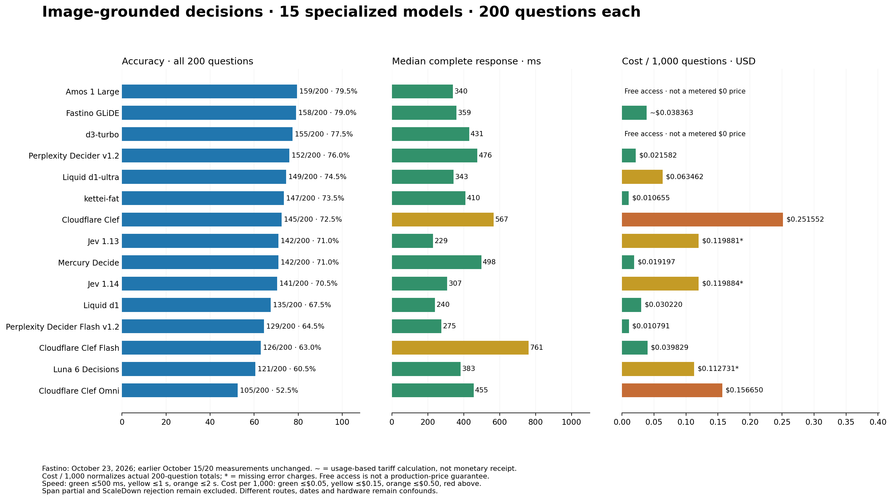
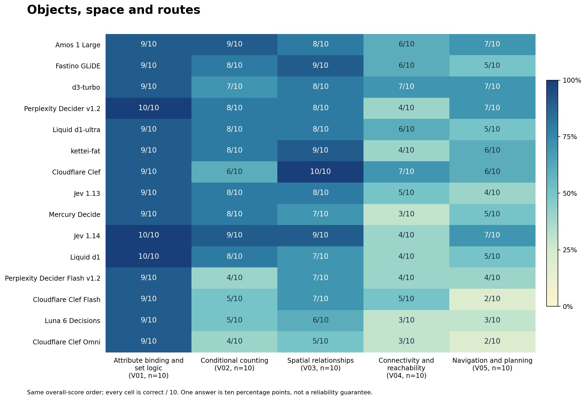
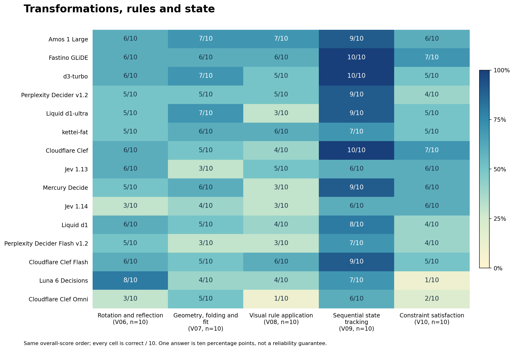
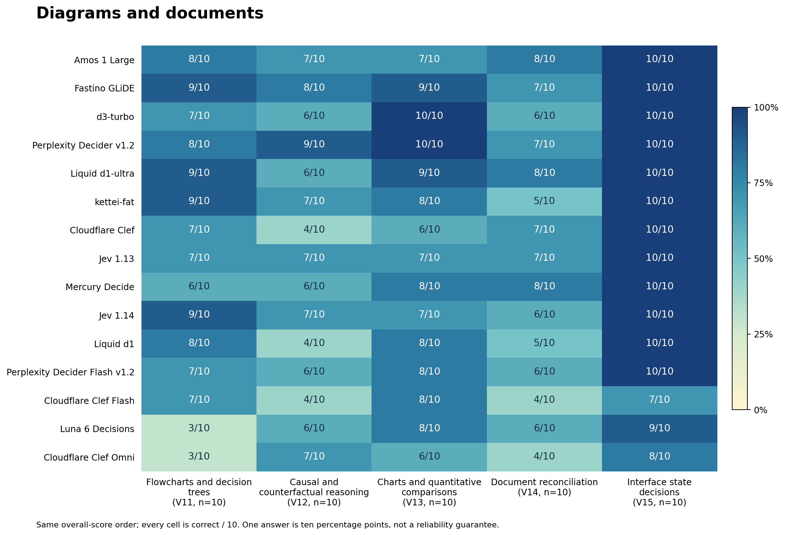
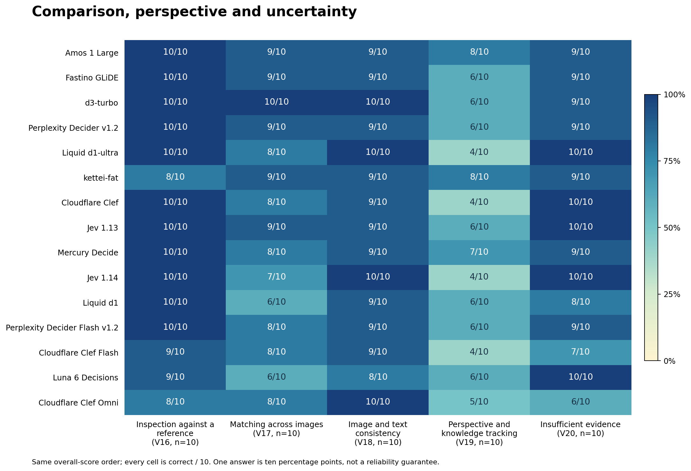

# Image-grounded System 1 decision benchmark

Fastino GLiDE joins the image comparison at **158/200 (79.0%)**, second to **Amos 1 Large at 159/200 (79.5%)**. GLiDE leads the separate text benchmark at **1154/1342 (86.0%)**; it is not first in both banks. Its image mean / median / p95 was **719/359/1950 ms**, and all 200 first attempts returned usable typed choices without retries.

The comparison contains **15 specialized decision models**, all tested on the same 200 image questions. Fastino was measured October 23, 2026. The earlier 14 model records, image bytes, questions and options are unchanged.

[Open the colour-coded report](https://etsabary.github.io/visual-decision-benchmark/report.html)

## Overall results

| Decision model | Correct / 200 | Accuracy | Usable | Mean | Median | p95 | Actual 200 cost | Cost / 1,000 | Test date |
|---|---:|---:|---:|---:|---:|---:|---:|---:|---|
| Amos 1 Large | 159/200 | 79.5% | 200/200 | 0.381 s | 0.340 s | 0.630 s | Free access† | Free access† | 2026-10-20 |
| Fastino GLiDE | 158/200 | 79.0% | 200/200 | 0.719 s | 0.359 s | 1.950 s | ~$0.007673 | ~$0.038363 | 2026-10-23 |
| d3-turbo | 155/200 | 77.5% | 200/200 | 0.510 s | 0.431 s | 0.975 s | Free access† | Free access† | 2026-10-20 |
| Perplexity Decider v1.2 | 152/200 | 76.0% | 200/200 | 0.573 s | 0.476 s | 0.970 s | $0.004316 | $0.021582 | 2026-10-20 |
| Liquid d1-ultra | 149/200 | 74.5% | 200/200 | 0.393 s | 0.343 s | 0.727 s | $0.012692 | $0.063462 | 2026-10-20 |
| kettei-fat | 147/200 | 73.5% | 200/200 | 0.467 s | 0.410 s | 0.775 s | $0.002131 | $0.010655 | 2026-10-20 |
| Cloudflare Clef | 145/200 | 72.5% | 200/200 | 0.685 s | 0.567 s | 1.440 s | $0.050310 | $0.251552 | 2026-10-20 |
| Jev 1.13 | 142/200 | 71.0% | 195/200 | 0.270 s | 0.229 s | 0.515 s | $0.023976* | $0.119881* | 2026-10-20 |
| Mercury Decide | 142/200 | 71.0% | 200/200 | 0.575 s | 0.498 s | 1.100 s | $0.003839 | $0.019197 | 2026-10-20 |
| Jev 1.14 | 141/200 | 70.5% | 195/200 | 0.358 s | 0.307 s | 0.724 s | $0.023977* | $0.119884* | 2026-10-15 (reused) |
| Liquid d1 | 135/200 | 67.5% | 200/200 | 0.277 s | 0.240 s | 0.509 s | $0.006044 | $0.030220 | 2026-10-20 |
| Perplexity Decider Flash v1.2 | 129/200 | 64.5% | 200/200 | 0.303 s | 0.275 s | 0.552 s | $0.002158 | $0.010791 | 2026-10-20 |
| Cloudflare Clef Flash | 126/200 | 63.0% | 200/200 | 0.827 s | 0.761 s | 1.595 s | $0.007966 | $0.039829 | 2026-10-20 |
| Luna 6 Decisions | 121/200 | 60.5% | 198/200 | 0.479 s | 0.383 s | 0.799 s | $0.022546* | $0.112731* | 2026-10-15 (reused) |
| Cloudflare Clef Omni | 105/200 | 52.5% | 200/200 | 0.562 s | 0.455 s | 1.202 s | $0.031330 | $0.156650 | 2026-10-20 |

## Method and reading the costs

Every ranked model has the same **200 questions**, original choices and reviewed image bytes. Accuracy includes all first attempts; invalid answers and provider errors remain unsuccessful. No wrong-choice or formatting retries. At most one transient recovery was permitted; Fastino needed none. The median cutoff is above two seconds after at least 20 questions.

**Cost / 1,000 is a normalization of each actual 200-question run**, not another 1000 calls. ~ means usage times captured tariff, not API monetary receipts; * means an incomplete sum with missing error charges; † means free public access, not a permanent production price of zero. Probes and stopped runs are separate from ranked core totals.

Speed colours: green ≤0.5 s, yellow ≤1 s, orange ≤2 s, red above. Cost colours per 1000: green ≤$0.05, yellow ≤$0.15, orange ≤$0.50, red above. Accuracy uses one fixed 0–100% scale across categories. Dates and routes differ; none of the older measurements was rerun.

## Fastino and Amos: one answer apart, different profiles

Amos answered 16 questions correctly that Fastino missed; Fastino answered 15 that Amos missed. The one-answer overall gap is not statistically resolved: the unadjusted paired exact p-value is 1.000. This selected bank includes related task types, so item-level tests do not establish a universal ordering or remove source and category dependence.

Fastino scored **10/10 on sequential state tracking, interface-state decisions and inspection against a reference**. Sequential questions ask what remains after the pictured actions; interface questions ask which action or state follows from a screenshot. It scored 9/10 on attribute/set filtering, spatial relationships, flowcharts, charts, cross-image matching, image/text consistency and recognizing insufficient evidence.

Navigation and planning was **5/10**. Connectivity, rotation/reflection, geometric fit, visual rules and perspective/knowledge tracking were each **6/10**. Amos scored 8/10 on perspective and knowledge tracking, versus Fastino’s 6/10. A strong combined total does not imply equal performance on every visual operation. Each category has ten questions: one answer is ten percentage points, and 10/10 is not a reliability certificate.

## Cost and the two-second rule

Fastino’s complete 200-question cost is **~$0.00767264**, or **~$0.0383632 per 1000 questions**. The tilde marks a calculation from reported input-token usage at the captured **$0.04 per million input tokens, $0 output** tariff, not API monetary receipts. The two separate image admission probes add **~$0.00010484**. Costs per 1000 normalize an actual 200-question run; no extra 1000 calls were made.

Perplexity Decider v1.2 remains a lower-priced metered option at $0.00431642 for 200, with 152 correct answers; kettei-fat costs $0.00213102 and scored 147. Amos and d3 used currently free public access, not guaranteed production tariffs of zero. Fastino is neither the cheapest nor the shortest-median image route.

The predeclared cutoff is a **cumulative median above two seconds after at least 20 cases**, not a p95 cutoff. Fastino’s 359 ms median passed throughout; its p95 was 1950 ms. The first-attempt timings include fresh HTTPS connection, image upload and the complete response. Local encoding, queues and deliberate waits are excluded. The serial image stream overlapped its two-request text stream, with at most three Fastino requests globally. Dates, hardware, load and provider image processing remain confounds.

## Version and actual image support

The native request model is `fastino/GLiDE`; all scored responses identify `glide_v2`. The authenticated catalog described **one-pass GLiDE v2.2**. This is a hosted alias, not an immutable-weight attestation, and the run must not be labelled v1.2. The catalog image flag was false while Fastino’s documentation described image parts. Single-image and three-image probes succeeded, followed by the complete unchanged 200-question image bank. No OCR, captions or replacement images were used.

All scored responses returned valid probabilities, zero reported output tokens and `not-stored` retention headers for `store:false` requests. These are observed API facts, not independent inspection of hidden computation.

## Other models retain category-specific strengths

d3-turbo scored 155/200, including 10/10 on charts, state tracking, interfaces, reference inspection, image matching and image/text consistency. Perplexity scored 152, with 9/10 on causal questions and 10/10 on charts, but 4/10 on connectivity and constraint satisfaction. Cloudflare Clef’s constraint-satisfaction score was 7/10, above Amos’s 6/10 and matching Fastino’s 7/10. Luna Decisions retains the strongest observed rotation/reflection score at 8/10. Model choice can depend on the operation, not just the overall row.

Jev 1.13 and 1.14 remain 142/200 and 141/200, each with five rejected images in their tested routes. Their old failures and timings have not been removed or rerun. The three older general LLMs remain archived references, not the current specialized-model ranking.

## Exclusions are not zero accuracy scores

Respan Span-02’s existing image stream stopped after 21 questions when its median reached 2.166 seconds. Its 14/21 partial score is not a 200-question accuracy estimate. ScaleDown’s pinned route rejected image parts despite catalog support. Those two routes remain outside the complete ranking. Their exclusion is not a claim about their text performance, and the old image statement that Span leads the text bank is superseded by the current text report.

## Results by named category

Every category has ten questions; one answer is ten percentage points.

## What the categories test

- **[V01 Attribute binding and set logic](data/questions/V01.md)**: Find objects that satisfy several visible properties at once.
- **[V02 Conditional counting](data/questions/V02.md)**: Count only the objects meeting the stated visual rule.
- **[V03 Spatial relationships](data/questions/V03.md)**: Apply left/right, above/below or relative-position constraints.
- **[V04 Connectivity and reachability](data/questions/V04.md)**: Follow connected paths or directed arrows between nodes.
- **[V05 Navigation and planning](data/questions/V05.md)**: Choose a feasible route under movement and obstacle rules.
- **[V06 Rotation and reflection](data/questions/V06.md)**: Recognize the result of a rotation or mirror transformation.
- **[V07 Geometry, folding and fit](data/questions/V07.md)**: Reason about shapes, folds, dimensions or what fits.
- **[V08 Visual rule application](data/questions/V08.md)**: Infer or apply a rule across symbols and pictured patterns.
- **[V09 Sequential state tracking](data/questions/V09.md)**: Track how successive visible actions change a state.
- **[V10 Constraint satisfaction](data/questions/V10.md)**: Find the arrangement satisfying all the stated restrictions.
- **[V11 Flowcharts and decision trees](data/questions/V11.md)**: Follow conditional branches to their final outcome.
- **[V12 Causal and counterfactual reasoning](data/questions/V12.md)**: Determine what changes when a pictured condition is altered.
- **[V13 Charts and quantitative comparisons](data/questions/V13.md)**: Read plotted values and compare or calculate the required quantity.
- **[V14 Document reconciliation](data/questions/V14.md)**: Combine entries across forms, receipts or tables and apply a rule.
- **[V15 Interface state decisions](data/questions/V15.md)**: Choose an action or identify a state from a screenshot.
- **[V16 Inspection against a reference](data/questions/V16.md)**: Compare an object or scene against a supplied reference.
- **[V17 Matching across images](data/questions/V17.md)**: Identify a corresponding object across two or three images.
- **[V18 Image and text consistency](data/questions/V18.md)**: Check whether a written claim agrees with the visible evidence.
- **[V19 Perspective and knowledge tracking](data/questions/V19.md)**: Apply line-of-sight constraints or track what an observer has seen.
- **[V20 Insufficient evidence](data/questions/V20.md)**: Recognize when the image cannot determine the requested answer.

## Bank and limitations

The bank has 20 categories × 10 questions, 227 compressed source files and 23.44% uniform-random baseline (choice counts vary). There are 187 reasoning/grounded-decision questions and 13 perception controls. No image was recompressed for this update. 221 files are publicly redistributable; six Our World in Data charts remain withheld pending source-terms review. All scored models used the same private reviewed snapshots, not replacement downloads.

The frozen supplied key was kept outside inference execution. Offline re-scoring reproduced all 14 prior specialized totals and Fastino’s new total. This is consistency against the existing key, not an independent new audit of every answer. Public validators reconcile hashes, payloads where assets are available, categories, timing and exact-decimal costs; private-key correctness cannot be independently reproduced from aggregate exports alone.

[Questions and source images](data/questions/README.md) · [Image gallery](docs/gallery.html) · [Attribution](documents/THIRD_PARTY_NOTICES.md) · [Aggregate results](results/releases/fastino_2026-10-23/summary.json) · [Category CSV](results/releases/fastino_2026-10-23/family_scores.csv) · [Sanitized route evidence](results/releases/fastino_2026-10-23/attempts.jsonl) · [Audit](results/releases/fastino_2026-10-23/audit_receipt.json).

Older general LLM runs are preserved in [original results](results/original_2026-10-15/summary.json), outside the current specialized ranking. The [separate text benchmark](https://etsabary.github.io/system-1-decision-benchmark/report.html) has 1342 text questions; the two bank scores must not be combined.

Implementation is in scripts/, supporting documents in documents/, bank and image assets in data/, and dated evidence in results/. Public report and gallery URLs remain stable. Offline checks: `python3 scripts/validate_fastino_images.py`, `python3 scripts/validate_native_images.py`, and the focused tests in scripts/.
