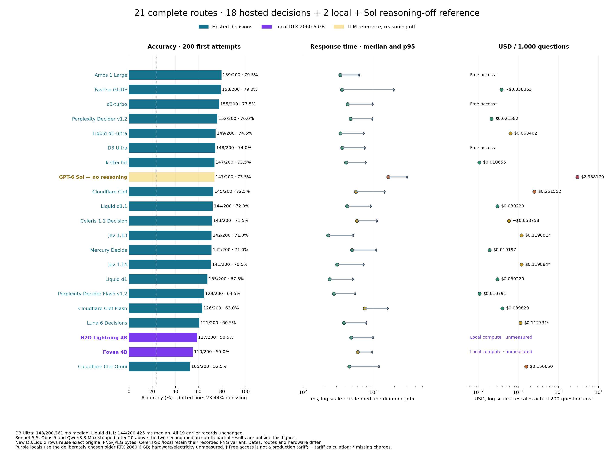
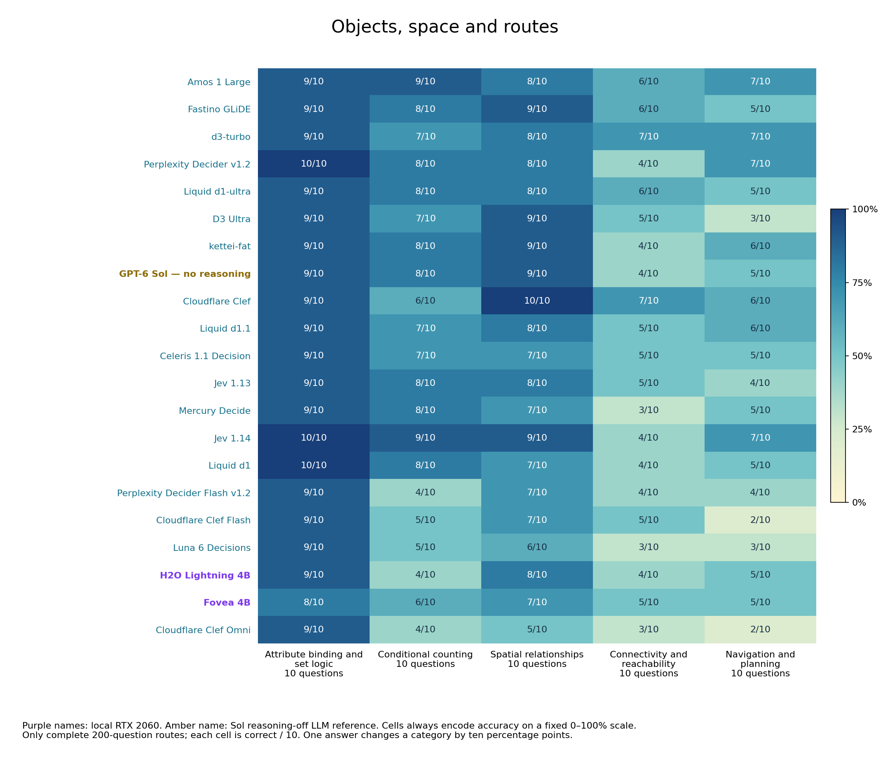
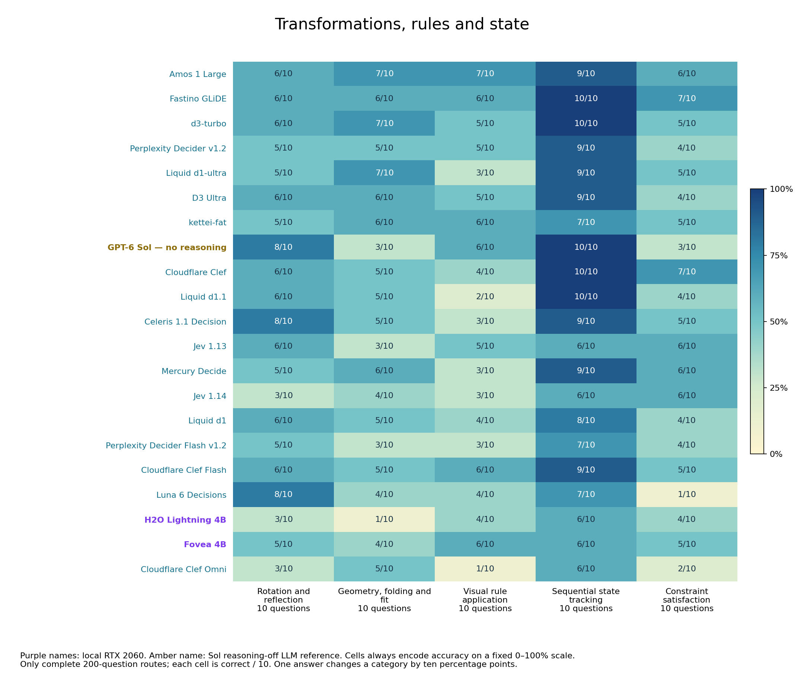
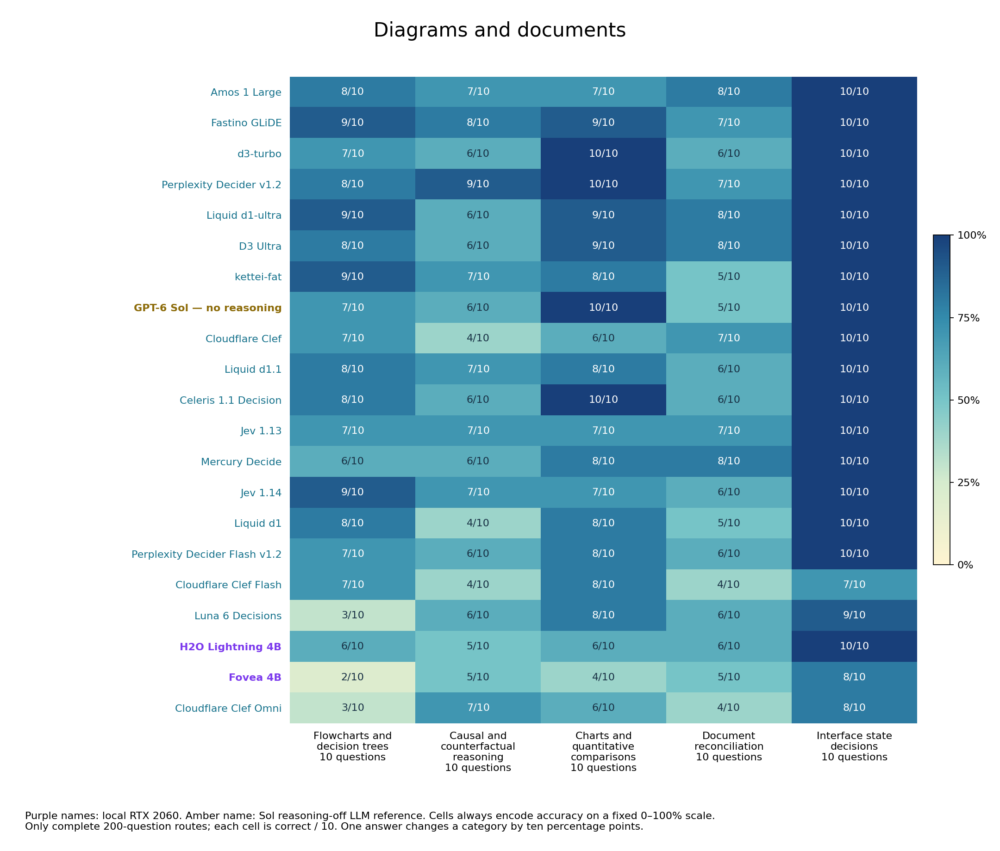
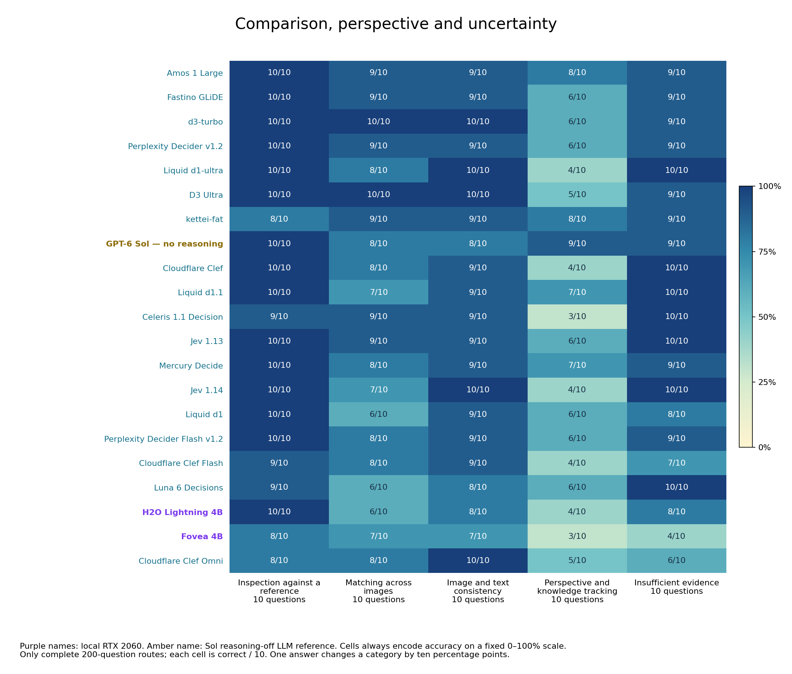

# Image-grounded System 1 decision benchmark

The comparison contains **21 complete routes: 18 hosted decision models, two local models and GPT-6 Sol as a non-reasoning LLM reference**. Each complete route covers the same 200 first attempts across 20 categories. All 19 earlier records and three partial LLM speed stops are preserved.

**D3 Ultra scored 148/200 (74.0%); Liquid d1.1 scored 144/200 (72.0%).** Both returned 200 usable native decisions and passed the two-second cumulative-median gate. Amos remains highest at 159/200 (79.5%), followed by Fastino GLiDE at 158 (79.0%) and the earlier D3 Turbo at 155 (77.5%). Sol retains 147 (73.5%). One overall answer is half a percentage point; these observed gaps do not establish a universal model ranking.

[Open the colour-coded report](https://etsabary.github.io/visual-decision-benchmark/report.html)

**Colour key:** blue `#16728c` = hosted decisions; purple `#7c3aed` = local RTX 2060 6 GB; pale yellow with transparency = LLM reference with reasoning off. Accuracy cells and speed/cost bands retain their fixed scales.

## Overall results

| Model | Type / inputs | Correct / 200 | Accuracy | Usable | Mean | Median | p95 | 200 cost / basis | Cost / 1,000 | Date |
| --- | --- | ---: | ---: | ---: | ---: | ---: | ---: | --- | --- | --- |
| Amos 1 Large | Hosted decision · original PNG/JPEG | 159/200 | 79.5% | 200/200 | 381 ms | 340 ms | 630 ms | Free access† | Free access† | 2026-10-20 |
| Fastino GLiDE | Hosted decision · original PNG/JPEG | 158/200 | 79.0% | 200/200 | 719 ms | 359 ms | 1950 ms | ~$0.007673 | ~$0.038363 | 2026-10-23 |
| d3-turbo | Hosted decision · original PNG/JPEG | 155/200 | 77.5% | 200/200 | 510 ms | 431 ms | 975 ms | Free access† | Free access† | 2026-10-20 |
| Perplexity Decider v1.2 | Hosted decision · original PNG/JPEG | 152/200 | 76.0% | 200/200 | 573 ms | 476 ms | 970 ms | $0.004316 | $0.021582 | 2026-10-20 |
| Liquid d1-ultra | Hosted decision · original PNG/JPEG | 149/200 | 74.5% | 200/200 | 393 ms | 343 ms | 727 ms | $0.012692 | $0.063462 | 2026-10-20 |
| D3 Ultra | Hosted decision · original PNG/JPEG | 148/200 | 74.0% | 200/200 | 451 ms | 361 ms | 752 ms | Free access† | Free access† | 2026-10-27 |
| kettei-fat | Hosted decision · original PNG/JPEG | 147/200 | 73.5% | 200/200 | 467 ms | 410 ms | 775 ms | $0.002131 | $0.010655 | 2026-10-20 |
| GPT-6 Sol — no reasoning | LLM reference · reasoning off · PNG | 147/200 | 73.5% | 200/200 | 1787 ms | 1637 ms | 3028 ms | $0.591634 | $2.958170 | 2026-10-25 |
| Cloudflare Clef | Hosted decision · original PNG/JPEG | 145/200 | 72.5% | 200/200 | 685 ms | 567 ms | 1440 ms | $0.050310 | $0.251552 | 2026-10-20 |
| Liquid d1.1 | Hosted decision · original PNG/JPEG | 144/200 | 72.0% | 200/200 | 487 ms | 425 ms | 915 ms | $0.006044 | $0.030220 | 2026-10-27 |
| Celeris 1.1 Decision | Hosted decision · PNG · resolution 1120 | 143/200 | 71.5% | 200/200 | 667 ms | 585 ms | 1120 ms | ~$0.011752 | ~$0.058758 | 2026-10-25 |
| Jev 1.13 | Hosted decision · original PNG/JPEG | 142/200 | 71.0% | 195/200 | 270 ms | 229 ms | 515 ms | $0.023976* | $0.119881* | 2026-10-20 |
| Mercury Decide | Hosted decision · original PNG/JPEG | 142/200 | 71.0% | 200/200 | 575 ms | 498 ms | 1100 ms | $0.003839 | $0.019197 | 2026-10-20 |
| Jev 1.14 | Hosted decision · original PNG/JPEG | 141/200 | 70.5% | 195/200 | 358 ms | 307 ms | 724 ms | $0.023977* | $0.119884* | 2026-10-15 (reused) |
| Liquid d1 | Hosted decision · original PNG/JPEG | 135/200 | 67.5% | 200/200 | 277 ms | 240 ms | 509 ms | $0.006044 | $0.030220 | 2026-10-20 |
| Perplexity Decider Flash v1.2 | Hosted decision · original PNG/JPEG | 129/200 | 64.5% | 200/200 | 303 ms | 275 ms | 552 ms | $0.002158 | $0.010791 | 2026-10-20 |
| Cloudflare Clef Flash | Hosted decision · original PNG/JPEG | 126/200 | 63.0% | 200/200 | 827 ms | 761 ms | 1595 ms | $0.007966 | $0.039829 | 2026-10-20 |
| Luna 6 Decisions | Hosted decision · original PNG/JPEG | 121/200 | 60.5% | 198/200 | 479 ms | 383 ms | 799 ms | $0.022546* | $0.112731* | 2026-10-15 (reused) |
| H2O Lightning 4B | Local RTX 2060 6 GB · PNG | 117/200 | 58.5% | 200/200 | 560 ms | 484 ms | 988 ms | Unmeasured local compute | Unmeasured local compute | 2026-10-25 |
| Fovea 4B | Local RTX 2060 6 GB · PNG | 110/200 | 55.0% | 200/200 | 658 ms | 602 ms | 962 ms | Unmeasured local compute | Unmeasured local compute | 2026-10-25 |
| Cloudflare Clef Omni | Hosted decision · original PNG/JPEG | 105/200 | 52.5% | 200/200 | 562 ms | 455 ms | 1202 ms | $0.031330 | $0.156650 | 2026-10-20 |

## Apple M2 image speed screens

On October 28, 2026, I tested two Liquid models on the first 20 image questions on an Apple M2 Mac with 16 GB unified memory, using Ollama 0.40.12, MLX/Metal and BF16. Both passed the image-input checks. Their median response times exceeded the two-second cutoff, so the runs stopped after 20 questions and do not enter the 200-question ranking.

| Model | Correct / 20 | Mean | Median | p95 |
| --- | ---: | ---: | ---: | ---: |
| Liquid d1-2B · local Apple M2 | 9/20 | 5,185 ms | 4,709 ms | 9,041 ms |
| Liquid d1-Omni-2B · local Apple M2 | 13/20 | 4,140 ms | 3,323 ms | 7,282 ms |

These are small preliminary screens, not full image-benchmark scores. Tests were sequential, with model loading and image probes excluded from timing. Local hardware and electricity costs were not measured. Both completed the text bank: [text comparison](https://etsabary.github.io/system-1-decision-benchmark/report.html). [Screen data](results/releases/local_m2_screens_2026-10-28/screens.json) · [Answer-free timings](results/releases/local_m2_screens_2026-10-28/timing.csv).

## October 27 findings

### D3 Ultra improves on text and loses seven image answers

D3 Ultra measured **451 / 361 / 752 ms mean / median / p95**, compared with the earlier Turbo image median of 431 ms. Its image score fell from 155/200 to 148/200, while its text score rose from 1,106/1,342 (82.4%) to 1,124 (83.8%). A newer model does not improve every tested operation.

Navigation and planning fell from **7/10 to 3/10**; connectivity and reachability from **7/10 to 5/10**. Document reconciliation—comparing records across documents—improved from **6/10 to 8/10**, and spatial relationships from **8/10 to 9/10**. Visual rule application scored 5/10; constraint satisfaction 4/10. Each category contains ten questions, so a one-answer difference is ten percentage points.

### Liquid d1.1 gains nine image answers, with a longer median

Liquid d1.1 measured **487 / 425 / 915 ms mean / median / p95**. It scored nine more than the older d1 run's 135/200 (67.5%), whose median was 240 ms. Liquid d1-ultra retains 149/200 (74.5%). Its text run also improved: 1,044/1,342 (77.8%) versus the older d1's 965 (71.9%).

Causal and counterfactual image decisions rose from **4/10 to 7/10**. Sequential visual state tracking and insufficient-evidence decisions each rose from **8/10 to 10/10**. Visual rule application fell from **4/10 to 2/10**, and attribute binding/set logic from **10/10 to 9/10**. The full 420-cell category matrix shows where each model differs.

### Image inputs, identity and cost

The new runs used the **exact original reviewed PNG/JPEG bytes** from the earlier native-provider D3/Liquid image runs. The same 200 questions, rules, option IDs/text, image order and request order were retained. No resizing, replacement downloads, OCR or captions. Celeris, Sol and the two local rows retain their separately documented lossless PNG variant; all earlier inputs and measurements are unchanged.

D3 explicitly requested and returned `vllm-sr/d3-ultra`. The current service aliases its old Turbo name to Ultra, so the October 20 Turbo record remains a separately dated historical measurement. OpenRouter was pinned to Liquid, requested `liquid/d1.1`, and returned `liquid/d1.1-20261027` throughout. Start/end selected identity, provider and tariff remained unchanged. Provider-controlled image preprocessing and immutable weights were not independently attested.

D3 used **free public access**, without monetary receipts or a permanent production-price guarantee. Liquid reported **$0.00604404 for 200 questions**, or **$0.03022020 per 1,000**. Five separate admission probes added **$0.00001032**. Cost per 1,000 rescales the actual 200-question run; it does not mean 1,000 scored calls per model.

Five synthetic probes per route checked red/blue recognition, reversed pair order and a three-image request. All passed. Every scored output was a usable native choice with zero reported output tokens and no explanation. No scored retries. One fresh HTTPS call per provider ran at a time; the independent D3/Liquid providers ran concurrently. The timer includes connection, upload and full response; image/base64/JSON preparation and idle waits are excluded. All cumulative medians after the first 20 stayed below 2,000 ms.

The [new timing/usage evidence](results/releases/native_updates_2026-10-27/october27_timing_evidence.jsonl), [model metadata](results/releases/native_updates_2026-10-27/october27_model_metadata.json) and [execution protocol](results/releases/native_updates_2026-10-27/october27_execution_protocol.json) are answer-free. Scores were reconciled offline with the existing revision-bound private key. Public exports can verify coverage, timing and arithmetic, but cannot independently reproduce private-key correctness.

## Why Sol is the strongest non-reasoning-capable LLM reference

**Sol was the highest-scoring non-reasoning-capable general LLM in our completed text comparison: 1,143/1,342 (85.2%).** The other selected text references scored 1,109 for Opus 5, 1,070 for Sonnet 5.5 and 967 for Qwen3.8-Max. That is the measured basis for selecting Sol as the strongest—or “smartest”—non-reasoning-capable LLM reference here. The selection claim is bounded to those four tested configurations on the text bank; its image score is measured separately.

Sol supports image input and a reasoning effort of `none`, as documented in the [official model documentation](https://developers.openai.com/api/docs/models/gpt-6-sol). This image run used the same OpenRouter → OpenAI standard route, `reasoning.enabled=false`, `reasoning.effort=none`, no tools and a 16-token output cap. All 200 scored responses explicitly reported **zero reasoning tokens and no reasoning content**. These are observed API facts; the model's weights are not independently attested.

The [text comparison](https://etsabary.github.io/system-1-decision-benchmark/report.html) and [captured text statistics](https://etsabary.github.io/system-1-decision-benchmark/local_additions_2026-10-25/statistics.json) establish the selection population and scores. This is an immediate fixed-choice comparison without tools, crop/zoom operations or iterative reasoning.

## Sol on the image bank

Sol finished 12 answers behind Amos and 11 behind GLiDE. Its 1,637 ms median was longer than Amos's 340 ms, GLiDE's 359 ms and kettei-fat's 410 ms. Their weights, preprocessing, serving hardware, input file formats and dates differ; these are route-specific measurements.

Sol scored **10/10 on sequential state tracking, charts, interface-state decisions and inspection against a reference**. Attribute/set filtering, spatial relationships, perspective/knowledge tracking and recognizing insufficient evidence were 9/10. Geometry/folding/fit and constraint satisfaction were each 3/10; connectivity 4/10, navigation/planning and document reconciliation 5/10. Each category contains ten questions, so one answer changes its score by ten percentage points.

With exactly the same PNG inputs as the local runs, Sol answered 30 more questions correctly than H2O Lightning and 37 more than Fovea. Both local routes had shorter mean and median response times. This comparison does not isolate hosting location, because the model weights, hardware and serving routes also differ.

## LLM speed stops

The two-second **cumulative median** cutoff was retained explicitly for all four LLM references. Sonnet 5.5 stopped at 20 with a 3,150 ms median; Opus 5 stopped at 20 with 2,628 ms; Qwen3.8-Max stopped at 20 with 2,837 ms. All 60 partial first attempts returned usable outputs. These rows describe partial samples, with no full-bank score, full-run cost or entry in the 420-cell category ranking.

| LLM reference | Outcome | Correct / attempted | Sample accuracy | Mean | Median | p95 | Actual sample cost |
| --- | --- | ---: | ---: | ---: | ---: | ---: | --- |
| Sonnet 5.5 — no thinking, JSON-choice | **SPEED STOP · partial** | 18/20 | 90.0% | 3026 ms | 3150 ms | 3900 ms | $0.066222 |
| Opus 5 — no thinking, JSON-choice | **SPEED STOP · partial** | 16/20 | 80.0% | 2507 ms | 2628 ms | 3128 ms | $0.165305 |
| Qwen3.8-Max — none, Hyper Charm | **SPEED STOP · partial** | 13/20 | 65.0% | 2914 ms | 2837 ms | 4290 ms | $0.041894 quota-equivalent |

Sonnet's 18/20 (90.0%) is a promising partial result; it does not establish 90% accuracy on the 200-question bank. Its mode was `thinking.type=between_tools`, high effort, no tools and constrained JSON choice. Opus used disabled thinking at high effort with the same JSON-choice contract. All 40 scored Claude responses reported zero thinking tokens and no thinking blocks. Qwen requested catalog-supported `reasoning_effort=none`; its 20 responses omitted reasoning-token telemetry, which remains **unknown**, with no reasoning text. Hyper Charm cost values are reported USD-equivalent prepaid quota debits, not cash invoices.

Sol passed 20 at a 1,746 ms median, then the separate offline 100-case accuracy gate at 73/100 before continuation. The cumulative median stayed at or below 2,000 ms throughout 200. All four retained their text-reference routes and output contracts; JSON enums followed each image question's 3/4/5 choices. No failed-format, wrong-answer or scored transport retries were made in this cohort.

## LLM timing, input and cost qualifications

New LLM calls used **PNG-lossless-from-reviewed-decoded-RGB-v1**, the exact PNG bytes used by the two local runs. Earlier 15 hosted decision models retain their original mixed PNG/JPEG bytes. The original questions, rules, option IDs, option order and image order remain frozen. No model was rerun to change a presentation or produce this publication.

At most two distinct hosted model streams overlapped, with one request per model. Sol continuation ran alone. Timings include fresh HTTPS connection, PNG upload and the complete response; local encoding and between-phase waits are excluded. Two image admission probes per route have separate timings and costs.

The complete Sol cost is its actual 200-question reported charge; cost/1,000 is a normalization, not another 1,000 calls. The three speed-stopped rows show only their actual 20-question sample costs. Probe charges remain separate in the exports. In this new cohort there were 260 first attempts and 8 admission probes, with zero retries. No inference was performed for publication.

Public LLM timing/status evidence is answer-free: it contains request/image hashes, measured durations, returned identity, reported costs and reasoning telemetry. Private model choices, answer labels, per-item correctness, credentials, LAN addresses and account state are excluded. Accuracy was verified offline against the unchanged external key, and cannot be independently recreated from aggregates alone.

## Local hosting: useful speed, lower accuracy

H2O answered seven more questions correctly than Fovea and had lower mean and median latency. Their p95 values were both close to one second; Fovea's was slightly lower. This two-model comparison does not establish a general model ordering.

The exact local routes were `h2o-lightning:4b` at **Q8_0** and `fovea:4b` at **NF4 with FP16 compute and FP32 readout**, served by Ollaya 0.17.0 on `cuda:0`. Both reported an 8,192-token context. Serving digests are captured in the metadata export; these routes did not report immutable upstream weight revisions.

H2O's strongest categories were **interface-state decisions and inspection against a reference, both 10/10**, followed by attribute/set filtering at 9/10. Spatial relationships, image/text consistency and recognizing insufficient evidence were 8/10. Its weakest categories were geometry/folding/fit at 1/10 and rotation/reflection at 3/10. Counting, connectivity, visual rules, constraint satisfaction and perspective/knowledge tracking were each 4/10.

Fovea scored **8/10 on attribute/set filtering, interface-state decisions and inspection against a reference**. Spatial relationships, matching across images and image/text consistency were 7/10. Flowcharts were 2/10 and perspective/knowledge tracking 3/10. Fovea exceeded H2O on counting (6 vs 4), rotation/reflection (5 vs 3), geometric fit (4 vs 1), visual rules (6 vs 4) and cross-image matching (7 vs 6). Each category has ten questions: one answer is ten percentage points.

The strongest practical candidate in this tested local shortlist is H2O, but its 58.5% accuracy is a material limitation. The hosted leader answered 42 more questions correctly; differences in weights, precision, image preprocessing, serving hardware and dates prevent attributing that gap to local hosting itself. Local execution provides control over deployment; it did not match the leading hosted accuracy in this run.

## What the PNG conversion changes

The local input variant is **PNG-lossless-from-reviewed-decoded-RGB-v1**. Exactly 47 original JPEG assets were decoded with **Pillow 12.3.0** and saved as PNG; all 180 original PNG assets retained their exact bytes. Independent checks confirmed identical decoded RGB pixels and dimensions for all 227 source files. No resizing, rotation, compositing, OCR, captions, sharpening or replacement download was used.

Questions, rules, option IDs, option order and image order stayed fixed. The local cohort also retained the original 200-question execution order. Older hosted measurements used the original mixed PNG/JPEG file bytes and were not repeated. The local PNG uploads are a distinct recorded format variant; their byte sizes and route timings must not be treated as a controlled hardware-only comparison.

The public image-variant manifest records both original and PNG hashes plus decoded RGB hashes. The answer-free reproduction tool can rebuild the 221 publicly available inputs with the captured Pillow version; six source-rights exclusions remain withheld. Derivative PNG files are generated on demand, keeping the public source repository small.

## Speed gate, loading and usability

Each local route first received two unscored admission/warmup probes: one converted single PNG and one three-image PNG input. Qualifying routes then received 20 scored questions. Continuation required a cumulative median at or below **2,000 ms** and fewer than **5% unusable outputs**, checked after every subsequent first attempt. There was no accuracy-only stop rule. Two further unscored warmups preceded continuation.

H2O's 20-question screen median was **493 ms**; Fovea's was **587 ms**. Both remained within the speed gate through all 200 questions. Cold loading and all warmups are recorded separately and excluded from scored timings. The reported mean/median/p95 include LAN upload and the complete response; local image encoding is excluded. Both routes reported `cuda:0`, unchanged serving digests and zero output tokens. These are observed runtime facts, not independent weight or architecture attestation.

## Admission failures are outside the complete ranking

Liquid d1 3B accepted the converted 1024 × 768 single-image PNG, then returned **HTTP 500 / INFERENCE_FAILED on the three-image admission probe**. The runner's response-body decoding error does not establish the underlying cause. It received no scored bank run and has no accuracy score here.

D3 Mini, Nano, Lite and Edge Q8_0 each failed the first small PNG admission: **185 input tokens exceeded physical batch size 128**. Liquid d1-omni 600M Q8_0 accepted tiny single PNGs, but larger and multiple inputs exceeded the same physical batch setting. These are deployment findings, not wrong answers or zero-accuracy results. No server configuration or weights were changed to rescue a run. Mapika Decider 2B vision accepted single PNGs but rejected multiple images and JPEGs; it was not selected for the full bank. Installed D3 Flash Artemis and Perplexity Flash mixed4 advertised text-only support.

The earlier exclusions remain: Respan Span-02 stopped after 21 questions at a 2,166 ms median, with 14 correct in that partial sample; ScaleDown's tested route rejected image parts. Neither is ranked as a 200-question zero.

## Cost and earlier hosted evidence

**Local hardware and electricity costs are unmeasured.** Local rows have no metered API tariff or monetary receipts; they are not priced at $0. Hosted costs, dates, tariffs and missing-charge qualifications retain their previously measured values. Cost / 1,000 normalizes an actual 200-question run; it does not mean 1,000 calls were made.

Fastino's earlier image result remains 158/200, with **719/359/1950 ms** mean/median/p95 and **~$0.00767264** for 200 questions, or **~$0.0383632 per 1,000**. The tilde marks reported token usage times the captured tariff, not monetary receipts. Perplexity Decider v1.2 remains 152/200 at $0.00431642 for 200; kettei-fat remains 147/200 at $0.00213102. Amos and d3 used free public access, which is not a permanent production tariff.

Fastino retained 10/10 on sequential state tracking, interfaces and reference inspection; navigation was 5/10. Amos scored 8/10 on perspective/knowledge tracking versus Fastino's 6/10. Jev 1.13 and 1.14 retain 142/200 and 141/200, each with five rejected images. No earlier failures, scores or timings were removed. Fastino's separate text lead does not make it the image leader.

## Limits and reproducibility

The bank has 20 categories with ten questions each, 187 grounded/reasoning questions and 13 perception controls. Choice counts vary, giving a **23.44% uniform-guessing baseline**. Related templates and shared source collections limit independence; these are selected tasks, not a general-intelligence ranking. Category scores and confidence intervals do not remove those limitations.

The frozen external answer key stayed outside inference. Offline checks reproduced both new totals from private first attempts and verified coverage, payload hashes, timings, image bindings and serving identity. Public local timing/status evidence contains no model choices, answer labels or per-item correctness. Reproducing accuracy requires the external frozen key and the original saved choices; public aggregates alone cannot independently recreate it. Six chart snapshots remain withheld pending source-terms review. The three older general LLM references remain archived outside the specialized ranking.

## Results by named category

## What the categories test

- **[V01 Attribute binding and set logic](data/questions/V01.md)**: Find objects that satisfy several visible properties at once.
- **[V02 Conditional counting](data/questions/V02.md)**: Count only the objects meeting the stated visual rule.
- **[V03 Spatial relationships](data/questions/V03.md)**: Apply left/right, above/below or relative-position constraints.
- **[V04 Connectivity and reachability](data/questions/V04.md)**: Follow connected paths or directed arrows between nodes.
- **[V05 Navigation and planning](data/questions/V05.md)**: Choose a feasible route under movement and obstacle rules.
- **[V06 Rotation and reflection](data/questions/V06.md)**: Recognize the result of a rotation or mirror transformation.
- **[V07 Geometry, folding and fit](data/questions/V07.md)**: Reason about shapes, folds, dimensions or what fits.
- **[V08 Visual rule application](data/questions/V08.md)**: Infer or apply a rule across symbols and pictured patterns.
- **[V09 Sequential state tracking](data/questions/V09.md)**: Track how successive visible actions change a state.
- **[V10 Constraint satisfaction](data/questions/V10.md)**: Find the arrangement satisfying all the stated restrictions.
- **[V11 Flowcharts and decision trees](data/questions/V11.md)**: Follow conditional branches to their final outcome.
- **[V12 Causal and counterfactual reasoning](data/questions/V12.md)**: Determine what changes when a pictured condition is altered.
- **[V13 Charts and quantitative comparisons](data/questions/V13.md)**: Read plotted values and compare or calculate the required quantity.
- **[V14 Document reconciliation](data/questions/V14.md)**: Combine entries across forms, receipts or tables and apply a rule.
- **[V15 Interface state decisions](data/questions/V15.md)**: Choose an action or identify a state from a screenshot.
- **[V16 Inspection against a reference](data/questions/V16.md)**: Compare an object or scene against a supplied reference.
- **[V17 Matching across images](data/questions/V17.md)**: Identify a corresponding object across two or three images.
- **[V18 Image and text consistency](data/questions/V18.md)**: Check whether a written claim agrees with the visible evidence.
- **[V19 Perspective and knowledge tracking](data/questions/V19.md)**: Apply line-of-sight constraints or track what an observer has seen.
- **[V20 Insufficient evidence](data/questions/V20.md)**: Recognize when the image cannot determine the requested answer.

[Aggregate results](results/releases/native_updates_2026-10-27/summary.json) · [Category CSV](results/releases/native_updates_2026-10-27/family_scores.csv) · [New timing/usage](results/releases/native_updates_2026-10-27/october27_timing_evidence.jsonl) · [Audit](results/releases/native_updates_2026-10-27/audit_receipt.json) · [New method](documents/OCTOBER27_UPDATES.md)

[Questions and sources](data/questions/README.md) · [Gallery](docs/gallery.html) · [Attribution](documents/THIRD_PARTY_NOTICES.md) · [Local method](documents/LOCAL_IMAGE_RUNS.md)
