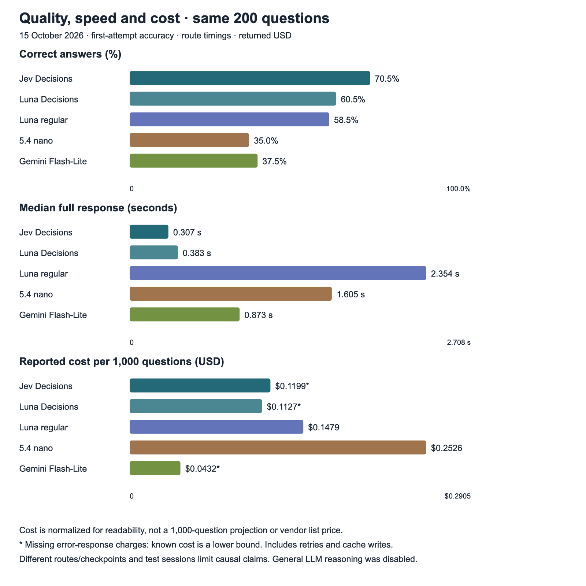
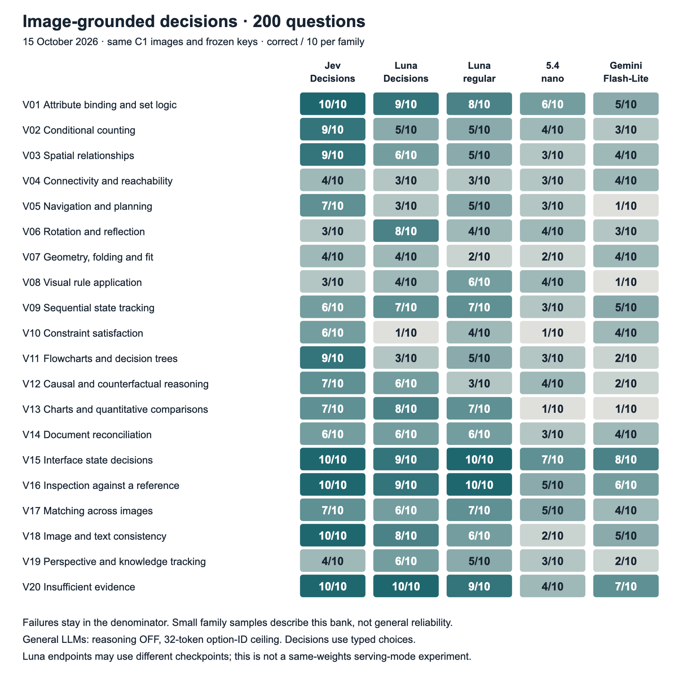

# Image grounded decisions across five model configurations

Jev 1.14 answered **141/200 questions correctly (70.5%)**, compared with **121/200 (60.5%)** for Luna 6 Decisions and **117/200 (58.5%)** for regular Luna 6. The two Decisions configurations had lower observed response latency than the three general LLMs. Gemini 2.5 Flash-Lite was the cheapest configuration, but answered only 75/200 correctly. GPT-5.4 nano answered 70/200 and had the highest reported cost.

I wanted to test whether fast, typed decision models offer a useful advantage when a choice depends on reading an image and applying a rule. The bank includes counting, spatial relations, planning, diagrams, documents, interface states and inspection against a reference. Every model received the same 200 questions, answer choices and ordered image bytes. The test date was **October 15, 2026**, in the America/Toronto time zone.



## Results, timing and cost

| Configuration | Correct / 200 | Accuracy | Usable first answers | Median response | p95 response | Reported cost, USD |
|---|---:|---:|---:|---:|---:|---:|
| Jev 1.14 Decisions | 141 | 70.5% | 195/200 | 0.307 s | 0.724 s | $0.023976876* |
| Luna 6 Decisions | 121 | 60.5% | 198/200 | 0.383 s | 0.799 s | $0.022546200* |
| Luna 6 regular | 117 | 58.5% | 200/200 | 2.354 s | 5.057 s | $0.029581700 |
| GPT-5.4 nano | 70 | 35.0% | 196/200 | 1.605 s | 2.978 s | $0.050524500 |
| Gemini 2.5 Flash-Lite | 75 | 37.5% | 180/200 | 0.873 s | 1.743 s | $0.008640400* |

Accuracy uses all 200 scheduled questions. An input rejection, transport error or invalid answer format is unsuccessful in that denominator. A usable answer is an allowed option ID; it can still be wrong. Timing runs from request dispatch through receipt of the complete response body, including connection and upload, and excludes local request construction. Cost includes text, images, output, default cache writes and permitted retries. An asterisk marks missing error-response charges: the displayed amount is a known sum, not a complete bill.

The three general LLMs used reasoning off, an instruction to return only an option ID, and a 32-token output ceiling. Their outputs were plain text, without schema-constrained decoding. These results describe that economical decision profile, rather than the best accuracy each LLM might reach with longer reasoning or output. All five configurations used OpenRouter, with the two Decisions models on its alpha Decisions endpoint and the three general LLMs on standard Chat Completions.

The 20-question general-LLM pilot was retained, then extended with the remaining 180 questions per model. This added 540 first requests and one transient-error retry, with **$0.080447325** in reported charges and one unreported error charge. The three general LLMs together, including the pilot, have known reported cost of **$0.088746600**. The earlier Decisions results were reused, not billed again.

## Similar Luna totals conceal different answers

Luna Decisions scored four questions higher than regular Luna, while its median complete response latency was about **6.1 times lower**. That supports the usefulness of the Decisions route for this particular low-output workflow. It does not establish equivalent quality: among the 198 questions both answered in a usable format, they selected the same option only **104 times (52.5%)**.

Both were correct on 88 questions. Luna Decisions alone was correct on 33; regular Luna alone was correct on 29; neither was correct on 50. The unadjusted item-level exact paired McNemar p-value is 0.704. This small aggregate difference is not evidence that the models are interchangeable, and a non-significant test is not an equivalence test.

The identities also limit a causal interpretation. Regular Luna's saved endpoint name advertises September 22, 2026, while Luna Decisions returned an October 6 snapshot. The regular model's responses contain an undated alias. The comparison therefore does not isolate serving mode on identical weights. Checkpoint, prompt framing, image preprocessing and serving route can all contribute to the differences.

## Where each configuration is stronger and weaker



**Jev's clearest relative strengths are conditional counting, spatial relationships and flowcharts**, with 9/10 in each. It answered all ten sampled attribute-binding, interface-state, reference-inspection, image/text-consistency and insufficient-evidence questions correctly. These results make it the strongest overall configuration in this bank, while leaving substantial weaknesses: rotation/reflection and visual rules were 3/10, and geometry/folding and perspective/knowledge tracking were 4/10. Its five input rejections are an additional deployment concern, separate from wrong choices.

**Luna Decisions has a different ability profile.** It reached 8/10 on rotation/reflection, compared with Jev's 3/10 and regular Luna's 4/10, and 8/10 on charts and quantitative comparisons. It was much weaker on constraint satisfaction (1/10), flowcharts (3/10) and navigation/planning (3/10). Ten questions per family describe these examples; they do not certify performance on a new domain.

**Regular Luna was consistent in answer format and strong on the small perception-control set.** It returned usable first answers on all 200 questions, answered all 13 perception controls correctly, and reached 10/10 on both interface states and reference inspection. On the 187 reasoning/grounded-decision questions, it scored 104/187, compared with 111/187 for Luna Decisions and 130/187 for Jev. Reading straightforward visual evidence correctly did not make its multi-step decisions dependable. It did, however, reach 6/10 on visual rule application, where neither Decisions configuration exceeded 4/10.

**Gemini's low price comes with a large quality trade-off in this profile.** Its strongest family was interface-state decisions, at 8/10. Navigation/planning, visual rules and charts were each 1/10. Nineteen responses failed the required format: seventeen reached the output ceiling, and two finished without an allowed option ID. A separate first-attempt HTTP 503 recovered to a usable but wrong answer. Even among its 180 usable first answers, only 75 were correct (41.7%), so formatting does not explain the whole gap.

**Nano showed no observed accuracy, latency or cost advantage over Gemini here.** Its 70/200 score was five questions lower, its median response was slower, and its reported cost was substantially higher. Four responses supplied numeric values outside the allowed option IDs. The five-question accuracy difference is small; the price difference is much larger. Constraint satisfaction and charts were each 1/10, while its strongest family, interface states, reached 7/10.

## Confidence can identify a narrower subset

The Decisions APIs also returned a confidence signal. Filtering on that signal retained smaller, more accurate subsets of this bank:

| Confidence cutoff | Jev correct / retained | Coverage of 200 | Luna Decisions correct / retained | Coverage of 200 |
|---|---:|---:|---:|---:|
| ≥0.8 | 83/86 (96.5%) | 43.0% | 45/46 (97.8%) | 23.0% |
| ≥0.9 | 63/64 (98.4%) | 32.0% | 30/31 (96.8%) | 15.5% |
| ≥0.95 | 59/59 (100.0%) | 29.5% | 21/22 (95.5%) | 11.0% |

Jev's 59 error-free retained answers are useful evidence for a selective workflow, but they cover less than a third of the bank. They do not establish a zero future error rate. These thresholds were examined after seeing this run, without a separate holdout set, so they are exploratory rather than validated production cutoffs. Provider-reported confidence is also distinct from the selected option's probability. The general LLMs were not asked for a comparable confidence signal.

Filtering still requires paying for the calls that are later rejected. Its practical role is to decide which outputs to accept and which to send to another check, not to remove their inference cost. The [threshold results](results/selective_accuracy.json) retain all six examined cutoffs, including those omitted from this compact table.

## Coverage and failures remain part of the result

Jev's five HTTP 400 responses reported invalid image dimensions. Those files decode locally and met the documented envelope checked for the run. Each rejected request contained an image with a short side below 280 pixels, but that association is not a confirmed cause. This result concerns the tested OpenRouter route; no direct TypeSafe comparison or resized replacement condition was run.

Luna Decisions had two first-attempt HTTP failures. One recovered to a usable but wrong answer; the other failed again. Gemini's single HTTP 503 also recovered to a wrong choice. No valid wrong choice or formatting failure was retried. Eventual recovery did not increase any model's correct-answer count.

On the **170 questions all five answered in a usable format on the first attempt**, Jev scored 128/170, Luna Decisions 105/170, regular Luna 99/170, nano 60/170 and Gemini 72/170. This separates answer quality from input and output coverage, while conditioning on a subset that excludes failures. It does not replace the scheduled-200 result.

No model answered 14 questions correctly. On eleven of those, all five returned usable but wrong choices; the other three had at least one coverage failure. These are candidates for further question/key review. Agreement in failure is not itself evidence that a gold answer is wrong, and no key was changed after observing the results.

## The bank and its public image files

The bank contains twenty families of ten questions, using **227 distinct tested image files**: 177 single-image questions, nineteen image pairs and four three-image questions. There are 187 reasoning/grounded-decision questions and thirteen perception controls. The questions use 64 photographs, 92 diagrams, thirteen charts, twelve documents, eleven screenshots and eight diagrams/published illustrations, counting question inputs by their assigned medium.

The reviewed C1 preparation reduced the image files from 75.73 MiB to 54.36 MiB, a 28.2% byte saving. Of 227 files, 202 preserved exact decoded pixels and 25 underwent visual review after lossy encoding or resizing. Only one image was resized, from 1280 × 960 to 1024 × 768. These file savings are not assumed to be billed-token savings.

**This public release includes 221 of the 227 tested images.** Six Our World in Data charts retain an unresolved third-party source-terms flag and are referenced rather than redistributed. Their questions, model results, source links, dimensions and tested SHA256 hashes are preserved. All images are present for 194 questions. A live chart downloaded later may differ from the tested snapshot and must not be silently substituted. This packaging limit does not remove those six questions from the published 200-question scores.

[Browse the questions and images on GitHub](questions/README.md), or clone the repository and open [gallery.html](gallery.html) locally. Third-party images retain their individual licenses and attribution, listed in [THIRD_PARTY_NOTICES.md](THIRD_PARTY_NOTICES.md) and the [asset manifest](data/assets.jsonl). They are not covered by the software's MIT license.

## Reproduction and interpretation

The repository retains the [blind questions](data/questions.jsonl), [sanitized attempt ledger](data/attempts.jsonl), [historical request plan](data/request_plan.jsonl), [model identities and endpoint metadata](data/model_manifest.json), [family scores](results/family_scores.csv), [full aggregate results](results/summary.json), [private-audit receipt](results/source_audit_receipt.json) and checksums. No account credentials, local filesystem paths, source backups, original unsafe receipt image or gold answer key are included. Individual model responses are preserved without per-item gold labels or correctness flags, following the companion text benchmark's external-key policy.

```bash
# Python 3.10 or newer. Standard library only. No credentials or API calls.
python3 validate.py
python3 -m unittest -v test_benchmark.py
python3 plot_results.py

# Optional: re-score the saved responses using the external reference key.
python3 score.py --answer-key /path/to/reference_key.jsonl
python3 selective.py --answer-key /path/to/reference_key.jsonl
```

Validation reproduces 970 of the 1,000 historical request payload hashes from the packaged images. The other thirty payloads require the six withheld charts. Without the external key, validation checks file integrity, request identity, coverage, cost arithmetic and internal consistency; it cannot independently establish the reported correct-answer counts. [METHODOLOGY.md](METHODOLOGY.md) specifies the prompts, scoring and timing, and [RELEASE_NOTES.md](RELEASE_NOTES.md) records what is and is not packaged.

The results support a practical distinction: the tested Decisions configurations made these bounded image-grounded choices faster, and Jev answered more of them correctly overall. They do not establish that decision architectures are generally superior to LLMs. The bank is small within each family, deliberately selected, and based on public imagery with unknown training exposure. A wrong choice alone cannot identify whether the failure came from image reading, reasoning or instruction following. None of the five configurations is established as dependable across all twenty abilities or for consequential unattended decisions.

The [Jev 1.14 text comparison](https://github.com/etsabary/jev-1.14-comparison-benchmark) remains the separate 1,136-question reference. This image benchmark has its own question bank and scoring denominator; its percentages should not be combined with the text scores.
