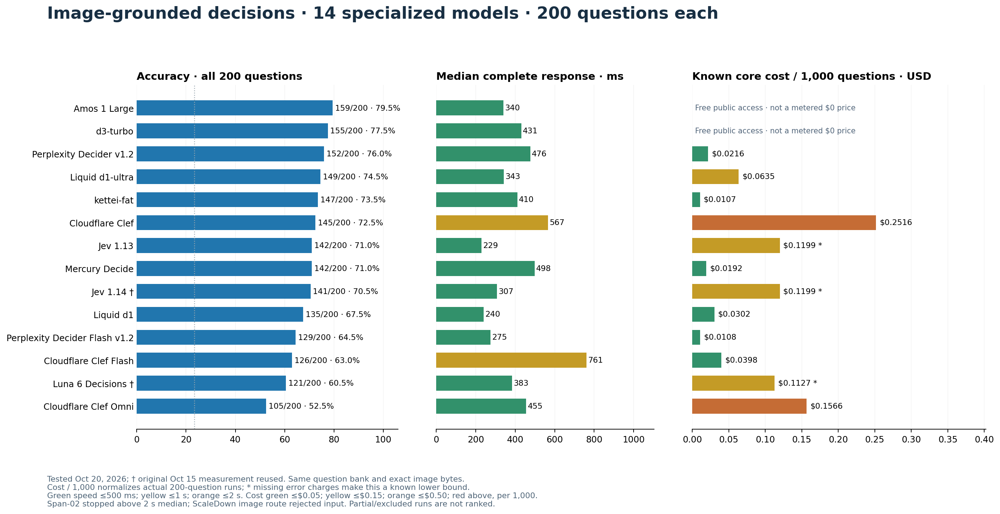
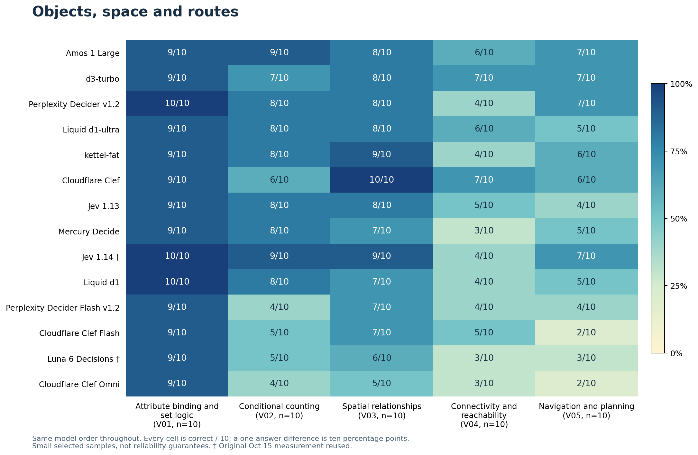
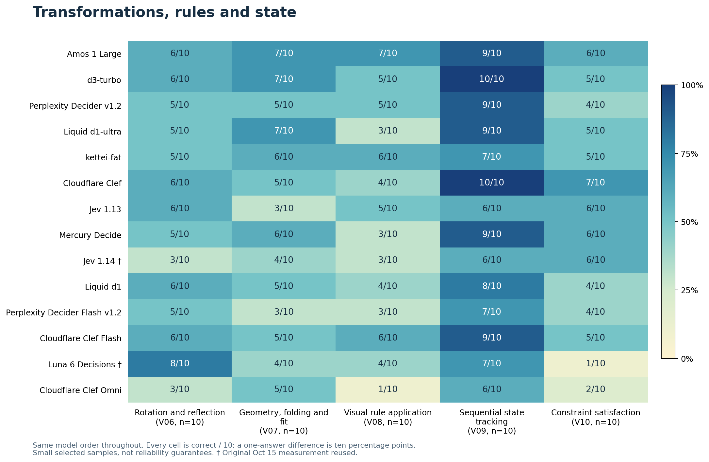
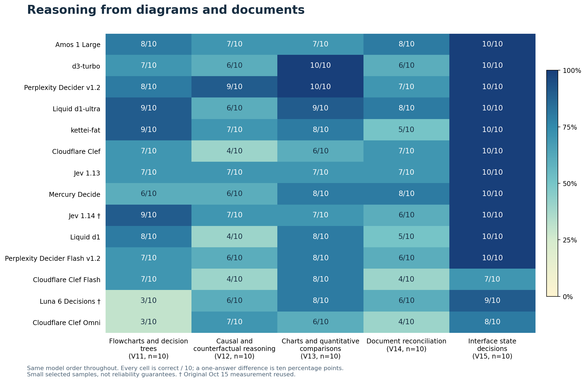
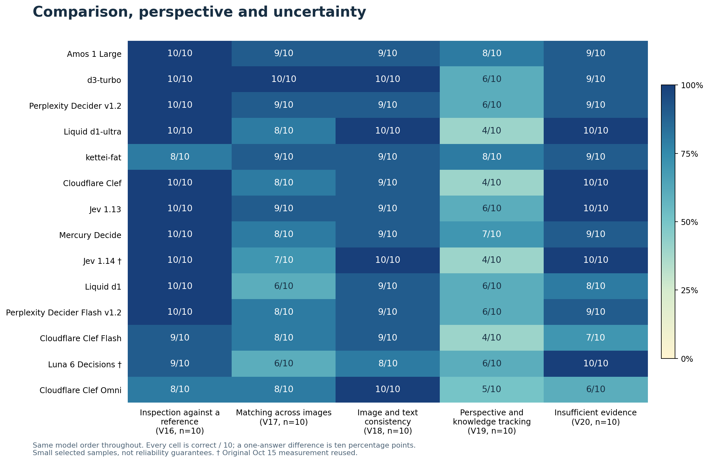

# Image-grounded System 1 decision benchmark

Amos 1 Large recorded the highest image score: **159/200 (79.5%)**, with a **340 ms median** complete response. d3-turbo followed at **155/200 (77.5%)**, then Perplexity Decider v1.2 at **152/200 (76%)**. All three returned usable typed choices on every question. These are the highest observed scores in this bank, not a universal intelligence ranking.

The expanded comparison now contains **14 specialized decision models**, each measured on the same 200 image-grounded questions. Twelve completed new runs on October 20; Jev 1.14 and Luna Decisions retain their completed October 15 results. Span- 02 crossed the prespecified two-second median limit and was stopped; ScaleDown's current route rejected images. The earlier general LLM runs remain accessible as reference results rather than the focus of the current comparison.

[Open the readable, colour-coded report](https://etsabary.github.io/visual-decision-benchmark/report.html)



## Overall results

| Decision model | Correct / 200 | Accuracy | Usable | Mean | Median | p95 | Actual 200 cost | Cost / 1,000 | Test date |
|---|---:|---:|---:|---:|---:|---:|---:|---:|---|
| Amos 1 Large | 159/200 | 79.5% | 200/200 | 0.381 s | 0.340 s | 0.630 s | Free access† | Free access† | 2026-10-20 |
| d3-turbo | 155/200 | 77.5% | 200/200 | 0.510 s | 0.431 s | 0.975 s | Free access† | Free access† | 2026-10-20 |
| Perplexity Decider v1.2 | 152/200 | 76.0% | 200/200 | 0.573 s | 0.476 s | 0.970 s | $0.004316 | $0.021582 | 2026-10-20 |
| Liquid d1-ultra | 149/200 | 74.5% | 200/200 | 0.393 s | 0.343 s | 0.727 s | $0.012692 | $0.063462 | 2026-10-20 |
| kettei-fat | 147/200 | 73.5% | 200/200 | 0.467 s | 0.410 s | 0.775 s | $0.002131 | $0.010655 | 2026-10-20 |
| Cloudflare Clef | 145/200 | 72.5% | 200/200 | 0.685 s | 0.567 s | 1.440 s | $0.050310 | $0.251552 | 2026-10-20 |
| Jev 1.13 | 142/200 | 71.0% | 195/200 | 0.270 s | 0.229 s | 0.515 s | $0.023976* | $0.119881* | 2026-10-20 |
| Mercury Decide | 142/200 | 71.0% | 200/200 | 0.575 s | 0.498 s | 1.100 s | $0.003839 | $0.019197 | 2026-10-20 |
| Jev 1.14 | 141/200 | 70.5% | 195/200 | 0.358 s | 0.307 s | 0.724 s | $0.023977* | $0.119884* | 2026-10-15 (reused) |
| Liquid d1 | 135/200 | 67.5% | 200/200 | 0.277 s | 0.240 s | 0.509 s | $0.006044 | $0.030220 | 2026-10-20 |
| Perplexity Decider Flash v1.2 | 129/200 | 64.5% | 200/200 | 0.303 s | 0.275 s | 0.552 s | $0.002158 | $0.010791 | 2026-10-20 |
| Cloudflare Clef Flash | 126/200 | 63.0% | 200/200 | 0.827 s | 0.761 s | 1.595 s | $0.007966 | $0.039829 | 2026-10-20 |
| Luna 6 Decisions | 121/200 | 60.5% | 198/200 | 0.479 s | 0.383 s | 0.799 s | $0.022546* | $0.112731* | 2026-10-15 (reused) |
| Cloudflare Clef Omni | 105/200 | 52.5% | 200/200 | 0.562 s | 0.455 s | 1.202 s | $0.031330 | $0.156650 | 2026-10-20 |

Every ranked model has the same **200 questions**, original options, original order and exact reviewed image bytes. Accuracy uses all 200 first attempts; HTTP errors and unusable choices are unsuccessful. Wrong choices and invalid formatting are not retried. One recovery is allowed only for transport failures or HTTP 408/429/5xx, with recovery charges included in core cost. All reported accuracy here is first-attempt accuracy.

The speed rule was set before these runs: after the first 20 questions, and after every subsequent question, stop a route if its cumulative **median exceeds 2 seconds**. This is a median cutoff, not a mean or p95 cutoff. Partial runs do not enter the full-bank ranking. No accuracy cutoff was applied to the eligible native decision models.

Timing includes a fresh HTTPS connection, image upload and the complete response body; it excludes local image encoding, request construction and deliberate rate/retry waits. At most four model streams ran together, with one request at a time per model. Different labs, endpoints, dates and image preprocessors remain part of the observed route comparison. This is not an isolated comparison of weights or architecture.

**Cost / 1,000 is a normalization of each actual 200-question run**, not an additional 1,000 questions per model. * Asterisked prices are known sums with missing error charges, so they are lower bounds. † d3 and Amos currently offer free public access; that is **not an API-reported metered price of $0**, and it is not a promise of future free service. Admission probes and stopped runs are accounted separately from ranked-model core totals.

Speed colours: green ≤0.5 s, yellow ≤1 s, orange ≤2 s, red >2 s. Cost colours per 1,000: green ≤$0.05, yellow ≤$0.15, orange ≤$0.50, red above $0.50. Free access is neutral grey. These are display thresholds, not provider performance guarantees. Accuracy colours use the same fixed 0–100% scale across all categories.

Jev 1.14 and Luna Decisions retain their completed **October 15** measurements; the other ranked image runs are from **October 20, 2026 (America/Toronto)**. Reusing them avoids paying to ask unchanged questions again, but means the entire table is not contemporaneous. Explicit returned identities and routes are preserved in the evidence.

The models use native typed-choice interfaces. Output-token telemetry is recorded rather than assumed to be zero; a token count alone does not establish internal reasoning or model architecture. The benchmark measures a bounded decision interface, not audio generation, agentic iteration or extended chain-of-thought performance.

## What changed in the picture

Jev 1.14 led the original image comparison at 70.5%. Amos's 79.5% adds 18 correct answers on the unchanged bank. The result also changes the order seen in text: Amos is sixth among specialized models in the current text benchmark, behind d3 and Perplexity, but has the highest image score here. Span remains the text leader and has no completed image score because it failed this run's speed screen. Nimble's text result has no native-image counterpart through its documented interface.

Amos, d3 and Perplexity are close enough that their exact order needs more evidence. Amos answered 14 questions correctly that d3 missed; d3 answered 10 that Amos missed. Against Perplexity, the corresponding counts are 20 and 13. The unadjusted paired exact p-values are 0.541 and 0.296; neither difference is statistically resolved on this selected 200-question bank. These item-level tests also do not remove dependence between related visual tasks or uncertainty about future inputs.

## Different strengths behind similar totals

**Amos has a broad profile rather than one dominant specialty.** It scored 9/10 on conditional counting, sequential state tracking, cross-image matching and image/text consistency;8/10 on perspective/knowledge tracking; and 10/10 on interface states and reference inspection. No category fell below 6/10. It still missed 41 of 200 questions. Connectivity, rotation and constraint satisfaction each remained 6/10. Its 13/13 perception controls and 146/187 reasoning/grounded decisions separate straightforward visual recognition from the more demanding part of the bank.

**d3 is particularly strong on charts and correspondence.** It scored 10/10 on charts, sequential state tracking, interface states, reference inspection, matching across images and image/text consistency. For example, matching asks whether an object in one image corresponds to a reference in another; sequential tracking asks what state remains after a series of visible changes. Its visual-rule and constraint-satisfaction scores were each 5/10, and perspective/knowledge tracking was 6/10. High performance on reading and matching does not establish dependable abstract rule execution.

**Perplexity is the strongest observed metered option overall.** Its 152/200 cost$0.00431642 for the entire 200, equivalent to$0.0215821 per 1,000. It reached 9/10 on causal/counterfactual questions and 10/10 on charts, but only 4/10 on connectivity and constraint satisfaction. Its Flash counterpart was faster at 275 ms versus 476 ms median, but scored 129/200 rather than 152/200. The speed saving came with 23 fewer correct decisions in this run.

**Sqwish kettei-fat is the least expensive metered route in this cohort.** Its 147/200 (73.5%) cost$0.00213102 for 200, or$0.0106551 per 1,000, with a410 ms median and 775 ms p95. It scored 9/10 on spatial relations and flowcharts, and 8/10 on perspective/knowledge tracking. Connectivity was 4/10; document reconciliation and constraint satisfaction were 5/10. Its low price and aggregate score do not make every application category equally suitable.

**Liquid d1-ultra trades more cost and latency for more correct answers than d1.** Ultra scored 149/200 at 343 ms median, versus 135/200 at 240 ms for d1. Ultra's flowchart score was 9/10 and its document reconciliation score 8/10, but visual rules were 3/10 and perspective/knowledge tracking 4/10. A flowchart question means following branches such as “if the measurement exceeds this limit, use the left path” to the final action; it is a different demand from merely recognizing a symbol.

**Several lower-ranked models retain category-specific value.** Cloudflare Clef scored 10/10 on spatial relations and sequential state tracking, and 7/10 on constraint satisfaction, above Amos's 6/10 in that category. Luna Decisions recorded the highest rotation/reflection score,8/10, compared with Amos and d3 at 6/10. Luna's measurement is from October 15. Each comparison is only ten questions per category; one answer changes a displayed percentage by ten points.

**Cloudflare's names do not predict its order here.** Clef scored 145/200, Clef Flash 126/200 and Clef Omni 105/200. Flash's observed median was 761 ms, slower than Clef's 567 ms, while Omni's 455 ms did not compensate for its lower accuracy. These are endpoint/date observations, not conclusions about all workloads or why the models differ.

## Where the bank separates useful vision from dependable decisions

Across the 14 complete models, interface states and reference inspection averaged 9.57/10, while visual-rule application averaged 4.21/10, connectivity 4.64/10 and constraint satisfaction 4.71/10. In a constraint question, several visible placements or relationships must all hold simultaneously; satisfying most of them is not enough. The best model's total remains below 80%, despite near-perfect scores on some simpler visual functions.

Jev 1.13 scored 142/200 and the earlier Jev 1.14 run 141/200. Both rejected the same five images through their tested OpenRouter routes, and both returned 195 usable first answers. Jev 1.13 was faster in the October 20 measurement (229 ms median versus the earlier 307 ms for 1.14), but the different dates and routes' operational conditions prevent attributing that speed difference to the model version. One extra correct answer does not establish a meaningful version-level intelligence change. The files were not resized to remove these failures.

Eleven of the 12 newly completed routes returned valid probability distributions for every usable first answer; Jev 1.13 had one probability warning, retained as a usable choice rather than retried. None of the 12 needed a scored transient retry. Returning a valid choice is not the same as choosing the correct one. Confidence filtering illustrates a possible narrower workflow: at a provider-reported cutoff of 0.9, Amos retained 77/200 and answered 76 correctly; Perplexity retained 84 and answered 83 correctly. Those are exploratory, post-run thresholds, not independently calibrated production settings. Calls rejected by a confidence filter still cost money and time.

## Cost, speed and exclusions

The new scored work—including Span's stopped 21 questions—has **$0.144871244 in known API charges**. Admission probes add **$0.001893180**, for **$0.146764424 known total**. Five scored Jev 1.13 error charges and one ScaleDown admission error charge were not reported; this is not a complete invoice. Amos and d3's 400 scored calls and five admission calls used currently free public access rather than priced receipts. The earlier reused results were not billed again.

Among fully priced completed runs, Perplexity costs roughly 5.6 times less than Jev 1.14's known cost while recording 11 more correct answers. Sqwish costs roughly 11.3 times less than that Jev amount and records six more correct answers. Jev's error charges are incomplete and the runs have different dates. These comparisons describe the observed routes and this image mix, not guaranteed future tariffs or throughput.

Span's image median reached 2.166 seconds after 21 questions (mean 1.400 seconds), triggering the declared median rule. Its 14/21 correct partial result is not a200-question accuracy estimate and is excluded from the main graphics. ScaleDown was not speed-screened: its current pinned route rejected native image parts with HTTP 400 despite catalog support. Neither exclusion is a zero accuracy score.

The completed primary cohort has 2,800 first decisions:2,400 new and 400 reused. Span contributes 21 separate partial decisions. The three older LLMs remain outside that count and the current specialized ranking. No new general LLMs were tested overnight.

## Results by named category

Every category has ten questions. Cells show correct / 10; one answer is ten percentage points. Full names and definitions are included below and in the interactive report.









## What the categories test

- **[V01 Attribute binding and set logic](questions/V01.md)**: Find objects that satisfy several visible properties at once.
- **[V02 Conditional counting](questions/V02.md)**: Count only the objects meeting the stated visual rule.
- **[V03 Spatial relationships](questions/V03.md)**: Apply left/right, above/below or relative-position constraints.
- **[V04 Connectivity and reachability](questions/V04.md)**: Follow connected paths or directed arrows between nodes.
- **[V05 Navigation and planning](questions/V05.md)**: Choose a feasible route under movement and obstacle rules.
- **[V06 Rotation and reflection](questions/V06.md)**: Recognize the result of a rotation or mirror transformation.
- **[V07 Geometry, folding and fit](questions/V07.md)**: Reason about shapes, folds, dimensions or what fits.
- **[V08 Visual rule application](questions/V08.md)**: Infer or apply a rule across symbols and pictured patterns.
- **[V09 Sequential state tracking](questions/V09.md)**: Track how successive visible actions change a state.
- **[V10 Constraint satisfaction](questions/V10.md)**: Find the arrangement satisfying all the stated restrictions.
- **[V11 Flowcharts and decision trees](questions/V11.md)**: Follow conditional branches to their final outcome.
- **[V12 Causal and counterfactual reasoning](questions/V12.md)**: Determine what changes when a pictured condition is altered.
- **[V13 Charts and quantitative comparisons](questions/V13.md)**: Read plotted values and compare or calculate the required quantity.
- **[V14 Document reconciliation](questions/V14.md)**: Combine entries across forms, receipts or tables and apply a rule.
- **[V15 Interface state decisions](questions/V15.md)**: Choose an action or identify a state from a screenshot.
- **[V16 Inspection against a reference](questions/V16.md)**: Compare an object or scene against a supplied reference.
- **[V17 Matching across images](questions/V17.md)**: Identify a corresponding object across two or three images.
- **[V18 Image and text consistency](questions/V18.md)**: Check whether a written claim agrees with the visible evidence.
- **[V19 Perspective and knowledge tracking](questions/V19.md)**: Apply line-of-sight constraints or track what an observer has seen.
- **[V20 Insufficient evidence](questions/V20.md)**: Recognize when the image cannot determine the requested answer.

## Excluded routes and eligibility

| Model | Status | First attempts | Observed median |
|---|---|---:|---:|
| Respan Span-02 | Stopped: median above 2 seconds | 21 | 2.166 s |
| ScaleDown Classify-1 | Current pinned image route rejects image input | 0 | Not scored |

Span's 21-question partial accuracy is reported only in the evidence; it is not comparable to a full-bank score. ScaleDown's catalog advertises image input, but its pinned route returned HTTP 400 rejecting `image_url` parts. No caption or OCR replacement was used. Nimble, Microsoft Decision, Drex, Kev, Tev and Solar have no documented native-image route in the current reviewed access. A successful response to encoded image-shaped JSON alone is not proof of pixel decoding. See the [dated capability review](native_images_2026-10-20/image_capabilities.json).

## Bank, reference results and limitations

The bank contains **20 categories × 10 questions**, using 227 tested compressed image files (177 single-image questions, 19 pairs and four triples). There are 187 reasoning/grounded-decision questions and 13 perception controls. Options vary: 64 questions have five choices, 135 have four, and one has three. Uniform guessing therefore averages **23.44%**, not 20% or 25% for every question.

The existing C1 preparation reduced 75.73 MiB to 54.36 MiB (28.2% fewer bytes). No images were recompressed or resized for this expansion. Smaller file size does not necessarily mean fewer billed image tokens. **221 of 227 images are redistributable in this packet**; six Our World in Data charts remain withheld pending third-party source-terms review. Their original private snapshots were used in all scored runs, not replacement downloads. Public hashes, source links, questions and results remain available.

The supplied key was kept outside execution and unchanged during these runs. Offline scoring reproduces **all five original model totals**, including the archived LLMs. This is a consistency check against the existing reference, not a new independent verification of every gold answer. A 10/10 category score has a wide uncertainty interval and is not a reliability certificate. No image file is shared across primary questions and the manifest assigns 200 scene groups, but source collections and task types recur. Item-level confidence intervals and pairwise tests should not be read as independent population estimates.

[Browse questions and source images](questions/README.md) · [Image gallery](gallery.html) · [Attribution and licenses](THIRD_PARTY_NOTICES.md) · [Expanded evidence](native_images_2026-10-20/summary.json) · [Family CSV](native_images_2026-10-20/family_scores.csv) · [Native route ledger](native_images_2026-10-20/attempts.jsonl) · [Admission probes](native_images_2026-10-20/compatibility_probes.jsonl) · [Model identities](native_images_2026-10-20/model_manifests.json) · [Audit receipt](native_images_2026-10-20/audit_receipt.json).

The three earlier general LLM runs are preserved in the [original five-model report](https://github.com/etsabary/visual-decision-benchmark/blob/433f9368c7e3f594febf7f42c6cefaae75cafca7/README.md) and [original results](results/summary.json): regular Luna 117/200, Gemini 2.5 Flash-Lite 75/200 and GPT-5.4 nano 70/200. They are not deleted, rescored, or silently replaced. They are outside the current specialized-model ranking and graphics; they are not frontier LLM references.

The separate [System 1 text benchmark](https://github.com/etsabary/system-1-decision-benchmark) uses 1,342 text questions. Its percentages and image percentages must not be combined into one score.

## Offline verification

```bash
python3 validate.py
python3 validate_native_images.py
python3 -m unittest -v test_benchmark test_image_models_2026_10_20 test_native_analysis test_native_publication
# Optional, with the original external key; never needed for API execution:
python3 score_native_images.py --answer-key /path/to/reference_key.jsonl
```

The original checksums remain intact, with superseded presentation files preserved under `archive_2026-10-16/`. The new release has a separate seal. Public validation checks file integrity, input identity, allowed choices, coverage, timing and exact-decimal costs, without network calls or credentials. Re-scoring requires the external key. Six withheld charts prevent complete request-body reconstruction using the public images alone; no validator substitutes new chart versions.
