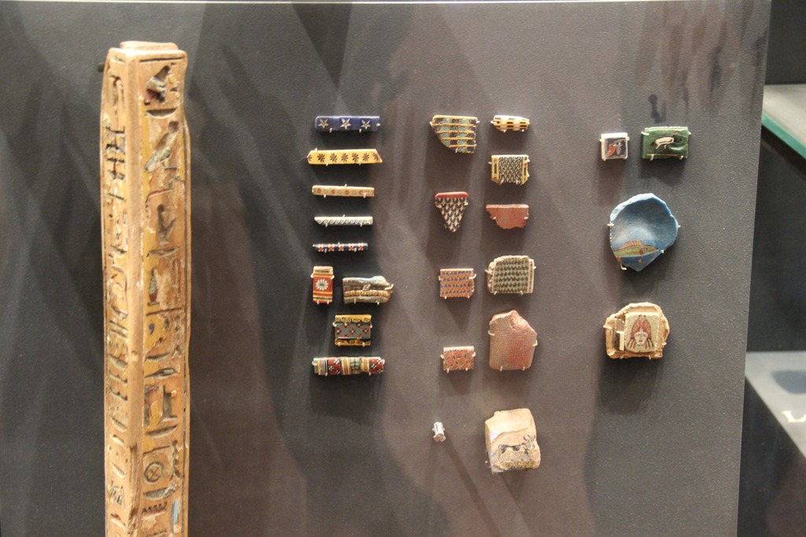
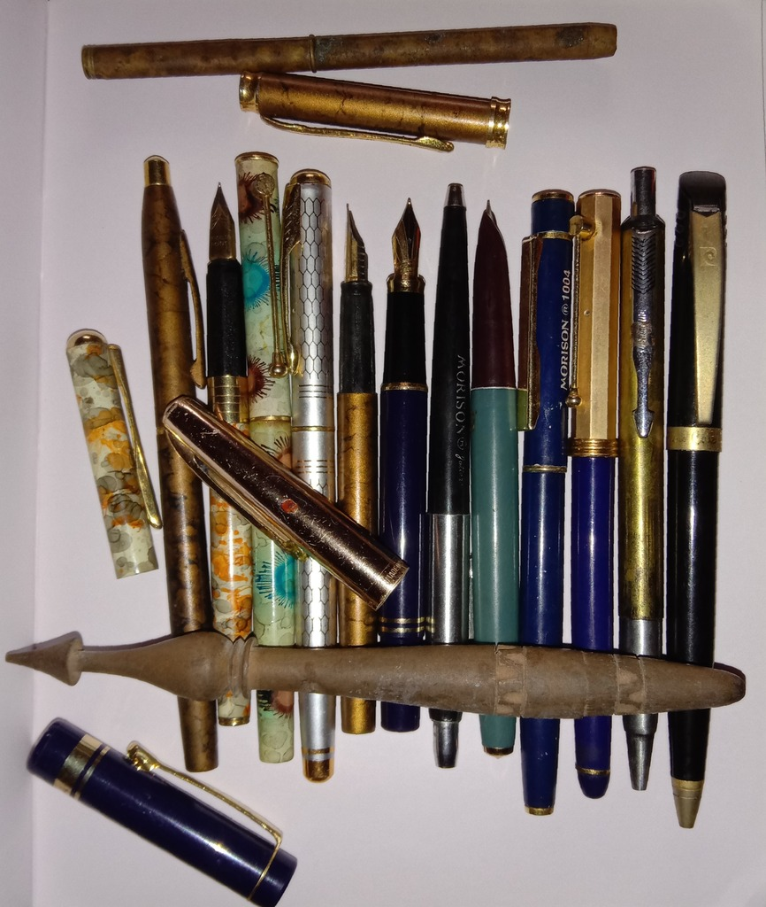
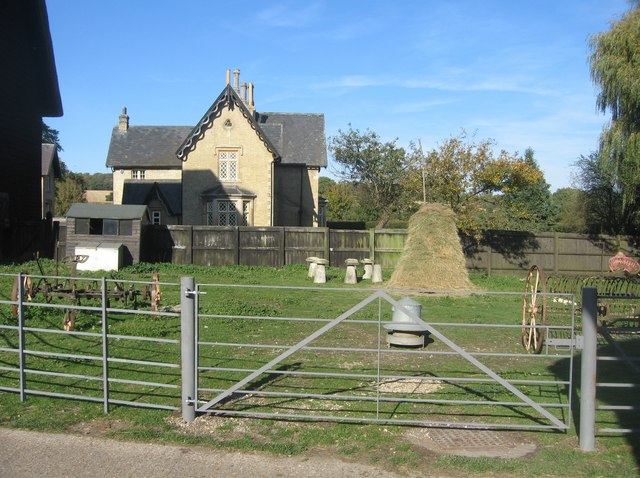
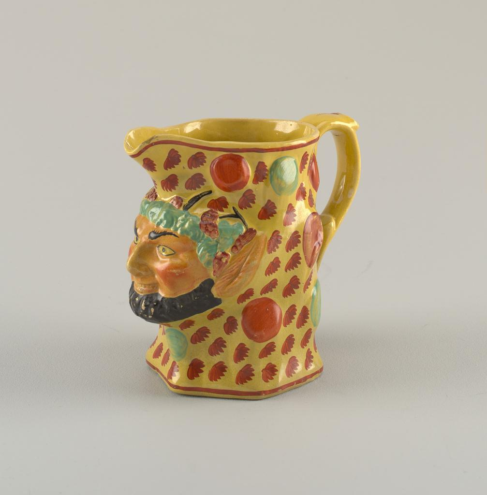
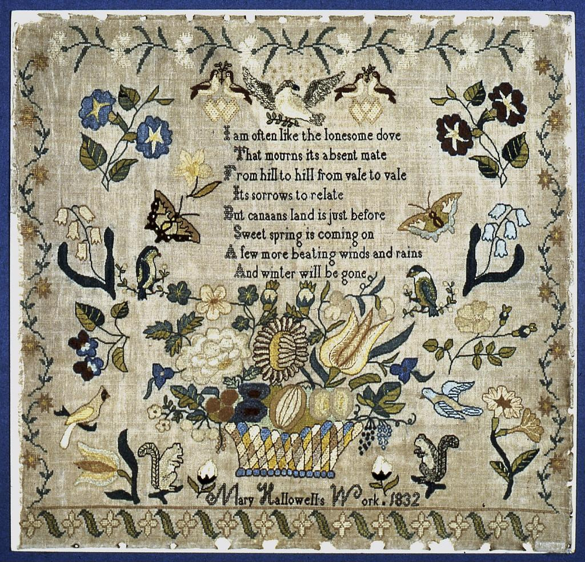
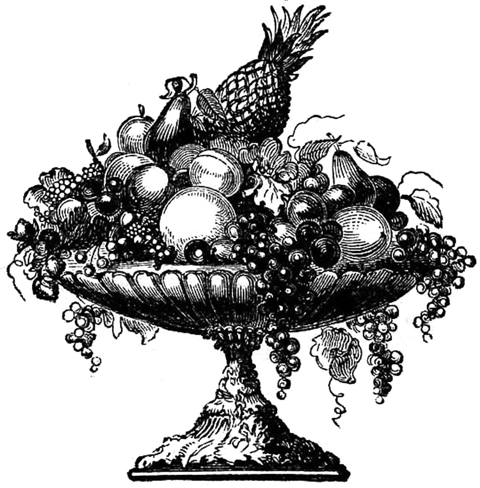
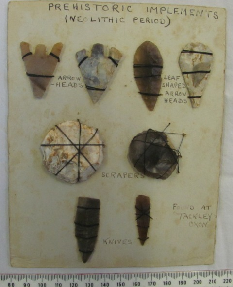
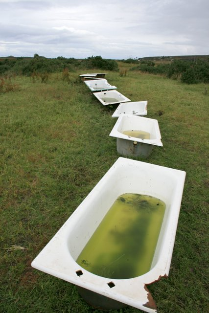
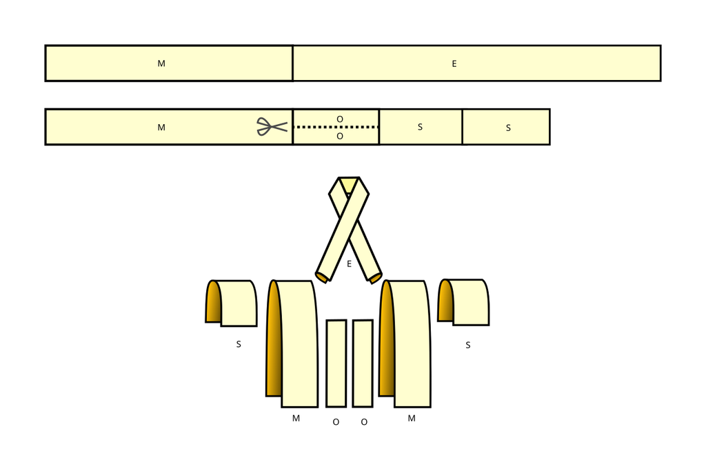

# Attribute binding and set logic

[All families](README.md) · [Methods](../../documents/METHODOLOGY.md)

## VB0080

To the right of the tall vertical wooden post, small ancient glass inlays are mounted in three general vertical columns (left, middle, and right). Which motif is depicted on the inlay fragment that is both located in the rightmost column and has a rounded blue body?

Rules: Bind both properties (rightmost column position and rounded blue body) to the same single fragment before identifying its depicted motif.

Image 1 credit: [Gary Lee Todd, Ph.D. / Wikimedia Commons / CC0 1.0](https://commons.wikimedia.org/wiki/File:Ancient_Egypt_Colored_Glass_(27753608063).jpg), [CC0](https://creativecommons.org/publicdomain/zero/1.0/). See the [asset manifest](../assets.jsonl) for preparation notes.

Options:

- 1: A walking four-legged animal
- 2: A frontal human face
- 3: A fish in side profile
- 4: A row of three five-pointed stars

## VB0081

In the main row of upright pens, some pens are uncapped to expose a pointed metal fountain-pen nib at the top, while others remain capped. Which barrel description belongs to an upright pen that both has an exposed classic metal fountain-pen nib at the top and stands to the left of the black-and-silver 'MORISON' pen?

Rules: Consider only the upright pens standing side-by-side in the main vertical row. An exposed classic fountain-pen nib is an open split metal nib protruding from a dark grip section at the top end of the pen.

Image 1 credit: [Billjones94 (Yogabrata Chakraborty) / Wikimedia Commons / CC BY-SA 4.0](https://commons.wikimedia.org/wiki/File:Antique_vintage_fountain_pens_from_a_personal_collection,_photographed_by_Yogabrata_Chakraborty.jpg), [CC BY-SA 4.0](https://creativecommons.org/licenses/by-sa/4.0/). See the [asset manifest](../assets.jsonl) for preparation notes.

Options:

- 1: White barrel patterned with orange and grey markings
- 2: Solid black barrel with a wide gold clip at the far right end
- 3: Royal-blue lower barrel paired with a faceted gold metal cap
- 4: Silver metal body with a hexagonal honeycomb grid pattern

## VB0093

Which object is below the haystack and to the left of the large upright spoked wheel?

Rules: Use image directions. Both position requirements must describe the same object.

Image 1 credit: [Sebastian Ballard; File:Assortment of farm implements - geograph.org.uk - 1012935.jpg; CC BY-SA 2.0; via Wikimedia Commons](https://commons.wikimedia.org/wiki/File:Assortment_of_farm_implements_-_geograph.org.uk_-_1012935.jpg), [CC BY-SA 2.0](https://creativecommons.org/licenses/by-sa/2.0/). See the [asset manifest](../assets.jsonl) for preparation notes.

Options:

- 1: The small white box at the far left
- 2: The red spoked wheel near the right edge
- 3: The house chimney
- 4: The grey cylindrical metal container with a conical lid

## VB0127

What color is the large oval painted mark that is above the protruding face and between the upper red roundel and the handle?

Rules: Use image positions and bind all location requirements to the same painted mark. Do not count the many small leaf-shaped marks as large medallions.

Image 1 credit: [Cooper Hewitt, Smithsonian Design Museum; Jug](https://collection.cooperhewitt.org/view/objects/asitem/id/229651), [CC0](https://creativecommons.org/publicdomain/zero/1.0/). See the [asset manifest](../assets.jsonl) for preparation notes.

Options:

- 1: Purple
- 2: Black
- 3: Red
- 4: Turquoise green

## VB0137

Which motif is above the green bird on the right of the verse and to the left of the pale blue hanging bell-shaped flowers?

Rules: Bind both position requirements to the same complete motif. Use image directions and ignore small border ornaments.

Image 1 credit: [Cooper Hewitt, Smithsonian Design Museum; Sampler](https://collection.cooperhewitt.org/view/objects/asitem/id/75215), [CC0](https://creativecommons.org/publicdomain/zero/1.0/). See the [asset manifest](../assets.jsonl) for preparation notes.

Options:

- 1: The yellow bird at lower-left
- 2: The tan butterfly on the right
- 3: The large central flower basket
- 4: The blue flowers at upper-left

## VB0150

Which fruit is above the large round fruit near the center and horizontally between the two prominent pear-shaped fruits?

Rules: Use image positions. The left pear is high on the left and the other pear is on the right; bind both relations to one object.

Image 1 credit: [AnonymousUnknown author; File:Bowl of Fruit.png; Public domain; via Wikimedia Commons](https://commons.wikimedia.org/wiki/File:Bowl_of_Fruit.png), [Public domain](https://commons.wikimedia.org/wiki/File:Bowl_of_Fruit.png). See the [asset manifest](../assets.jsonl) for preparation notes.

Options:

- 1: The low round fruit at the right
- 2: The pineapple
- 3: The grapes hanging below the bowl
- 4: The pear on the far right

## VB0155

Which tool lies below the circuit board and above the notebook, rather than being held in the person's hand?

Rules: Bind the two position conditions and the not-held condition to the same object. Use image directions; no claim about whether this is a sensible repair method is required.

Image 1 credit: [Shixart1985; File:Person working on a computer circuit board with tools at a desk.jpg; CC BY 2.0; via Wikimedia Commons](https://commons.wikimedia.org/wiki/File:Person_working_on_a_computer_circuit_board_with_tools_at_a_desk.jpg), [CC BY 2.0](https://creativecommons.org/licenses/by/2.0/). See the [asset manifest](../assets.jsonl) for preparation notes.

Options:

- 1: The stethoscope chest piece
- 2: The black cup at the back
- 3: The red-and-yellow screwdriver
- 4: The pen on the notebook

## VB0156

Which mounted artifact lies directly below the left leaf-shaped arrowhead and directly to the right of the large pale circular scraper?

Rules: The leaf-shaped arrowheads are the two narrow pieces at the upper-right. Use the left one of those two, not either forked arrowhead at the upper-left.

Image 1 credit: [The Portable Antiquities Scheme, Chris Edbury, 2012-06-15 15:29:25; File:An old collection of arrowheads, knives and scrapers mounted on card (FindID 507979).jpg; CC BY-SA 2.0; via Wikimedia Commons](https://commons.wikimedia.org/wiki/File:An_old_collection_of_arrowheads,_knives_and_scrapers_mounted_on_card_(FindID_507979).jpg), [CC BY-SA 2.0](https://creativecommons.org/licenses/by-sa/2.0/). See the [asset manifest](../assets.jsonl) for preparation notes.

Options:

- 1: The pale circular scraper on the left
- 2: The dark circular scraper on the right
- 3: The short bottom-right knife
- 4: The long bottom-left knife

## VB0163

Which bathtub both has an obvious break in its near rim and contains greenish liquid?

Rules: Bind both visible conditions to the same bathtub. Positions are ordered by distance from the camera; do not infer whether a tub is usable or safe.

Image 1 credit: [Mick Garratt; File:Assortment of Baths, Redpoint Farm - geograph.org.uk - 531611.jpg; CC BY-SA 2.0; via Wikimedia Commons](https://commons.wikimedia.org/wiki/File:Assortment_of_Baths,_Redpoint_Farm_-_geograph.org.uk_-_531611.jpg), [CC BY-SA 2.0](https://creativecommons.org/licenses/by-sa/2.0/). See the [asset manifest](../assets.jsonl) for preparation notes.

Options:

- 1: The nearest bathtub
- 2: The second-nearest bathtub
- 3: The tub at the far end
- 4: The narrow side-facing tub near the middle

## VB0164

Which label identifies the two long folded pieces directly beside the pair of narrow flat center strips in the lower assembly layout?

Rules: Use all three properties: long, folded, and immediately outside the central flat strips. Read the labels from the pictured layout, not from clothing terminology.

Image 1 credit: [HLHJ; File:Kosode assembly, exploded view.svg; CC BY-SA 4.0; via Wikimedia Commons](https://commons.wikimedia.org/wiki/File:Kosode_assembly,_exploded_view.svg), [CC BY-SA 4.0](https://creativecommons.org/licenses/by-sa/4.0/). See the [asset manifest](../assets.jsonl) for preparation notes.

Options:

- 1: O
- 2: M
- 3: E
- 4: S
