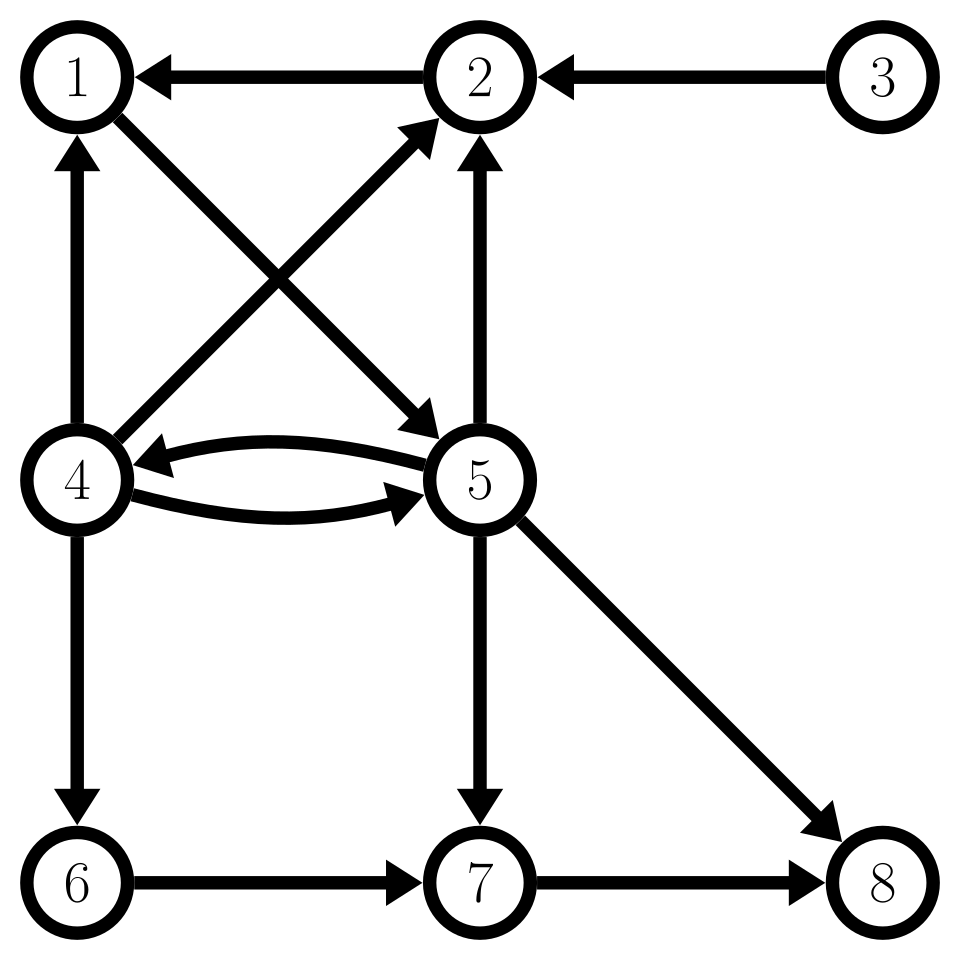
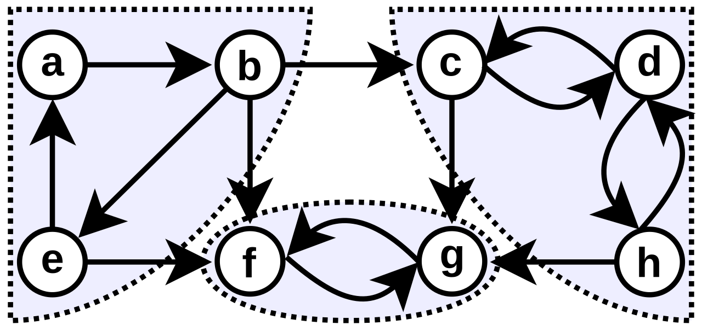
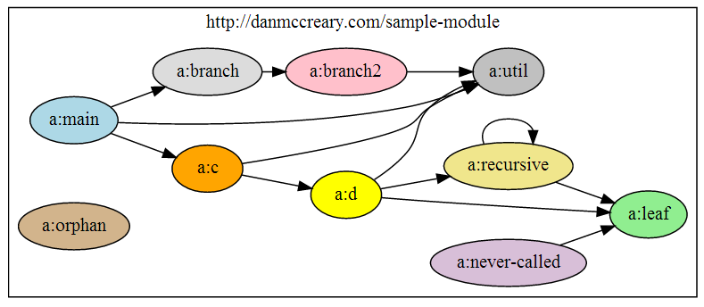
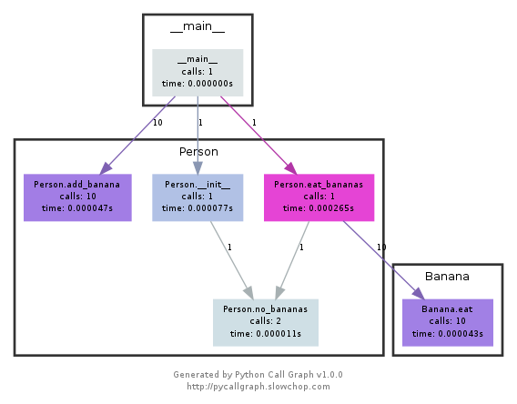
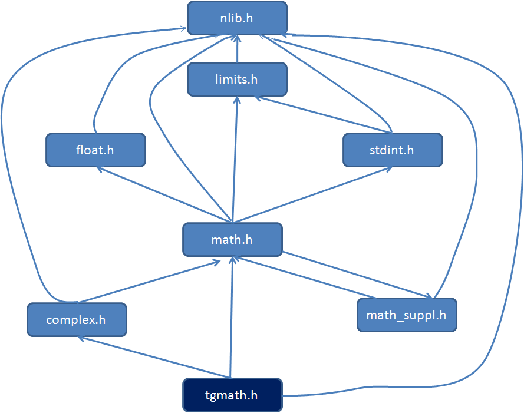
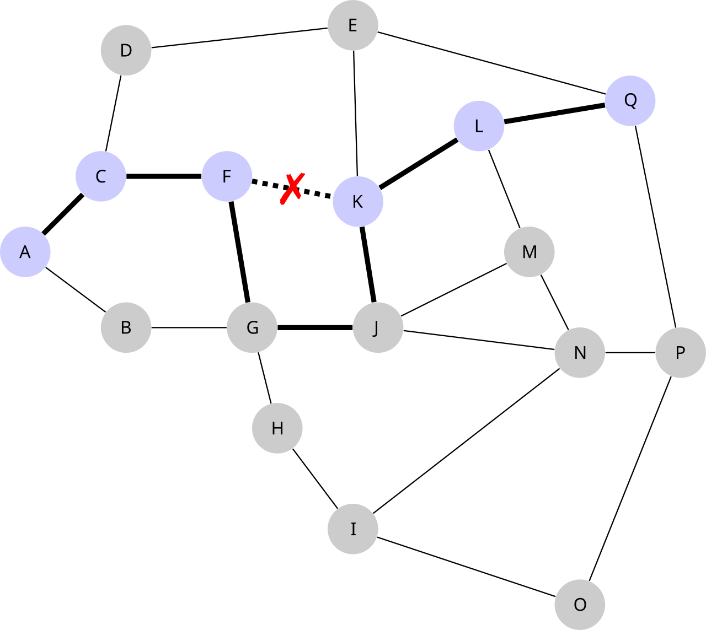
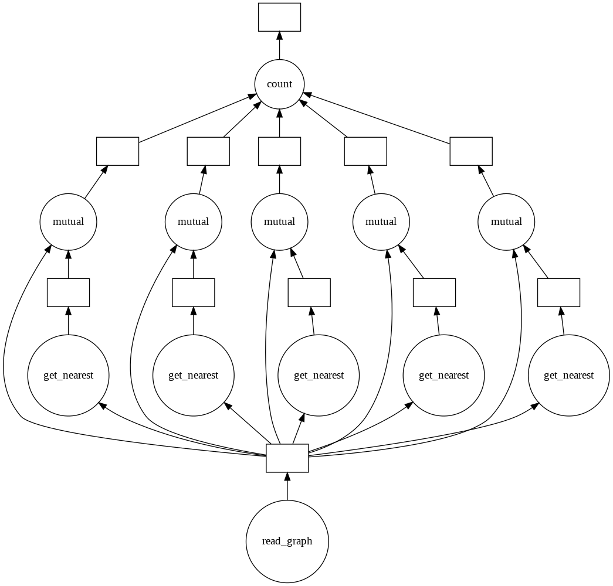
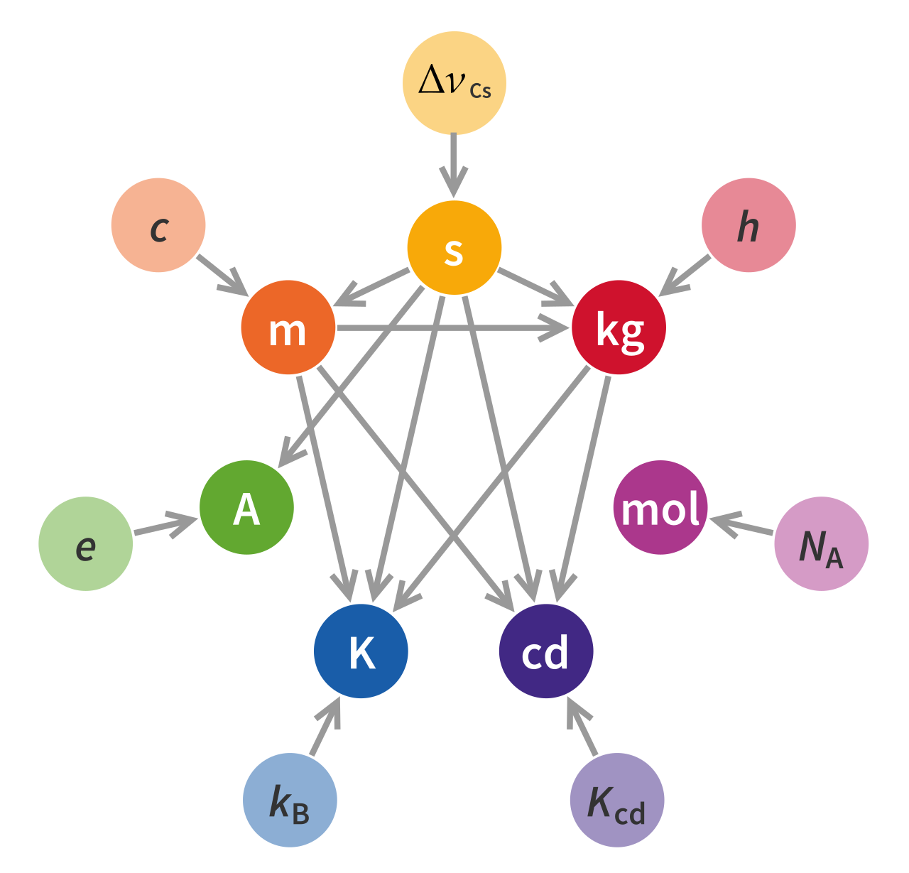
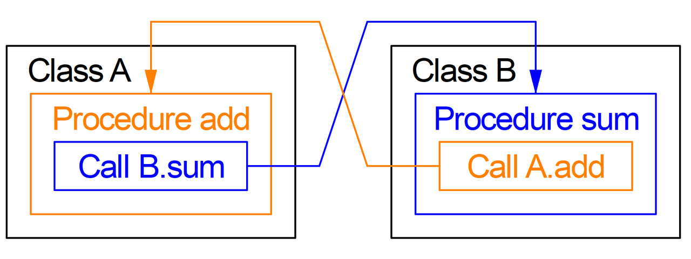
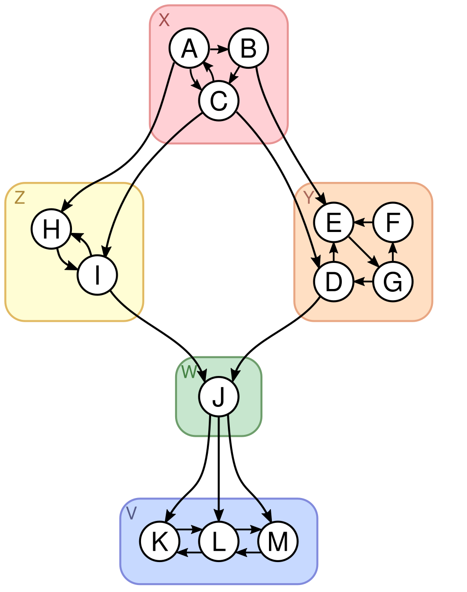

# Connectivity and reachability

[All families](README.md) · [Methods](../../documents/METHODOLOGY.md)

## VB0001

In the diagram each arrow runs from one numbered circle to another. Following arrows only in the direction they point, what is the smallest number of arrows needed to get from node 1 to node 6?

Rules: An arrow ends where its arrowhead touches a circle. Where two lines cross in open space without ending at a circle, they are not connected. Moving against an arrowhead is not allowed.

Image 1 credit: [Dimitris131, Public domain, via Wikimedia Commons (File:Directed graph example el.svg); credit: Own work](https://commons.wikimedia.org/wiki/File%3ADirected_graph_example_el.svg), [Public domain](https://commons.wikimedia.org/wiki/File%3ADirected_graph_example_el.svg). See the [asset manifest](../assets.jsonl) for preparation notes.

Options:

- 1: 2 arrows
- 2: 3 arrows
- 3: 4 arrows
- 4: 5 arrows
- 5: Node 6 cannot be reached from node 1

## VB0002

Starting at node h and following arrows only in the direction they point, how many of the other seven nodes can be reached? (Do not count h itself.)

Rules: Only arrows count. The shaded regions and dotted outlines are decoration and do not connect or separate anything. A pair of curved arrows between two nodes means each can reach the other.

Image 1 credit: [Д.Ильин: vectorization, CC0, via Wikimedia Commons (File:Scc-1.svg); credit: File:Scc.png by ℚuackor](https://commons.wikimedia.org/wiki/File%3AScc-1.svg), [CC0](https://creativecommons.org/publicdomain/zero/1.0/). See the [asset manifest](../assets.jsonl) for preparation notes.

Options:

- 1: 2
- 2: 3
- 3: 4
- 4: 5
- 5: 6

## VB0003

Following the arrows from the box labelled a:main, how many of the other nine boxes can be reached?

Rules: An arrow points from a caller to the box it calls. A box that has an arrow pointing out of it does not become reachable from a:main for that reason alone. A looping arrow that returns to its own box adds nothing.

Image 1 credit: [Dmccreary, CC BY-SA 3.0, via Wikimedia Commons (File:Sample-single-module-call-graph.png); credit: Own work](https://commons.wikimedia.org/wiki/File%3ASample-single-module-call-graph.png), [CC BY-SA 3.0](https://creativecommons.org/licenses/by-sa/3.0/). See the [asset manifest](../assets.jsonl) for preparation notes.

Options:

- 1: 5
- 2: 6
- 3: 7
- 4: 8
- 5: 9

## VB0004

In this call graph, which box is the end point of arrows that come from two different boxes?

Rules: Numbers beside the arrows are call counts and do not change which arrows exist. Count only arrowheads that touch the box.

Image 1 credit: [GeraldKaszuba, CC BY-SA 3.0, via Wikimedia Commons (File:A Call Graph generated by pycallgraph.png); credit: Own work](https://commons.wikimedia.org/wiki/File%3AA_Call_Graph_generated_by_pycallgraph.png), [CC BY-SA 3.0](https://creativecommons.org/licenses/by-sa/3.0/). See the [asset manifest](../assets.jsonl) for preparation notes.

Options:

- 1: Person.no_bananas
- 2: Person.add_banana
- 3: Person.eat_bananas
- 4: Person.__init__
- 5: Banana.eat

## VB0005

Following arrows only in the direction they point, what is the largest number of arrows on a path from tgmath.h to nlib.h that never visits the same box twice?

Rules: An arrow ends at the box where its arrowhead touches. Two boxes can have arrows in both directions between them, but a path may not return to a box it has already visited.

Image 1 credit: [Jobin RV, CC BY-SA 3.0, via Wikimedia Commons (File:Dependency Graph for tgmath.h.png); credit: Own work](https://commons.wikimedia.org/wiki/File%3ADependency_Graph_for_tgmath.h.png), [CC BY-SA 3.0](https://creativecommons.org/licenses/by-sa/3.0/). See the [asset manifest](../assets.jsonl) for preparation notes.

Options:

- 1: 3
- 2: 4
- 3: 5
- 4: 6
- 5: 7

## VB0006

The dotted link between F and K is out of service (it carries a red X) and may not be used. Ignoring the bold highlighting, what is the smallest number of links on a route from F to Q?

Rules: Each line between two circles is one link. Count every link on the route. Lines meet only at circles.

Image 1 credit: [Kjerish, CC BY-SA 4.0, via Wikimedia Commons (File:17 node network with a single link failure.svg); credit: Own work](https://commons.wikimedia.org/wiki/File%3A17_node_network_with_a_single_link_failure.svg), [CC BY-SA 4.0](https://creativecommons.org/licenses/by-sa/4.0/). See the [asset manifest](../assets.jsonl) for preparation notes.

Options:

- 1: 3
- 2: 4
- 3: 5
- 4: 6
- 5: 7

## VB0007

Following arrow directions, how many different routes lead from the bottom circle labelled read_graph to the circle labelled count?

Rules: Rectangles and circles are both stops on a route. Two routes are different if they differ in at least one arrow. Arrows keep their direction and lines meet only where they end.

Image 1 credit: [Daniee N H, CC BY-SA 4.0, via Wikimedia Commons (File:Example DASK.png); credit: Own work](https://commons.wikimedia.org/wiki/File%3AExample_DASK.png), [CC BY-SA 4.0](https://creativecommons.org/licenses/by-sa/4.0/). See the [asset manifest](../assets.jsonl) for preparation notes.

Options:

- 1: 5
- 2: 6
- 3: 10
- 4: 15
- 5: 25

## VB0008

Starting at the circle labelled with the symbol for the caesium frequency (the top circle, written as a Greek letter followed by a subscript 'Cs') and following arrows only in the direction they point, how many other circles can be reached?

Rules: Arrows point from one circle to another; a circle with only outgoing arrows cannot be reached from elsewhere. Count each reached circle once.

Image 1 credit: [Emilio Pisanty, CC BY-SA 4.0, via Wikimedia Commons (File:Unit relations in the new SI.svg); credit: Own work](https://commons.wikimedia.org/wiki/File%3AUnit_relations_in_the_new_SI.svg), [CC BY-SA 4.0](https://creativecommons.org/licenses/by-sa/4.0/). See the [asset manifest](../assets.jsonl) for preparation notes.

Options:

- 1: 4
- 2: 5
- 3: 6
- 4: 7
- 5: 8

## VB0009

The orange line starts at the box labelled 'Call A.add'. At which box does the arrowhead of that orange line point?

Rules: Lines may cross in open space without connecting. Each line keeps its colour from start to arrowhead.

Image 1 credit: [Bautsch, CC0, via Wikimedia Commons (File:Zyklischer.Import.png); credit: Own work](https://commons.wikimedia.org/wiki/File%3AZyklischer.Import.png), [CC0](https://creativecommons.org/publicdomain/zero/1.0/). See the [asset manifest](../assets.jsonl) for preparation notes.

Options:

- 1: Call B.sum
- 2: Class A
- 3: Procedure sum
- 4: Procedure add
- 5: Class B

## VB0010

Starting at node G and following arrows only in the direction they point, how many other nodes can be reached?

Rules: Do not count G itself. The coloured rounded boxes and their letters (X, Y, Z, W, V) are decoration and do not connect or separate anything. Where two curved arrows run between the same two nodes in opposite directions, each node can reach the other.

Image 1 credit: [RaspberryJamWikipedian, CC BY-SA 4.0, via Wikimedia Commons (File:Kosaraju stack after first pass.svg); credit: Own work](https://commons.wikimedia.org/wiki/File%3AKosaraju_stack_after_first_pass.svg), [CC BY-SA 4.0](https://creativecommons.org/licenses/by-sa/4.0/). See the [asset manifest](../assets.jsonl) for preparation notes.

Options:

- 1: 3
- 2: 4
- 3: 5
- 4: 6
- 5: 7
