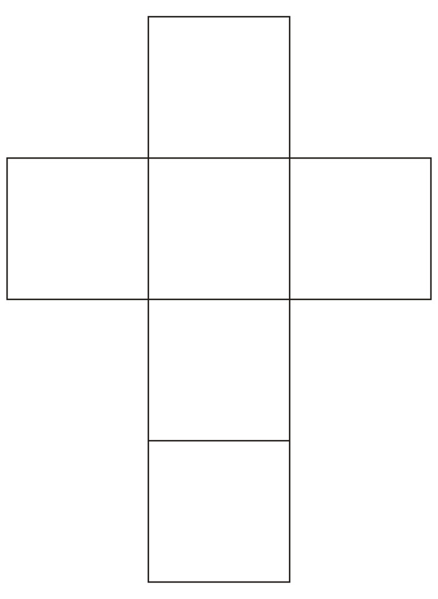
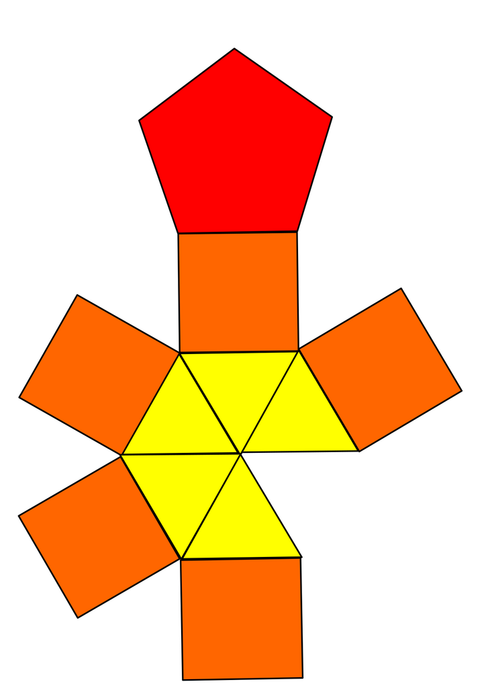
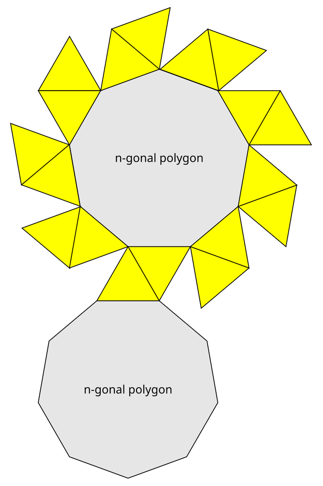
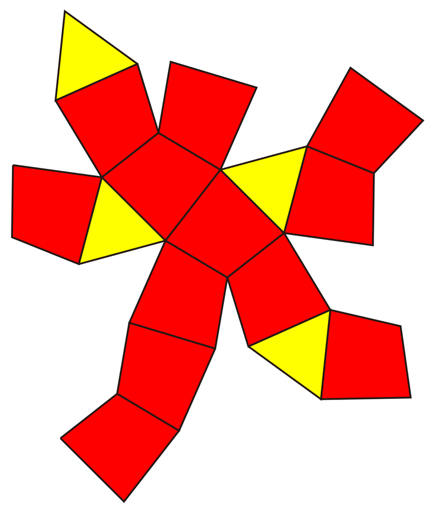
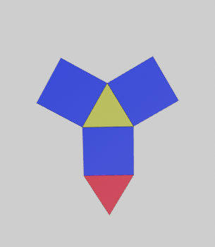
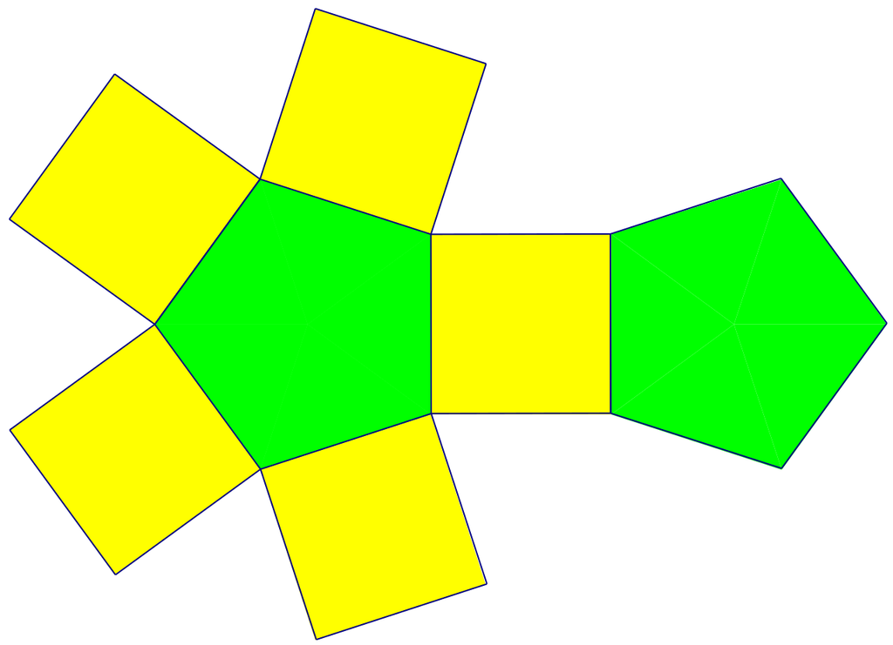
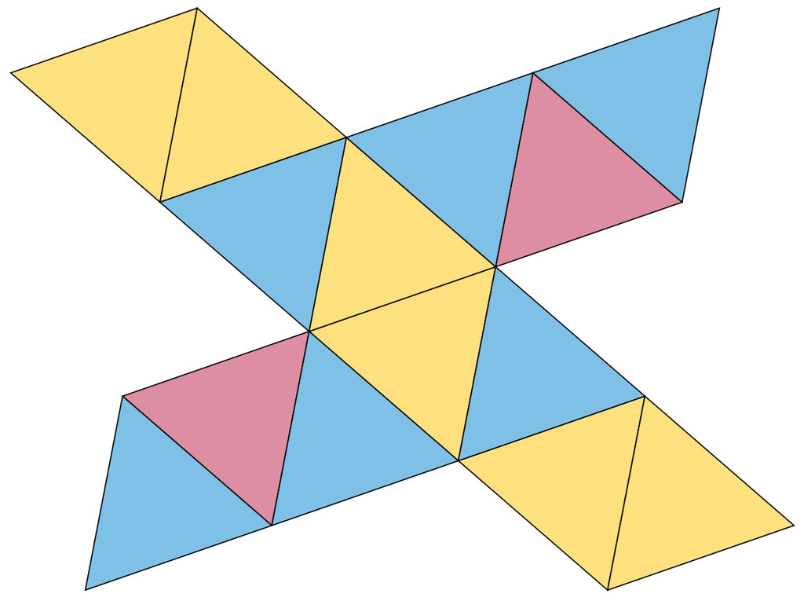
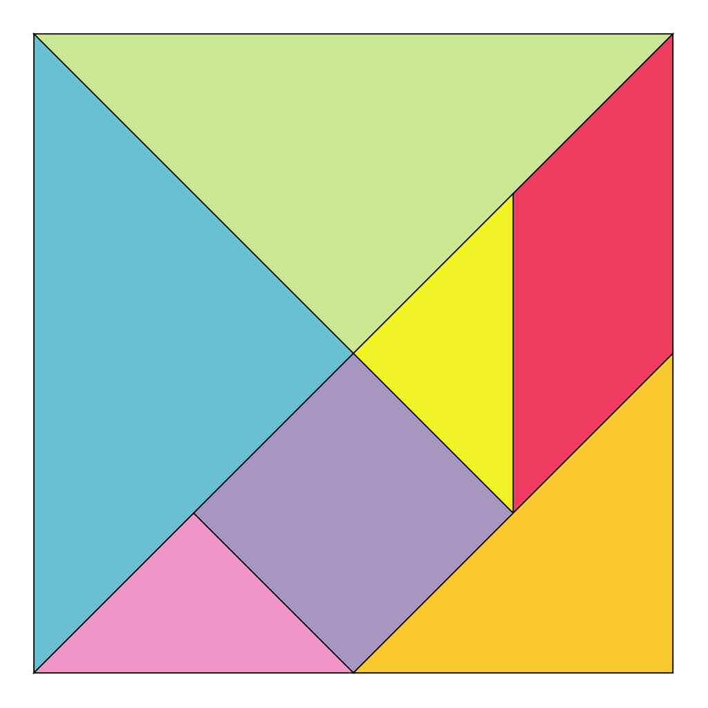
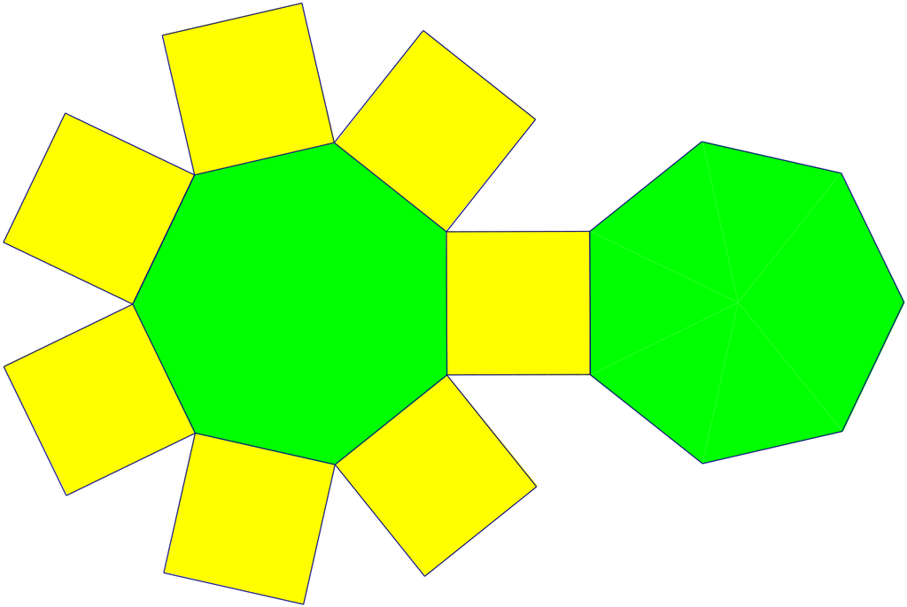
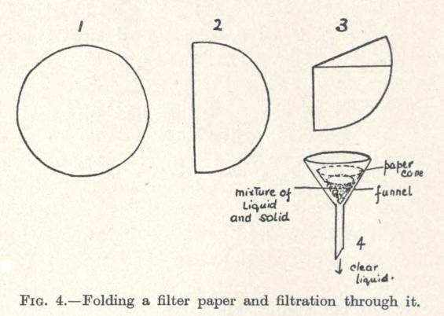

# Geometry, folding and fit

[All families](README.md) · [Methods](../../documents/METHODOLOGY.md)

## VB0087

When this net is folded into a closed cube, which square is opposite the central square that has another square attached on both its left and its right?

Rules: Fold along the shared square edges without cutting, stretching or overlapping faces. Identify positions in the pictured flat net.

Image 1 credit: [File:Hexahedron flat.svg / Wikimedia Commons](https://commons.wikimedia.org/wiki/File:Hexahedron_flat.svg), [Public domain](https://creativecommons.org/publicdomain/mark/1.0/). See the [asset manifest](../assets.jsonl) for preparation notes.

Options:

- 1: The topmost square
- 2: The rightmost square
- 3: The bottommost square
- 4: The leftmost square

## VB0106

When this net is folded into its closed convex solid, how many vertices does the solid have?

Rules: Every drawn polygon becomes one face. Every completed edge is shared by exactly two faces. You may use V - E + F = 2. Count the actual panels and their sides; no panel disappears or splits.

Image 1 credit: [Timeroot; File:Elongated Pentagonal Pyramid Net.svg; CC BY-SA 3.0; via Wikimedia Commons](https://commons.wikimedia.org/wiki/File:Elongated_Pentagonal_Pyramid_Net.svg), [CC BY-SA 3.0](https://creativecommons.org/licenses/by-sa/3.0/). See the [asset manifest](../assets.jsonl) for preparation notes.

Options:

- 1: 8
- 2: 10
- 3: 11
- 4: 12

## VB0107

After folding the pictured net, how many yellow triangular faces meet at each vertex on a grey base?

Rules: The grey polygons form disjoint parallel bases. The equal yellow triangles close into the repeating band between them, with no additional vertices away from the bases.

Image 1 credit: [Timeroot; File:Generalized antiprisim net.svg; Public domain; via Wikimedia Commons](https://commons.wikimedia.org/wiki/File:Generalized_antiprisim_net.svg), [Public domain](https://commons.wikimedia.org/wiki/File:Generalized_antiprisim_net.svg). See the [asset manifest](../assets.jsonl) for preparation notes.

Options:

- 1: 2
- 2: 3
- 3: 4
- 4: 6

## VB0108

How many pairs of cut boundary edges must be joined to close this one-piece net?

Rules: Every black shared edge between two panels is already a hinge. Each remaining outside boundary edge must be joined to exactly one other boundary edge. Do not count a hinge as a new join.

Image 1 credit: [A2569875; File:Net of self-dual form tetrahedrally diminished dodecahedron.svg; CC BY-SA 4.0; via Wikimedia Commons](https://commons.wikimedia.org/wiki/File:Net_of_self-dual_form_tetrahedrally_diminished_dodecahedron.svg), [CC BY-SA 4.0](https://creativecommons.org/licenses/by-sa/4.0/). See the [asset manifest](../assets.jsonl) for preparation notes.

Options:

- 1: 12
- 2: 14
- 3: 15
- 4: 30

## VB0118

After this net is folded into its closed solid, what do the red and yellow-green triangular faces share?

Rules: Fold along the polygon edges without cutting, stretching or overlapping panels. The two colored triangles remain distinct faces.

Image 1 credit: [IcosaMarty343; File:Triangular prism net.png; CC0; via Wikimedia Commons](https://commons.wikimedia.org/wiki/File:Triangular_prism_net.png), [CC0](https://creativecommons.org/publicdomain/zero/1.0/). See the [asset manifest](../assets.jsonl) for preparation notes.

Options:

- 1: Neither an edge nor a vertex
- 2: One vertex but no edge
- 3: A whole edge

## VB0119

After folding, how many yellow faces share an edge with both green faces?

Rules: Close the pictured prism without overlapping panels. Blue outlines define face edges; ignore faint white rendering hairlines inside a green panel.

Image 1 credit: [A2569875; File:Net of pentagonal prism.svg; Public domain; via Wikimedia Commons](https://commons.wikimedia.org/wiki/File:Net_of_pentagonal_prism.svg), [Public domain](https://commons.wikimedia.org/wiki/File:Net_of_pentagonal_prism.svg). See the [asset manifest](../assets.jsonl) for preparation notes.

Options:

- 1: 1
- 2: 2
- 3: 3
- 4: 5

## VB0120

When this net is folded, how does the total yellow surface area compare with the total pink surface area?

Rules: All pictured triangular faces are congruent. No face overlaps another in the completed solid.

Image 1 credit: [David Eppstein; File:Triaugmented triangular prism (symmetric net).svg; CC0; via Wikimedia Commons](https://commons.wikimedia.org/wiki/File:Triaugmented_triangular_prism_(symmetric_net).svg), [CC0](https://creativecommons.org/publicdomain/zero/1.0/). See the [asset manifest](../assets.jsonl) for preparation notes.

Options:

- 1: Yellow is three times pink
- 2: Yellow is six times pink
- 3: Yellow is twice pink
- 4: The areas are equal

## VB0121

Using other pieces from this dissection, which choice can exactly cover the central purple square?

Rules: Pieces may be moved, rotated and reflected, but not cut, stretched or overlapped. Match both area and shape, not area alone.

Image 1 credit: [Sarang; File:Tangram diagram.svg; Public domain; via Wikimedia Commons](https://commons.wikimedia.org/wiki/File:Tangram_diagram.svg), [Public domain](https://commons.wikimedia.org/wiki/File:Tangram_diagram.svg). See the [asset manifest](../assets.jsonl) for preparation notes.

Options:

- 1: The yellow and pink small triangles together
- 2: The red parallelogram alone
- 3: The yellow small triangle and the golden triangle together
- 4: The large golden triangle at bottom-right alone

## VB0143

After this net is folded into its closed prism, what is the fewest number of colors needed so that faces sharing an edge always have different colors?

Rules: You may recolor every face; the current yellow and green are only panel identifiers. Faces meeting only at a vertex may share a color. Count the actual lateral faces and how they join when folded.

Image 1 credit: [A2569875; File:Net of heptagonal prism.svg; Public domain; via Wikimedia Commons](https://commons.wikimedia.org/wiki/File:Net_of_heptagonal_prism.svg), [Public domain](https://commons.wikimedia.org/wiki/File:Net_of_heptagonal_prism.svg). See the [asset manifest](../assets.jsonl) for preparation notes.

Options:

- 1: 2
- 2: 3
- 3: 4
- 4: 5

## VB0159

At stage3, one outer paper flap is opened to form the cone in stage4. How many paper layers are on the two sides of that cone?

Rules: Start with the single paper sheet drawn at stage1. Follow the shown folds, each placing one half over the other. Open one outer flap, not a separation through the middle of the layer stack. Do not tear or add paper.

Image 1 credit: [Percy Cyril Lesley Thorne; File:Paper filter folding and filtration.JPG; Public domain; via Wikimedia Commons](https://commons.wikimedia.org/wiki/File:Paper_filter_folding_and_filtration.JPG), [Public domain](https://commons.wikimedia.org/wiki/File:Paper_filter_folding_and_filtration.JPG). See the [asset manifest](../assets.jsonl) for preparation notes.

Options:

- 1: 2 layers and2 layers
- 2: 1 layer and2 layers
- 3: 1 layer and3 layers
- 4: 1 layer and1 layer
