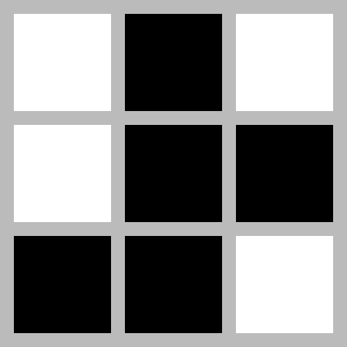
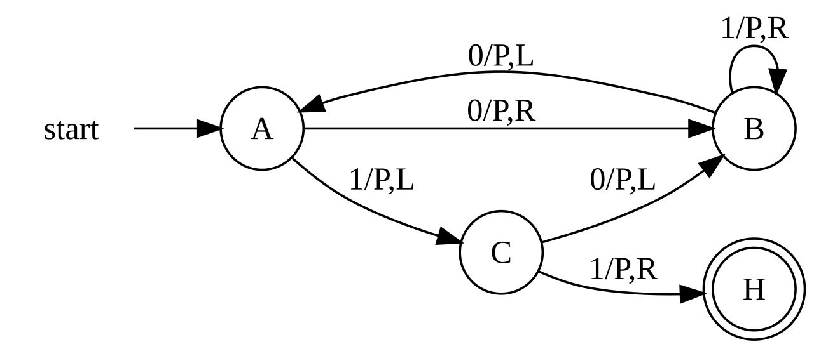
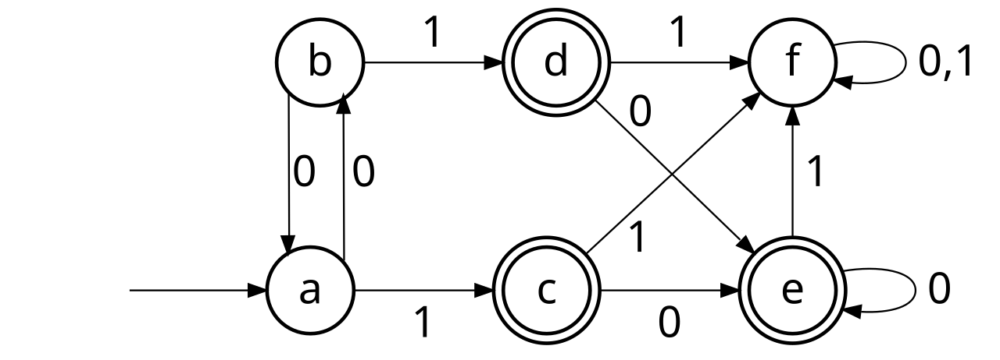
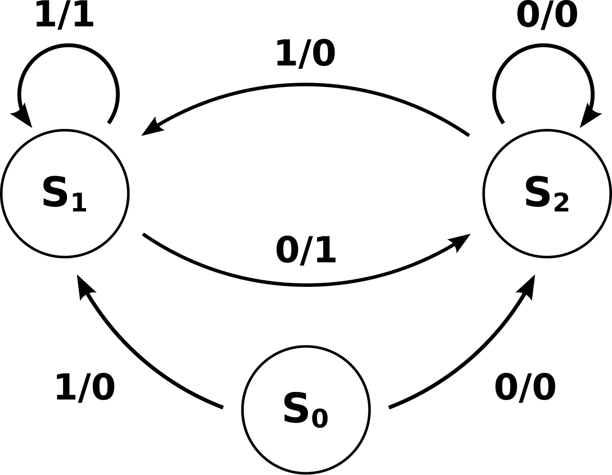
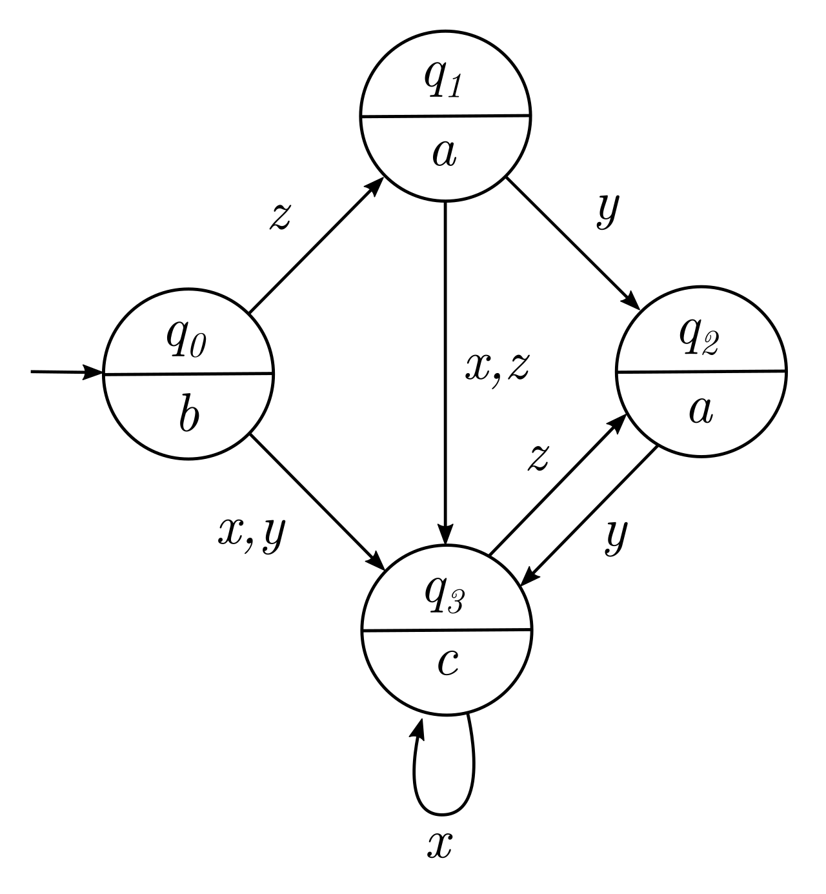
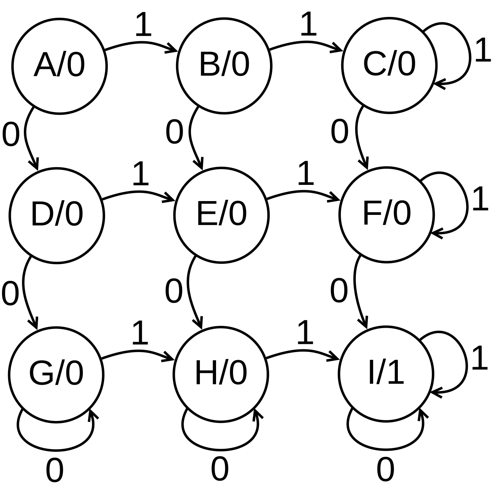
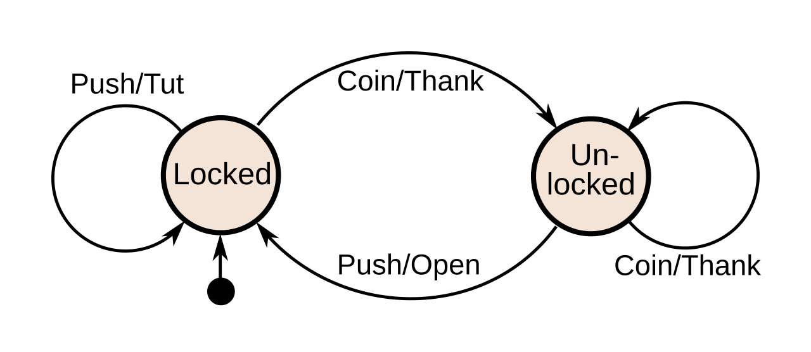
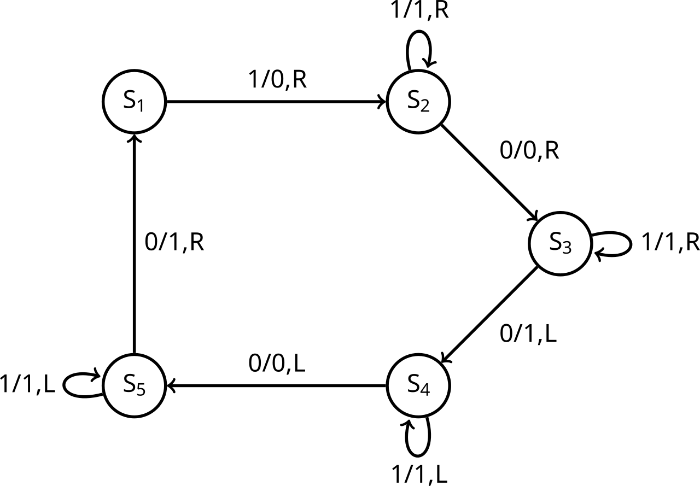
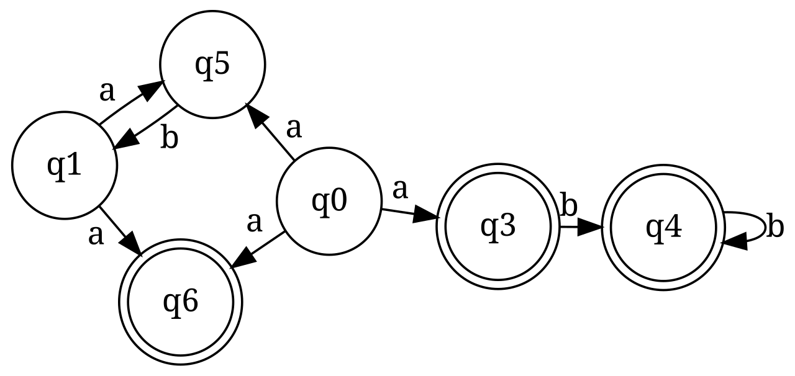
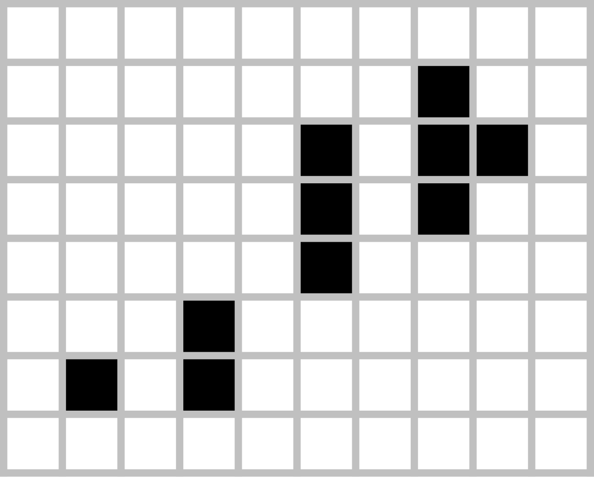

# Visual rule application

[All families](README.md) · [Methods](../../documents/METHODOLOGY.md)

## VB0017

Apply the Game of Life rules to the pattern in the picture two times in a row. How many live cells are there after the second generation?

Rules: Black squares are live cells, white squares are dead cells, and every cell outside the picture is dead; the grid is unbounded in all directions. Rules: a live cell with 2 or 3 live neighbours (the 8 surrounding cells, diagonals included) stays alive, otherwise it dies; a dead cell with exactly 3 live neighbours becomes alive. All cells change together in each generation.

Image 1 credit: [Sarang, Public domain, via Wikimedia Commons (File:Game of life 3x3 cell pento-R.svg); credit: Own work](https://commons.wikimedia.org/wiki/File%3AGame_of_life_3x3_cell_pento-R.svg), [Public domain](https://commons.wikimedia.org/wiki/File%3AGame_of_life_3x3_cell_pento-R.svg). See the [asset manifest](../assets.jsonl) for preparation notes.

Options:

- 1: 4
- 2: 5
- 3: 6
- 4: 7
- 5: 8

## VB0018

The picture is a Turing-machine state diagram. The machine starts in state A. The tape is infinite in both directions and every cell holds 0 except the single cell under the head, which holds 1. When the machine reaches the halting state H, how many cells on the tape hold 1?

Rules: An arrow label 'x/P,D' means: if the symbol under the head is x, write 1 (P), move the head one cell in direction D (L = left, R = right), then go to the state the arrow points to. The arrow from 'start' only marks the initial state. H is the halting state.

Image 1 credit: [Diego Queiroz, CC BY-SA 3.0, via Wikimedia Commons (File:State diagram 3 state busy beaver 2B.svg); credit: Own work](https://commons.wikimedia.org/wiki/File%3AState_diagram_3_state_busy_beaver_2B.svg), [CC BY-SA 3.0](https://creativecommons.org/licenses/by-sa/3.0/). See the [asset manifest](../assets.jsonl) for preparation notes.

Options:

- 1: 4
- 2: 5
- 3: 6
- 4: 7
- 5: 8

## VB0019

The machine starts in state a (the state with the entering arrow). Which one of these input strings does it accept?

Rules: A string is read left to right, one symbol per arrow, following the arrow labelled with that symbol. It is accepted if, after the last symbol, the machine is in a state drawn with a double circle.

Image 1 credit: [Pat Hawks, CC BY 4.0, via Wikimedia Commons (File:DFA to be minimized.svg); credit: Own work](https://commons.wikimedia.org/wiki/File%3ADFA_to_be_minimized.svg), [CC BY 4.0](https://creativecommons.org/licenses/by/4.0/). See the [asset manifest](../assets.jsonl) for preparation notes.

Options:

- 1: 1100
- 2: 0110
- 3: 1010
- 4: 01000
- 5: 0101

## VB0020

The machine starts in S0 (the state with no arrow into it). What output sequence does it produce for the input sequence 1, 0, 0, 1, 1?

Rules: An arrow labelled x/y means: on input x, output y and move along that arrow. Write the five outputs in order.

Image 1 credit: [Jake Choules, Public domain, via Wikimedia Commons (File:Mealy machine state diagram.svg); credit: Own work, derived from Mealymachine_jaredwf.png.](https://commons.wikimedia.org/wiki/File%3AMealy_machine_state_diagram.svg), [Public domain](https://commons.wikimedia.org/wiki/File%3AMealy_machine_state_diagram.svg). See the [asset manifest](../assets.jsonl) for preparation notes.

Options:

- 1: 01101
- 2: 00101
- 3: 10011
- 4: 01001
- 5: 11001

## VB0021

The machine starts in q0. For the input sequence z, y, y, x, x, what output string is produced?

Rules: Each state shows its output letter in its lower half. Write the output of the starting state first, then the output of each state reached after every input symbol. An arrow labelled with several letters (for example x, z) is followed for any of them.

Image 1 credit: [Stiegenaufgang, based on NikolausMayer's work, CC BY-SA 4.0, via Wikimedia Commons (File:MooreMachineExample.svg); credit: Based on MooreAutomaton.png - vectorized](https://commons.wikimedia.org/wiki/File%3AMooreMachineExample.svg), [CC BY-SA 4.0](https://creativecommons.org/licenses/by-sa/4.0/). See the [asset manifest](../assets.jsonl) for preparation notes.

Options:

- 1: bcaccc
- 2: baacc
- 3: bacccc
- 4: aaccc
- 5: baaccc

## VB0022

The machine starts in state A (the top-left state). Which state is it in after reading the input 1, 1, 0, 1, 1, 1?

Rules: Follow the arrow labelled with each input symbol, one symbol at a time. A looping arrow keeps the machine in the same state.

Image 1 credit: [ColinStocks, CC0, via Wikimedia Commons (File:ExampleMooreMachine.svg); credit: Own work](https://commons.wikimedia.org/wiki/File%3AExampleMooreMachine.svg), [CC0](https://creativecommons.org/publicdomain/zero/1.0/). See the [asset manifest](../assets.jsonl) for preparation notes.

Options:

- 1: I
- 2: E
- 3: C
- 4: B
- 5: F

## VB0023

The machine starts in the Locked state (the arrow from the black dot). For the inputs Push, Coin, Coin, Push, Push in that order, what is the output sequence?

Rules: An arrow labelled input/output means: on that input, produce that output and move along the arrow (a loop stays in the same state).

Image 1 credit: [Chetvorno, CC0, via Wikimedia Commons (File:Turnstile finite-state machine with actions.svg); credit: Own work based on: Turnstile state machine colored.svg, with minor modifications](https://commons.wikimedia.org/wiki/File%3ATurnstile_finite-state_machine_with_actions.svg), [CC0](https://creativecommons.org/publicdomain/zero/1.0/). See the [asset manifest](../assets.jsonl) for preparation notes.

Options:

- 1: Tut, Thank, Thank, Open, Open
- 2: Open, Thank, Thank, Open, Tut
- 3: Tut, Thank, Open, Open, Tut
- 4: Tut, Thank, Thank, Open, Tut
- 5: Tut, Thank, Thank, Thank, Open

## VB0024

The machine starts in S1 with its head on the leftmost symbol of the tape 1 1 0 1 1; every other cell holds 0. When it halts, how many cells on the tape hold 1?

Rules: An arrow labelled a/b,D means: if the symbol under the head is a, write b, move the head one cell in direction D (L = left, R = right), then go to the state the arrow points to. The machine halts when no arrow leaves the current state for the symbol under the head. The tape is unbounded in both directions.

Image 1 credit: [Sn KGS, CC BY-SA 4.0, via Wikimedia Commons (File:Example of a Turing machine.svg); credit: Own work](https://commons.wikimedia.org/wiki/File%3AExample_of_a_Turing_machine.svg), [CC BY-SA 4.0](https://creativecommons.org/licenses/by-sa/4.0/). See the [asset manifest](../assets.jsonl) for preparation notes.

Options:

- 1: 4
- 2: 5
- 3: 6
- 4: 7
- 5: 8

## VB0025

Starting from q0, which one of these strings is accepted by the machine?

Rules: q0 is the start state (the only state with no incoming arrow). A string is accepted if at least one path through the machine reads the whole string and ends in a state drawn with a double circle. A path that gets stuck (no arrow for the next symbol) does not count.

Image 1 credit: [HeatSink, CC BY-SA 3.0, via Wikimedia Commons (File:Nfa several.svg); credit: Own work](https://commons.wikimedia.org/wiki/File%3ANfa_several.svg), [CC BY-SA 3.0](https://creativecommons.org/licenses/by-sa/3.0/). See the [asset manifest](../assets.jsonl) for preparation notes.

Options:

- 1: ba
- 2: ababa
- 3: abba
- 4: aab
- 5: abab

## VB0026

Apply the Game of Life rules once to the pattern in the picture. How many live cells are there after that one generation?

Rules: Black squares are live cells, white squares are dead cells, and every cell outside the picture is dead; the grid is unbounded in all directions. A live cell with 2 or 3 live neighbours (the 8 surrounding cells, diagonals included) stays alive, otherwise it dies; a dead cell with exactly 3 live neighbours becomes alive. All cells change together.

Image 1 credit: [Bryan.burgers, Public domain, via Wikimedia Commons (File:Game of life infinite1.svg); credit: Own work](https://commons.wikimedia.org/wiki/File%3AGame_of_life_infinite1.svg), [Public domain](https://commons.wikimedia.org/wiki/File%3AGame_of_life_infinite1.svg). See the [asset manifest](../assets.jsonl) for preparation notes.

Options:

- 1: 12
- 2: 13
- 3: 14
- 4: 15
- 5: 16
