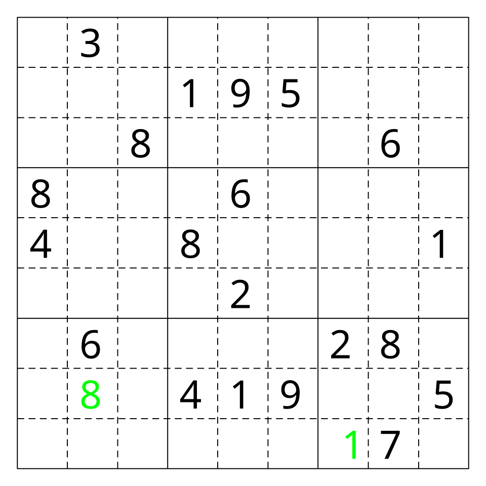
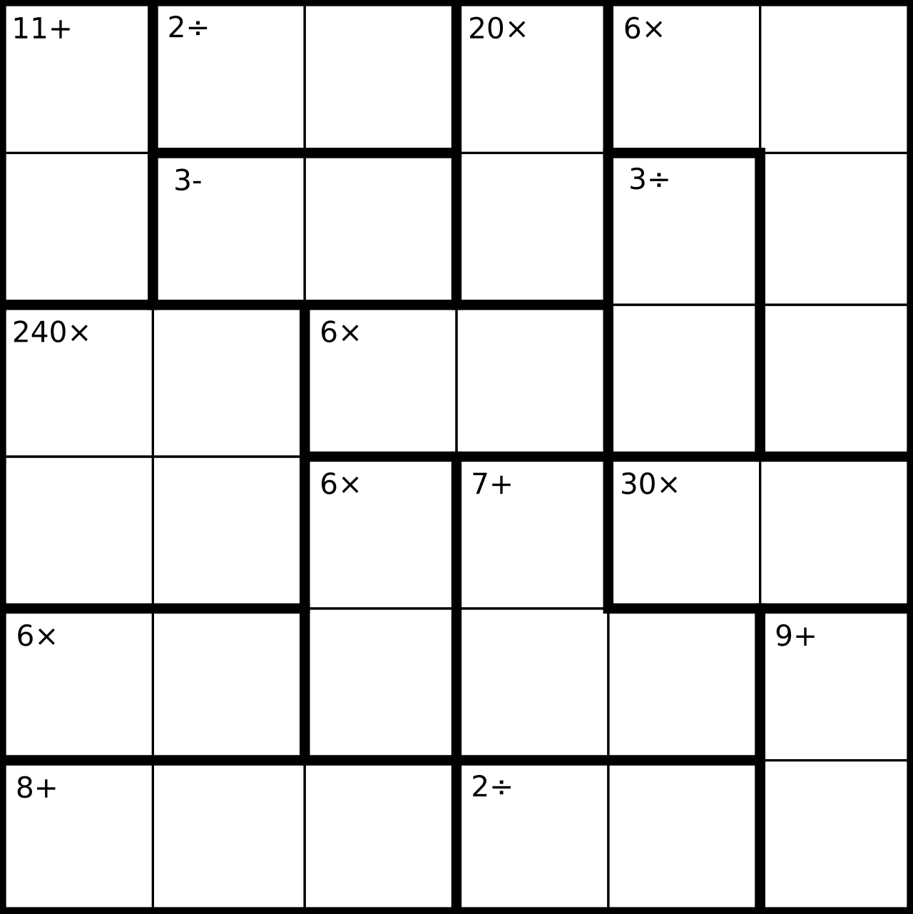
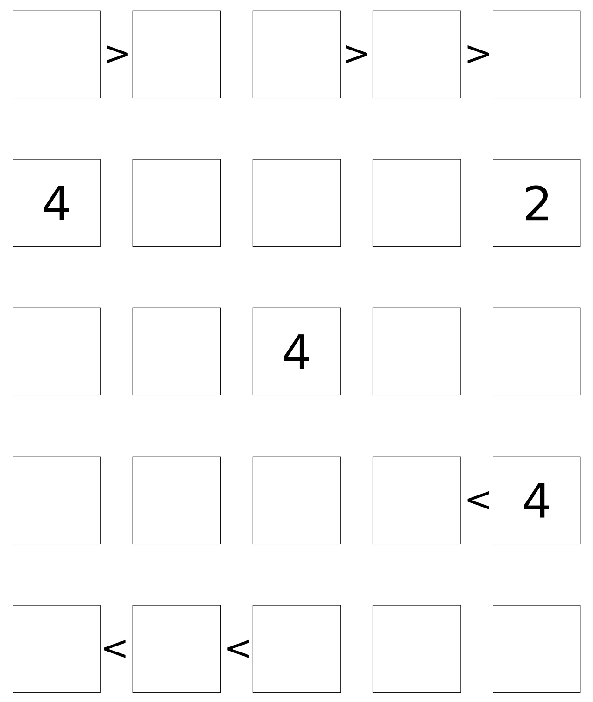
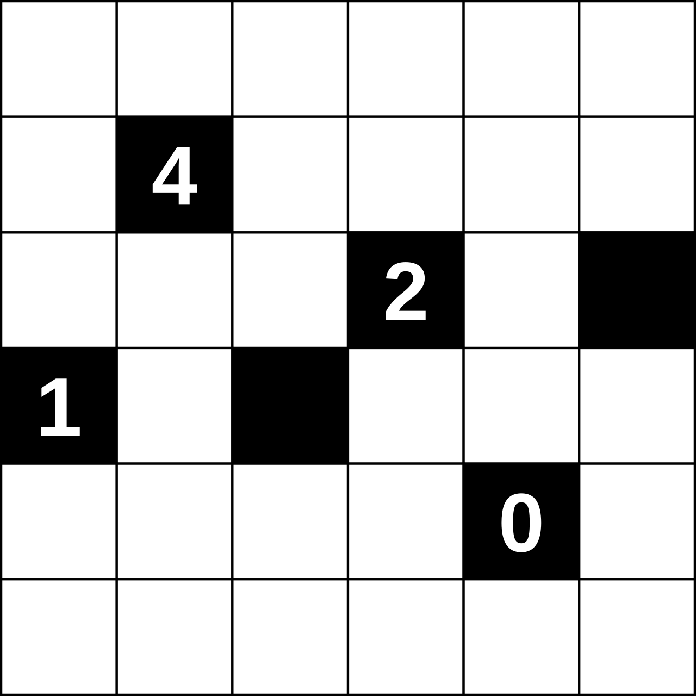
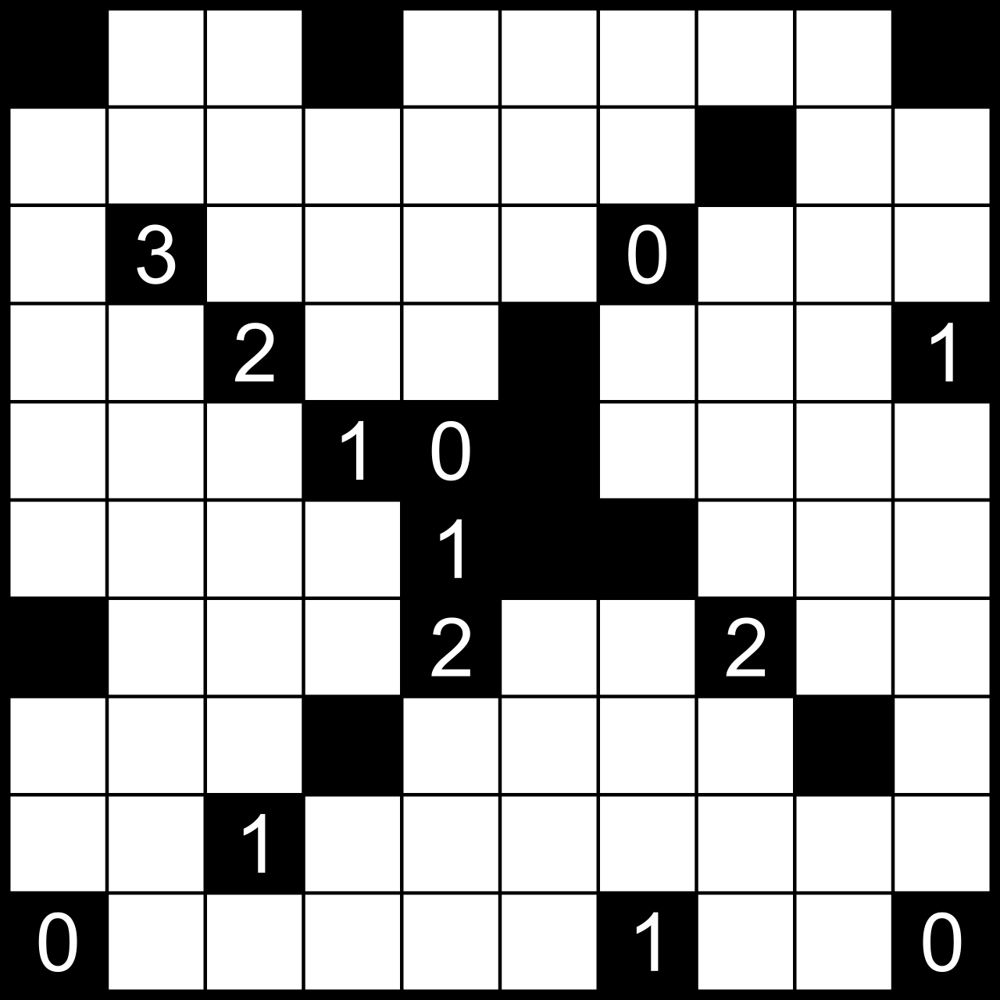
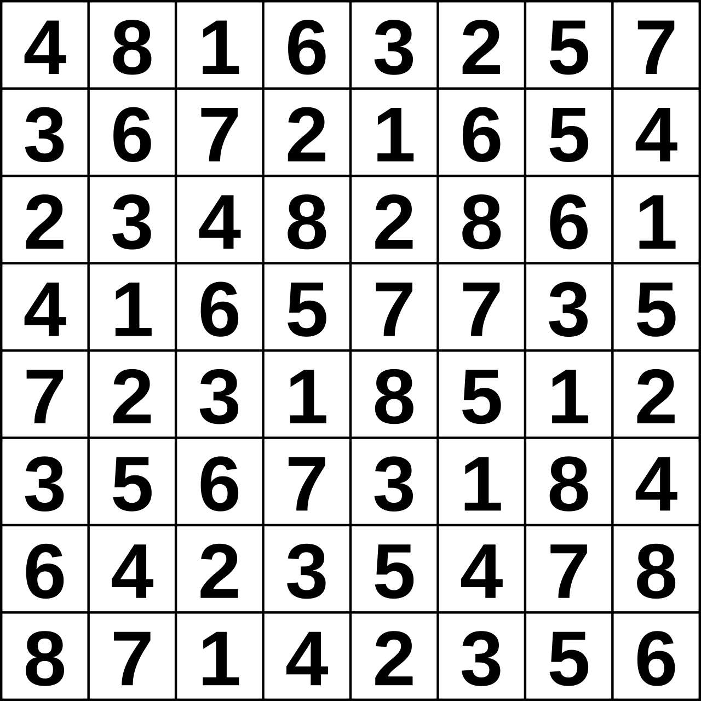
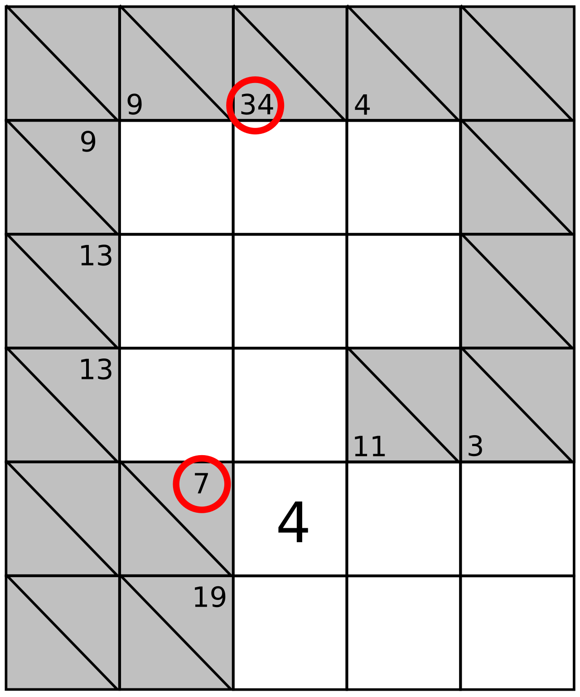
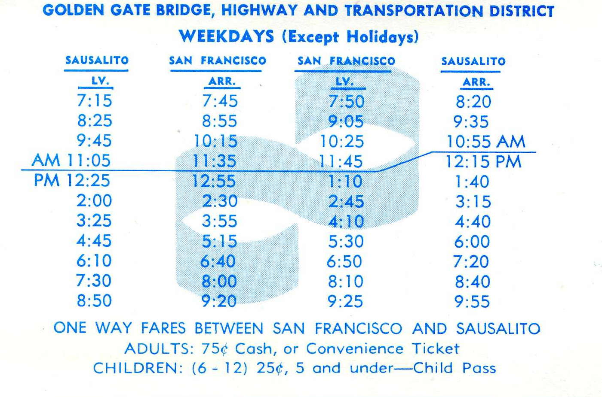
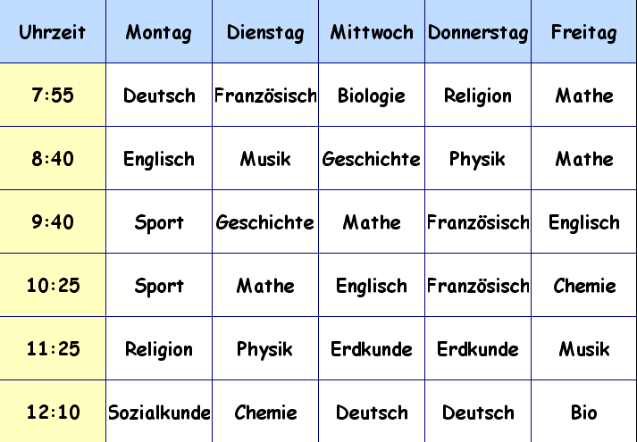
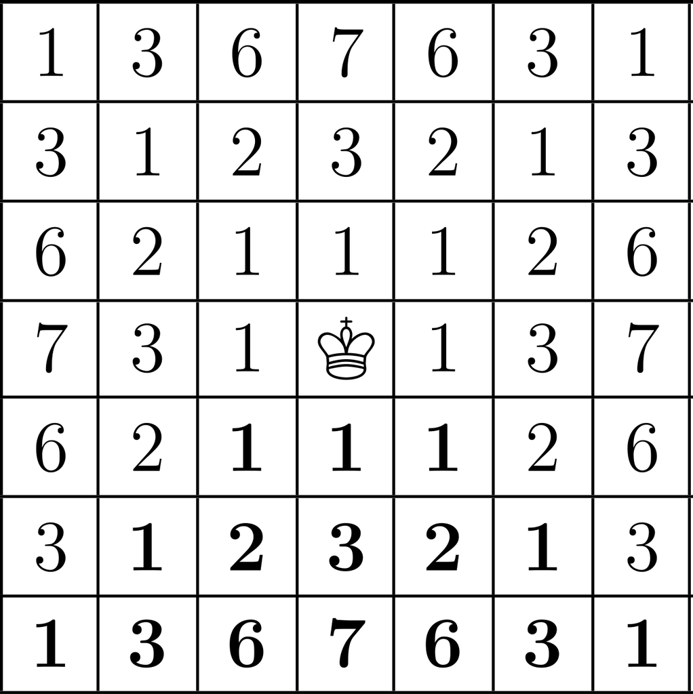

# Constraint satisfaction

[All families](README.md) · [Methods](../../documents/METHODOLOGY.md)

## VB0027

Under the usual sudoku rules (no repeated digit in any row, column or 3x3 box), which digits could legally be written in the empty centre cell, row 5 column 5? Count rows from the top and columns from the left.

Rules: Treat every digit shown, black or green, as already placed. Heavy lines mark the 3x3 boxes; dashed lines are ordinary cell borders. Do not try to solve the whole puzzle; ask only which digits do not conflict with the placed digits.

Image 1 credit: [Amahoney, CC BY-SA 4.0, via Wikimedia Commons (File:Sudoku partial 1.svg); credit: Own work](https://commons.wikimedia.org/wiki/File%3ASudoku_partial_1.svg), [CC BY-SA 4.0](https://creativecommons.org/licenses/by-sa/4.0/). See the [asset manifest](../assets.jsonl) for preparation notes.

Options:

- 1: 3, 5 or 7
- 2: 2, 3, 5 or 7
- 3: 3, 5, 7 or 9
- 4: 3 or 7 only
- 5: 1, 3, 5 or 7

## VB0028

Fill the 6x6 grid with the digits 1 to 6 so that every row and every column contains each digit exactly once, and every heavily outlined group of cells produces the number in its corner using the operation shown. Exactly one completed grid satisfies every rule. Which choice is the bottom row of that grid, read left to right?

Rules: For + the digits in the group add up to the number; for x they multiply to the number; for - (two cells) the larger digit minus the smaller equals the number; for / (two cells) the larger digit divided by the smaller equals the number. Groups with no operation symbol shown do not occur; each group has exactly one label in its top-left cell. A digit may repeat inside a group only if its cells are in different rows and columns.

Image 1 credit: [Underpants, SGBailey, Public domain, via Wikimedia Commons (File:KenKenProblem.svg); credit: SVG version of Kenkenproblem.png](https://commons.wikimedia.org/wiki/File%3AKenKenProblem.svg), [Public domain](https://commons.wikimedia.org/wiki/File%3AKenKenProblem.svg). See the [asset manifest](../assets.jsonl) for preparation notes.

Options:

- 1: 1 5 2 3 6 4
- 2: 2 1 5 6 3 4
- 3: 1 2 5 3 6 4
- 4: 1 2 5 6 3 4
- 5: 5 1 2 6 3 4

## VB0029

Fill the 5x5 grid with the digits 1 to 5 so that no digit repeats in any row or column and every inequality sign is true. Which digit goes in the cell in row 5, column 3? (Count rows from the top and columns from the left.)

Rules: A sign between two neighbouring cells points to the smaller one: 'a > b' means the left cell is larger than the right cell, and 'a < b' means the left cell is smaller. The grid has exactly one solution.

Image 1 credit: [User:Pruneau, CC BY-SA 3.0, via Wikimedia Commons (File:Futoshiki1.svg); credit: File:Futoshiki1.png](https://commons.wikimedia.org/wiki/File%3AFutoshiki1.svg), [CC BY-SA 3.0](https://creativecommons.org/licenses/by-sa/3.0/). See the [asset manifest](../assets.jsonl) for preparation notes.

Options:

- 1: 1
- 2: 2
- 3: 3
- 4: 4
- 5: 5

## VB0030

Solve this 6x6 Light Up puzzle. How many lamps does the completed puzzle contain?

Rules: Black squares are walls. A numbered black square must have exactly that many lamps in its four edge-adjacent squares. A lamp lights its own square and every white square in the same row and column up to the next black square. Every white square must be lit, and no lamp may be lit by another lamp. The puzzle has exactly one solution.

Image 1 credit: [Life of Riley, Public domain, via Wikimedia Commons (File:Light up 1.svg); credit: Own work](https://commons.wikimedia.org/wiki/File%3ALight_up_1.svg), [Public domain](https://commons.wikimedia.org/wiki/File%3ALight_up_1.svg). See the [asset manifest](../assets.jsonl) for preparation notes.

Options:

- 1: 6
- 2: 7
- 3: 8
- 4: 9
- 5: 10

## VB0031

Solve this 10x10 Light Up puzzle. How many lamps does the completed puzzle contain?

Rules: Black squares are walls. A numbered black square must have exactly that many lamps in its four edge-adjacent squares. A lamp lights its own square and every white square in the same row and column up to the next black square. Every white square must be lit, and no lamp may be lit by another lamp. The puzzle has exactly one solution.

Image 1 credit: [Amit6, CC BY-SA 3.0, via Wikimedia Commons (File:Lightup.svg); credit: Own work](https://commons.wikimedia.org/wiki/File%3ALightup.svg), [CC BY-SA 3.0](https://creativecommons.org/licenses/by-sa/3.0/). See the [asset manifest](../assets.jsonl) for preparation notes.

Options:

- 1: 17
- 2: 18
- 3: 19
- 4: 20
- 5: 21

## VB0032

Solve this Hitori puzzle. Which one of these cells must be shaded black in the unique solution? (Rows count from the top, columns from the left.)

Rules: Shade some cells black so that (a) no number appears more than once among the unshaded cells of any row or column, (b) no two shaded cells share an edge, and (c) all unshaded cells form a single group connected by edges. The puzzle has exactly one solution.

Image 1 credit: [Own work, Dan1980, CC BY 1.0, via Wikimedia Commons (File:Hitori.svg); credit: Own work, based on File:Hitori.jpg](https://commons.wikimedia.org/wiki/File%3AHitori.svg), [CC BY 1.0](https://creativecommons.org/licenses/by/1.0/). See the [asset manifest](../assets.jsonl) for preparation notes.

Options:

- 1: Row 3, column 4 (the 8)
- 2: Row 4, column 5 (the 7)
- 3: Row 7, column 6 (the 4)
- 4: Row 2, column 2 (the 6)
- 5: Row 3, column 6 (the 8)

## VB0033

Solve this Kakuro. Which number goes in the white cell in row 6, column 4 (bottom row, middle of the three white cells)?

Rules: Each white cell holds a digit from 1 to 9. A number in the upper right of a grey cell is the sum of the run of white cells to its right; a number in the lower left is the sum of the run of white cells below it. Digits may not repeat within a run. The 4 is already placed. The red circles are marks and carry no meaning. The puzzle has exactly one solution.

Image 1 credit: [Samuli Lintula, Public domain, via Wikimedia Commons (File:Kakuro.01.svg); credit: Own work](https://commons.wikimedia.org/wiki/File%3AKakuro.01.svg), [Public domain](https://commons.wikimedia.org/wiki/File%3AKakuro.01.svg). See the [asset manifest](../assets.jsonl) for preparation notes.

Options:

- 1: 5
- 2: 6
- 3: 7
- 4: 8
- 5: 9

## VB0034

Using the weekday table, which itinerary meets all four conditions: (1) leave Sausalito at 9:00 or later, (2) arrive in San Francisco no later than 11:00, (3) spend more than 2 hours in San Francisco between arriving and leaving on the return ferry, and (4) be back in Sausalito by 2:00 PM?

Rules: The two left columns give the Sausalito-to-San Francisco ferries (departure, then arrival in the same row). The two right columns give the San Francisco-to-Sausalito ferries (departure, then arrival in the same row). Times above the horizontal rule drawn across the table are AM and times below it are PM.

Image 1 credit: [Piergiuliano Chesi, Public domain, via Wikimedia Commons (File:San Francisco Golden Gate Ferry timetable June 1974 02.jpg); credit: Own work from scan](https://commons.wikimedia.org/wiki/File%3ASan_Francisco_Golden_Gate_Ferry_timetable_June_1974_02.jpg), [Public domain](https://commons.wikimedia.org/wiki/File%3ASan_Francisco_Golden_Gate_Ferry_timetable_June_1974_02.jpg). See the [asset manifest](../assets.jsonl) for preparation notes.

Options:

- 1: Leave Sausalito 8:25; return on the 11:45 ferry from San Francisco
- 2: Leave Sausalito 9:45; return on the 1:10 PM ferry from San Francisco
- 3: Leave Sausalito 8:25; return on the 10:25 AM ferry from San Francisco
- 4: Leave Sausalito 9:45; return on the 2:45 PM ferry from San Francisco
- 5: Leave Sausalito 9:45; return on the 11:45 AM ferry from San Francisco

## VB0035

Which weekday satisfies both rules: (1) two lessons in a row on that day are the same subject, and (2) the last lesson of the day (the 12:10 row) is Deutsch?

Rules: Read each day's column from top (7:55) to bottom (12:10). 'In a row' means two neighbouring rows in the same column.

Image 1 credit: [unknown, Public domain, via Wikimedia Commons (File:Stundenplan.PNG); credit: own work with Shrek!](https://commons.wikimedia.org/wiki/File%3AStundenplan.PNG), [Public domain](https://commons.wikimedia.org/wiki/File%3AStundenplan.PNG). See the [asset manifest](../assets.jsonl) for preparation notes.

Options:

- 1: Montag
- 2: Dienstag
- 3: Mittwoch
- 4: Donnerstag
- 5: Freitag

## VB0110

Starting at the king symbol, which route satisfies all three conditions: exactly four moves, no square visited twice, and a sum of 11 across the numbered squares entered?

Rules: Each named direction moves one square, including diagonals. Up is image-up. The starting square counts as visited but contributes zero. Remain inside the drawn grid.

Image 1 credit: [w:de:Benutzer:Gunther; File:King walks.svg; Public domain; via Wikimedia Commons](https://commons.wikimedia.org/wiki/File:King_walks.svg), [Public domain](https://commons.wikimedia.org/wiki/File:King_walks.svg). See the [asset manifest](../assets.jsonl) for preparation notes.

Options:

- 1: Up, up, right, down-right, up-right
- 2: Up, up, up, right
- 3: Up, up-right, up, down
- 4: Up-left, up-left, up-right, down-right
