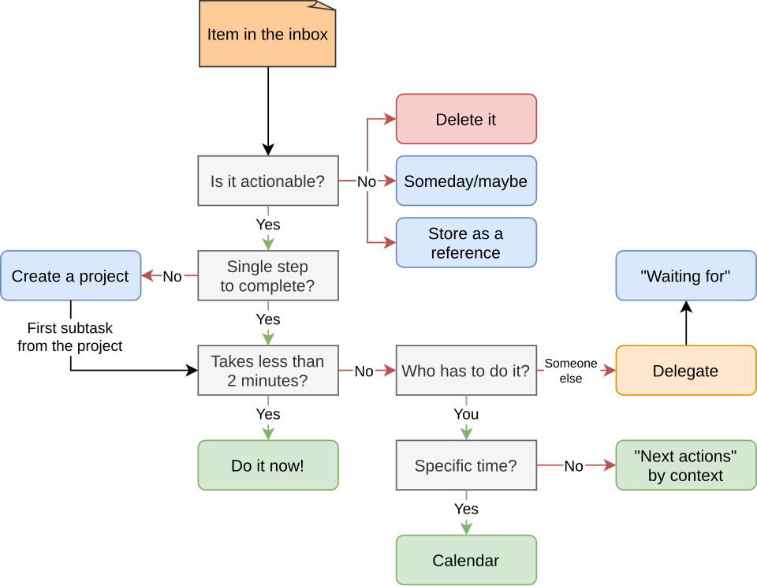
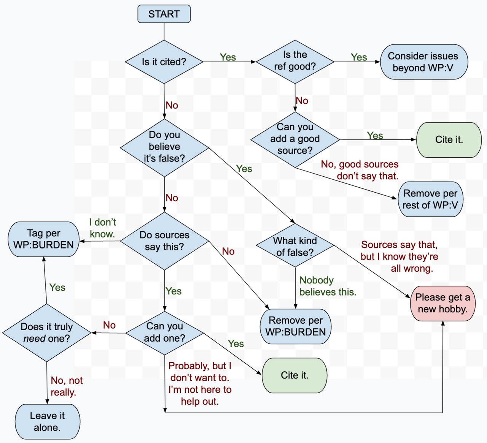
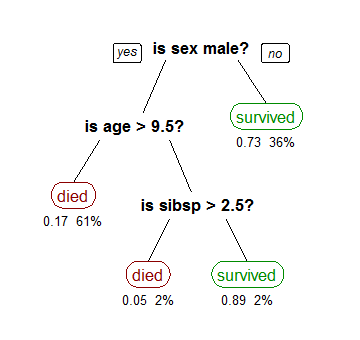
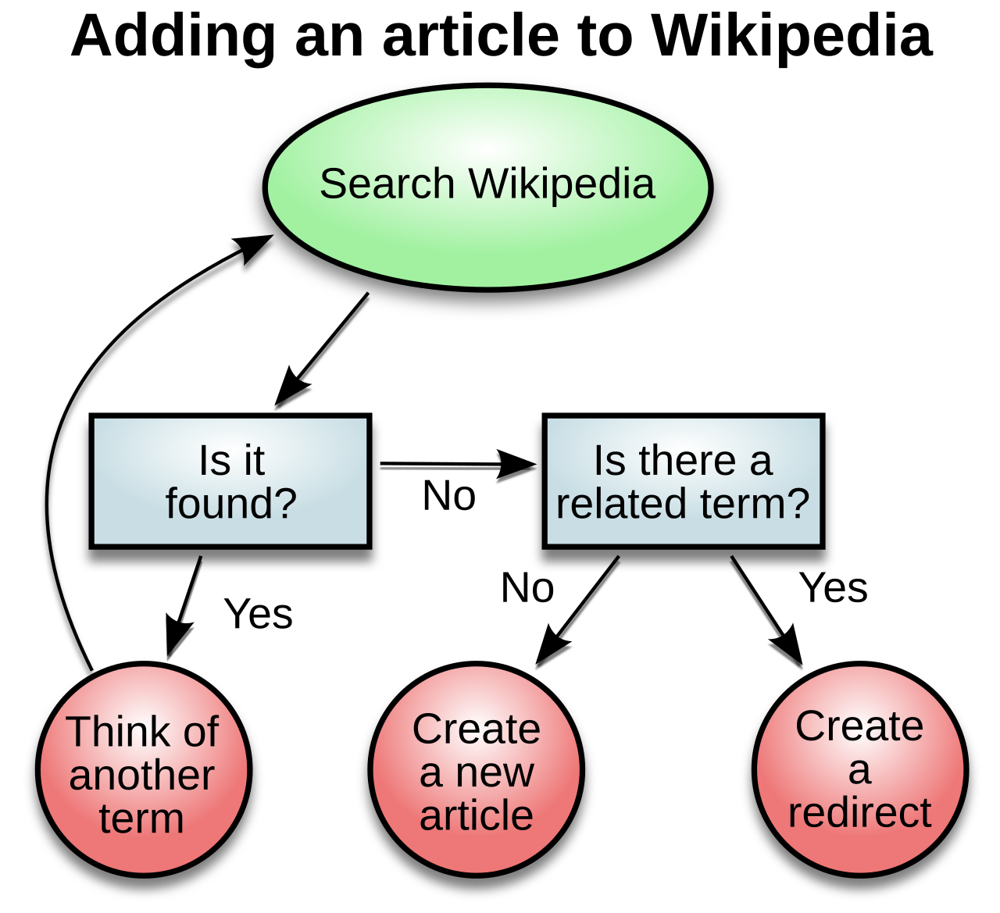
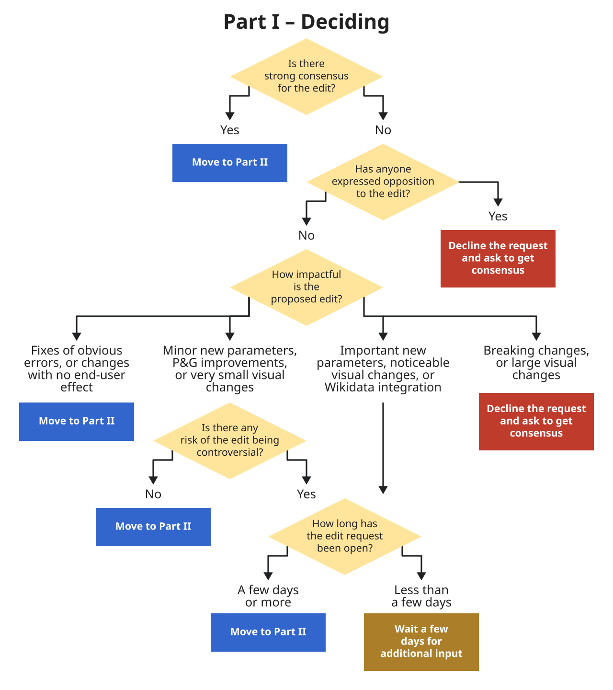
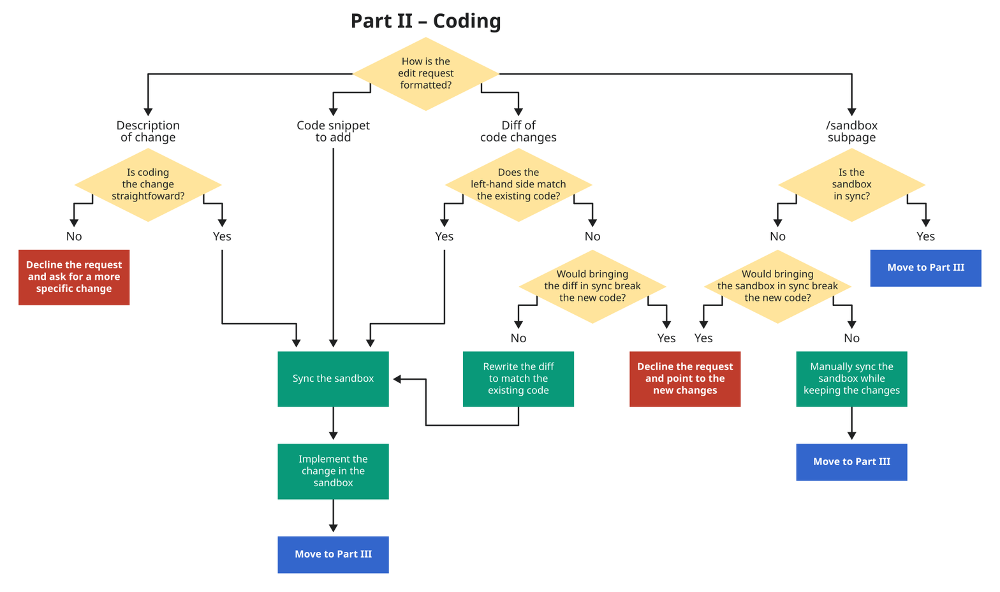
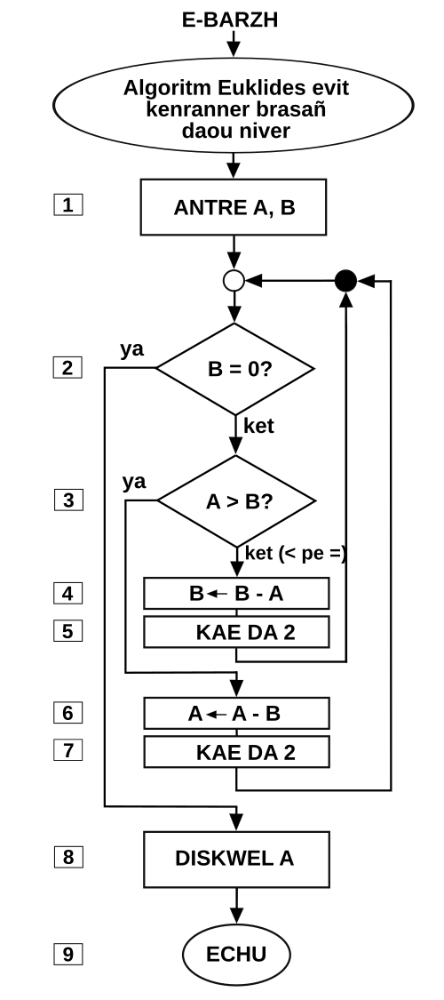
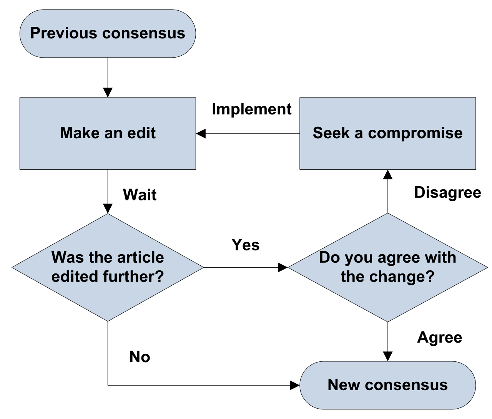
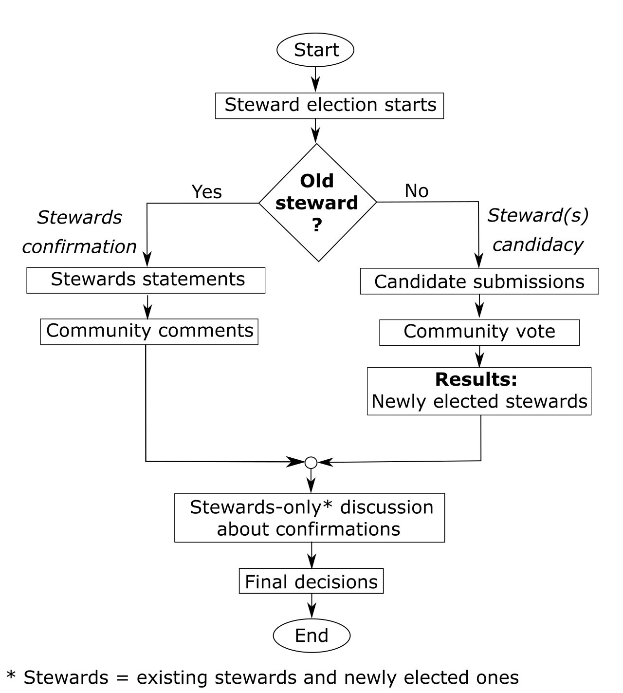
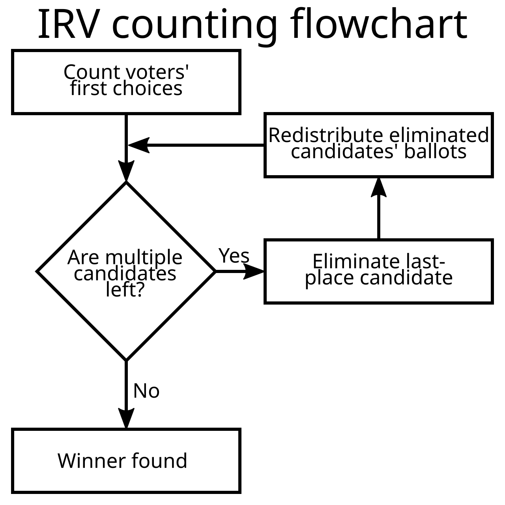

# Flowcharts and decision trees

[All families](README.md) · [Methods](../../documents/METHODOLOGY.md)

## VB0036

An item is in the inbox. It is actionable. It is not a single step, so a project is created. The first subtask of that project would take about 10 minutes, you must do it yourself, and it has to happen at a specific time. Following the flowchart, which box does that first subtask end in?

Rules: Treat the first subtask as re-entering the chart at the box the arrow labelled 'First subtask from the project' points to. Follow Yes/No labels exactly as drawn.

Image 1 credit: [Flexagoon, CC0, via Wikimedia Commons (File:GTD flowchart.svg); credit: Own work](https://commons.wikimedia.org/wiki/File%3AGTD_flowchart.svg), [CC0](https://creativecommons.org/publicdomain/zero/1.0/). See the [asset manifest](../assets.jsonl) for preparation notes.

Options:

- 1: Calendar
- 2: Do it now!
- 3: "Waiting for"
- 4: "Next actions" by context
- 5: Delete it

## VB0037

A sentence in an article has no citation. You do not believe it is false. You find that sources do say it, and you could add a citation but you do not want to help out. Following the flowchart from START, which end box do you reach?

Rules: Follow each answer label on the arrows as drawn. Choose the end box (a rounded box with no outgoing arrow) where the path finishes.

Image 1 credit: [WhatamIdoing, CC BY-SA 4.0, via Wikimedia Commons (File:Possible workflow for reviewers at English Wikipedia.png); credit: Own work](https://commons.wikimedia.org/wiki/File%3APossible_workflow_for_reviewers_at_English_Wikipedia.png), [CC BY-SA 4.0](https://creativecommons.org/licenses/by-sa/4.0/). See the [asset manifest](../assets.jsonl) for preparation notes.

Options:

- 1: Tag per WP:BURDEN
- 2: Remove per WP:BURDEN
- 3: Cite it.
- 4: Leave it alone.
- 5: Please get a new hobby.

## VB0038

A passenger is male, 8 years old and had 3 siblings or spouses aboard. Which leaf of the tree does this passenger reach?

Rules: At every question box the 'yes' branch goes down and to the left and the 'no' branch goes down and to the right, as the two labelled boxes at the top show. 'sibsp' is the number of siblings or spouses aboard. Answer with the leaf label as printed (class, then the two numbers beneath it).

Image 1 credit: [Stephen Milborrow, CC BY-SA 3.0, via Wikimedia Commons (File:CART tree titanic survivors.png); credit: Own work](https://commons.wikimedia.org/wiki/File%3ACART_tree_titanic_survivors.png), [CC BY-SA 3.0](https://creativecommons.org/licenses/by-sa/3.0/). See the [asset manifest](../assets.jsonl) for preparation notes.

Options:

- 1: died (0.05, 2%)
- 2: died (0.17, 61%)
- 3: survived (0.89, 2%)
- 4: survived (0.73, 36%)
- 5: No leaf is reached

## VB0039

You search for a term and an article about it already exists. You think of another term and search again; this time nothing is found and there is no related term. Which box finishes the procedure?

Rules: Follow every Yes/No label as drawn and every arrow, including the long curved arrow back to the top.

Image 1 credit: [derivative work: Pbroks13 (talk)
Wikipedia_article-creation.svg: Linuxerist, Public domain, via Wikimedia Commons (File:Wikipedia article-creation-2.svg); credit: Wikipedia_article-creation.svg](https://commons.wikimedia.org/wiki/File%3AWikipedia_article-creation-2.svg), [Public domain](https://commons.wikimedia.org/wiki/File%3AWikipedia_article-creation-2.svg). See the [asset manifest](../assets.jsonl) for preparation notes.

Options:

- 1: Create a new article
- 2: Search Wikipedia
- 3: Create a redirect
- 4: The procedure never ends
- 5: Think of another term

## VB0040

An edit request has no strong consensus, nobody has opposed it, and it proposes minor new parameters. There is some risk that the edit would be controversial, and the request has been open for one day. Which box ends the path in this chart?

Rules: Follow the labelled branches. 'Less than a few days' applies to a request open for one day.

Image 1 credit: [Chaotic Enby, CC0, via Wikimedia Commons (File:Template edit request flowchart (part 1).svg); credit: Own work](https://commons.wikimedia.org/wiki/File%3ATemplate_edit_request_flowchart_%28part_1%29.svg), [CC0](https://creativecommons.org/publicdomain/zero/1.0/). See the [asset manifest](../assets.jsonl) for preparation notes.

Options:

- 1: Move to Part II
- 2: Wait a few days for additional input
- 3: No outcome is shown for this combination
- 4: Decline the request and ask to get consensus

## VB0041

An edit request is submitted as a diff of code changes. The left-hand side of the diff does not match the existing code, but bringing the diff in sync would not break the new code. How many green action boxes does the request pass through before reaching 'Move to Part III'?

Rules: Count each green box on the path once. Blue boxes and decision diamonds are not counted.

Image 1 credit: [Chaotic Enby, CC0, via Wikimedia Commons (File:Template edit request flowchart (part 2).svg); credit: Own work](https://commons.wikimedia.org/wiki/File%3ATemplate_edit_request_flowchart_%28part_2%29.svg), [CC0](https://creativecommons.org/publicdomain/zero/1.0/). See the [asset manifest](../assets.jsonl) for preparation notes.

Options:

- 1: 1
- 2: 2
- 3: 3
- 4: 4
- 5: 5

## VB0042

Inputs are A = 9 and B = 30. How many times is the box 'B <- B - A' executed before the chart reaches 'DISKWEL A'?

Rules: Translations for convenience: 'ya' = yes; 'ket' = no / otherwise; 'ket (< pe =)' = otherwise (A < B or A = B); 'ANTRE' = input; 'KAE DA 2' = go to step 2; 'DISKWEL' = display. Follow the arrows including the two return arrows that re-enter above step 2. The numbers 1-9 beside the boxes are step labels only.

Image 1 credit: [Huñvreüs, CC BY-SA 4.0, via Wikimedia Commons (File:Euclid algorithm flowchart diagram in Breton.svg); credit: Own work](https://commons.wikimedia.org/wiki/File%3AEuclid_algorithm_flowchart_diagram_in_Breton.svg), [CC BY-SA 4.0](https://creativecommons.org/licenses/by-sa/4.0/). See the [asset manifest](../assets.jsonl) for preparation notes.

Options:

- 1: 2
- 2: 3
- 3: 4
- 4: 5
- 5: 6

## VB0043

Start at 'Previous consensus'. Someone makes an edit, the article is then edited further, you disagree with the change, a compromise is reached and implemented, and the article is then not edited further. In total, how many times is the box 'Make an edit' visited?

Rules: Count each arrival at the box, including the first.

Image 1 credit: [Locke Cole at English Wikipedia, CC BY-SA 3.0, via Wikimedia Commons (File:Consensus Flowchart.svg); credit: Transferred from en.wikipedia to Commons by Jayantanth using CommonsHelper.](https://commons.wikimedia.org/wiki/File%3AConsensus_Flowchart.svg), [CC BY-SA 3.0](https://creativecommons.org/licenses/by-sa/3.0/). See the [asset manifest](../assets.jsonl) for preparation notes.

Options:

- 1: 1
- 2: 2
- 3: 3
- 4: 4
- 5: 5

## VB0044

A person taking part is not an old steward. Counting only rectangular boxes (not the ovals or the small circle), how many boxes are passed from Start to End?

Rules: Count each rectangle on the path once, including 'Steward election starts' and 'Final decisions'.

Image 1 credit: [Created by Michel Bakni, edited and uploaded by علاء, CC BY-SA 3.0, via Wikimedia Commons (File:Flowchart of Stewards election.svg); credit: Own work](https://commons.wikimedia.org/wiki/File%3AFlowchart_of_Stewards_election.svg), [CC BY-SA 3.0](https://creativecommons.org/licenses/by-sa/3.0/). See the [asset manifest](../assets.jsonl) for preparation notes.

Options:

- 1: 4
- 2: 5
- 3: 6
- 4: 7
- 5: 8

## VB0045

After the initial counting box, the totals are A = 60, B = 25 and C = 15. All three candidates remain. According to the drawn procedure, what action happens next?

Rules: Follow the arrows and tests exactly as drawn, rather than using an election rule remembered from elsewhere. No candidate has withdrawn.

Image 1 credit: [Zerodamage, CC BY-SA 3.0, via Wikimedia Commons (File:IRV counting flowchart.svg); credit: File:Alternative IRV counting flowchart.png](https://commons.wikimedia.org/wiki/File%3AIRV_counting_flowchart.svg), [CC BY-SA 3.0](https://creativecommons.org/licenses/by-sa/3.0/). See the [asset manifest](../assets.jsonl) for preparation notes.

Options:

- 1: Declare A the winner immediately
- 2: Redistribute C's ballots before eliminating anyone
- 3: Eliminate B
- 4: Eliminate C
