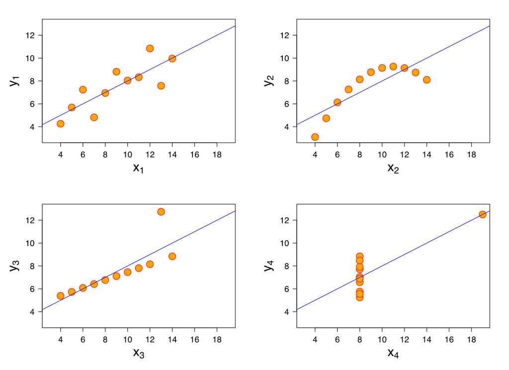
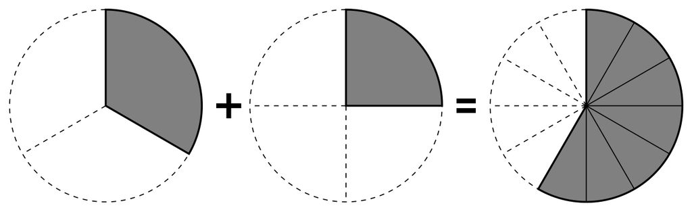
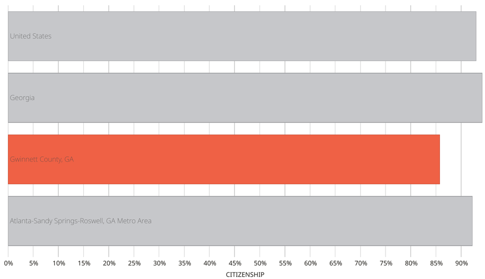
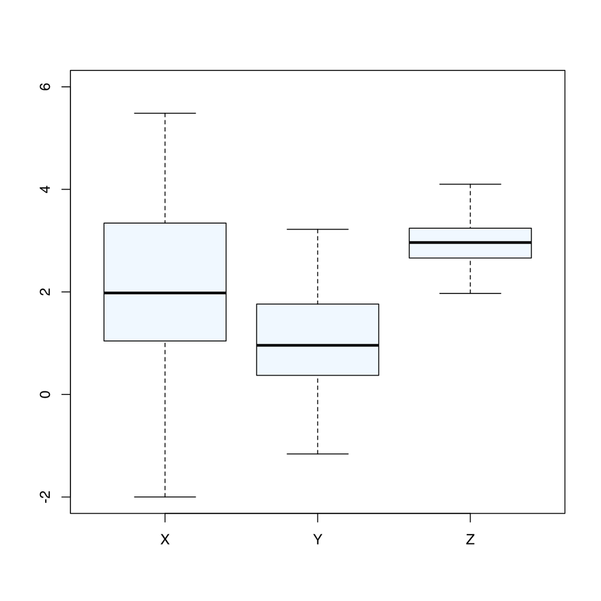
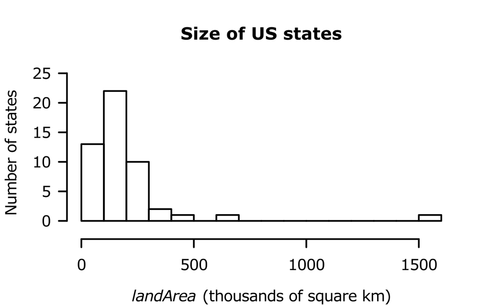
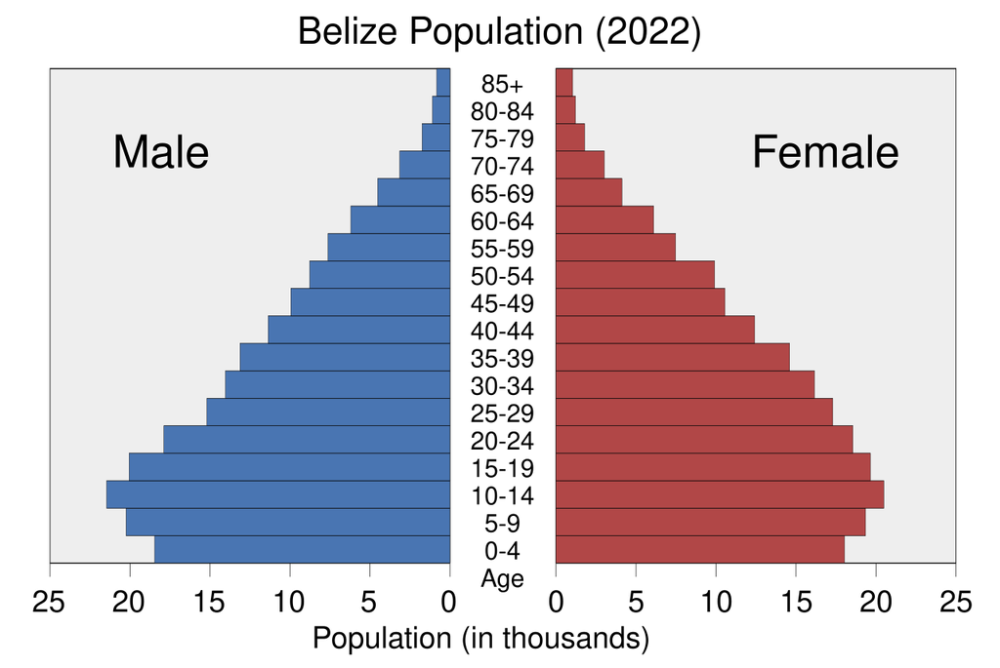

# Charts and quantitative comparisons

[All families](README.md) · [Methods](../../documents/METHODOLOGY.md)

## VB0050

Between 2000 and 2010, which country's share of the population using the Internet increased by the largest number of percentage points?

Rules: Read the value of each country's line at 2000 and at 2010 from the vertical axis and compare the increases. Use only the plotted chart.

Image 1, CCA0010: withheld pending third-party terms review. Tested SHA256: `a22ea71183cadebee83e68fbca6f345b8c2e9535198bdaeed76ba8fa2b7ec010`.

Image 1 credit: [Our World in Data, 'Share of the population using the Internet', data source: World Telecommunication/ICT Indicators Database - International Telecommunication Union (ITU), via World Bank (2026); CC BY](https://ourworldindata.org/grapher/share-of-individuals-using-the-internet?tab=chart&country=USA~CHN~IND~DEU~BRA), [CC BY 4.0 (per OWID FAQ; third-party source terms not independently cleared)](https://creativecommons.org/licenses/by/4.0/). See the [asset manifest](../assets.jsonl) for preparation notes.

Options:

- 1: United States
- 2: Germany
- 3: India
- 4: China
- 5: Brazil

## VB0051

In 2020, about how many times larger was the United States' GDP per capita than India's?

Rules: Read both values at 2020 from the vertical axis, divide, and choose the nearest option.

Image 1, CCA0059: withheld pending third-party terms review. Tested SHA256: `29e35248e89176fbe01ecfe8a94d517cdb4340a0c95768a620b8267c2546a883`.

Image 1 credit: [Our World in Data, 'GDP per capita', data source: Eurostat, OECD, IMF, and World Bank (2026); CC BY](https://ourworldindata.org/grapher/gdp-per-capita-worldbank?tab=chart&country=USA~CHN~IND~DEU~BRA), [CC BY 4.0 (per OWID FAQ; third-party source terms not independently cleared)](https://creativecommons.org/licenses/by/4.0/). See the [asset manifest](../assets.jsonl) for preparation notes.

Options:

- 1: About 12 times
- 2: About 3 times
- 3: About 15 times
- 4: About 9 times
- 5: About 6 times

## VB0052

In 2010, how many of the other four countries used less than one third as much primary energy per person as the United States?

Rules: Read all five lines at 2010 (a labelled tick) and compare each other country with one third of the United States value.

Image 1, CCA0062: withheld pending third-party terms review. Tested SHA256: `d3d6b6e05aebd49bc8b420e878e0d8437a9da92df186ec355f9e968ba4d66925`.

Image 1 credit: [Our World in Data, 'Primary energy use per person', data source: Energy Institute – Statistical Review of World Energy (2026) and other sources; CC BY](https://ourworldindata.org/grapher/energy-mix?metric=per_capita&source=total&tab=chart&country=USA~CHN~IND~DEU~BRA), [CC BY 4.0 (per OWID FAQ; third-party source terms not independently cleared)](https://creativecommons.org/licenses/by/4.0/). See the [asset manifest](../assets.jsonl) for preparation notes.

Options:

- 1: 0
- 2: 1
- 3: 2
- 4: 3
- 5: 4

## VB0053

In which period did China's annual CO2 emissions first rise above those of the United States?

Rules: Find where the China line first crosses above the United States line. The horizontal axis starts in 1792; use the labelled years to estimate the crossing.

Image 1, CCA0065: withheld pending third-party terms review. Tested SHA256: `e9da119c45650a1aec35833086543ed46ae7558f3c1c42f4c2175c36dc047b84`.

Image 1 credit: [Our World in Data, 'Annual CO₂ emissions', data source: Global Carbon Budget (2025); CC BY](https://ourworldindata.org/grapher/annual-co2-emissions-per-country?tab=chart&country=USA~CHN~IND~DEU~BRA), [CC BY 4.0 (per OWID FAQ; third-party source terms not independently cleared)](https://creativecommons.org/licenses/by/4.0/). See the [asset manifest](../assets.jsonl) for preparation notes.

Options:

- 1: 2000 to 2009
- 2: Before 1990
- 3: 2020 or later
- 4: 2010 to 2019
- 5: 1990 to 1999

## VB0182

In which panel do most points follow a broad curved rise-and-fall pattern that the blue straight line misses, rather than the main mismatch being one isolated outlier?

Rules: Judge the arrangement of most orange points. A single high or far-right point is not a broad curved pattern. Use panel positions, not an assumption that equal-looking blue lines imply equal data shapes.

Image 1 credit: [Anscombe.svg: Schutz
(label using subscripts): Avenue; File:Anscombe's quartet 3.svg; CC BY-SA 3.0; via Wikimedia Commons](https://commons.wikimedia.org/wiki/File:Anscombe%27s_quartet_3.svg), [CC BY-SA 3.0](https://creativecommons.org/licenses/by-sa/3.0/). See the [asset manifest](../assets.jsonl) for preparation notes.

Options:

- 1: Lower-right
- 2: Upper-left
- 3: Lower-left
- 4: Upper-right

## VB0183

Compared with the unshaded share of the middle pie, how does the unshaded share of the result pie on the right differ?

Rules: All circles represent the same whole. White is unshaded and grey is shaded. Use the radial partitions to read fractions; do not compare the total size of the circles on the page.

Image 1 credit: [Averater; File:Pie chart example 06.svg; CC BY-SA 3.0; via Wikimedia Commons](https://commons.wikimedia.org/wiki/File:Pie_chart_example_06.svg), [CC BY-SA 3.0](https://creativecommons.org/licenses/by-sa/3.0/). See the [asset manifest](../assets.jsonl) for preparation notes.

Options:

- 1: It is larger by one third of a whole
- 2: The unshaded shares are equal
- 3: It is smaller by one third of a whole
- 4: It is smaller by one quarter of a whole

## VB0184

Using the chart, how does the share of noncitizens in Gwinnett County compare with the share in Georgia?

Rules: The bars show citizenship, not noncitizenship. Treat the noncitizen share as100% minus the displayed citizenship share. Compare percentage points and choose the nearest offered magnitude. This concerns the pictured2015 chart, not current populations.

Image 1 credit: [Datawheel; File:Bar Chart of Citizenship in Gwinnett County, GA (2015).svg; CC0; via Wikimedia Commons](https://commons.wikimedia.org/wiki/File:Bar_Chart_of_Citizenship_in_Gwinnett_County,_GA_(2015).svg), [CC0](https://creativecommons.org/publicdomain/zero/1.0/). See the [asset manifest](../assets.jsonl) for preparation notes.

Options:

- 1: Georgia is higher by about8 percentage points
- 2: Gwinnett is higher by about8 percentage points
- 3: Gwinnett is higher by about2 percentage points
- 4: Georgia is higher by about2 percentage points

## VB0185

Which comparison correctly combines a higher median with a smaller interquartile range?

Rules: The thick line inside each box is its median. The box height, not the full whisker span, is the interquartile range. Read both properties before choosing.

Image 1 credit: [Jojotipe; File:Boxplot XYZ.svg; CC BY-SA 4.0; via Wikimedia Commons](https://commons.wikimedia.org/wiki/File:Boxplot_XYZ.svg), [CC BY-SA 4.0](https://creativecommons.org/licenses/by-sa/4.0/). See the [asset manifest](../assets.jsonl) for preparation notes.

Options:

- 1: Y has a higher median and a smaller interquartile range than Z
- 2: Z has a higher median and a smaller interquartile range than X
- 3: X has a higher median and a smaller interquartile range than Y
- 4: The median and interquartile-range comparison is not established by this chart

## VB0193

Approximately what fraction of the states are represented by the first three histogram bins combined?

Rules: The vertical axis counts states, not land area. Add the counts in the first three adjacent bins, then compare with the total count across every nonempty bin. Choose the nearest offered percentage.

Image 1 credit: [HYanWong; File:R-US state areas-histogram.svg; Public domain; via Wikimedia Commons](https://commons.wikimedia.org/wiki/File:R-US_state_areas-histogram.svg), [Public domain](https://commons.wikimedia.org/wiki/File:R-US_state_areas-histogram.svg). See the [asset manifest](../assets.jsonl) for preparation notes.

Options:

- 1: 90%
- 2: 10%
- 3: 45%
- 4: 60%

## VB0194

Combining males and females, the population aged10 to14 is approximately how many times the population aged65 to69?

Rules: Use the pictured2022 population, not current estimates. Add the male and female bar magnitudes for each age band; the left side shows positive population magnitudes despite extending leftward. Choose the nearest offered ratio.

Image 1 credit: [Nosferattus; File:Belize Population Pyramid for 2022.svg; CC0; via Wikimedia Commons](https://commons.wikimedia.org/wiki/File:Belize_Population_Pyramid_for_2022.svg), [CC0](https://creativecommons.org/publicdomain/zero/1.0/). See the [asset manifest](../assets.jsonl) for preparation notes.

Options:

- 1: About3 times
- 2: About2 times
- 3: About5 times
- 4: About10 times
