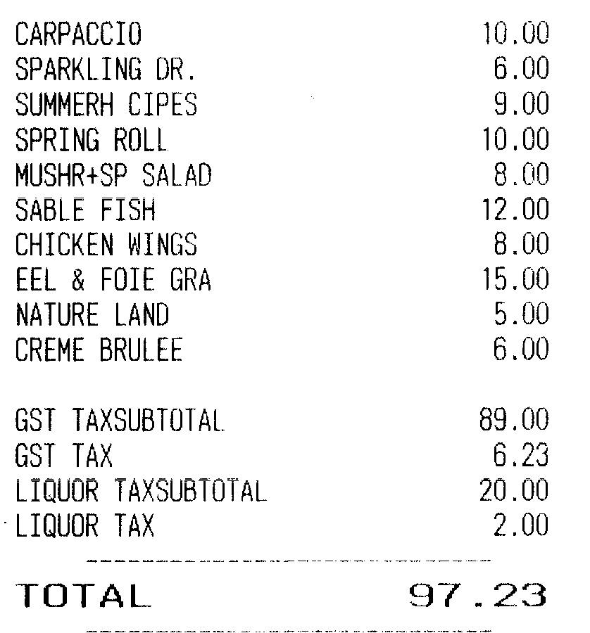
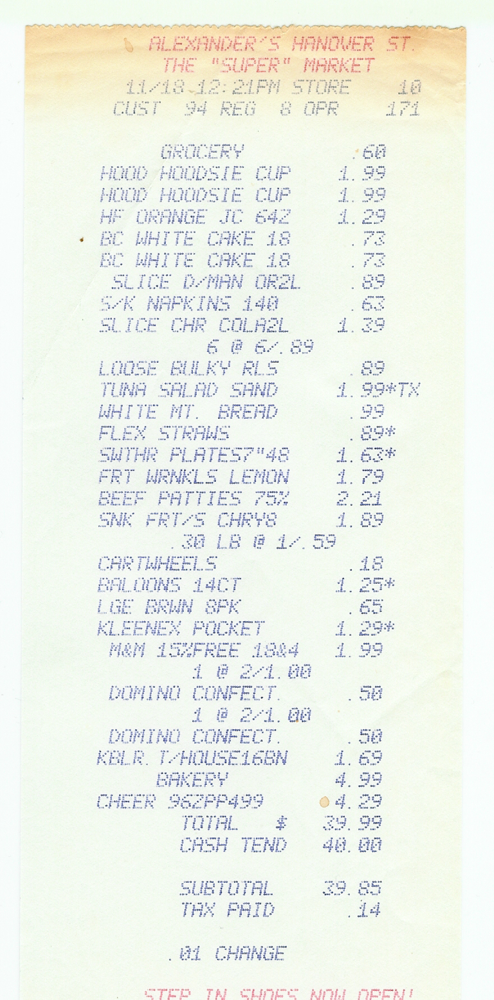
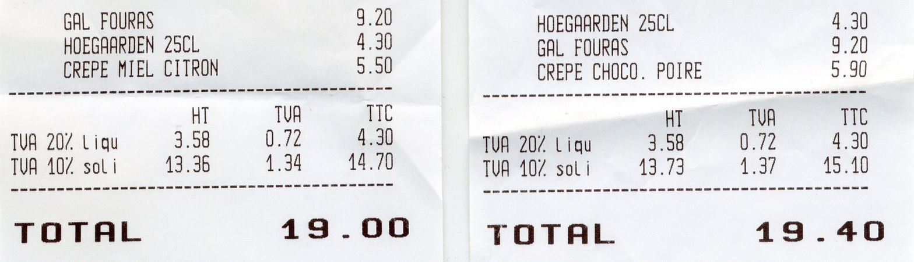
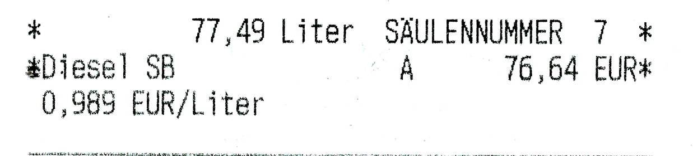
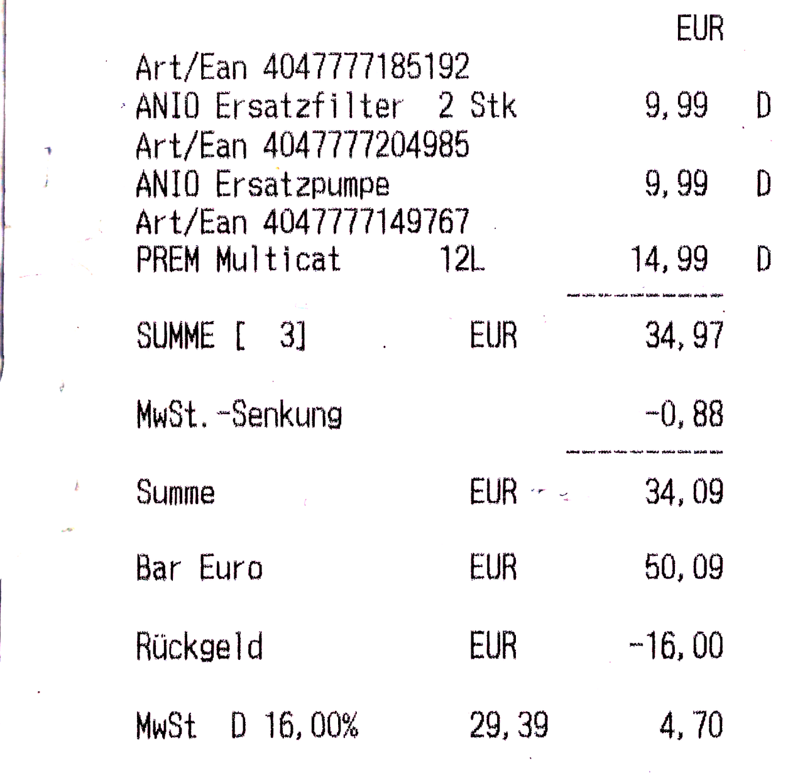
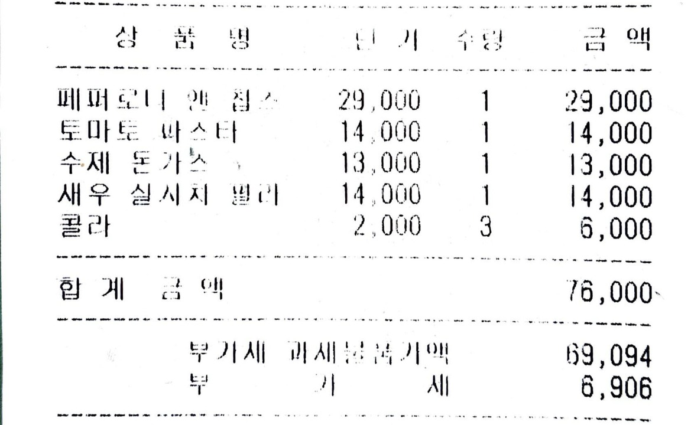
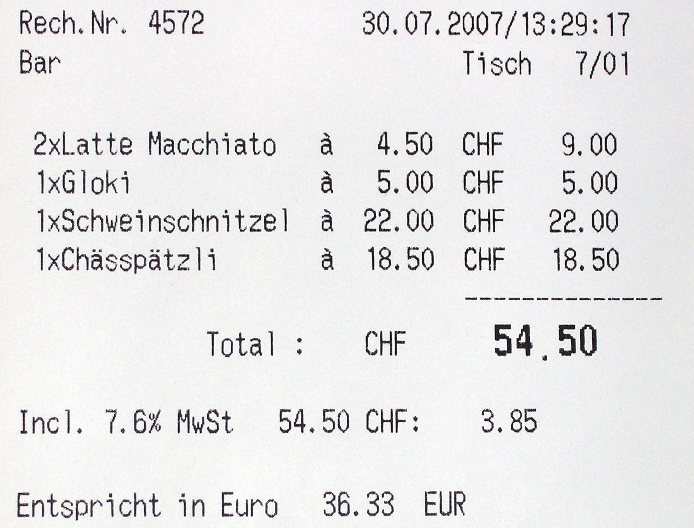
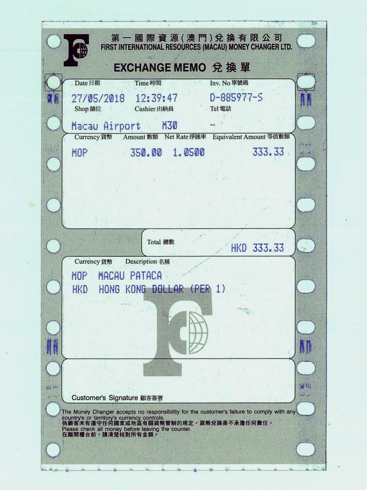
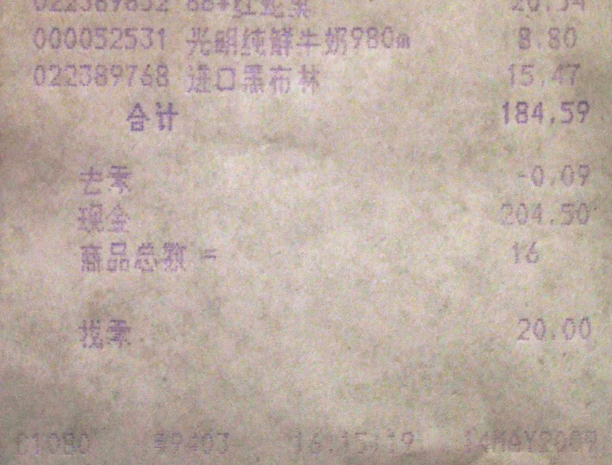
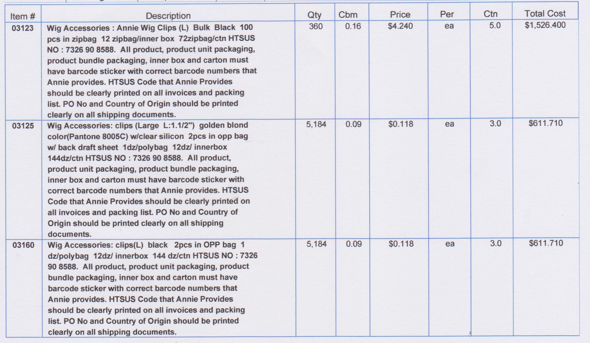

# Document reconciliation

[All families](README.md) · [Methods](../../documents/METHODOLOGY.md)

## VB0054

Which formula reproduces the printed TOTAL without double-counting any tax base?

Rules: Use all ten item-price lines from CARPACCIO through CREME BRULEE. GST TAXSUBTOTAL and LIQUOR TAXSUBTOTAL are separate printed lines from GST TAX and LIQUOR TAX.

Image 1 credit: [Roland Tanglao from Vancouver, Canada, CC BY 2.0, via Wikimedia Commons (File:A fine bill for a fine meal!.jpg); credit: Umami Bill from July 11 2005](https://commons.wikimedia.org/wiki/File%3AA_fine_bill_for_a_fine_meal%21.jpg), [CC BY 2.0](https://creativecommons.org/licenses/by/2.0/). See the [asset manifest](../assets.jsonl) for preparation notes.

Options:

- 1: Item prices + GST TAX + LIQUOR TAX
- 2: Item prices + LIQUOR TAX only
- 3: Item prices + GST TAX only
- 4: Item prices + all four tax-related lines

## VB0055

On this supermarket receipt, treat the lines marked with an asterisk (* or *TX after the price) as the taxable items and TAX PAID as the tax charged on them. What tax rate was applied?

Rules: Use the printed prices of the starred lines only. Round to the nearest whole percent.

Image 1 credit: [Struthious Bandersnatch, CC0, via Wikimedia Commons (File:Alexander's Supermarket receipt, late twentieth century.tif); credit: Own work](https://commons.wikimedia.org/wiki/File%3AAlexander%27s_Supermarket_receipt%2C_late_twentieth_century.tif), [CC0](https://creativecommons.org/publicdomain/zero/1.0/). See the [asset manifest](../assets.jsonl) for preparation notes.

Options:

- 1: 1%
- 2: 2%
- 3: 3%
- 4: 5%
- 5: 7%

## VB0056

Which item-line difference accounts for the difference between the two printed TOTAL amounts?

Rules: Compare the two tickets as shown. HT is before VAT, TVA is VAT and TTC includes VAT.

Image 1 credit: [Crêperie Tante Lucie, Public domain, via Wikimedia Commons (File:Tickets de caisse de la crêperie Tante Lucie.jpg); credit: Crêperie Tante Lucie](https://commons.wikimedia.org/wiki/File%3ATickets_de_caisse_de_la_cr%C3%AAperie_Tante_Lucie.jpg), [Public domain](https://commons.wikimedia.org/wiki/File%3ATickets_de_caisse_de_la_cr%C3%AAperie_Tante_Lucie.jpg). See the [asset manifest](../assets.jsonl) for preparation notes.

Options:

- 1: The galette costs more on the right
- 2: Hoegaarden costs more on the right
- 3: The dessert crepe costs more on the right
- 4: The right ticket adds a separate cover charge

## VB0057

For the printed number of litres, suppose the unit price had been 0.990 EUR per litre instead of the printed unit price. How much higher would the rounded total be than the printed total?

Rules: Decimal commas are used. Calculate the new total and round it to the nearest cent before comparing.

Image 1 credit: [HIT-Tankstelle, Public domain, via Wikimedia Commons (File:Tankquittung HIT-Tankstelle Rheinbach mit Abschnitt Technische Sicherheitseinrichtung, 2020.jpg); credit: Scan by Raimond Spekking](https://commons.wikimedia.org/wiki/File%3ATankquittung_HIT-Tankstelle_Rheinbach_mit_Abschnitt_Technische_Sicherheitseinrichtung%2C_2020.jpg), [Public domain](https://commons.wikimedia.org/wiki/File%3ATankquittung_HIT-Tankstelle_Rheinbach_mit_Abschnitt_Technische_Sicherheitseinrichtung%2C_2020.jpg). See the [asset manifest](../assets.jsonl) for preparation notes.

Options:

- 1: 0.01 EUR
- 2: 0.08 EUR
- 3: 0.77 EUR
- 4: 7.75 EUR

## VB0058

If the customer handed over 40.00 EUR instead of the printed cash amount, how much change should they receive after the printed deduction?

Rules: Decimal commas are used. Summe is total, MwSt.-Senkung is a deduction, Bar Euro is cash and Rueckgeld is change. Keep the purchases and deduction unchanged.

Image 1 credit: [Fressnapf, Public domain, via Wikimedia Commons (File:Kassenzettel Fressnapf mit ausgewiesener MwSt-Senkung und TSE Transaktionsnummer 12 2020.png); credit: Scan by Raimond Spekking](https://commons.wikimedia.org/wiki/File%3AKassenzettel_Fressnapf_mit_ausgewiesener_MwSt-Senkung_und_TSE_Transaktionsnummer_12_2020.png), [Public domain](https://commons.wikimedia.org/wiki/File%3AKassenzettel_Fressnapf_mit_ausgewiesener_MwSt-Senkung_und_TSE_Transaktionsnummer_12_2020.png). See the [asset manifest](../assets.jsonl) for preparation notes.

Options:

- 1: 5.03 EUR
- 2: 5.91 EUR
- 3: 6.79 EUR
- 4: 16.00 EUR

## VB0059

If one of the cola drinks were removed while every other purchased unit stayed the same, what would the revised total be?

Rules: Columns are product, unit price, quantity and line amount. The cola row is labelled 콜라. Prices are VAT-inclusive; subtract one printed unit price with no other repricing or adjustment.

Image 1 credit: [이태리집(태백시 소재), Public domain, via Wikimedia Commons (File:Receipt taebaek restaurant IMG 2614 modified.jpg); credit: 이태리집(태백시 소재)](https://commons.wikimedia.org/wiki/File%3AReceipt_taebaek_restaurant_IMG_2614_modified.jpg), [Public domain](https://commons.wikimedia.org/wiki/File%3AReceipt_taebaek_restaurant_IMG_2614_modified.jpg). See the [asset manifest](../assets.jsonl) for preparation notes.

Options:

- 1: 78,000 won
- 2: 70,000 won
- 3: 72,000 won
- 4: 74,000 won

## VB0060

If the amount before VAT increased by 10.00 CHF, keeping the VAT rate printed on this receipt, what would the new VAT amount be?

Rules: The printed total includes VAT. Compute the current tax-exclusive base from that total, add 10.00 CHF, then apply the printed rate and round VAT to the nearest cent.

Image 1 credit: [Audrius Meskauskas (Audriusa), CC BY-SA 3.0, via Wikimedia Commons (File:ReceiptSwiss.jpg); credit: Own work](https://commons.wikimedia.org/wiki/File%3AReceiptSwiss.jpg), [CC BY-SA 3.0](https://creativecommons.org/licenses/by-sa/3.0/). See the [asset manifest](../assets.jsonl) for preparation notes.

Options:

- 1: 3.85 CHF
- 2: 4.61 CHF
- 3: 4.85 CHF
- 4: 5.45 CHF

## VB0061

If the same exchange direction and net rate shown on this memo were applied to MOP 525.00, how many HKD would be received?

Rules: Use the printed net rate with no extra fee. Round the result to two decimal places.

Image 1 credit: [Solomon203, CC BY-SA 4.0, via Wikimedia Commons (File:FIRMMC exchange memo at Macau Airport 20180527.jpg); credit: Own work](https://commons.wikimedia.org/wiki/File%3AFIRMMC_exchange_memo_at_Macau_Airport_20180527.jpg), [CC BY-SA 4.0](https://creativecommons.org/licenses/by-sa/4.0/). See the [asset manifest](../assets.jsonl) for preparation notes.

Options:

- 1: HKD 523.95
- 2: HKD 498.75
- 3: HKD 500.00
- 4: HKD 551.25

## VB0062

What change would be due if the customer handed over 200.00 yuan instead of the printed cash amount, keeping the purchases and rounding adjustment unchanged?

Rules: 合计 = total; 去零 = rounding-off deduction; 现金 = cash; 找零 = change. Subtract the printed deduction from the printed total before calculating change.

Image 1 credit: [User:Smyth, Public domain, via Wikimedia Commons (File:Chinese Swedish rounding.jpg); credit: Own work](https://commons.wikimedia.org/wiki/File%3AChinese_Swedish_rounding.jpg), [Public domain](https://commons.wikimedia.org/wiki/File%3AChinese_Swedish_rounding.jpg). See the [asset manifest](../assets.jsonl) for preparation notes.

Options:

- 1: 20.00 yuan
- 2: 15.41 yuan
- 3: 15.59 yuan
- 4: 15.50 yuan

## VB0063

What is the sum of the three Total Cost amounts in this purchase-order table?

Rules: Use the printed Total Cost column. Rounding to the nearest cent.

Image 1 credit: [Kxtar, CC BY-SA 4.0, via Wikimedia Commons (File:Invoice1633.jpg); credit: Own work](https://commons.wikimedia.org/wiki/File%3AInvoice1633.jpg), [CC BY-SA 4.0](https://creativecommons.org/licenses/by-sa/4.0/). See the [asset manifest](../assets.jsonl) for preparation notes.

Options:

- 1: $2,750.12
- 2: $2,839.82
- 3: $2,749.92
- 4: $2,149.82
- 5: $2,749.82
