# Matching across images

[All families](README.md) · [Methods](../../documents/METHODOLOGY.md)

## VB0089

Image 1 shows a frontal view of an ancient painted amphora, and Image 2 shows the same amphora viewed from an angle centered on one of its two vertical handles. By matching the painted neck scene, vertical geometric border strips, and lower body figures visible next to the handle in Image 2 against Image 1, which side of Image 1 corresponds to the handle centered in Image 2?

Rules: Match specific visible painted features—such as the direction the neck figure faces, the vertical inscription beside its back, and the vertical border strips—between the two views.

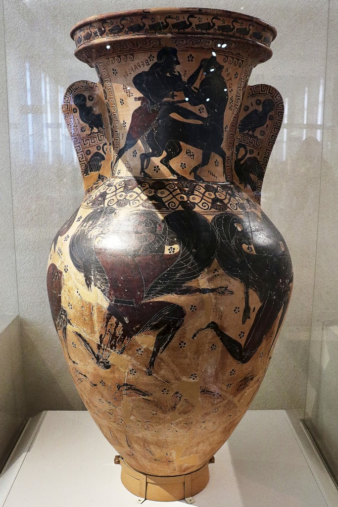

Image 1 credit: [George E. Koronaios / Wikimedia Commons / CC BY-SA 4.0](https://commons.wikimedia.org/wiki/File:Attic_black-figure_funerary_amphora_(side_A),_7th_cent._B.C._at_the_National_Archaeological_Museum_of_Athens_(6-4-2018).jpg), [CC BY-SA 4.0](https://creativecommons.org/licenses/by-sa/4.0/). See the [asset manifest](../assets.jsonl) for preparation notes.

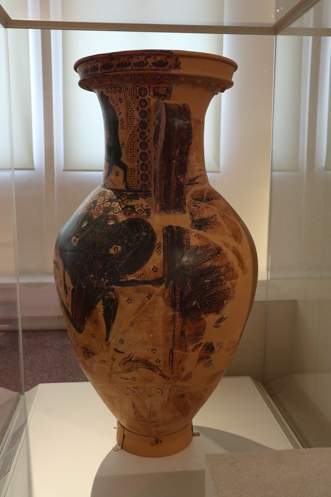

Image 2 credit: [George E. Koronaios / Wikimedia Commons / CC BY-SA 4.0](https://commons.wikimedia.org/wiki/File:Attic_black-figure_funerary_amphora_(side_A-B)._7th_cent._B.C.jpg), [CC BY-SA 4.0](https://creativecommons.org/licenses/by-sa/4.0/). See the [asset manifest](../assets.jsonl) for preparation notes.

Options:

- 1: Neither handle; Image 2 shows a completely unpainted vessel with no matching figures
- 2: The right-hand handle of Image 1, with the painted scene from Image 1 appearing to the left of the handle in Image 2
- 3: The left-hand handle of Image 1, with the painted scene from Image 1 appearing to the left of the handle in Image 2
- 4: The left-hand handle of Image 1, with the painted scene from Image 1 appearing to the right of the handle in Image 2

## VB0116

Which region in the right drawing corresponds to the broad layered hat crown at the top of the left drawing?

Rules: Match the concentric curved bands and the irregular straw fringe. Do not match by the color of the long hanging ribbons alone.

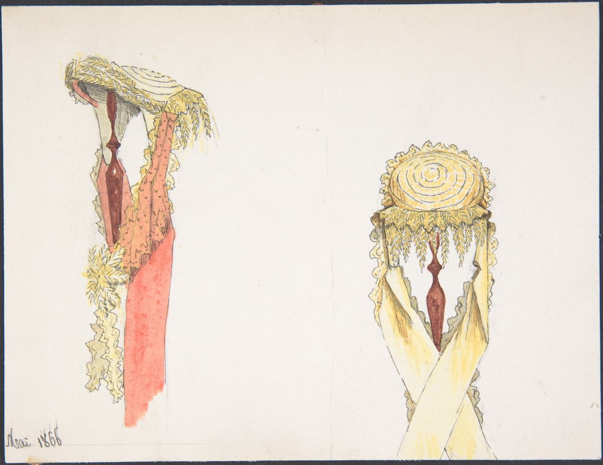

Image 1 credit: [Auguste Félix; File:Two Views (Side and Front) of a Hat on a Stand (IA mma two views side and front of a hat on a stand 387445).jpg; Public domain; via Wikimedia Commons](https://commons.wikimedia.org/wiki/File:Two_Views_(Side_and_Front)_of_a_Hat_on_a_Stand_(IA_mma_two_views_side_and_front_of_a_hat_on_a_stand_387445).jpg), [Public domain](https://commons.wikimedia.org/wiki/File:Two_Views_(Side_and_Front)_of_a_Hat_on_a_Stand_(IA_mma_two_views_side_and_front_of_a_hat_on_a_stand_387445).jpg). See the [asset manifest](../assets.jsonl) for preparation notes.

Options:

- 1: The oval spiral-banded form above the fringe
- 2: The crossed pale ribbons at the bottom
- 3: The small side bow beside the post
- 4: The narrow brown turned post in the center

## VB0124

Which side wall of the building-like case in Image1 is revealed in Image2, in addition to its front?

Rules: Define the front by the large central lower door and curved balcony in Image1. Left and right refer to that front-on view. Match those features before deciding.

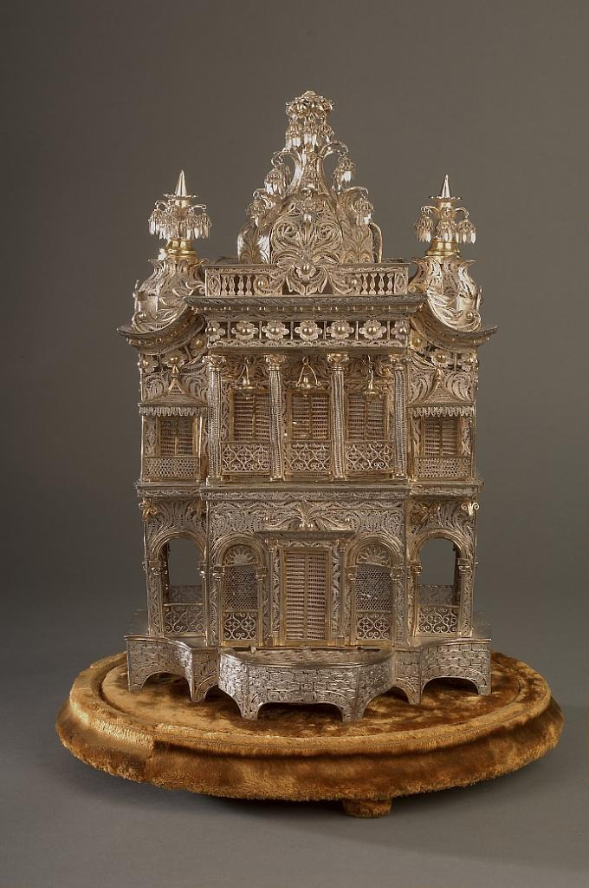

Image 1 credit: [National Museum of American History; perfume case](https://n2t.net/ark:/65665/ng49ca746a3-3615-704b-e053-15f76fa0b4fa), [CC0](https://creativecommons.org/publicdomain/zero/1.0/). See the [asset manifest](../assets.jsonl) for preparation notes.

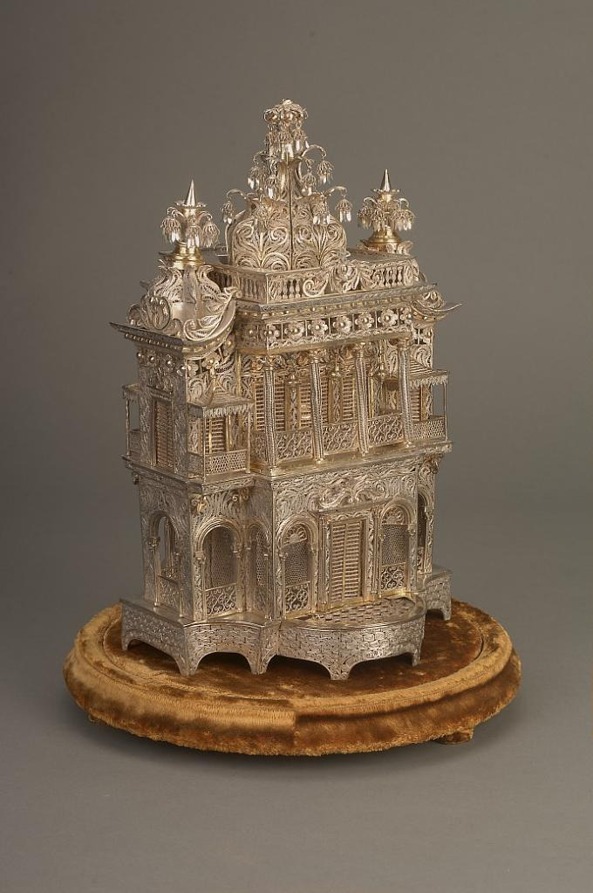

Image 2 credit: [National Museum of American History; perfume case](https://n2t.net/ark:/65665/ng49ca746a3-3615-704b-e053-15f76fa0b4fa), [CC0](https://creativecommons.org/publicdomain/zero/1.0/). See the [asset manifest](../assets.jsonl) for preparation notes.

Options:

- 1: The back wall
- 2: The right side wall
- 3: Only the front is shown; no side wall is revealed
- 4: The left side wall

## VB0125

Which button in the horizontal row of six in Image2 matches the detailed button in Image1?

Rules: Count positions from image-left. Match the arrangement of carved fruit, flower and leaves, not just the ivory color or the rim.

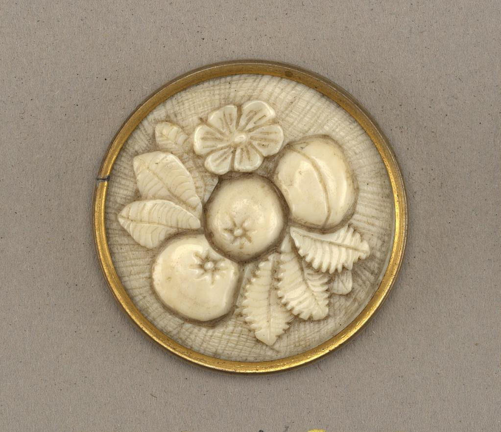

Image 1 credit: [Cooper Hewitt, Smithsonian Design Museum; Button](https://collection.cooperhewitt.org/view/objects/asitem/id/281862), [CC0](https://creativecommons.org/publicdomain/zero/1.0/). See the [asset manifest](../assets.jsonl) for preparation notes.

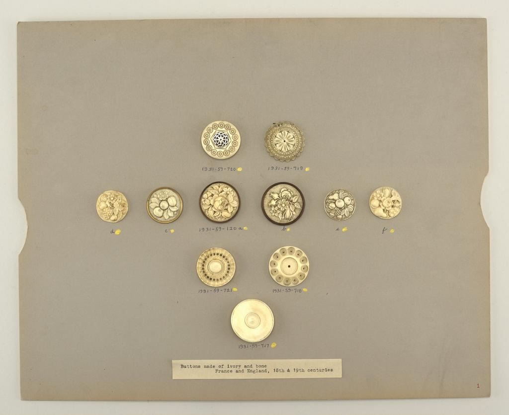

Image 2 credit: [Cooper Hewitt, Smithsonian Design Museum; Button](https://collection.cooperhewitt.org/view/objects/asitem/id/281862), [CC0](https://creativecommons.org/publicdomain/zero/1.0/). See the [asset manifest](../assets.jsonl) for preparation notes.

Options:

- 1: First
- 2: Fifth
- 3: Second
- 4: Fourth

## VB0126

Which of the four figures in Image2 belongs to the object shown alone in Image1?

Rules: Order the figures by their head positions from image-left to image-right. Match the raised arm, cup position and surrounding scrollwork; do not rely on ceramic color alone.

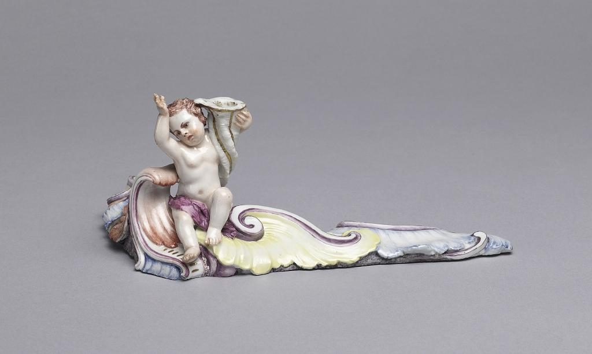

Image 1 credit: [Cooper Hewitt, Smithsonian Design Museum; Taperstick (One of Four)](https://collection.cooperhewitt.org/view/objects/asitem/id/296124), [CC0](https://creativecommons.org/publicdomain/zero/1.0/). See the [asset manifest](../assets.jsonl) for preparation notes.

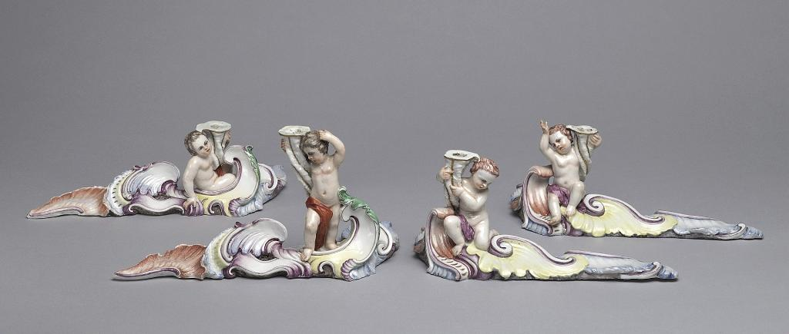

Image 2 credit: [Cooper Hewitt, Smithsonian Design Museum; Taperstick (One of Four)](https://collection.cooperhewitt.org/view/objects/asitem/id/296124), [CC0](https://creativecommons.org/publicdomain/zero/1.0/). See the [asset manifest](../assets.jsonl) for preparation notes.

Options:

- 1: Fourth
- 2: Third
- 3: Second
- 4: First

## VB0130

Which part in Image2 corresponds to the small curl projecting to the left of the coil at mid-height in Image1?

Rules: Match the physical attachment to the coil and distinguish the short curl from the long outer arm and the feet. Camera direction changes between photographs.

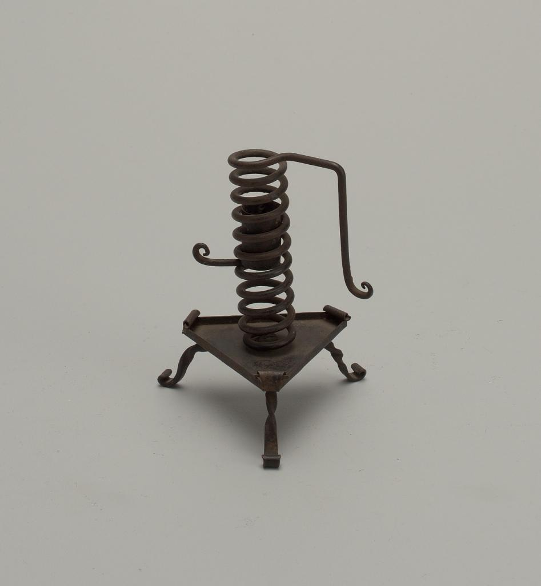

Image 1 credit: [Cooper Hewitt, Smithsonian Design Museum; Candle holder](https://collection.cooperhewitt.org/view/objects/asitem/id/155464), [CC0](https://creativecommons.org/publicdomain/zero/1.0/). See the [asset manifest](../assets.jsonl) for preparation notes.

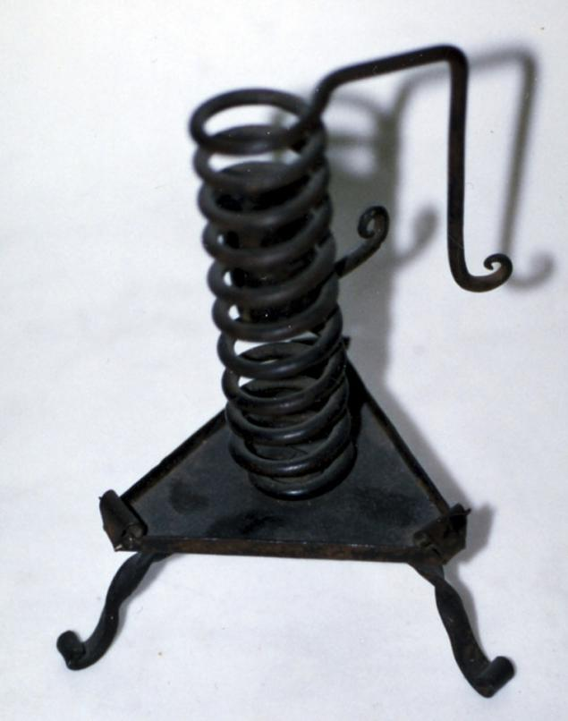

Image 2 credit: [Cooper Hewitt, Smithsonian Design Museum; Candle holder](https://collection.cooperhewitt.org/view/objects/asitem/id/155464), [CC0](https://creativecommons.org/publicdomain/zero/1.0/). See the [asset manifest](../assets.jsonl) for preparation notes.

Options:

- 1: The curled foot at bottom-left
- 2: The curl at the lower end of the long outer arm
- 3: The short curl beside the upper-middle coil, projecting right
- 4: The curled foot at bottom-right

## VB0131

In Image2, which image direction leads from the two threaded posts toward the dial face shown front-on in Image1?

Rules: Match the circular dial rim to the rim in the side view. Use image directions, not a compass heading. No judgment about instrument operation is required.

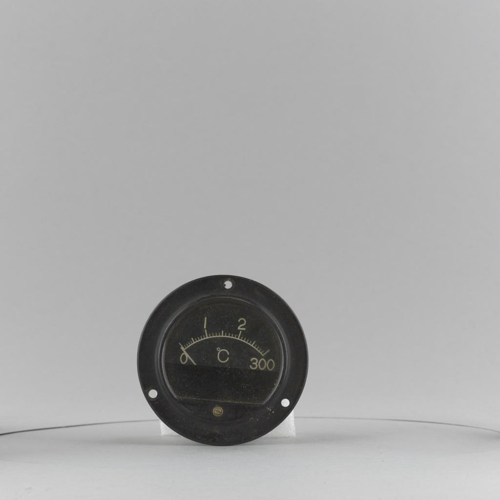

Image 1 credit: [National Air and Space Museum; Indicator, Cylinder Head Temperature, Japanese](http://n2t.net/ark:/65665/nv9a6534859-c902-4662-a72b-a47bf4417e31), [CC0](https://creativecommons.org/publicdomain/zero/1.0/). See the [asset manifest](../assets.jsonl) for preparation notes.

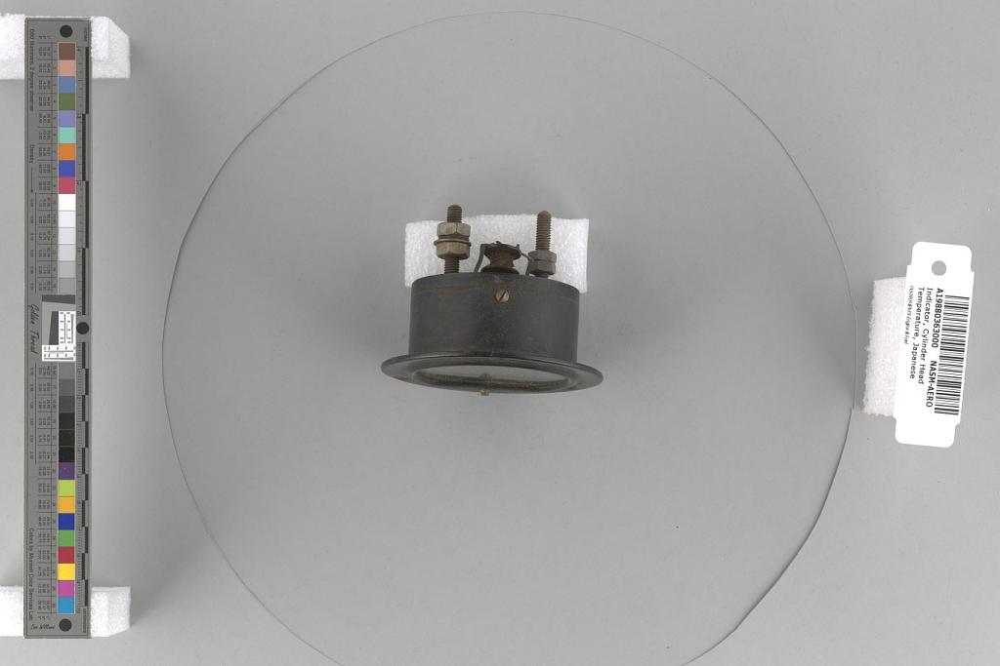

Image 2 credit: [National Air and Space Museum; Indicator, Cylinder Head Temperature, Japanese](http://n2t.net/ark:/65665/nv9a6534859-c902-4662-a72b-a47bf4417e31), [CC0](https://creativecommons.org/publicdomain/zero/1.0/). See the [asset manifest](../assets.jsonl) for preparation notes.

Options:

- 1: Right
- 2: Left
- 3: Up
- 4: Down

## VB0132

Which figure in Image2 matches the figure in Image1 in both clothing and pose?

Rules: Match visible garment shapes, leg positions and arm positions. Similar colors alone do not establish a match; a no-match answer is allowed.

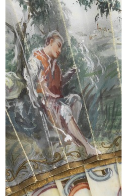

Image 1 credit: [Cooper Hewitt, Smithsonian Design Museum; Pleated fan](https://collection.cooperhewitt.org/view/objects/asitem/id/107997), [CC0](https://creativecommons.org/publicdomain/zero/1.0/). See the [asset manifest](../assets.jsonl) for preparation notes.

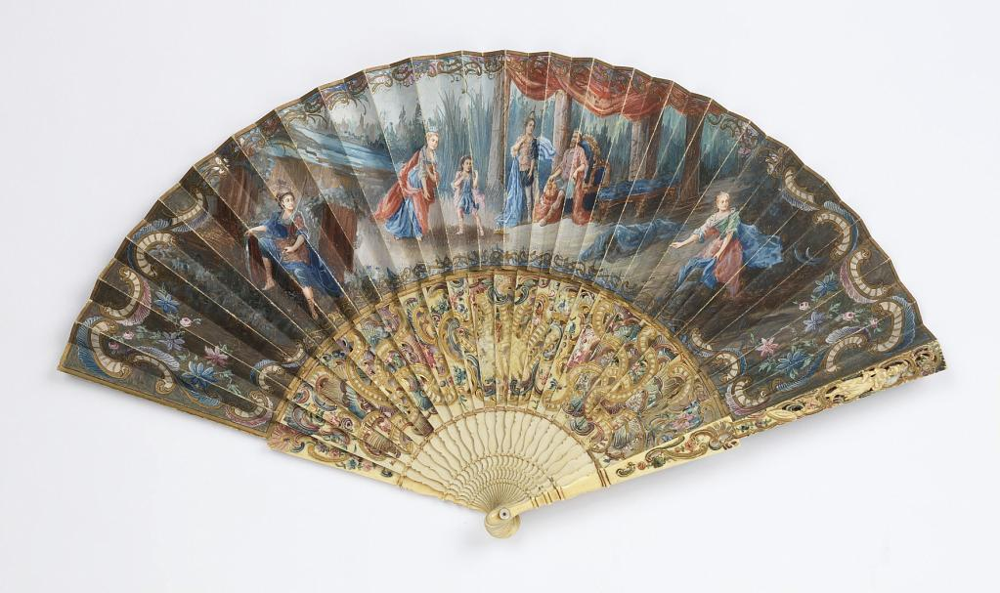

Image 2 credit: [Cooper Hewitt, Smithsonian Design Museum; Pleated fan](https://collection.cooperhewitt.org/view/objects/asitem/id/107997), [CC0](https://creativecommons.org/publicdomain/zero/1.0/). See the [asset manifest](../assets.jsonl) for preparation notes.

Options:

- 1: The standing red-and-blue figure left of center
- 2: None of those figures matches both clothing and pose
- 3: The seated figure at the far right
- 4: The seated figure at the far left

## VB0133

Which description correctly matches features between these two spoon photographs?

Rules: Compare shapes and decoration separately from apparent brightness. A dark reflection is not by itself evidence that a feature disappeared.

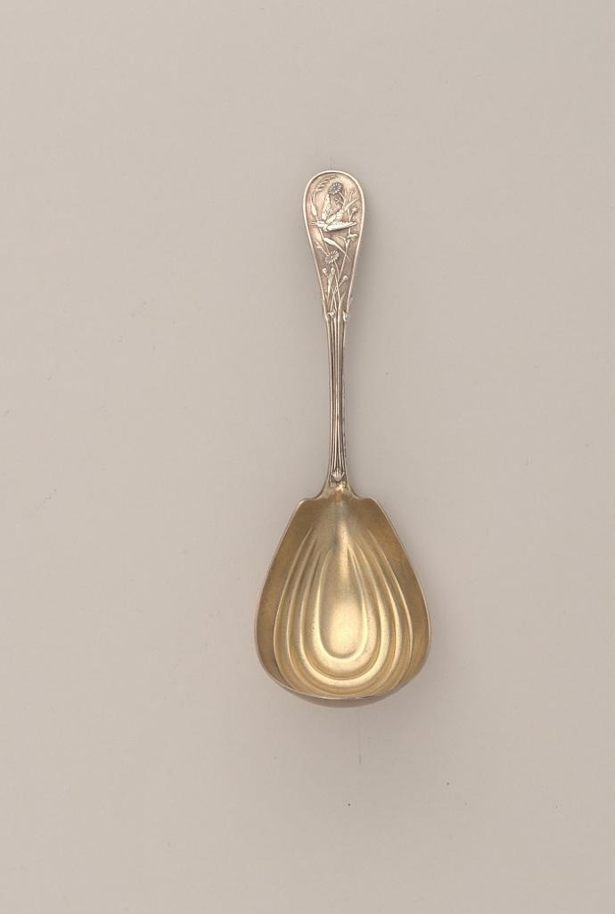

Image 1 credit: [Cooper Hewitt, Smithsonian Design Museum; Tea Caddy Spoon](https://collection.cooperhewitt.org/view/objects/asitem/id/42206), [CC0](https://creativecommons.org/publicdomain/zero/1.0/). See the [asset manifest](../assets.jsonl) for preparation notes.

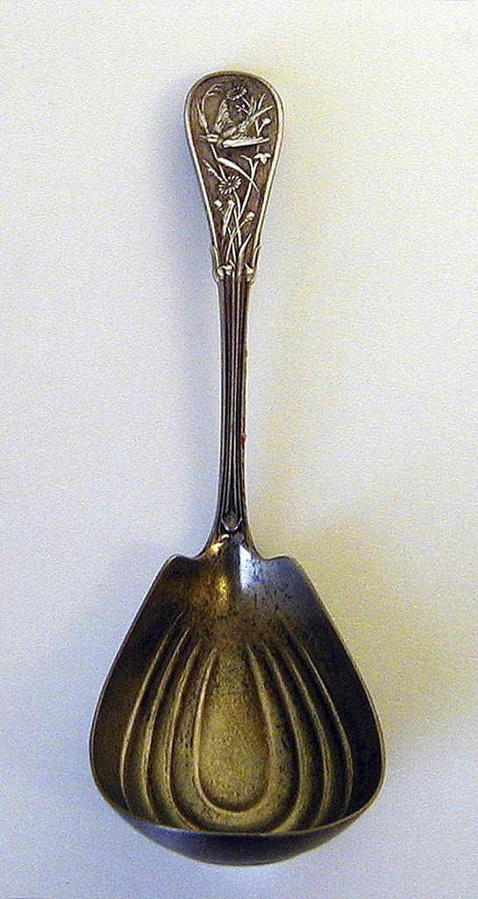

Image 2 credit: [Cooper Hewitt, Smithsonian Design Museum; Tea Caddy Spoon](https://collection.cooperhewitt.org/view/objects/asitem/id/42206), [CC0](https://creativecommons.org/publicdomain/zero/1.0/). See the [asset manifest](../assets.jsonl) for preparation notes.

Options:

- 1: The bird-and-reeds decoration is on the handle in both; the nested teardrop ridges are on the bowl in both
- 2: The bird decoration moves from the handle to the bowl
- 3: The bowl ridges are present only in Image1 and the bird only in Image2
- 4: The handle is undecorated in Image1 but decorated in Image2

## VB0172

The thin branch ending near the left interior rim in Image2 corresponds to which branch end in Image1?

Rules: Use the blue bow and the large flower clusters to align the decorative pattern across the different camera views. Divide Image1 around the center of the dish; do not assume image-left stays object-left.

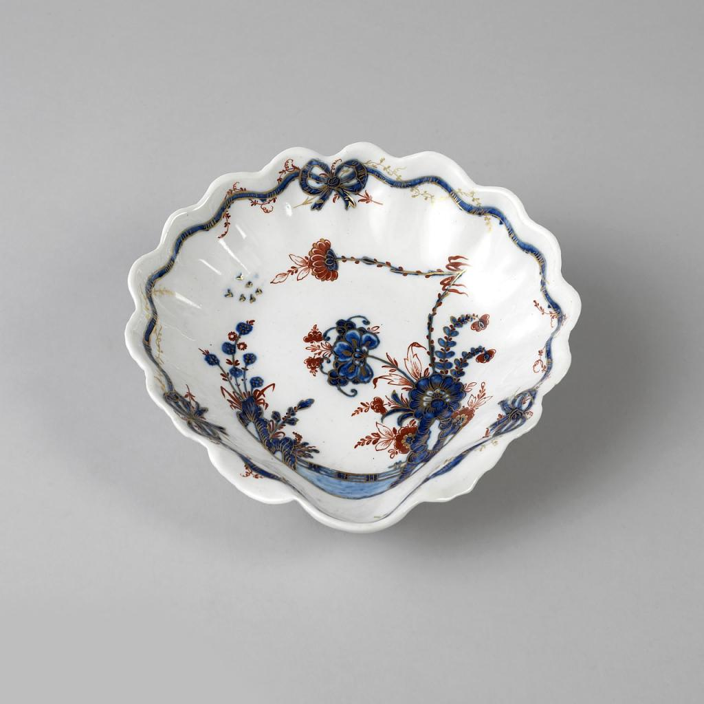

Image 1 credit: [Cooper Hewitt, Smithsonian Design Museum; Dish (One of Six)](https://collection.cooperhewitt.org/view/objects/asitem/id/281642), [CC0](https://creativecommons.org/publicdomain/zero/1.0/). See the [asset manifest](../assets.jsonl) for preparation notes.

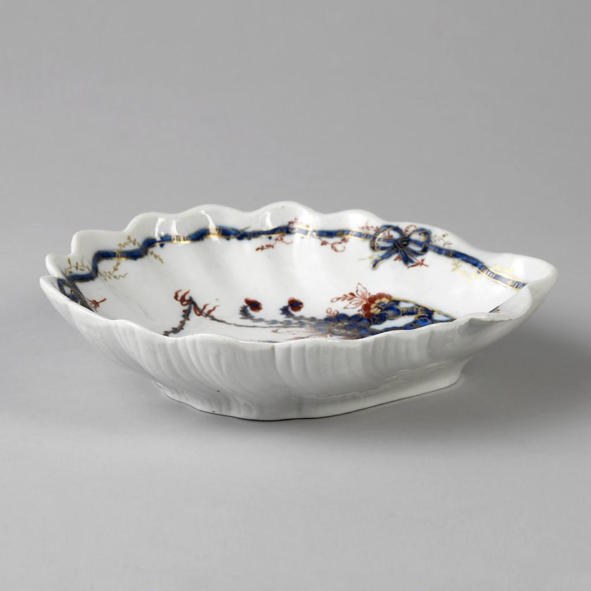

Image 2 credit: [Cooper Hewitt, Smithsonian Design Museum; Dish (One of Six)](https://collection.cooperhewitt.org/view/objects/asitem/id/281642), [CC0](https://creativecommons.org/publicdomain/zero/1.0/). See the [asset manifest](../assets.jsonl) for preparation notes.

Options:

- 1: The lower-left flower cluster
- 2: The upper-right forked red branch end
- 3: The lower-right blue border segment
- 4: The upper-left branch end
