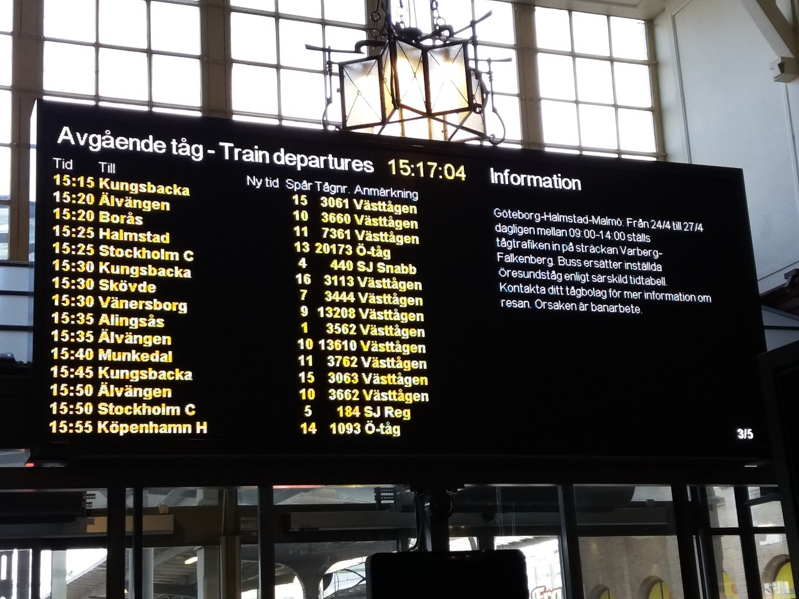
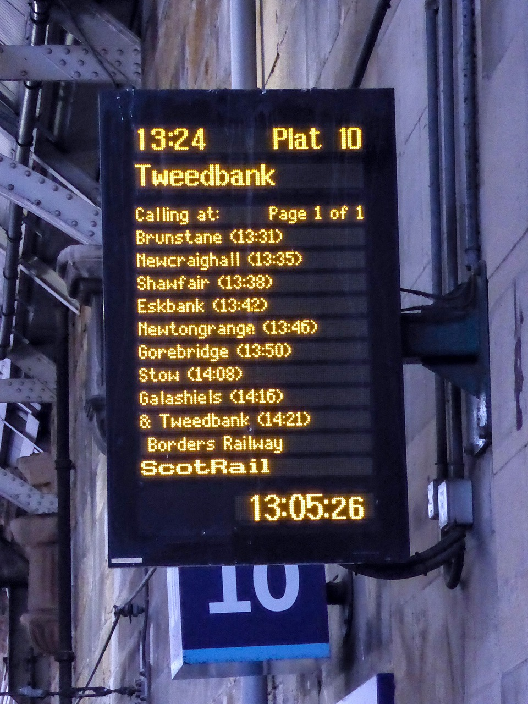
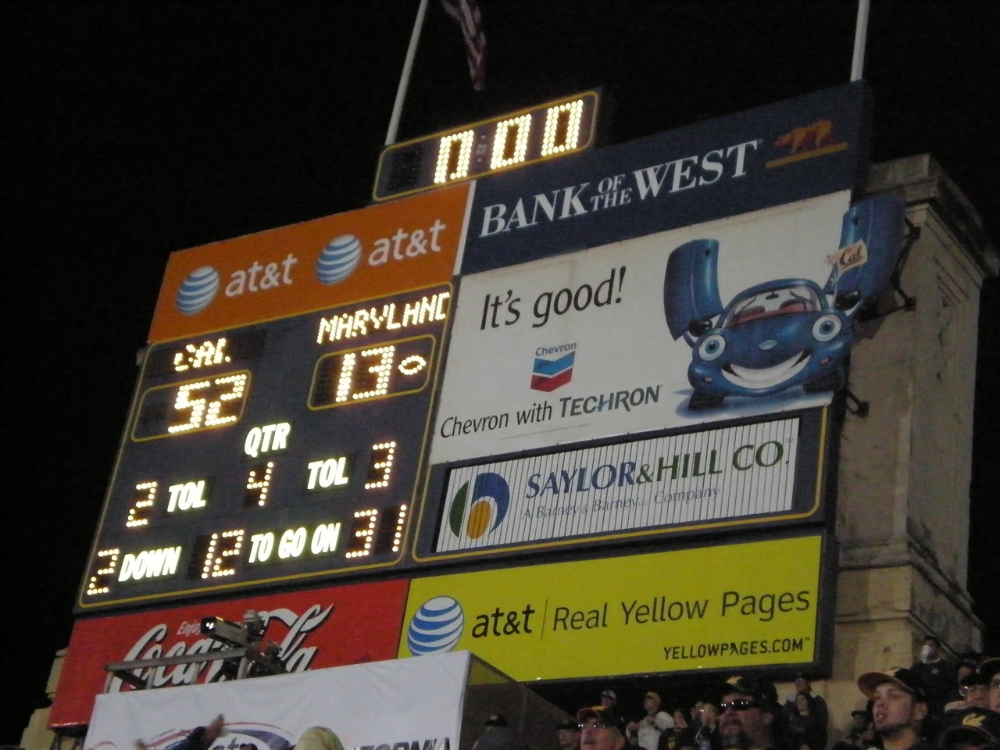
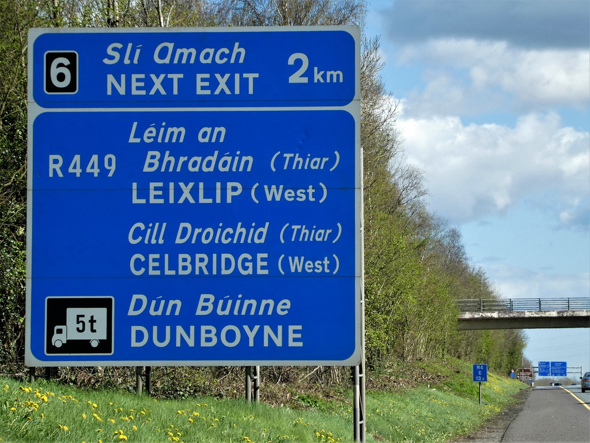
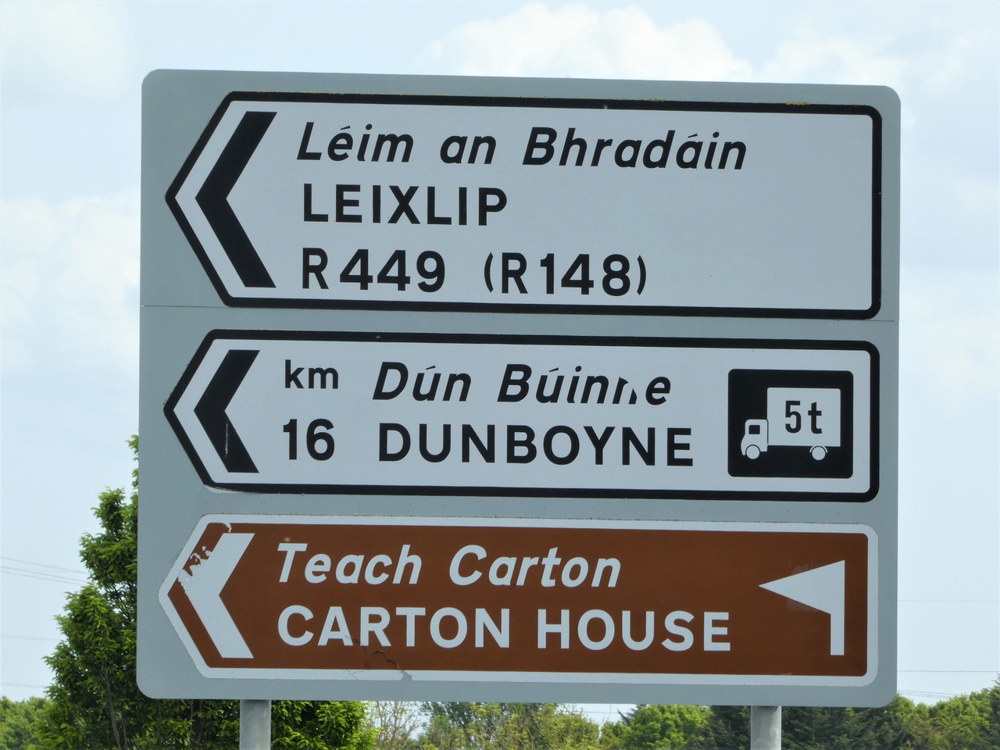
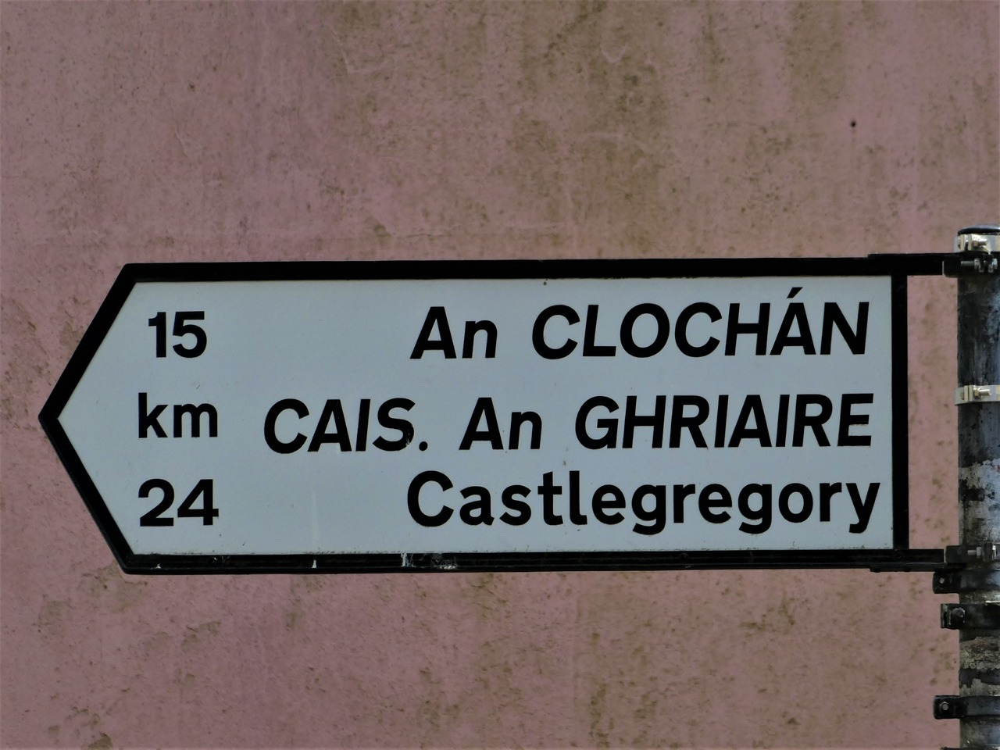
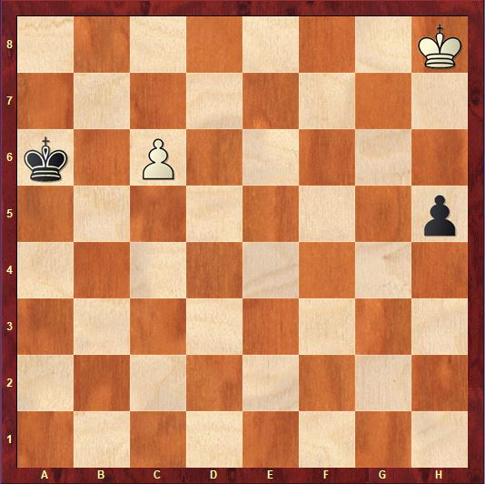
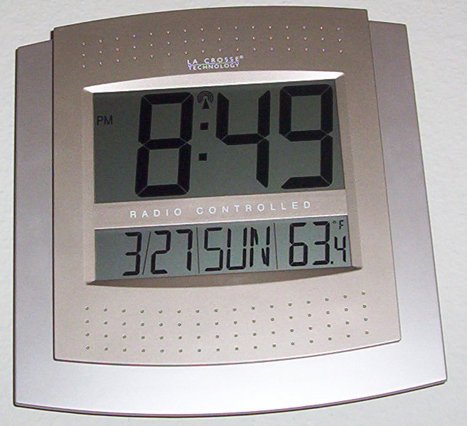

# Image and text consistency

[All families](README.md) · [Methods](../../documents/METHODOLOGY.md)

## VB0070

Which one of the following statements about this departures board is true?

Rules: The column headed 'Spår' gives the platform number. The board lists fifteen departures. Exactly one statement is true.

Image 1 credit: [Yann Forget, CC BY-SA 4.0, via Wikimedia Commons (File:Train departure board in Göteborg railway station, Sweden .jpg); credit: Own work](https://commons.wikimedia.org/wiki/File%3ATrain_departure_board_in_G%C3%B6teborg_railway_station%2C_Sweden_.jpg), [CC BY-SA 4.0](https://creativecommons.org/licenses/by-sa/4.0/). See the [asset manifest](../assets.jsonl) for preparation notes.

Options:

- 1: The first departure listed leaves from platform 1.
- 2: Exactly three of the fifteen departures use a platform number above 12.
- 3: The departures to Borås and to Munkedal use different platforms.
- 4: All three departures to Älvängen use platform 10.
- 5: The two departures to Stockholm C use the same platform.

## VB0071

Which one of the following statements about this train information display is true?

Rules: The times in brackets are the scheduled times at each calling point. The large 13:24 is the departure time shown at the top. Exactly one statement is true.

Image 1 credit: [John Lucas, CC BY-SA 2.0, via Wikimedia Commons (File:A Borders Railway departure board - geograph.org.uk - 7744028.jpg); credit: Geograph Britain and Ireland](https://commons.wikimedia.org/wiki/File%3AA_Borders_Railway_departure_board_-_geograph.org.uk_-_7744028.jpg), [CC BY-SA 2.0](https://creativecommons.org/licenses/by-sa/2.0/). See the [asset manifest](../assets.jsonl) for preparation notes.

Options:

- 1: The longest time gap between consecutive listed calling points is between Gorebridge and Stow.
- 2: The train leaves from platform 13.
- 3: The train takes 8 minutes to go from Newtongrange to Gorebridge.
- 4: Shawfair is the first calling point after Brunstane.
- 5: The train reaches Tweedbank before it reaches Galashiels.

## VB0072

Which one of these statements is consistent with the scoreboard?

Rules: Exactly one statement is consistent with the picture. 'TOL' means timeouts left and 'QTR' the quarter. The team name above each score is the team that owns that score.

Image 1 credit: [BrokenSphere, CC BY-SA 3.0, via Wikimedia Commons (File:Final score of Maryland at Cal 2009-09-05.JPG); credit: Own work](https://commons.wikimedia.org/wiki/File%3AFinal_score_of_Maryland_at_Cal_2009-09-05.JPG), [CC BY-SA 3.0](https://creativecommons.org/licenses/by-sa/3.0/). See the [asset manifest](../assets.jsonl) for preparation notes.

Options:

- 1: The two scores add up to 75
- 2: The scoreboard shows MARYLAND ahead by 39 points
- 3: CAL has more timeouts left than MARYLAND
- 4: The scoreboard shows CAL ahead by exactly 39 points
- 5: The game is in the second quarter

## VB0073

Which one of these statements is consistent with the road sign?

Rules: Exactly one statement is consistent with the picture.

Image 1 credit: [Leimanbhradain, CC BY-SA 4.0, via Wikimedia Commons (File:Sign-1030661, M4, Co. Kildare, Ireland.jpg); credit: Own work](https://commons.wikimedia.org/wiki/File%3ASign-1030661%2C_M4%2C_Co._Kildare%2C_Ireland.jpg), [CC BY-SA 4.0](https://creativecommons.org/licenses/by-sa/4.0/). See the [asset manifest](../assets.jsonl) for preparation notes.

Options:

- 1: The 5t lorry symbol is next to Leixlip
- 2: The next exit is number 2, in 6 km
- 3: Dunboyne is marked '(West)'
- 4: Celbridge is signed for the next exit but Leixlip is not
- 5: The next exit, number 6, is 2 km ahead

## VB0074

Which one of these statements is consistent with the road sign?

Rules: Exactly one statement is consistent with the picture.

Image 1 credit: [Leimanbhradain, CC BY-SA 4.0, via Wikimedia Commons (File:Sign-1040504, Celbridge, Co. Kildare, Ireland.jpg); credit: Own work](https://commons.wikimedia.org/wiki/File%3ASign-1040504%2C_Celbridge%2C_Co._Kildare%2C_Ireland.jpg), [CC BY-SA 4.0](https://creativecommons.org/licenses/by-sa/4.0/). See the [asset manifest](../assets.jsonl) for preparation notes.

Options:

- 1: Carton House is signed on a green background
- 2: Dunboyne is signed at 16 km and the lorry symbol shows 5t
- 3: Dunboyne is signed at 16 km and the lorry symbol shows 7.5t
- 4: Leixlip is on the R149
- 5: Dunboyne is signed at 18 km

## VB0075

Which statement is consistent with the road sign?

Rules: The printed number beside each place is its signed distance in kilometres. Compare those displayed distances without assuming the destinations lie on one unbranched route.

Image 1 credit: [Mucklagh, CC BY-SA 4.0, via Wikimedia Commons (File:Sign-1050251, Dingle, Co. Kerry, Ireland.jpg); credit: Own work](https://commons.wikimedia.org/wiki/File%3ASign-1050251%2C_Dingle%2C_Co._Kerry%2C_Ireland.jpg), [CC BY-SA 4.0](https://creativecommons.org/licenses/by-sa/4.0/). See the [asset manifest](../assets.jsonl) for preparation notes.

Options:

- 1: An Clochan is signed at 24 km
- 2: The arrow points to the right
- 3: Castlegregory is signed at 15 km
- 4: The signed distance to Castlegregory is 9 km greater than the signed distance to An Clochan

## VB0076

Which one of these statements about the chess position is consistent with the picture?

Rules: Exactly one statement is consistent with the picture. Files run a-h from left to right and ranks 1-8 from bottom to top, as the board labels show. White pieces are the light-coloured ones, black the dark ones.

Image 1 credit: [Melv douc, CC BY-SA 4.0, via Wikimedia Commons (File:Studio de Reti.JPG); credit: Own work](https://commons.wikimedia.org/wiki/File%3AStudio_de_Reti.JPG), [CC BY-SA 4.0](https://creativecommons.org/licenses/by-sa/4.0/). See the [asset manifest](../assets.jsonl) for preparation notes.

Options:

- 1: Black's pawn is on h6
- 2: Black has more pieces than White
- 3: Black's king is on a7
- 4: White has two pawns
- 5: White's king is on h8 and White's pawn is on c6

## VB0077

Which one of these statements is consistent with the clock's display?

Rules: Exactly one statement is consistent with the picture.

Image 1 credit: [unknown, CC BY-SA 3.0, via Wikimedia Commons (File:Atomic clock.jpg)](https://commons.wikimedia.org/wiki/File%3AAtomic_clock.jpg), [CC BY-SA 3.0](https://creativecommons.org/licenses/by-sa/3.0/). See the [asset manifest](../assets.jsonl) for preparation notes.

Options:

- 1: It shows 8:49 PM and the day Sunday
- 2: It shows 9:48 PM
- 3: It shows the day Monday
- 4: It shows a temperature of 63.4 degrees Celsius
- 5: It shows a morning time

## VB0078

Which one of these statements is consistent with the chart?

Rules: Exactly one statement is consistent with the picture. Use the plotted lines and the labelled axes; 'the end of the chart' means the right-hand end of each line.

Image 1, CCA0134: withheld pending third-party terms review. Tested SHA256: `e0b7fd82c2cfdc9287e27e8f07b694c4eb8d7c9853e3e9700bf2af508fe43733`.

Image 1 credit: [Our World in Data, 'Child mortality rate', data source: Gapminder (2015); UN Inter-agency Group for Child Mortality Estimation (2025); CC BY](https://ourworldindata.org/grapher/child-mortality?tab=chart&country=USA~CHN~IND~NGA~BRA), [CC BY 4.0 (per OWID FAQ; third-party source terms not independently cleared)](https://creativecommons.org/licenses/by/4.0/). See the [asset manifest](../assets.jsonl) for preparation notes.

Options:

- 1: Nigeria's line stays above 10% in every year from 1990 to the end of the chart
- 2: In 2000 Brazil's line is above India's line
- 3: The United States line rises above 5% after 1980
- 4: India's line is below 20% throughout the chart
- 5: In 1960 China's line is below Brazil's line

## VB0079

Which one of these statements is consistent with the chart?

Rules: Exactly one statement is consistent with the picture. Use the plotted lines and the labelled axes.

Image 1, CCA0135: withheld pending third-party terms review. Tested SHA256: `794c70c12da3475b712a66261c30472fb50d78323899164bd98f2be8d51d09c2`.

Image 1 credit: [Our World in Data, 'Maternal mortality ratio', data source: UN MMEIG (2023) and other sources; CC BY](https://ourworldindata.org/grapher/maternal-mortality?tab=chart&country=USA~CHN~IND~NGA~BRA), [CC BY 4.0 (per OWID FAQ; third-party source terms not independently cleared)](https://creativecommons.org/licenses/by/4.0/). See the [asset manifest](../assets.jsonl) for preparation notes.

Options:

- 1: Nigeria's line stays above 900 at every point where it is plotted
- 2: China's line is above Brazil's line in 1990
- 3: Brazil's line ends below China's line
- 4: The United States line peaks above 1,200 around 1918
- 5: India's line is above Nigeria's line at some point
