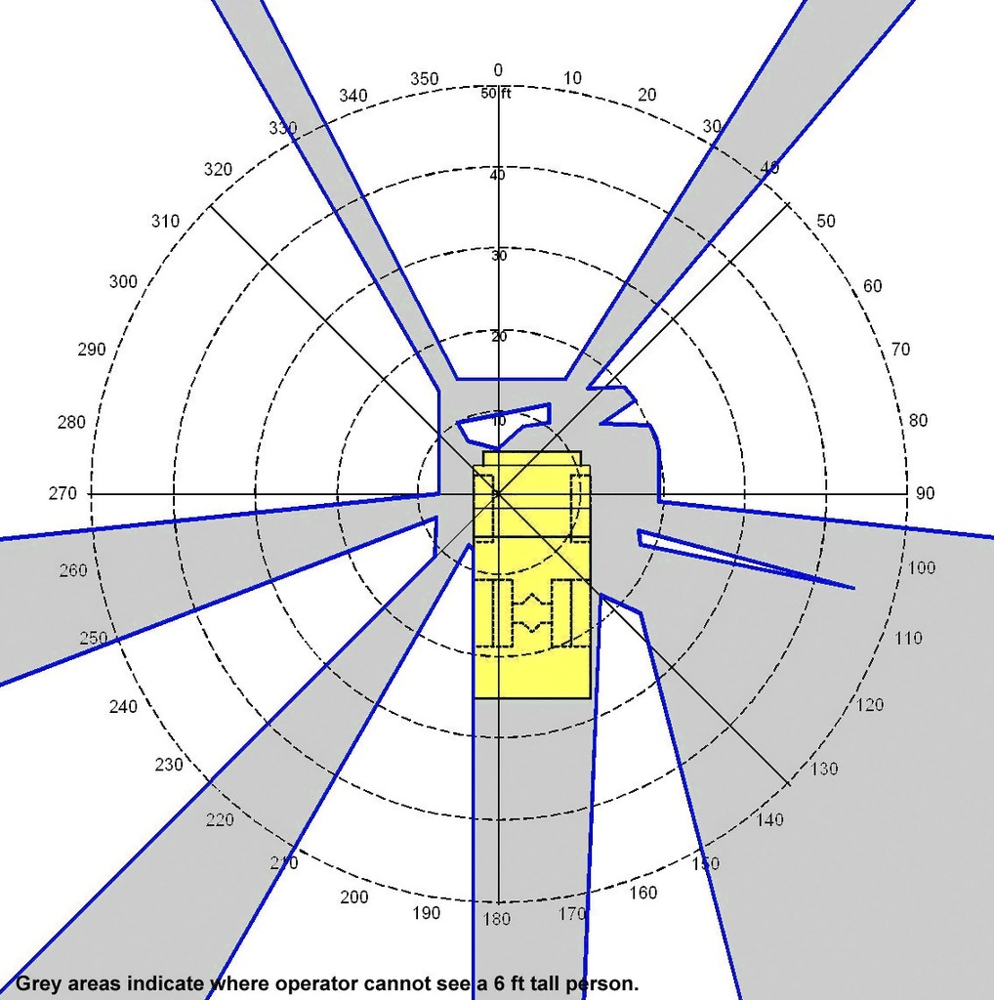
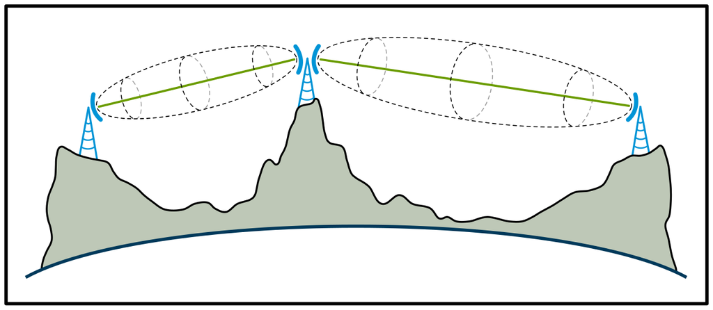
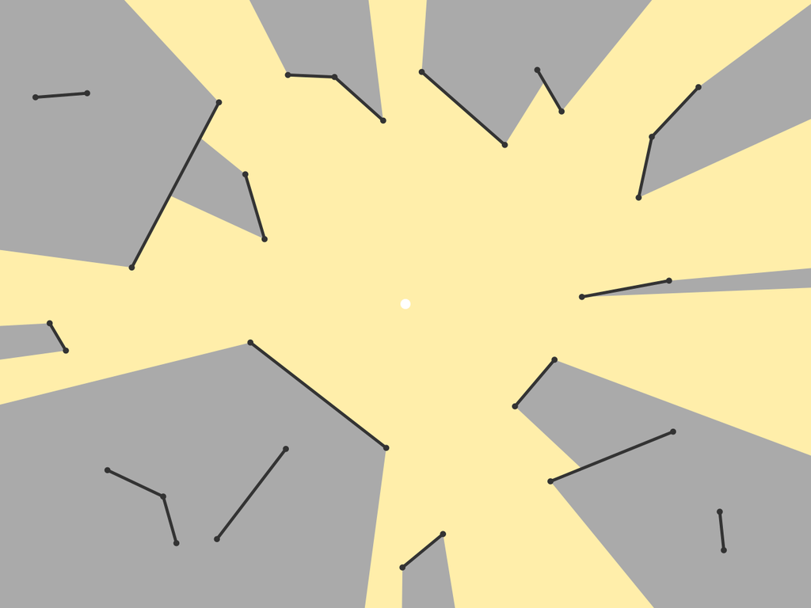
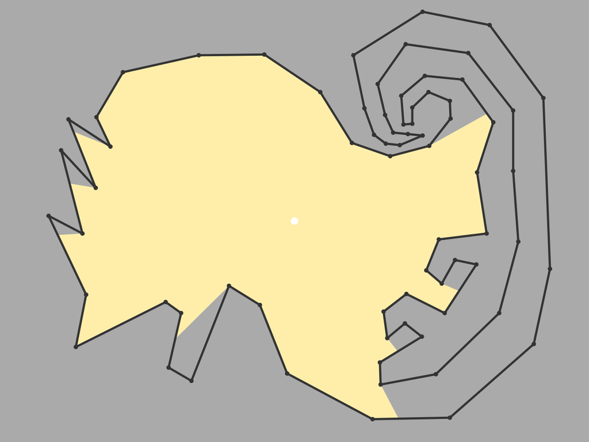
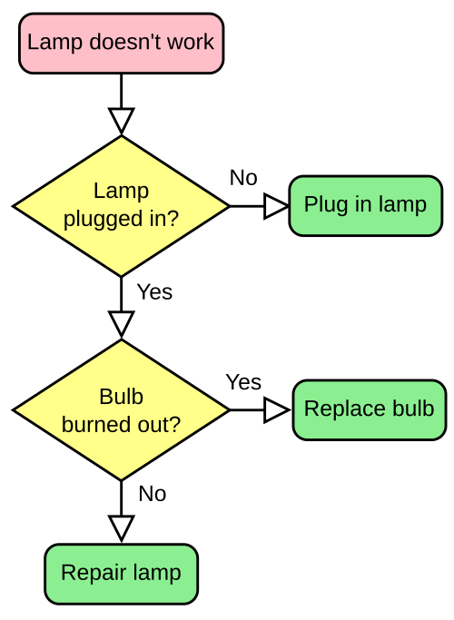
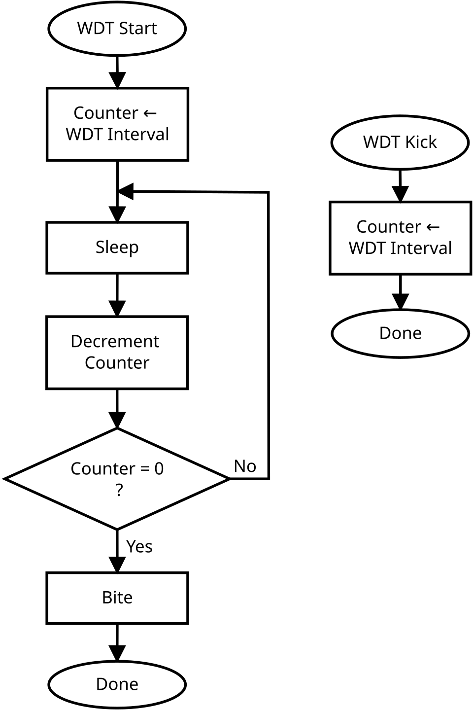
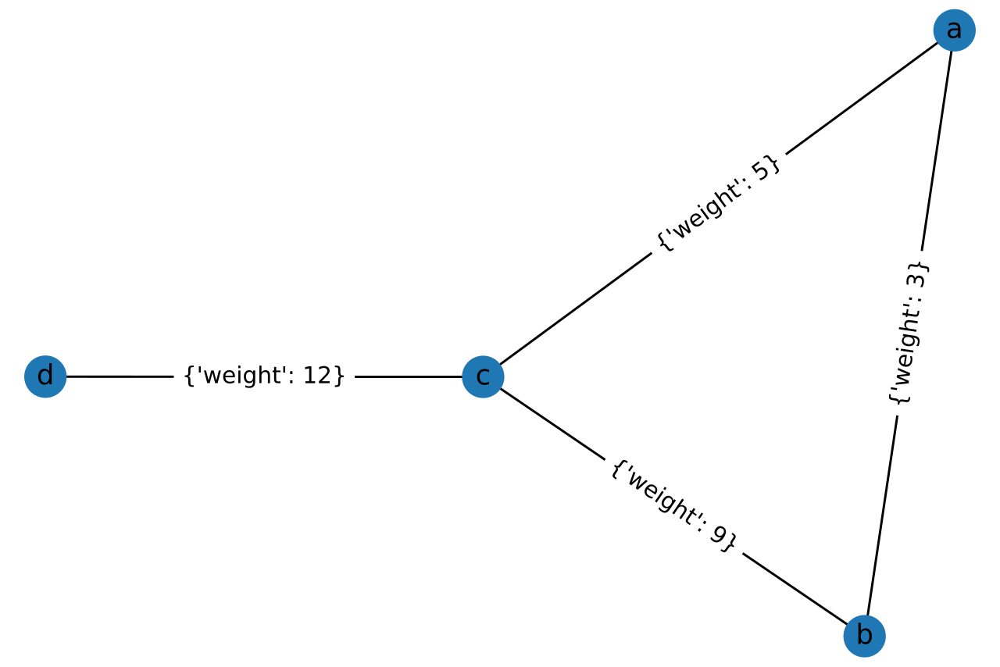
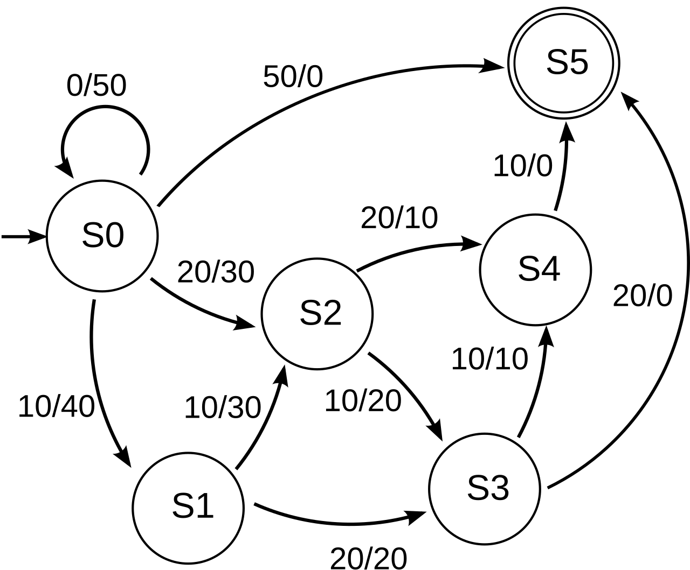
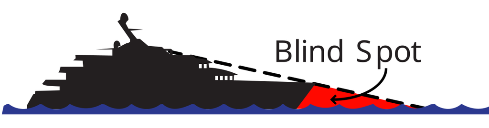
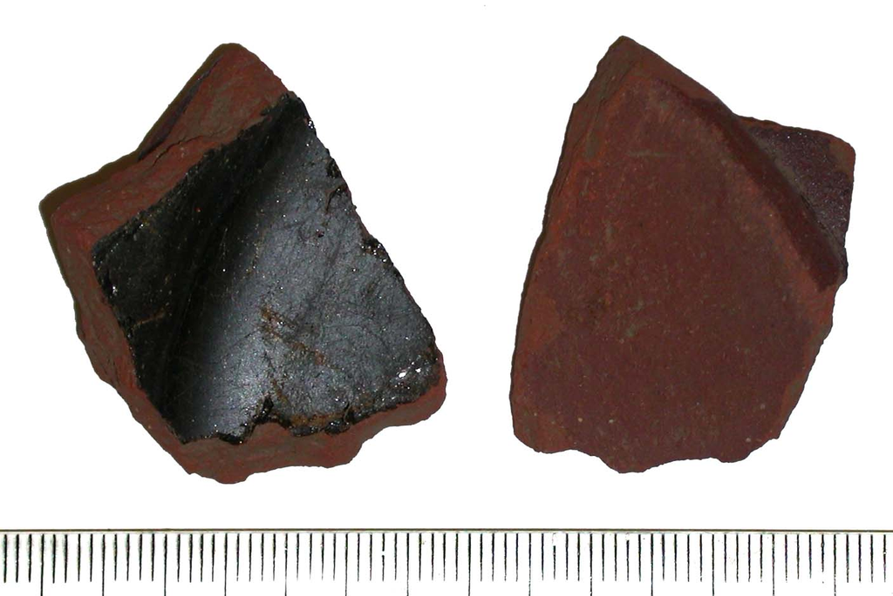

# Perspective and knowledge tracking

[All families](README.md) · [Methods](../../documents/METHODOLOGY.md)

## VB0092

In this polar visibility chart around a haul truck (where 0 degrees is straight ahead, angles increase clockwise around the outer circle, dashed circles mark distances from 10 ft to 50 ft, grey regions show where the operator cannot see a 6-foot-tall person, and white regions show where the person is visible), at a distance of 40 feet from the center, at which pair of bearings can the operator see a 6-foot-tall person?

Rules: Read the bearing angles around the 50-foot outer circle and locate the intersection with the 40-foot dashed concentric circle. Both bearings in the chosen pair must lie in a white (visible) region.

Image 1 credit: [CDC / NIOSH / Public Domain](https://commons.wikimedia.org/wiki/File:Blind_zones_around_a_typical_haul_truck.jpg), [Public domain](https://creativecommons.org/publicdomain/mark/1.0/). See the [asset manifest](../assets.jsonl) for preparation notes.

Options:

- 1: 0 degrees and 280 degrees
- 2: 120 degrees and 180 degrees
- 3: 140 degrees and 260 degrees
- 4: 90 degrees and 130 degrees

## VB0111

Initially every watcher knows that all three sites display red flags. The rightmost watcher then changes that site to green. A watcher at each tower base observes continuously, with no messages. Which watchers can know that the rightmost flag is now green?

Rules: A straight segment between two tower bases is visible only if it does not cross grey terrain. Watchers learn later changes only by seeing or performing them and remember earlier observations. Ignore the green radio-link lines.

Image 1 credit: [Micogen; File:Line of sight mw transmission.svg; CC BY-SA 3.0; via Wikimedia Commons](https://commons.wikimedia.org/wiki/File:Line_of_sight_mw_transmission.svg), [CC BY-SA 3.0](https://creativecommons.org/licenses/by-sa/3.0/). See the [asset manifest](../assets.jsonl) for preparation notes.

Options:

- 1: Left and right
- 2: Middle and right
- 3: Left and middle
- 4: All three

## VB0122

The watcher at the white point initially records both flags as red. Flag A at(10% width,15% height) changes to green; flag B at(50% width,25% height) changes to blue. With no messages, what colors remain in the watcher's record?

Rules: Coordinates start at the image top-left. Yellow is visible to the white point; grey is hidden by the black barriers. A recorded color changes only when the watcher sees that flag change.

Image 1 credit: [Dllu; File:Visibility polygon for a point among segments.svg; CC0; via Wikimedia Commons](https://commons.wikimedia.org/wiki/File:Visibility_polygon_for_a_point_among_segments.svg), [CC0](https://creativecommons.org/publicdomain/zero/1.0/). See the [asset manifest](../assets.jsonl) for preparation notes.

Options:

- 1: A red, B red
- 2: A green, B blue
- 3: A green, B red
- 4: A red, B blue

## VB0123

At moment1 a marker at(50% width,20% height) is red. At moment2 it is at(75%,20%) and turns blue. At moment3 it is at(50%,80%) and remains blue. When can the watcher at the white point first record it as blue?

Rules: Coordinates start at the top-left. The watcher observes only at the three stated moments, with no observations between them. Yellow is visible and grey hidden. Only a visible marker can update its recorded color.

Image 1 credit: [Dllu; File:Visibility polygon for a point in a simple polygon 1.svg; CC0; via Wikimedia Commons](https://commons.wikimedia.org/wiki/File:Visibility_polygon_for_a_point_in_a_simple_polygon_1.svg), [CC0](https://creativecommons.org/publicdomain/zero/1.0/). See the [asset manifest](../assets.jsonl) for preparation notes.

Options:

- 1: Moment2
- 2: At none of these moments
- 3: Moment1
- 4: Moment3

## VB0141

Alice sees the first decision answered Yes, then sees nothing more. Bob sees only the final Replace bulb box reached. Who can know that the lamp was plugged in?

Rules: Both know this chart is followed exactly once from its start, without changing any answer during the traversal. They exchange no messages and have no other observations. Knowledge means true in every traversal compatible with that observer's evidence.

Image 1 credit: [svg by Booyabazookaoriginal png by Wapcaplet, CC BY-SA 3.0, via Wikimedia Commons (File:LampFlowchart.svg); credit: vector version of Image:LampFlowchart.png](https://commons.wikimedia.org/wiki/File%3ALampFlowchart.svg), [CC BY-SA 3.0](https://creativecommons.org/licenses/by-sa/3.0/). See the [asset manifest](../assets.jsonl) for preparation notes.

Options:

- 1: Alice only
- 2: Bob only
- 3: Neither observer
- 4: Both Alice and Bob

## VB0147

The interval is4. Alice and Bob record the start and three completed decrement steps. A kick occurs after decrement2 and before Sleep3, but only Alice sees it. What counter values do their records contain after decrement3?

Rules: Each observer updates a record using only operations they see, with the effects defined by the chart. Both see all three decrements, Alice also sees the kick, and there are no other operations. Ask for recorded values, not whether Bob's record is currently true.

Image 1 credit: [Lambtron, CC BY-SA 4.0, via Wikimedia Commons (File:Software watchdog timer flowchart.svg); credit: Own work](https://commons.wikimedia.org/wiki/File%3ASoftware_watchdog_timer_flowchart.svg), [CC BY-SA 4.0](https://creativecommons.org/licenses/by-sa/4.0/). See the [asset manifest](../assets.jsonl) for preparation notes.

Options:

- 1: Alice3, Bob3
- 2: Alice4, Bob2
- 3: Alice3, Bob1
- 4: Alice1, Bob1

## VB0148

Who can establish that the shortest-route cost from d to b is at most20: Alice, who reads only d-c and c-b, or Bob, who reads only d-c, c-a and a-b?

Rules: Both know the full undirected topology and that all costs are positive. Each knows only the numeric edge costs they personally read from this image; unread costs remain unknown to that observer. They exchange no messages. A known route of cost20 or less is enough to establish the upper bound.

Image 1 credit: [Daniel Mietchen, CC0, via Wikimedia Commons (File:Simple graph example for illustration of Bellman-Ford algorithm.svg); credit: Own work](https://commons.wikimedia.org/wiki/File%3ASimple_graph_example_for_illustration_of_Bellman-Ford_algorithm.svg), [CC0](https://creativecommons.org/publicdomain/zero/1.0/). See the [asset manifest](../assets.jsonl) for preparation notes.

Options:

- 1: Neither observer
- 2: Bob only
- 3: Both observers
- 4: Alice only

## VB0149

A run starts at S0 and takes exactly three transitions. Alice sees only that the first input was10. Bob sees only that the third output was0. Who can know the final state is S5?

Rules: Labels are input/output. Each observer knows the whole diagram and the run length, but only the stated observation from this run. They do not exchange messages. Knowledge must hold for every allowed three-transition run consistent with that observer's evidence.

Image 1 credit: [Pluke, CC0, via Wikimedia Commons (File:CPT-FSM-Mealy-02.svg); credit: Own work](https://commons.wikimedia.org/wiki/File%3ACPT-FSM-Mealy-02.svg), [CC0](https://creativecommons.org/publicdomain/zero/1.0/). See the [asset manifest](../assets.jsonl) for preparation notes.

Options:

- 1: Both observers
- 2: Bob only
- 3: Neither observer
- 4: Alice only

## VB0161

A pilot first sees a red beacon at B=(95% width,84% height). It moves to A=(75%,78%) and turns green there. A shore observer sees the whole event. With the beacon still at A, who can know its light is green?

Rules: Coordinates start at the top-left. For this task the red water area is hidden from the pilot and other water is visible. The pilot cannot see through the ship, receives no messages and does not know a color change occurred while hidden. Both observers initially know the light was red.

Image 1 credit: [Blind_spot_(watercraft).JPG: KVDP
derivative work: Blleininger (talk); File:Blind spot (watercraft-2).svg; Public domain; via Wikimedia Commons](https://commons.wikimedia.org/wiki/File:Blind_spot_(watercraft-2).svg), [Public domain](https://commons.wikimedia.org/wiki/File:Blind_spot_(watercraft-2).svg). See the [asset manifest](../assets.jsonl) for preparation notes.

Options:

- 1: Neither observer
- 2: Both observers
- 3: The pilot only
- 4: The shore observer only

## VB0162

Mira initially sees a white spot at the center of the glossy black face shown on the left. The fragment is then turned to the right-hand photograph's orientation. The spot turns blue while it stays in that orientation. What remains in Mira's color record?

Rules: The spot is a hypothetical mark at the center of that face. The fragment is opaque; Mira sees only the surface presented in the photograph and cannot look around its edges. She receives no message and updates her record only when she sees the spot.

Image 1 credit: [Birmingham Museums Trust, Caroline Johnson, 2006-05-08 14:03:17; File:Post Medieval vessel sherd (front and back) (FindID 131739).jpg; CC BY-SA 2.0; via Wikimedia Commons](https://commons.wikimedia.org/wiki/File:Post_Medieval_vessel_sherd_(front_and_back)_(FindID_131739).jpg), [CC BY-SA 2.0](https://creativecommons.org/licenses/by-sa/2.0/). See the [asset manifest](../assets.jsonl) for preparation notes.

Options:

- 1: White
- 2: Red
- 3: Blue
- 4: No initial color was recorded
