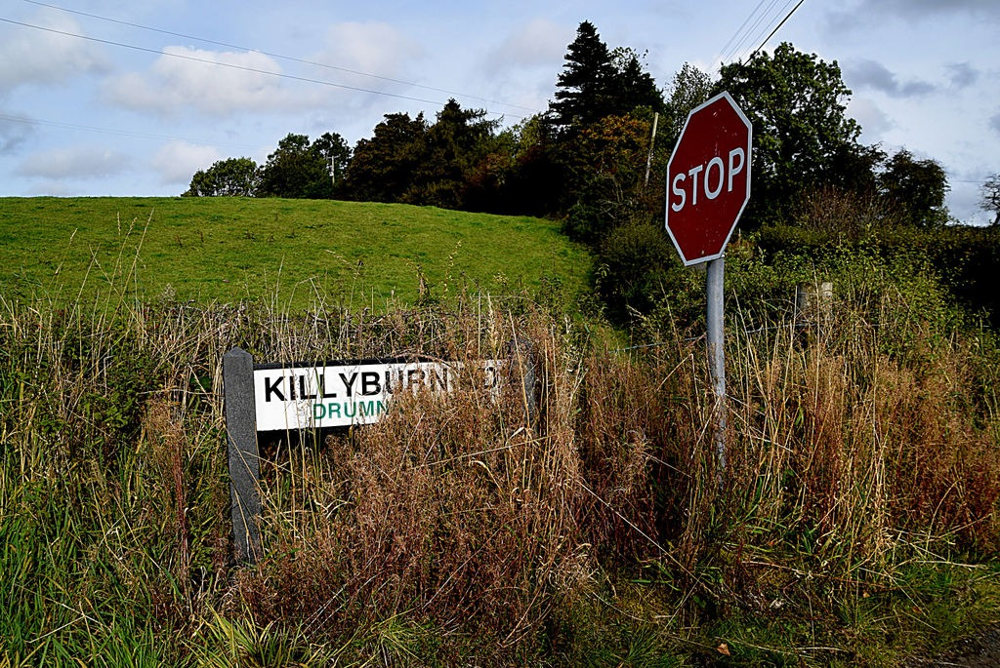
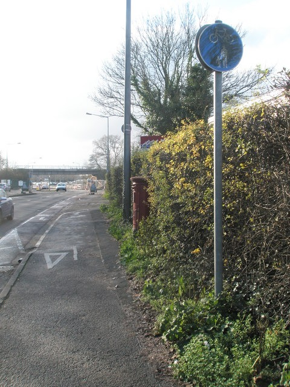
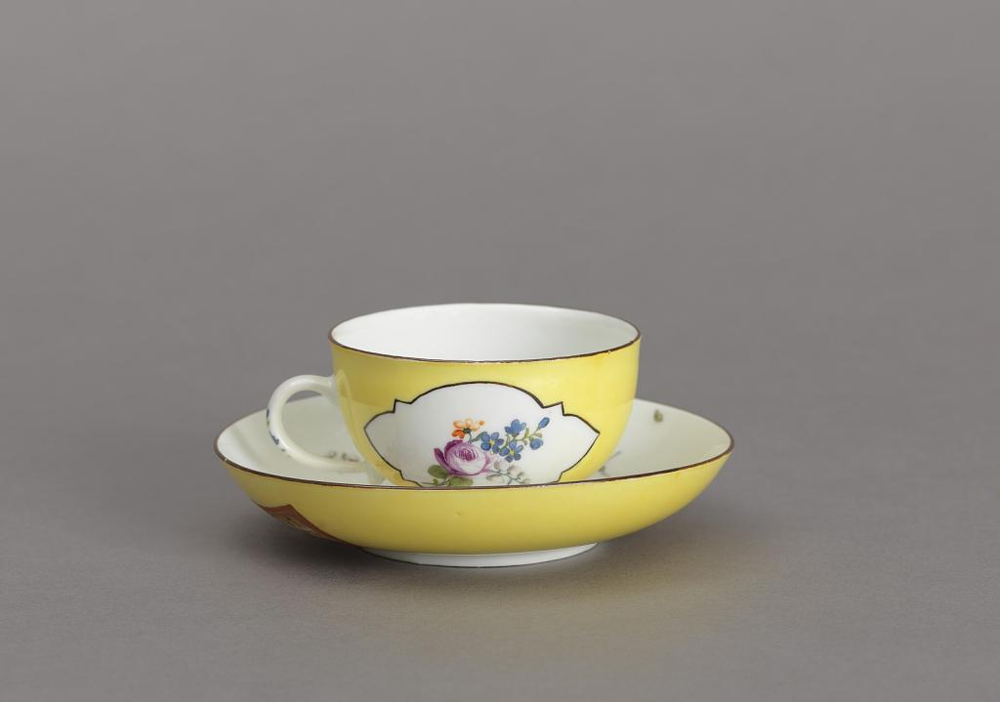
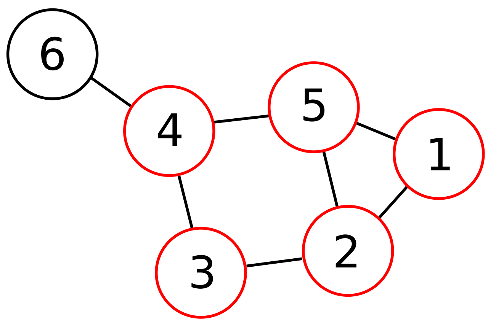
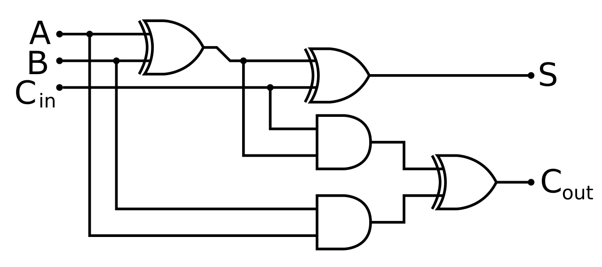
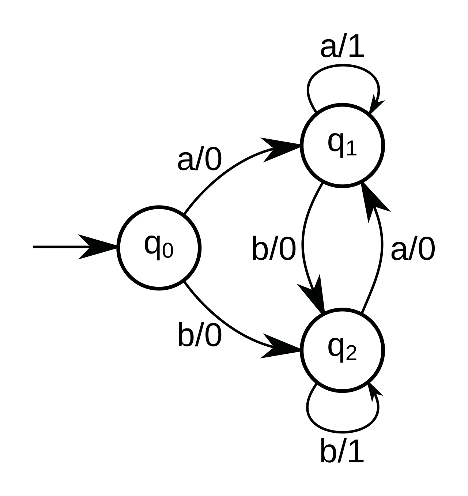
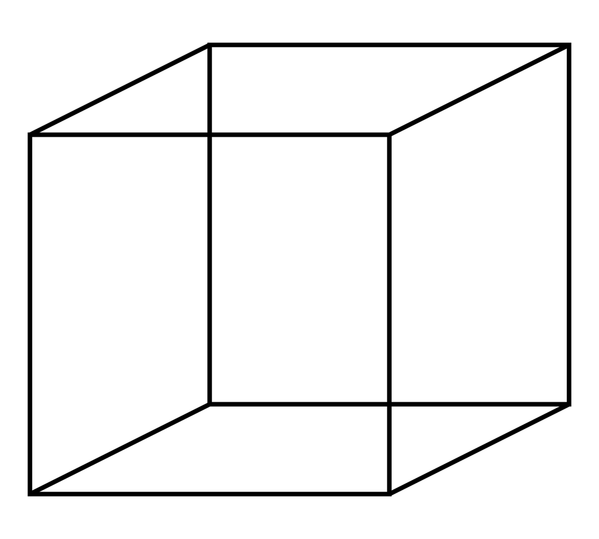
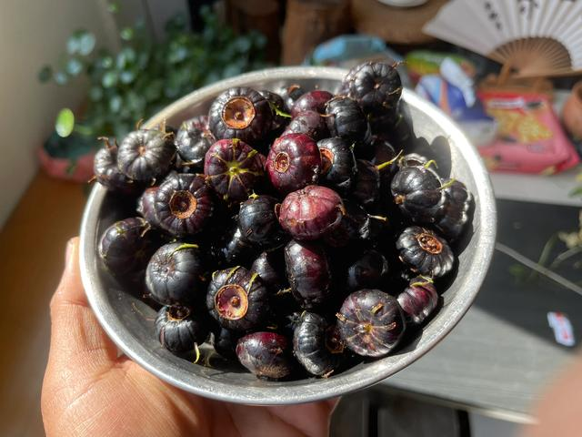

# Insufficient evidence

[All families](README.md) · [Methods](../../documents/METHODOLOGY.md)

## VB0090

The lower line of the white roadside nameplate is partly covered by vegetation. Which of these complete names can be uniquely established from the visible lettering?

Rules: Use only the visible image. Do not use the source title, a map, location knowledge or an inferred completion of covered letters.

Image 1 credit: [Kenneth Allen / Geograph Britain and Ireland / Wikimedia Commons / CC BY-SA 2.0](https://commons.wikimedia.org/wiki/File:Partly_obscured_road_sign_along_Killyburn_Road_-_geograph.org.uk_-_7892310.jpg), [CC BY-SA 2.0](https://creativecommons.org/licenses/by-sa/2.0/). See the [asset manifest](../assets.jsonl) for preparation notes.

Options:

- 1: DRUMNACROSS
- 2: DRUMNAHOE
- 3: DRUMNAKILLY
- 4: None can be uniquely established because distinguishing letters are covered

## VB0091

Which royal cypher can be established from the visible features of the red postbox in this photograph?

Rules: Use only a readable emblem on the postbox itself. Do not infer a monarch from the location, casing style, source caption or surrounding buildings.

Image 1 credit: [Geograph 1623572 / Wikimedia Commons / CC BY-SA 2.0 (author verification pending)](https://commons.wikimedia.org/wiki/File:Partially_hidden_postbox_in_Woodside_Avenue,_Eastleigh_-_geograph.org.uk_-_1623572.jpg), [CC BY-SA 2.0](https://creativecommons.org/licenses/by-sa/2.0/). See the [asset manifest](../assets.jsonl) for preparation notes.

Options:

- 1: GR VI
- 2: EIIR
- 3: No particular cypher can be established from the visible image
- 4: VR

## VB0128

Which geographic compass direction does the flower's stem extend toward in this photograph?

Rules: Geographic north/east/south/west are not image-up/right/down/left. Use only the supplied picture, not a source location, metadata or an assumed camera heading.

Image 1 credit: [Sharon Mollerus; File:Rose in Three Views (Close) (2536313844).jpg; CC BY 2.0; via Wikimedia Commons](https://commons.wikimedia.org/wiki/File:Rose_in_Three_Views_(Close)_(2536313844).jpg), [CC BY 2.0](https://creativecommons.org/licenses/by/2.0/). See the [asset manifest](../assets.jsonl) for preparation notes.

Options:

- 1: North
- 2: West
- 3: South
- 4: East
- 5: The geographic direction is not established

## VB0135

How many painted flower groupings are there in total on the saucer's inner surface?

Rules: Count groupings on the saucer, not on the cup. Use this photograph alone. Do not assume that hidden decoration repeats visible decoration or that the cup is transparent.

Image 1 credit: [Cooper Hewitt, Smithsonian Design Museum; Cup and Saucer](https://collection.cooperhewitt.org/view/objects/asitem/id/19151), [CC0](https://creativecommons.org/publicdomain/zero/1.0/). See the [asset manifest](../assets.jsonl) for preparation notes.

Options:

- 1: 3
- 2: 4
- 3: 5
- 4: The total cannot be uniquely determined from this photograph

## VB0138

Which route from node4 to node1 is guaranteed to have the least total cost?

Rules: Every drawn connection is undirected and has a fixed but unreported strictly positive cost. Route cost is the sum of its edge costs; node labels are names, not costs. Do not assume equal costs.

Image 1 credit: [Tavin, Public domain, via Wikimedia Commons (File:6n-graf-2-clique.svg); credit: File:6n-graf-clique.svg](https://commons.wikimedia.org/wiki/File%3A6n-graf-2-clique.svg), [Public domain](https://commons.wikimedia.org/wiki/File%3A6n-graf-2-clique.svg). See the [asset manifest](../assets.jsonl) for preparation notes.

Options:

- 1: 4 to3 to2 to1
- 2: 4 to5 to1
- 3: 4 to5 to2 to1
- 4: The least-cost route is not established

## VB0139

The observed outputs are S=1 and Cout=0. What does that establish about input A?

Rules: Inputs are binary. A gate with the extra curved input line is XOR; the other gates are AND. A black dot connects crossing wires; an unmarked crossing does not. No gate is faulty and all shown connections apply.

Image 1 credit: [inductiveload, Public domain, via Wikimedia Commons (File:Full Adder XOR.svg); credit: Own drawing, Inkscape 0.43](https://commons.wikimedia.org/wiki/File%3AFull_Adder_XOR.svg), [Public domain](https://commons.wikimedia.org/wiki/File%3AFull_Adder_XOR.svg). See the [asset manifest](../assets.jsonl) for preparation notes.

Options:

- 1: A is not uniquely determined
- 2: A must be1
- 3: A must be0
- 4: A must equal Cin

## VB0140

Starting at q0, three inputs produce the output sequence000. Which state must the machine be in after the third input?

Rules: An edge label input/output emits the shown output while taking that transition. The input sequence contains only a and b and is not given. Follow arrowheads.

Image 1 credit: [Aritzh, CC BY-SA 4.0, via Wikimedia Commons (File:MealyMachine.svg); credit: Own work](https://commons.wikimedia.org/wiki/File%3AMealyMachine.svg), [CC BY-SA 4.0](https://creativecommons.org/licenses/by-sa/4.0/). See the [asset manifest](../assets.jsonl) for preparation notes.

Options:

- 1: The final state is not uniquely determined
- 2: q0
- 3: q1
- 4: q2

## VB0146

Which of the location-requesting apps have actually been granted location permission?

Rules: Standort means location. Use the displayed permission summary alone; do not assume app names, alphabetical order, installation order or which apps normally need location.

Image 1 credit: [Futurwiki, Public domain, via Wikimedia Commons (File:App berechtigung.png); credit: Screenshot](https://commons.wikimedia.org/wiki/File%3AApp_berechtigung.png), [Public domain](https://commons.wikimedia.org/wiki/File%3AApp_berechtigung.png). See the [asset manifest](../assets.jsonl) for preparation notes.

Options:

- 1: The identities of the permitted apps are not established
- 2: All25 requesting apps
- 3: The first seven apps alphabetically
- 4: The last seven apps alphabetically

## VB0160

Which of the two square faces is closer to the observer in the depicted three-dimensional wireframe cube?

Rules: The two squares are the lower-left square and the upper-right square linked by diagonal edges. Use depicted depth cues, not a habitual preferred interpretation of a familiar drawing.

Image 1 credit: [BenFrantzDale; File:Necker cube.svg; CC BY-SA 3.0; via Wikimedia Commons](https://commons.wikimedia.org/wiki/File:Necker_cube.svg), [CC BY-SA 3.0](https://creativecommons.org/licenses/by-sa/3.0/). See the [asset manifest](../assets.jsonl) for preparation notes.

Options:

- 1: The nearer face is not uniquely established
- 2: The upper-right square must be closer
- 3: Both squares must be at the same depth
- 4: The lower-left square must be closer

## VB0173

How many whole fruits are inside this bowl in total, including any that are fully hidden?

Rules: Use only the photograph. A partly visible fruit counts as one fruit, but do not assume that every fruit must have some part visible from this viewpoint.

Image 1 credit: [Fumikas Sagisavas; File:Bowl of Spider Fruit.jpg; CC0; via Wikimedia Commons](https://commons.wikimedia.org/wiki/File:Bowl_of_Spider_Fruit.jpg), [CC0](https://creativecommons.org/publicdomain/zero/1.0/). See the [asset manifest](../assets.jsonl) for preparation notes.

Options:

- 1: 25
- 2: 30
- 3: 35
- 4: The exact total is not established
