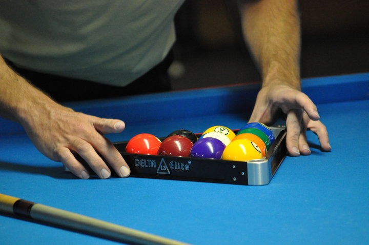
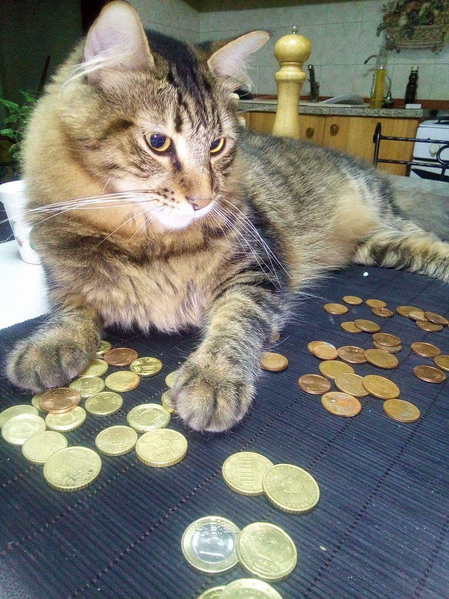
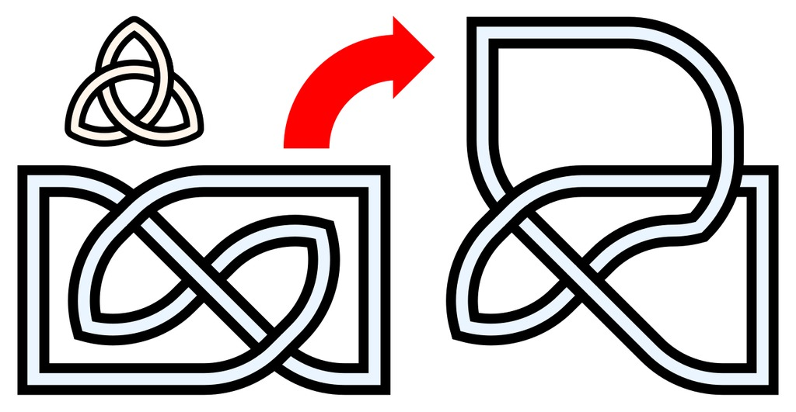
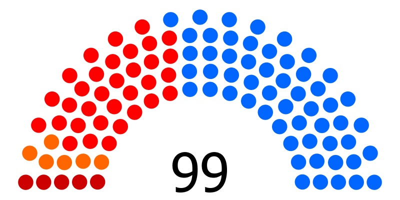
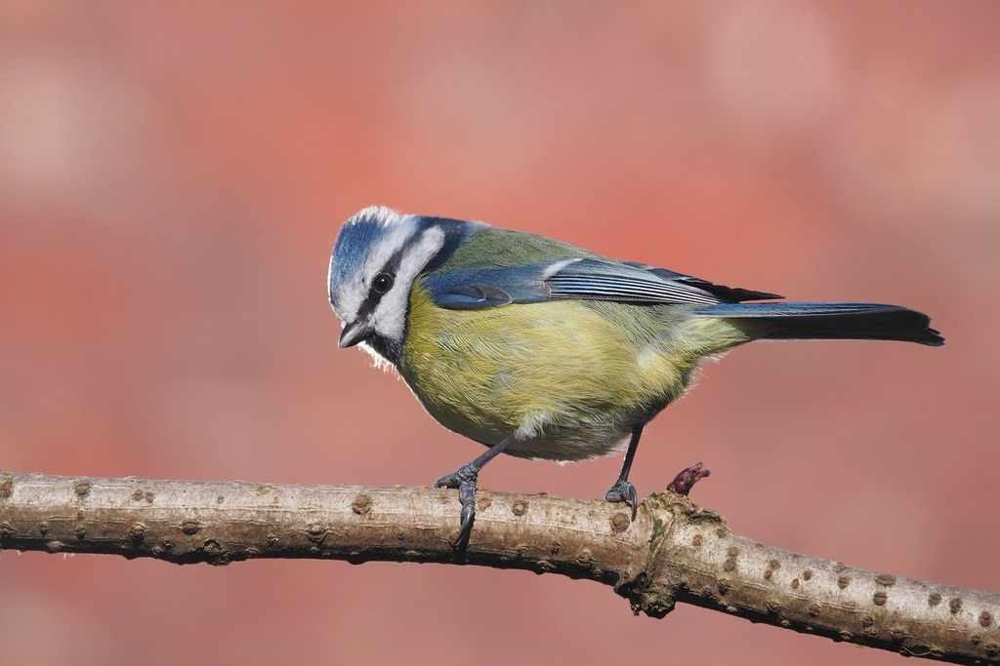
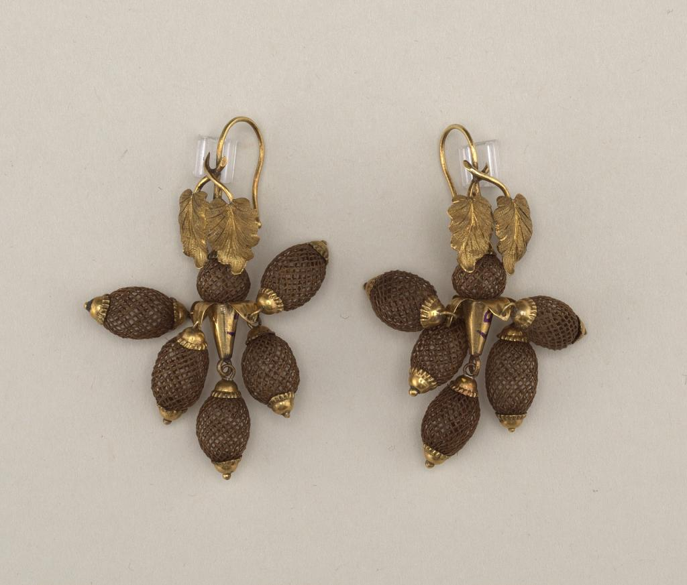
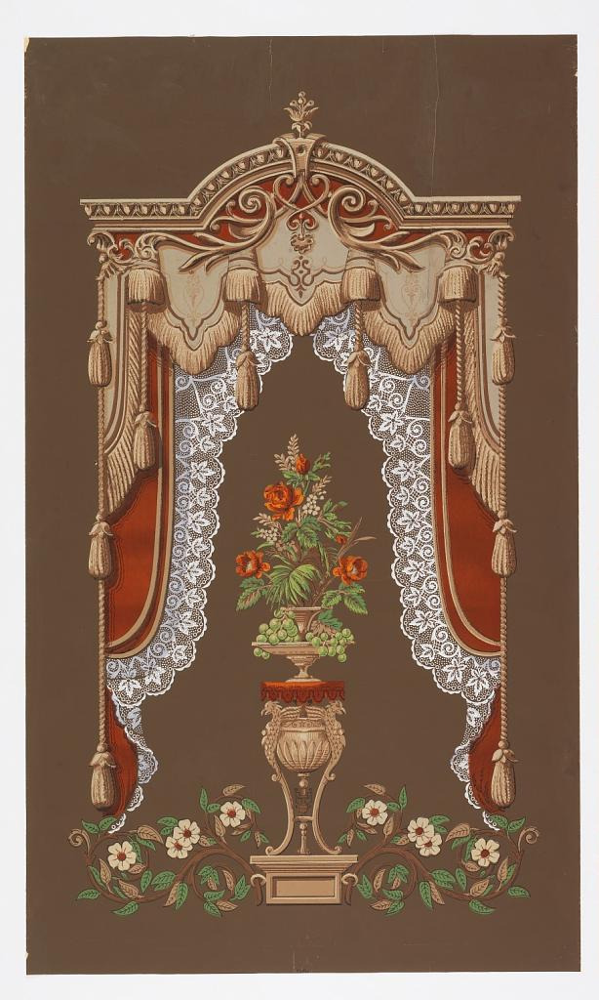
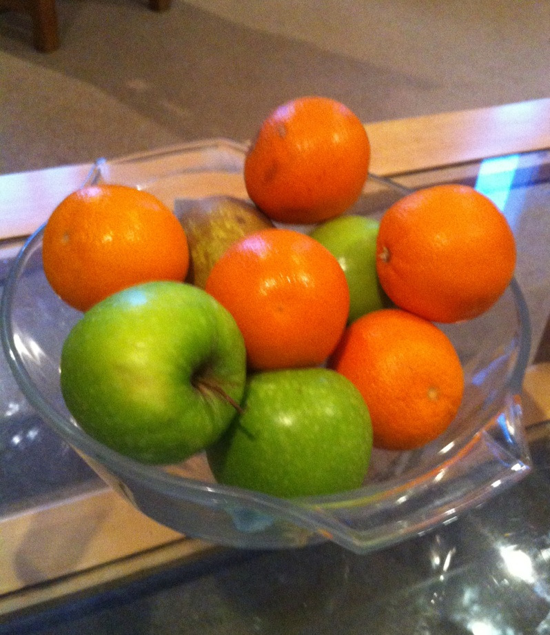
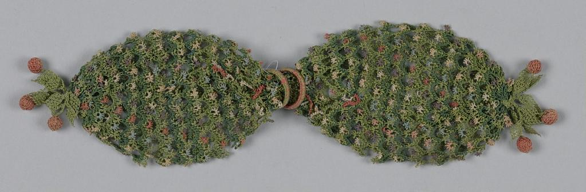
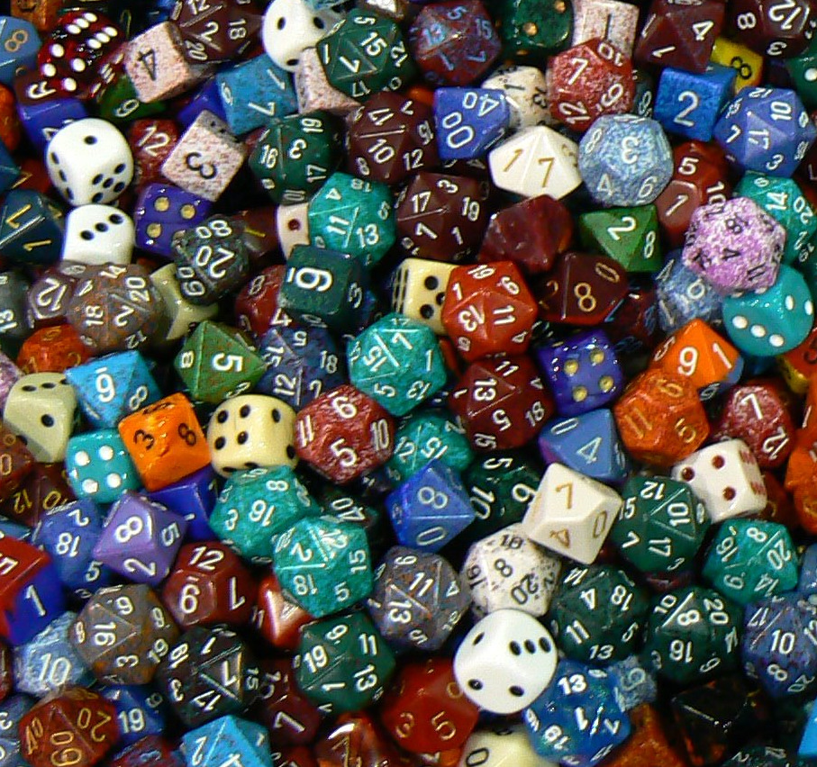

# Conditional counting

[All families](README.md) · [Methods](../METHODOLOGY.md)

## VB0082

How many billiard balls are visibly resting completely outside the triangular rack in this photograph?

Rules: Count only balls visible within the photograph and completely outside the rack's interior perimeter. Do not infer objects beyond the image boundaries.

Image 1 credit: [File:Billiard Balls and Rack.jpg / Wikimedia Commons (creator verification pending)](https://commons.wikimedia.org/wiki/File:Billiard_Balls_and_Rack.jpg), [CC BY-SA 3.0](https://creativecommons.org/licenses/by-sa/3.0/). See the [asset manifest](../data/assets.jsonl) for preparation notes.

Options:

- 1: 0
- 2: 2
- 3: 3
- 4: 1

## VB0083

Several dozen coins are scattered on the dark ribbed mat in front of the cat. How many of the visible coins are bimetallic—specifically showing a silver-colored inner core surrounded by a yellow-gold outer ring?

Rules: Count only coins on the mat that visibly display both a silver-colored central disc and a contrasting yellow-gold outer ring. Exclude every coin cut off by an image border, as well as solid yellow-gold or copper-colored coins. Partial overlap by another object is allowed only if both qualifying materials remain clearly visible.

Image 1 credit: [Continentaleurope / Wikimedia Commons / CC BY-SA 4.0](https://commons.wikimedia.org/wiki/File:Cat_%22counting%22_money.jpg), [CC BY-SA 4.0](https://creativecommons.org/licenses/by-sa/4.0/). See the [asset manifest](../data/assets.jsonl) for preparation notes.

Options:

- 1: 2
- 2: 1
- 3: 3
- 4: 0

## VB0084

This diagram shows a small trefoil knot at the upper left, a larger rectangular-loop knot diagram at the lower left, and a deformed version of that larger diagram on the right after the red-arrow move. How many strand crossings appear in the small upper-left knot, and how many strand crossings appear in the right-hand diagram?

Rules: A strand crossing is a point where one white-filled black-bordered ribbon passes directly over another, indicated by a break in the under-passing ribbon's black border lines.

Image 1 credit: [AnonMoos / Wikimedia Commons / Public Domain](https://commons.wikimedia.org/wiki/File:Trefoil-non-3-symm-flip_demonstration.svg), [Public domain](https://creativecommons.org/publicdomain/mark/1.0/). See the [asset manifest](../data/assets.jsonl) for preparation notes.

Options:

- 1: 3 in the upper-left knot and 6 in the right-hand diagram
- 2: 4 in the upper-left knot and 5 in the right-hand diagram
- 3: 3 in the upper-left knot and 4 in the right-hand diagram
- 4: 3 in the upper-left knot and 5 in the right-hand diagram

## VB0094

Compare the blue circles with all the red and orange circles combined. Which group is larger, and by how many circles?

Rules: Count both shades of red in the red group. Count each circle once; the printed 99 is not a color-group count.

Image 1 credit: [Lluket24; File:Corts 2011.jpg; CC BY-SA 3.0; via Wikimedia Commons](https://commons.wikimedia.org/wiki/File:Corts_2011.jpg), [CC BY-SA 3.0](https://creativecommons.org/licenses/by-sa/3.0/). See the [asset manifest](../data/assets.jsonl) for preparation notes.

Options:

- 1: Blue by17
- 2: Red and orange combined by11
- 3: The groups are equal
- 4: Blue by11

## VB0117

How many of the bird's feet are visibly in contact with the branch?

Rules: Count feet, not individual toes. Use visible contact only; do not infer flight, motion or hidden legs.

Image 1 credit: [Francis C. Franklin; File:Blue tit front and back-lit.jpg; CC BY-SA 3.0; via Wikimedia Commons](https://commons.wikimedia.org/wiki/File:Blue_tit_front_and_back-lit.jpg), [CC BY-SA 3.0](https://creativecommons.org/licenses/by-sa/3.0/). See the [asset manifest](../data/assets.jsonl) for preparation notes.

Options:

- 1: 0
- 2: 1
- 3: 2
- 4: The photograph does not establish the number

## VB0129

How many elongated brown basket-weave pendants with gold tips are visible across the pair of earrings?

Rules: Exclude the nearly round brown connector directly under each pair of leaves, the metal leaf mounts, and the hooks. Count each elongated pendant once.

Image 1 credit: [Cooper Hewitt, Smithsonian Design Museum; Pair of earrings](https://collection.cooperhewitt.org/view/objects/asitem/id/43709), [CC0](https://creativecommons.org/publicdomain/zero/1.0/). See the [asset manifest](../data/assets.jsonl) for preparation notes.

Options:

- 1: 8
- 2: 10
- 3: 12
- 4: 14

## VB0134

How many large tassels hang from the two outermost vertical cords combined?

Rules: Use the single far-left cord and single far-right cord. Exclude tassels on inner cords, the short fringe along the upper valance, and small architectural ornaments.

Image 1 credit: [Cooper Hewitt, Smithsonian Design Museum; Window shade](https://collection.cooperhewitt.org/view/objects/asitem/id/129847), [CC0](https://creativecommons.org/publicdomain/zero/1.0/). See the [asset manifest](../data/assets.jsonl) for preparation notes.

Options:

- 1: 4
- 2: 6
- 3: 8
- 4: 10

## VB0151

How many orange-colored round fruits are visible in the bowl?

Rules: Exclude green and brown-green fruits even where partly hidden. Count each visible orange-colored fruit once, not each bright patch on a fruit.

Image 1 credit: [PaulCharlesSmith; File:Bowl of fruit.jpg; CC BY-SA 3.0; via Wikimedia Commons](https://commons.wikimedia.org/wiki/File:Bowl_of_fruit.jpg), [CC BY-SA 3.0](https://creativecommons.org/licenses/by-sa/3.0/). See the [asset manifest](../data/assets.jsonl) for preparation notes.

Options:

- 1: 4
- 2: 5
- 3: 6
- 4: 7

## VB0165

How many rounded reddish-brown end ornaments are visible on this purse in total?

Rules: Count only the ball-like ornaments attached to green leafy extensions at the two outer ends. Exclude tiny flower centers across the mesh and the two sliding rings at the middle.

Image 1 credit: [Cooper Hewitt, Smithsonian Design Museum; Miser's purse](https://collection.cooperhewitt.org/view/objects/asitem/id/103419), [CC0](https://creativecommons.org/publicdomain/zero/1.0/). See the [asset manifest](../data/assets.jsonl) for preparation notes.

Options:

- 1: 4
- 2: 5
- 3: 6
- 4: 8

## VB0166

How many pips are on the large front-facing faces of the two purple cubes with yellow pips, in total?

Rules: Ignore printed numerals, other-colored dice and the white spherical die. Each face uses a standard1-to6 die pip pattern. Include a partly hidden corner pip if the remaining pattern forces it, but do not invent a hidden center pip.

Image 1 credit: [Benny Mazur; File:Assorted dice for games at GenCon 2009.jpg; CC BY 2.0; via Wikimedia Commons](https://commons.wikimedia.org/wiki/File:Assorted_dice_for_games_at_GenCon_2009.jpg), [CC BY 2.0](https://creativecommons.org/licenses/by/2.0/). See the [asset manifest](../data/assets.jsonl) for preparation notes.

Options:

- 1: 7
- 2: 8
- 3: 9
- 4: 10
