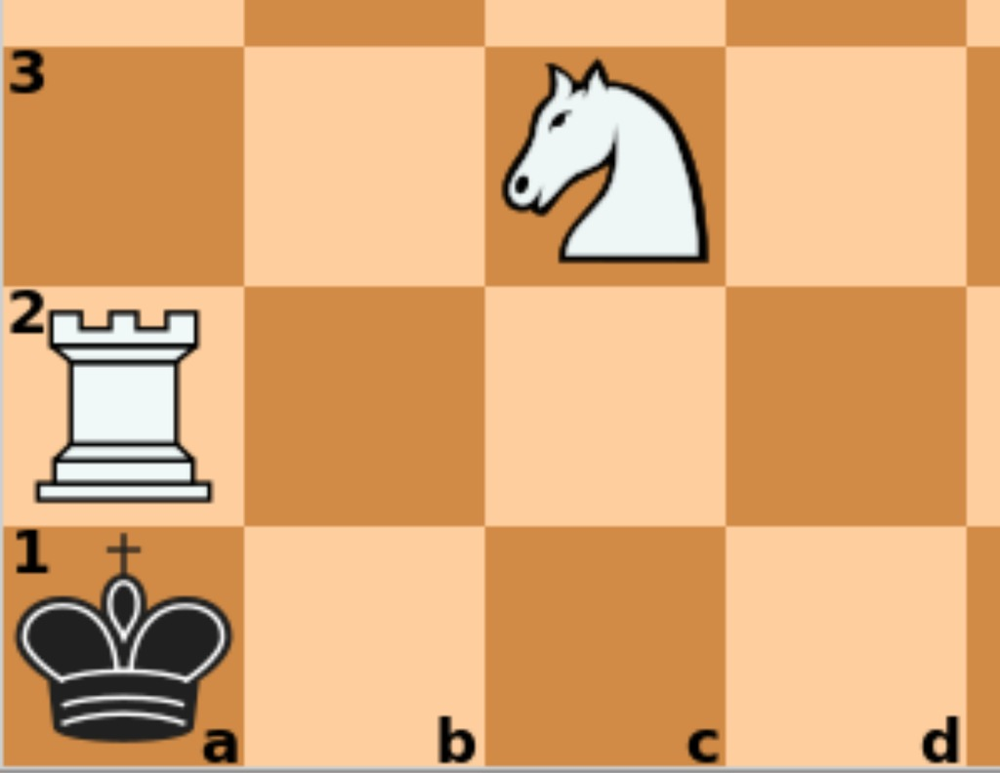
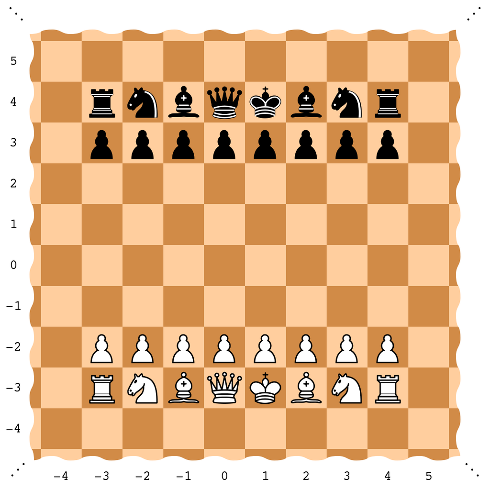
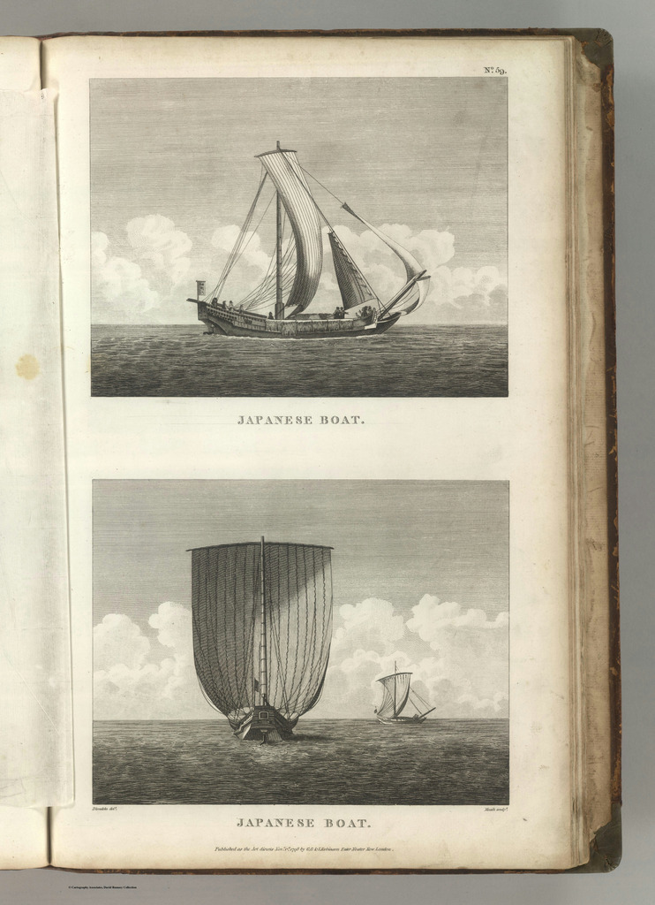
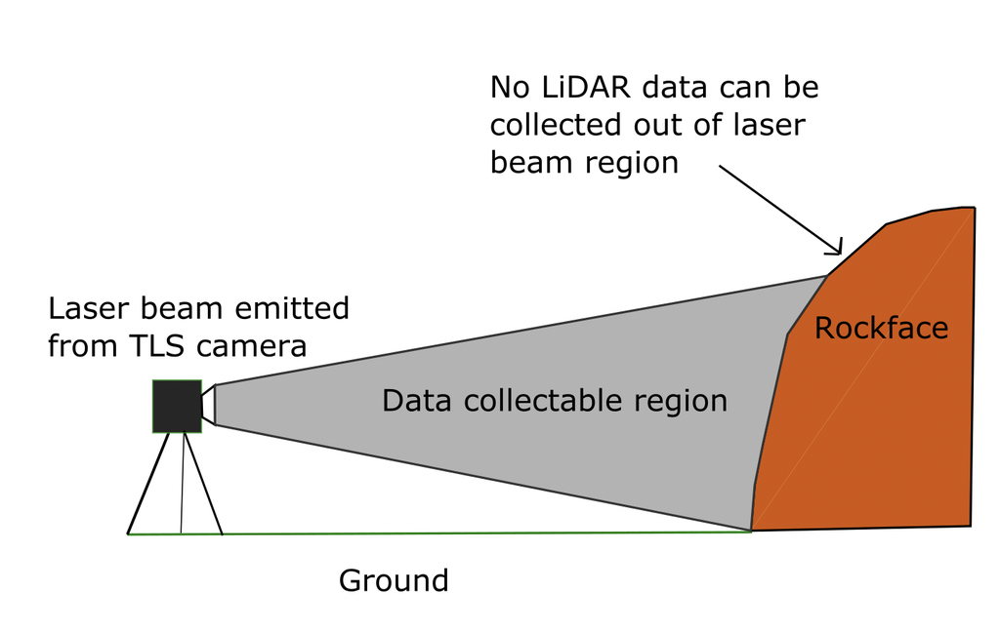
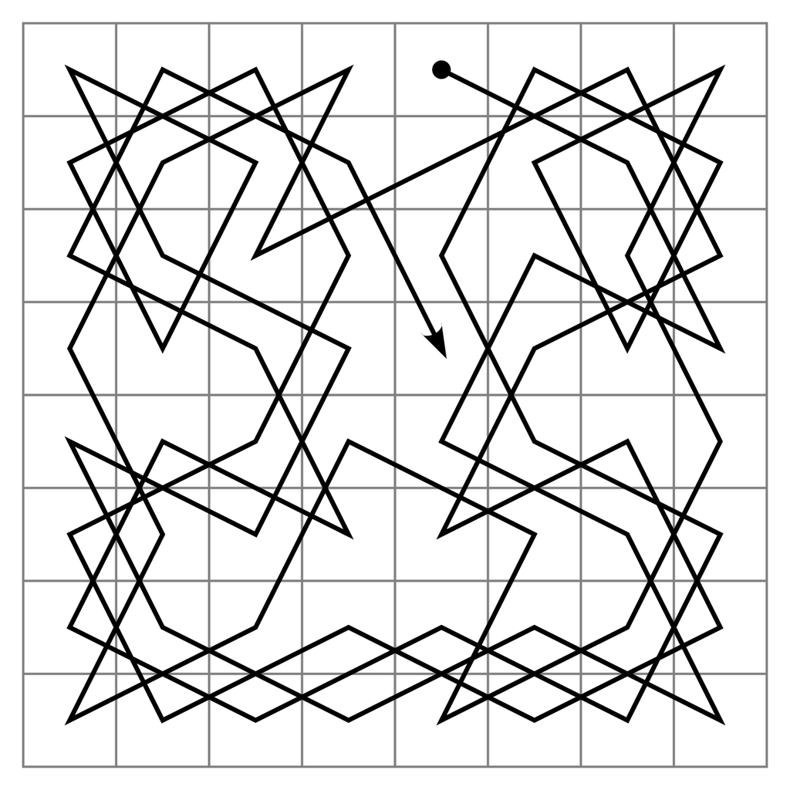
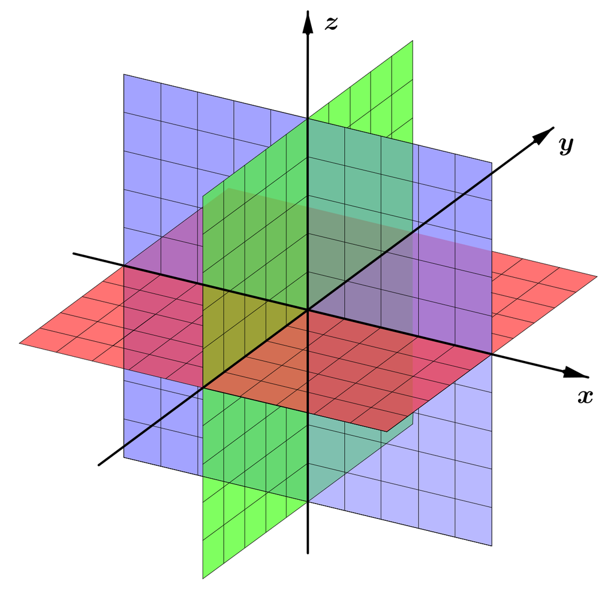
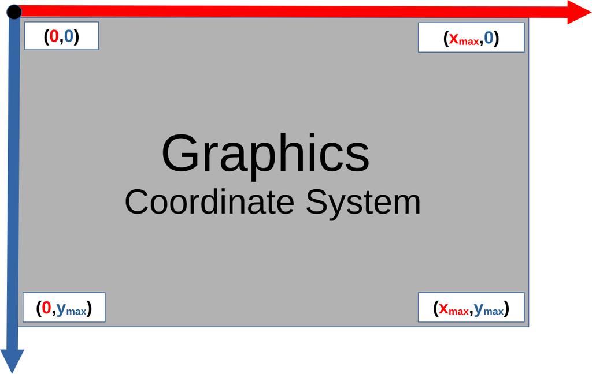

# Spatial relationships

[All families](README.md) · [Methods](../METHODOLOGY.md)

## VB0085

Which square is in the same rank as the white rook and the same file as the white knight?

Rules: Use the file letters and rank numbers printed on the board. A rank is a horizontal row and a file is a vertical column.

Image 1 credit: [File:ArabicMate.svg / Wikimedia Commons (creator verification pending)](https://commons.wikimedia.org/wiki/File:ArabicMate.svg), [CC BY-SA 4.0](https://creativecommons.org/licenses/by-sa/4.0/). See the [asset manifest](../data/assets.jsonl) for preparation notes.

Options:

- 1: a2
- 2: c3
- 3: c2
- 4: b2

## VB0095

What is the minimum number of unit grid steps from the white king to the black rook farthest to the image left?

Rules: A step moves one square horizontally or vertically. Ignore chess movement rules, other pieces and obstacles. Use the printed coordinates, including negative numbers.

Image 1 credit: [LaundryPizza03; File:Infinite chess.png; CC BY-SA 3.0; via Wikimedia Commons](https://commons.wikimedia.org/wiki/File:Infinite_chess.png), [CC BY-SA 3.0](https://creativecommons.org/licenses/by-sa/3.0/). See the [asset manifest](../data/assets.jsonl) for preparation notes.

Options:

- 1: 9
- 2: 10
- 3: 11
- 4: The distance is not established by the image

## VB0153

From the center of the orange carrot toward the center of the large dark-green courgette, which pair of robot-relative directions applies?

Rules: For this task the robot's forward direction is image-right, and its right direction is image-down. Use the centers of the visible objects, not their long-axis directions.

Image 1 credit: [Salicyna; File:Allium cepa Karmen and other vegetables 2023-07-20 8383.jpg; CC BY-SA 4.0; via Wikimedia Commons](https://commons.wikimedia.org/wiki/File:Allium_cepa_Karmen_and_other_vegetables_2023-07-20_8383.jpg), [CC BY-SA 4.0](https://creativecommons.org/licenses/by-sa/4.0/). See the [asset manifest](../data/assets.jsonl) for preparation notes.

Options:

- 1: Forward and right
- 2: Backward and right
- 3: Backward and left
- 4: Forward and left

## VB0154

At the crossing near the image center-right, what is the visible depth order of the basket handle and the pale vegetable?

Rules: Judge the local overlap where the upright handle crosses the large pale vegetable. Do not infer the order of objects elsewhere in the basket.

Image 1 credit: [George Chernilevsky; File:Basket with vegetables 2017 G1.jpg; Public domain; via Wikimedia Commons](https://commons.wikimedia.org/wiki/File:Basket_with_vegetables_2017_G1.jpg), [Public domain](https://commons.wikimedia.org/wiki/File:Basket_with_vegetables_2017_G1.jpg). See the [asset manifest](../data/assets.jsonl) for preparation notes.

Options:

- 1: Their visible silhouettes never overlap
- 2: The pale vegetable is in front of the handle
- 3: The photograph gives no overlap cue there
- 4: The handle is in front of the pale vegetable

## VB0167

Can the two rings be completely separated by moving and rotating them in three-dimensional space without opening either ring?

Rules: Both rings are physically closed and cannot pass through solid material. White gaps at the crossings indicate which ring is hidden behind the other, not actual cuts. Read both crossings before deciding.

Image 1 credit: [Lorc; File:Linked-rings - Lorc - game-icons.svg; CC BY 3.0; via Wikimedia Commons](https://commons.wikimedia.org/wiki/File:Linked-rings_-_Lorc_-_game-icons.svg), [CC BY 3.0](https://creativecommons.org/licenses/by/3.0/). See the [asset manifest](../data/assets.jsonl) for preparation notes.

Options:

- 1: Yes, by rotating one ring without opening it
- 2: They are already separate, with no interlocking
- 3: Yes, by translating one ring straight away
- 4: No; at least one ring must be opened

## VB0168

In the lower illustration, how are the large foreground boat and the smaller distant boat viewed?

Rules: End-on means looking approximately along a boat's length; broadside means seeing its length from the side. Judge hull shape and symmetry, not apparent size alone. The two illustrations need not show the same individual boat.

Image 1 credit: [La Perouse, Jean-Francois de Galaup, comte de, 1741-1788
Blondela
Heath; File:(Two views). Japanese Boat(s). Published as the Act directs Novr. 1st 1798, by G.G. & J. Robinson, Pater Noster Row (IA dr two-views-japanese-boats-published-as-the-act-directs-novr-1st-1798-0414059).jpg; Public domain; via Wikimedia Commons](https://commons.wikimedia.org/wiki/File:(Two_views)._Japanese_Boat(s)._Published_as_the_Act_directs_Novr._1st_1798,_by_G.G._%26_J._Robinson,_Pater_Noster_Row_(IA_dr_two-views-japanese-boats-published-as-the-act-directs-novr-1st-1798-0414059).jpg), [Public domain](https://commons.wikimedia.org/wiki/File:(Two_views)._Japanese_Boat(s)._Published_as_the_Act_directs_Novr._1st_1798,_by_G.G._%26_J._Robinson,_Pater_Noster_Row_(IA_dr_two-views-japanese-boats-published-as-the-act-directs-novr-1st-1798-0414059).jpg). See the [asset manifest](../data/assets.jsonl) for preparation notes.

Options:

- 1: The large boat is end-on; the small boat is more nearly broadside
- 2: Both are viewed broadside
- 3: The large boat is broadside; the small boat is end-on
- 4: Both are viewed end-on

## VB0174

Extend the straight upper boundary of the grey beam to the vertical line at90% of the image width. Where would that extension lie relative to the orange rock shape?

Rules: This is a line extrapolation on the drawing, not a claim that a laser passes through rock. Continue the same slope beyond the first rock contact. Use the orange polygon boundary rather than the caption text.

Image 1 credit: [Waikinl; File:Line of sight TLS1.png; CC BY-SA 4.0; via Wikimedia Commons](https://commons.wikimedia.org/wiki/File:Line_of_sight_TLS1.png), [CC BY-SA 4.0](https://creativecommons.org/licenses/by-sa/4.0/). See the [asset manifest](../data/assets.jsonl) for preparation notes.

Options:

- 1: It cannot reach that image-width position
- 2: Inside the orange rock shape, below its top boundary
- 3: Below the ground line
- 4: Above the entire rock shape

## VB0175

Starting at the black dot, follow the black route through its first two complete straight segments. What is the net displacement in grid cells?

Rules: Count each grid cell as one unit. At a crossing keep following the same straight line until the next actual corner; do not turn merely because lines cross. Use image-right and image-down directions.

Image 1 credit: [Created by Ilmari Karonen; File:Knight's tour.svg; Public domain; via Wikimedia Commons](https://commons.wikimedia.org/wiki/File:Knight%27s_tour.svg), [Public domain](https://commons.wikimedia.org/wiki/File:Knight%27s_tour.svg). See the [asset manifest](../data/assets.jsonl) for preparation notes.

Options:

- 1: 3 left and3 down
- 2: 3 right and1 down
- 3: 1 right and3 down
- 4: 3 right and3 down

## VB0178

Point A is one positive unit along the x-axis and point B one positive unit along the y-axis. Which colored sheet contains the entire straight segment from A to B?

Rules: The colored sheets are the coordinate planes. Use the axis labels in the image. A and B are not at the origin; do not mistake tinted overlaps for additional sheets.

Image 1 credit: [Sakurambo~commonswiki

derivative work: Petrus3743; File:3D coordinate system.svg; CC BY-SA 4.0; via Wikimedia Commons](https://commons.wikimedia.org/wiki/File:3D_coordinate_system.svg), [CC BY-SA 4.0](https://creativecommons.org/licenses/by-sa/4.0/). See the [asset manifest](../data/assets.jsonl) for preparation notes.

Options:

- 1: All three sheets
- 2: The red horizontal sheet
- 3: The green upright sheet
- 4: The purple upright sheet

## VB0179

Under the coordinate convention shown, a rectangle has opposite corners(20,30) and(80,90). Translate the whole rectangle15 units toward image-right and10 units toward image-up. What are the new opposite corners?

Rules: Read the directions of increasing coordinates from this diagram. Both maximum coordinate values are at least100. Apply a translation, not a resize or reflection.

Image 1 credit: [Bert Niehaus; File:Graphics coordinate system.svg; CC BY-SA 4.0; via Wikimedia Commons](https://commons.wikimedia.org/wiki/File:Graphics_coordinate_system.svg), [CC BY-SA 4.0](https://creativecommons.org/licenses/by-sa/4.0/). See the [asset manifest](../data/assets.jsonl) for preparation notes.

Options:

- 1: (5,40) and(65,100)
- 2: (35,40) and(95,100)
- 3: (35,20) and(95,80)
- 4: (5,20) and(65,80)
