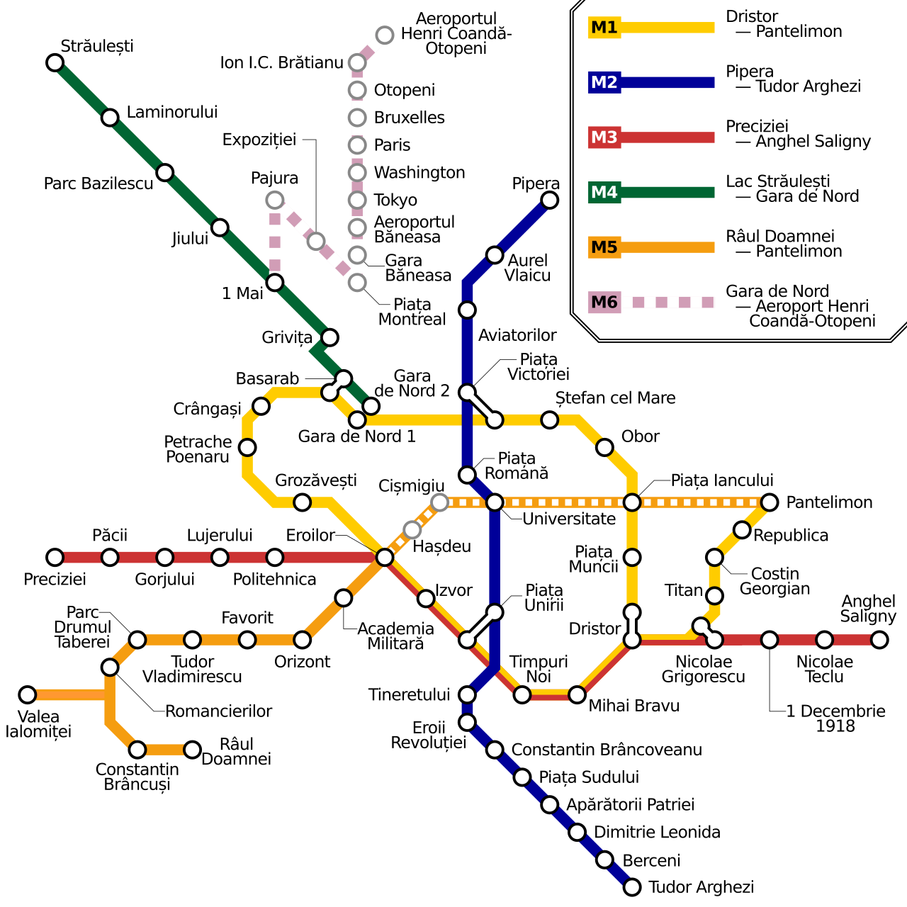
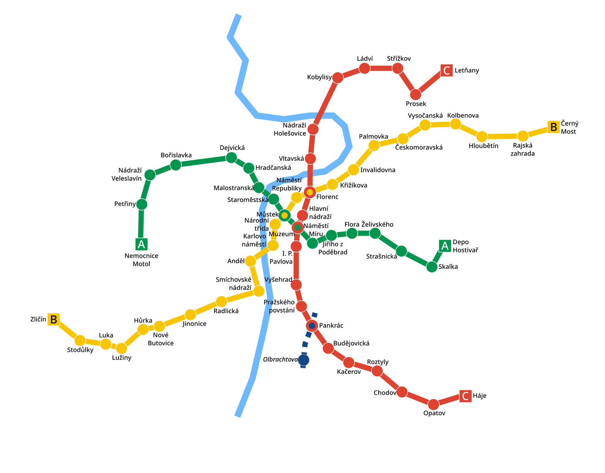
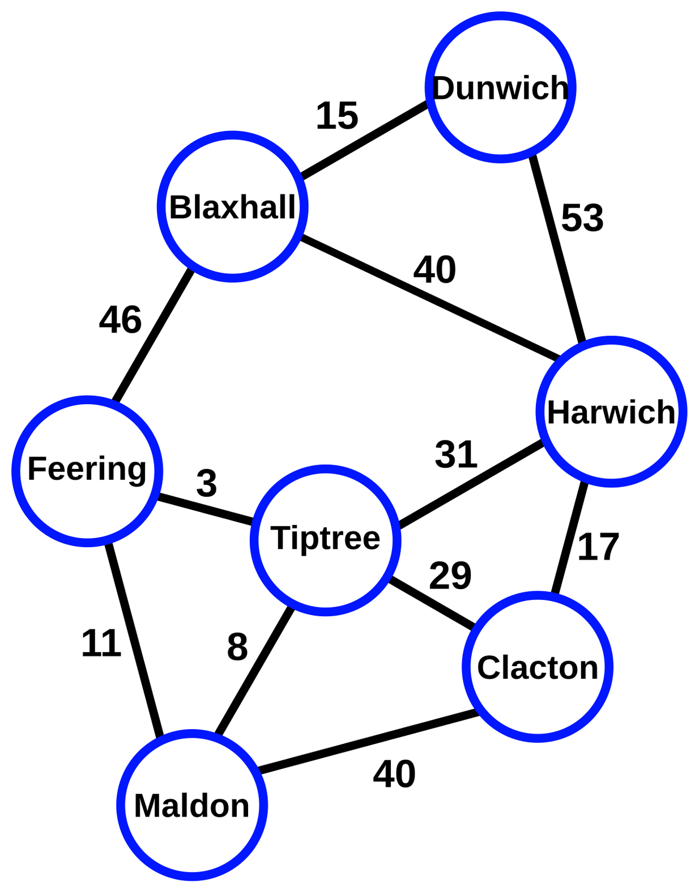
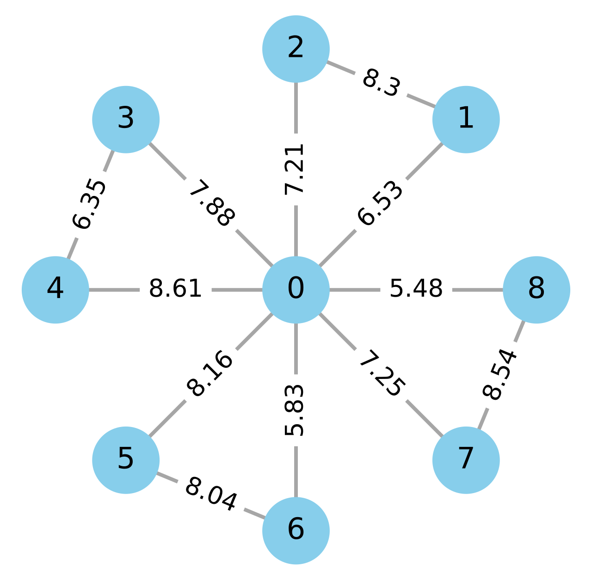
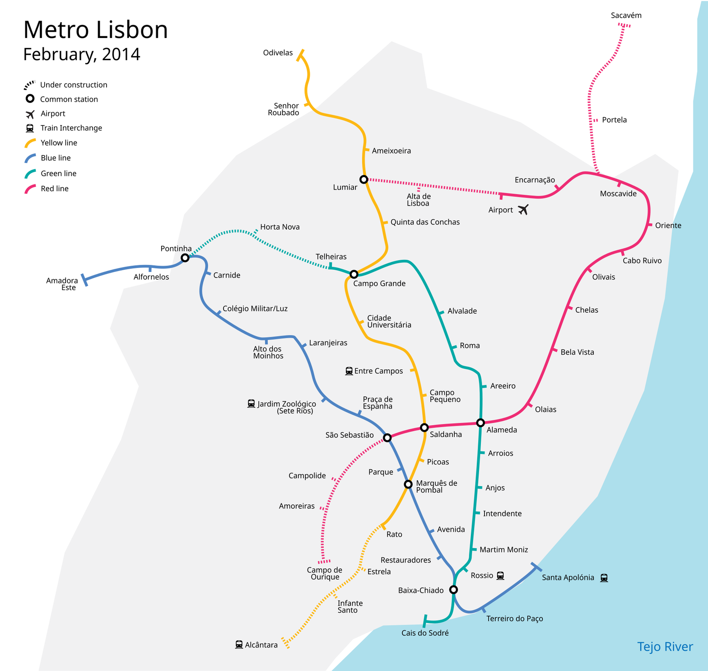
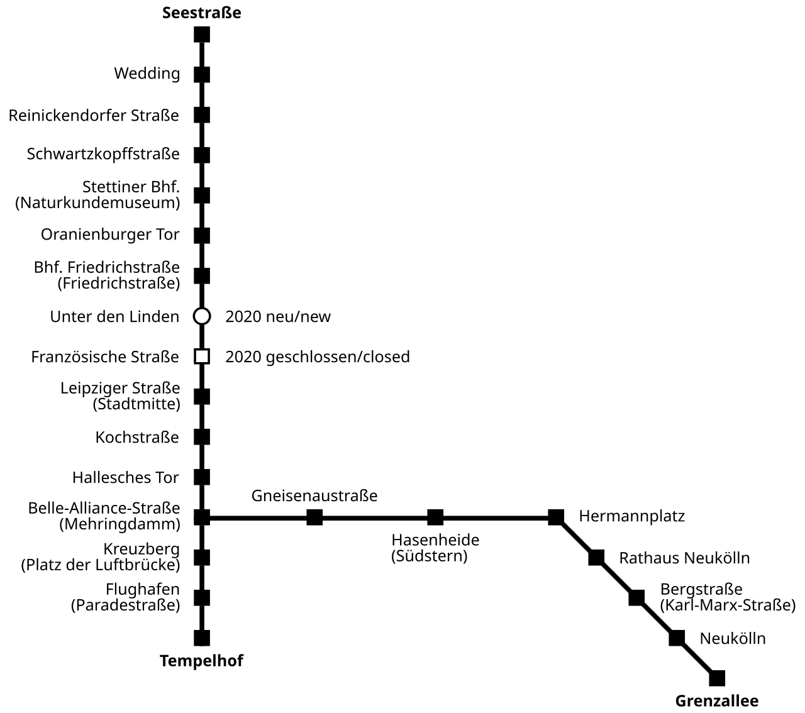
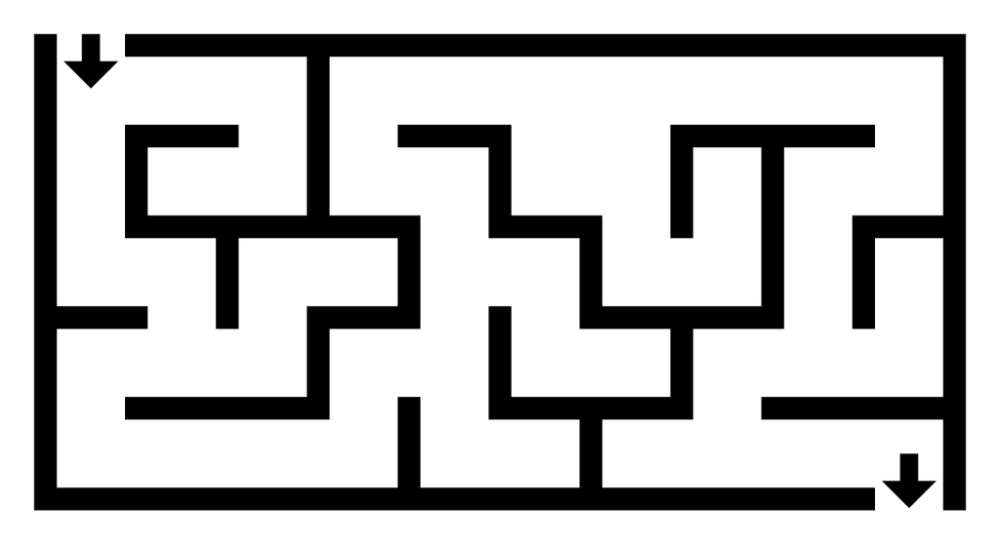
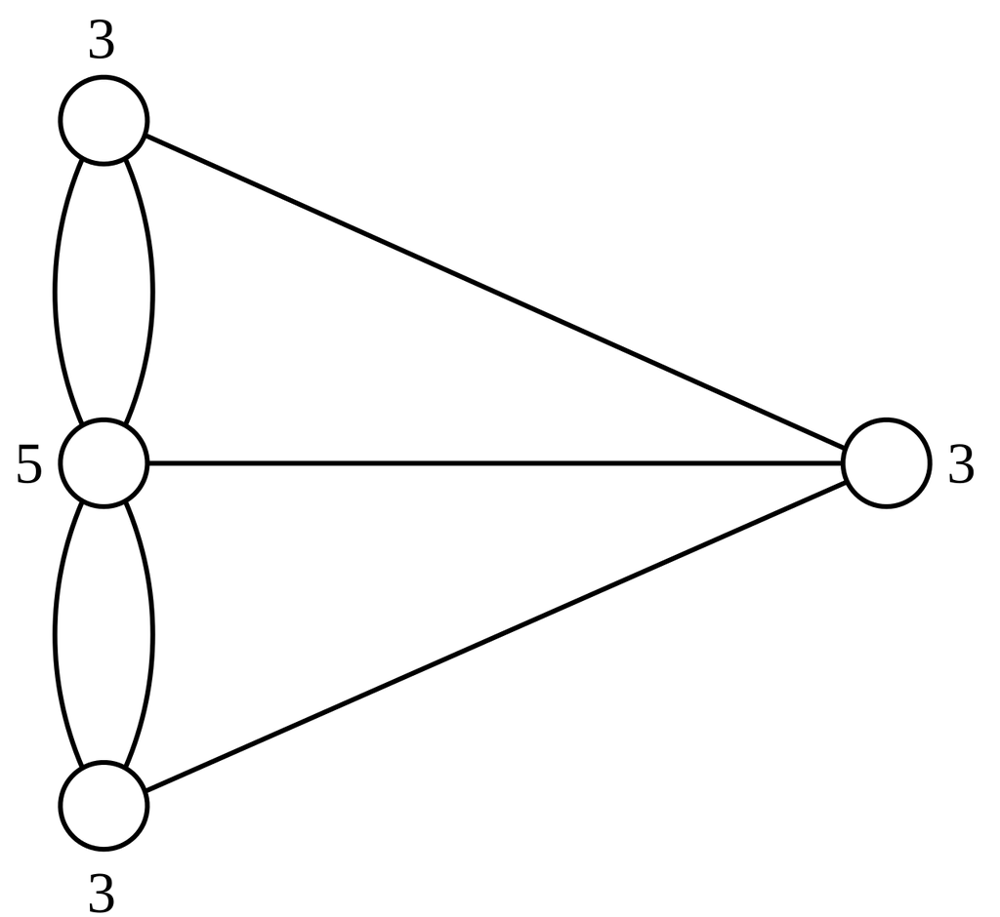
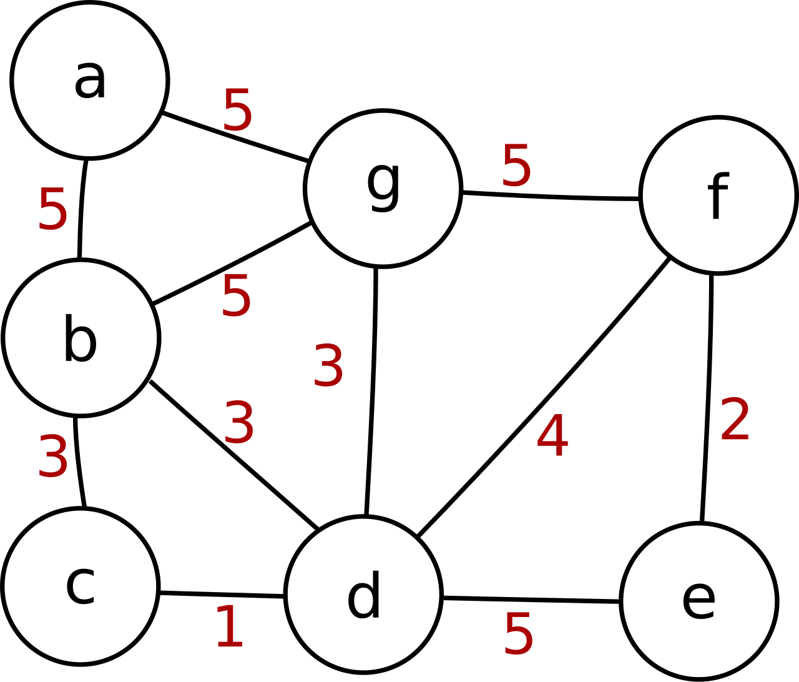
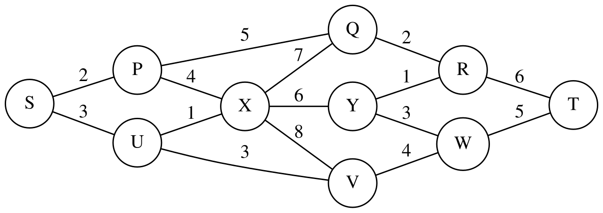

# Navigation and planning

[All families](README.md) · [Methods](../METHODOLOGY.md)

## VB0011

On this Bucharest metro diagram, at which station should a rider change lines to travel from Preciziei (west end of the red line) to Tudor Arghezi (south end of the blue line) with the fewest changes of line?

Rules: Use only solid line segments; ignore dotted or striped segments. A station drawn as two circles joined by a white link, or as one shared circle, is an interchange. Two stations that are merely close together without a link are not an interchange.

Image 1 credit: [Mliu92, CC BY-SA 4.0, via Wikimedia Commons (File:Metro București.svg); credit: Own work, inspired by sources listed below with station names and rough routing from Harta reţelei de metrou din municipiul Bucureşti. Metrorex (April 2016). Archived from the original on 5 January 2017. Retrieved on 5 January 2016.](https://commons.wikimedia.org/wiki/File%3AMetro_Bucure%C8%99ti.svg), [CC BY-SA 4.0](https://creativecommons.org/licenses/by-sa/4.0/). See the [asset manifest](../data/assets.jsonl) for preparation notes.

Options:

- 1: Piața Victoriei
- 2: Dristor
- 3: No single change is enough; at least two changes are needed
- 4: Eroilor
- 5: Piața Unirii

## VB0012

Using this Prague metro plan, what is the smallest number of station-to-station moves from Nemocnice Motol to Letňany?

Rules: Count one move between adjacent station symbols, including departures from and arrivals at the lettered square terminal markers. Changing lines at a shared station costs no moves. Ignore the dotted dark-blue line and the pale-blue river. Minimize moves, regardless of the number of line changes.

Image 1 credit: [Bilykralik16, CC BY-SA 4.0, via Wikimedia Commons (File:Prague metro plan 2022.svg); credit: Own work with the base of File:Prague metro plan 2015.svg](https://commons.wikimedia.org/wiki/File%3APrague_metro_plan_2022.svg), [CC BY-SA 4.0](https://creativecommons.org/licenses/by-sa/4.0/). See the [asset manifest](../data/assets.jsonl) for preparation notes.

Options:

- 1: 16
- 2: 17
- 3: 18
- 4: 19
- 5: 20

## VB0013

What is the smallest total distance for a trip from Maldon to Dunwich?

Rules: Numbers beside the lines are distances. A route's length is the sum of the numbers on the lines it uses. Lines that cross in open space without a circle do not connect. A trip may pass through other towns. If two routes tie for shortest, the question is about the common length.

Image 1 credit: [Pluke, CC0, via Wikimedia Commons (File:CPT-Graphs-undirected-weighted.svg); credit: Own work](https://commons.wikimedia.org/wiki/File%3ACPT-Graphs-undirected-weighted.svg), [CC0](https://creativecommons.org/publicdomain/zero/1.0/). See the [asset manifest](../data/assets.jsonl) for preparation notes.

Options:

- 1: 66
- 2: 72
- 3: 78
- 4: 92
- 5: The least distance is not established by the image

## VB0014

What is the smallest total distance from node 6 to node 7?

Rules: Numbers beside the lines are distances. A route's length is the sum of the numbers on the lines it uses. Lines that cross in open space without a circle do not connect.

Image 1 credit: [BagLuke, CC0, via Wikimedia Commons (File:Weighted friendship graph.svg); credit: Own work](https://commons.wikimedia.org/wiki/File%3AWeighted_friendship_graph.svg), [CC0](https://creativecommons.org/publicdomain/zero/1.0/). See the [asset manifest](../data/assets.jsonl) for preparation notes.

Options:

- 1: 12.34
- 2: 19.85
- 3: 23.45
- 4: 15.14
- 5: 13.08

## VB0015

To travel from Odivelas (north end of the yellow line) to Cais do Sodré (south end of the green line) with as few changes of line as possible, at which station do you change?

Rules: Use only solid line sections; dotted sections are under construction (see the legend) and cannot be used. A white circle marks a station where lines meet (common station). Choose the single station that allows the fewest changes.

Image 1 credit: [Laura Sun, CC BY-SA 3.0, via Wikimedia Commons (File:Lisbon metro.svg); credit: Own work](https://commons.wikimedia.org/wiki/File%3ALisbon_metro.svg), [CC BY-SA 3.0](https://creativecommons.org/licenses/by-sa/3.0/). See the [asset manifest](../data/assets.jsonl) for preparation notes.

Options:

- 1: Lumiar
- 2: Campo Grande
- 3: Marquês de Pombal
- 4: Saldanha
- 5: Alameda

## VB0016

How many stops must a passenger travel from Tempelhof to reach Grenzallee, counting Grenzallee but not Tempelhof?

Rules: The line has one branch. A stop is any black square on the route. The route takes the branch to the right at the junction. Ignore the notes beside the open markers (they are not on this route).

Image 1 credit: [Grummelbacke, CC0, via Wikimedia Commons (File:Nord-sued-u-bahn berlin karte 1930.svg); credit: Own work](https://commons.wikimedia.org/wiki/File%3ANord-sued-u-bahn_berlin_karte_1930.svg), [CC0](https://creativecommons.org/publicdomain/zero/1.0/). See the [asset manifest](../data/assets.jsonl) for preparation notes.

Options:

- 1: 8
- 2: 9
- 3: 10
- 4: 11
- 5: 12

## VB0197

Just inside the upper-left entrance, choose between continuing down and turning right. Which choice can lead to the lower-right exit without returning through that first junction?

Rules: Black lines are impassable walls and white corridors are passable. The arrows mark entry and exit, not extra walls. You may follow bends and later junctions, but cannot cross a wall or leave the maze through its outside boundary.

Image 1 credit: [Vystrix Nexoth, Simple Maze, CC BY-SA 3.0 via GFDL license migration, via Wikimedia Commons; canonical rasterization and metadata-free input conversion.](https://commons.wikimedia.org/wiki/File:Simple_Maze.svg), [CC BY-SA 3.0](https://creativecommons.org/licenses/by-sa/3.0/). See the [asset manifest](../data/assets.jsonl) for preparation notes.

Options:

- 1: Continue down only
- 2: Neither initial choice
- 3: Either initial choice
- 4: Turn right only

## VB0198

Close the straight horizontal connection from the middle-left circle to the right-hand circle. What can be the two endpoints of a walk that uses every remaining connection exactly once?

Rules: Each drawn connection is an undirected edge, including each separate curved connection. You may revisit circles but cannot repeat or omit any remaining edge. The printed numbers describe the original graph, not the graph after closure. Either walking direction is allowed.

Image 1 credit: [Sarang; File:Königsberg Bridges graph.svg; Public domain; via Wikimedia Commons](https://commons.wikimedia.org/wiki/File:K%C3%B6nigsberg_Bridges_graph.svg), [Public domain](https://commons.wikimedia.org/wiki/File:K%C3%B6nigsberg_Bridges_graph.svg). See the [asset manifest](../data/assets.jsonl) for preparation notes.

Options:

- 1: The middle-left and right-hand circles
- 2: The upper-left and lower-left circles
- 3: The upper-left and right-hand circles
- 4: No such walk is possible

## VB0199

Start at a, visit every labeled node at least once, and return to a. What is the smallest possible total edge weight?

Rules: Connections are undirected. Add each traversed edge weight, including repeated traversals. Repeated nodes and edges are allowed; merely finding the shortest path to e does not meet the visit-all-and-return goal.

Image 1 credit: [me, Public domain, via Wikimedia Commons (File:Graph weights.svg); credit: Own work](https://commons.wikimedia.org/wiki/File%3AGraph_weights.svg), [Public domain](https://commons.wikimedia.org/wiki/File%3AGraph_weights.svg). See the [asset manifest](../data/assets.jsonl) for preparation notes.

Options:

- 1: 24
- 2: 25
- 3: 26
- 4: 27

## VB0200

Choose a route from S to T that minimizes its largest single-edge weight, rather than its total weight. Which offered route achieves the best possible bottleneck?

Rules: Connections are undirected and each printed number is that edge's weight. A route's bottleneck is the maximum weight of any edge it uses. Smaller is better. Select a globally optimal route among the offered choices.

Image 1 credit: [Willprice, CC BY-SA 3.0, via Wikimedia Commons (File:Dijkstra algorithm 1.svg); credit: Own work](https://commons.wikimedia.org/wiki/File%3ADijkstra_algorithm_1.svg), [CC BY-SA 3.0](https://creativecommons.org/licenses/by-sa/3.0/). See the [asset manifest](../data/assets.jsonl) for preparation notes.

Options:

- 1: S-U-X-Y-R-T
- 2: S-U-V-W-T
- 3: S-P-X-Y-W-T
- 4: S-P-Q-R-T
