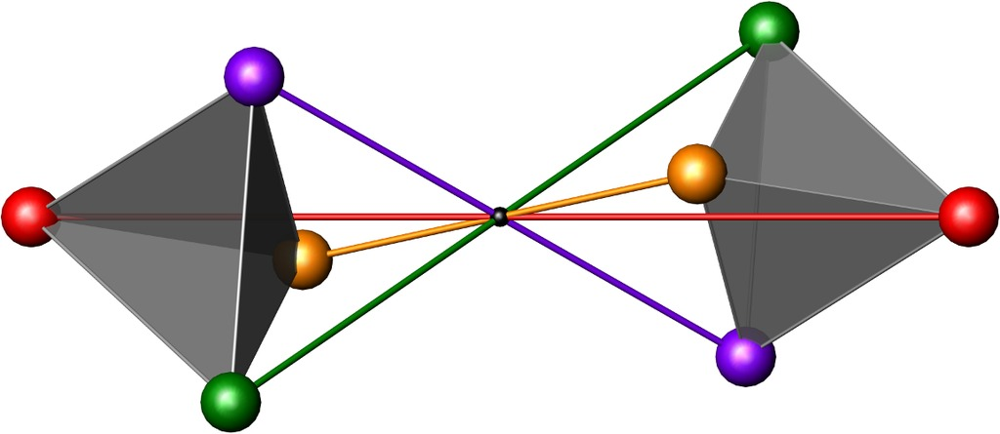
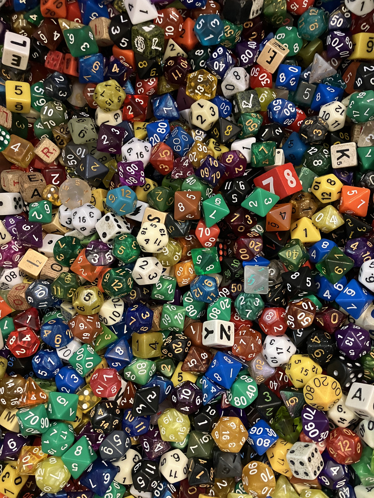
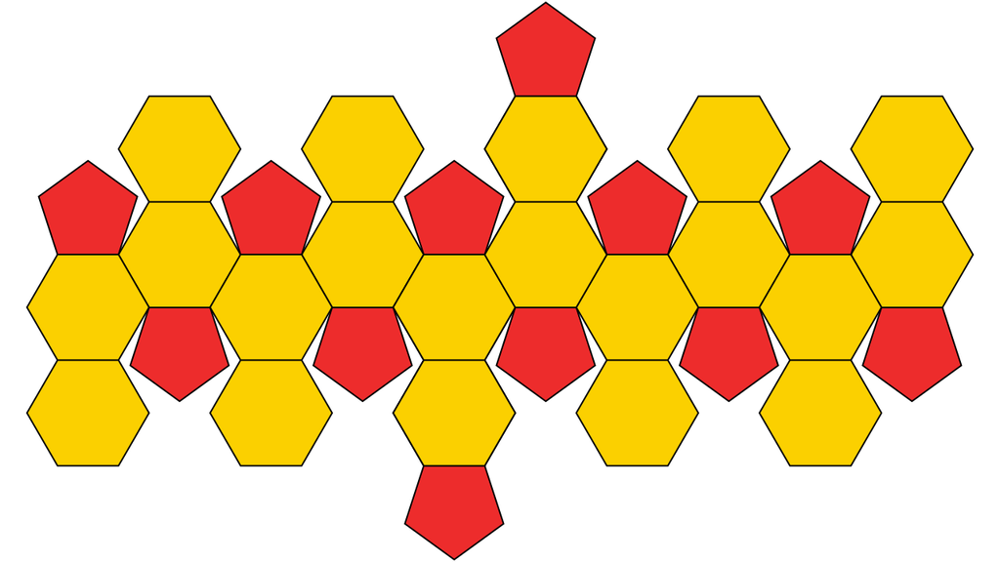
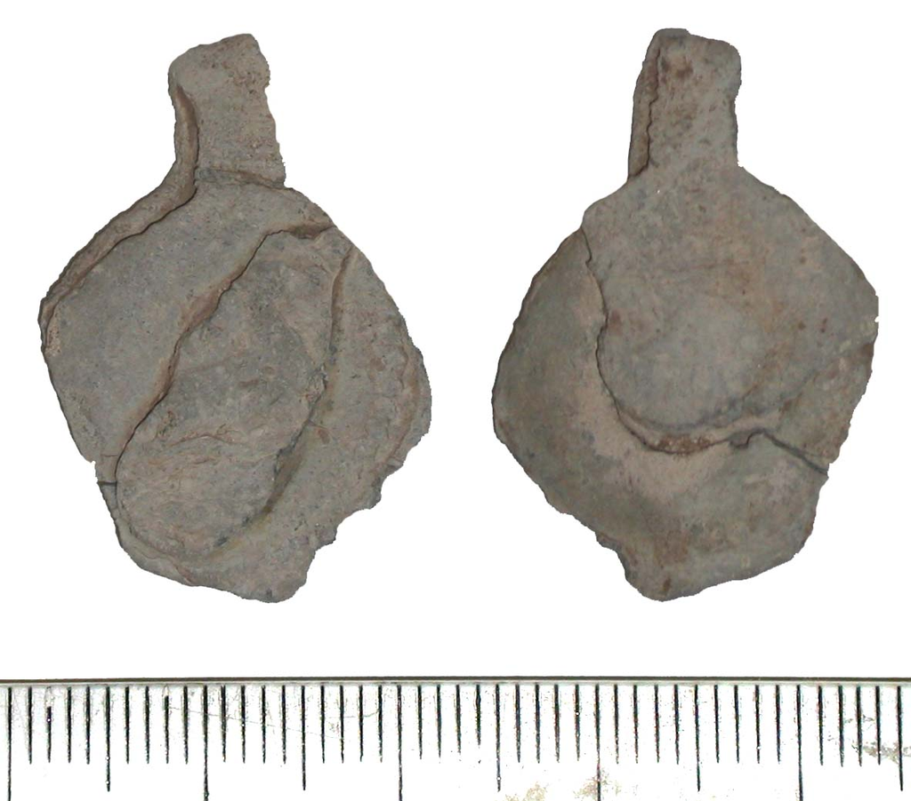
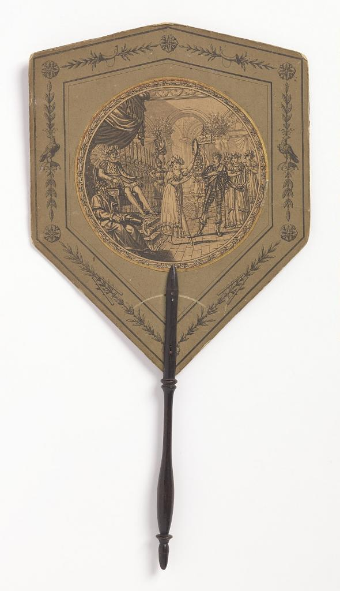
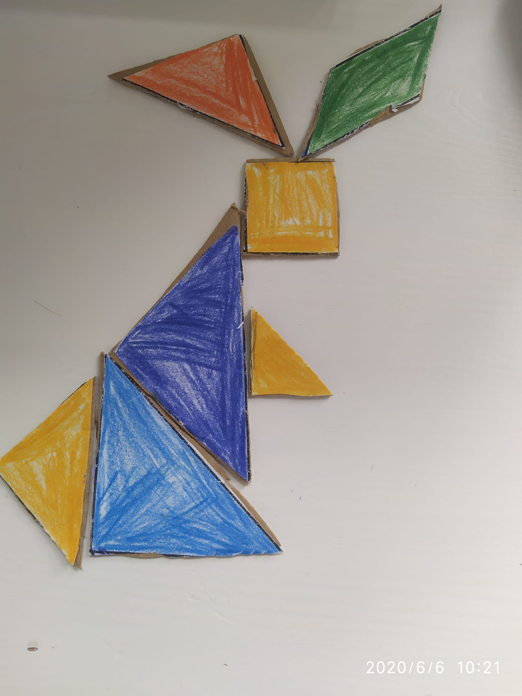
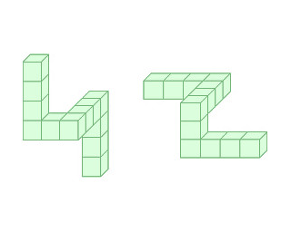
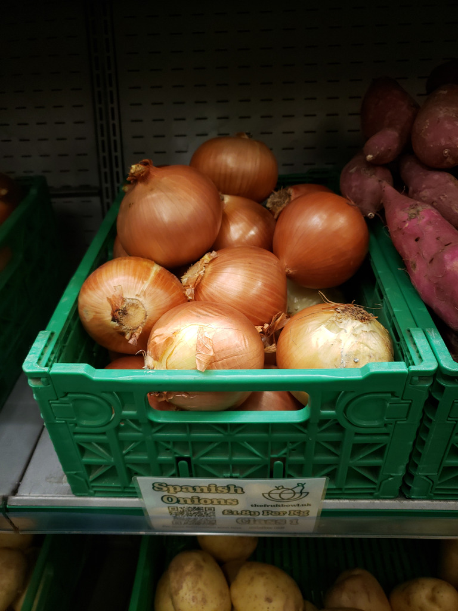
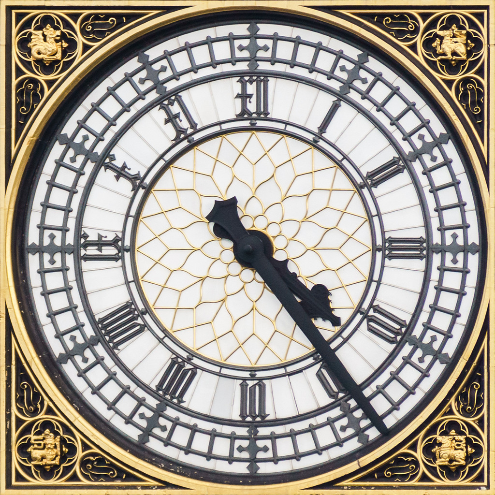
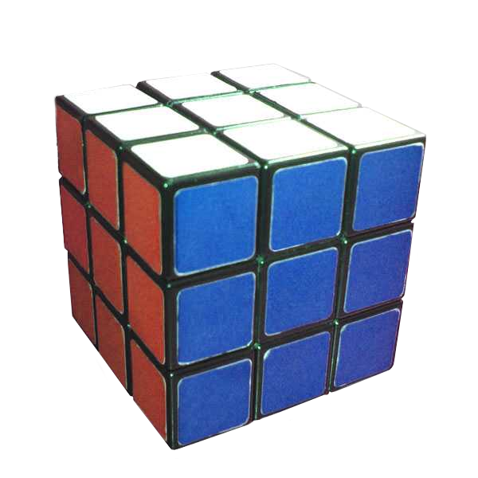

# Rotation and reflection

[All families](README.md) · [Methods](../METHODOLOGY.md)

## VB0086

Suppose the left four-sphere figure is reflected horizontally across a vertical line passing through the central black point (a left-to-right mirror flip in the image plane, with no vertical flip). Compared with the actual right-hand figure shown in the diagram, which pair of vertex sphere colors would remain swapped?

Rules: A horizontal reflection across a vertical line reverses left-right positions while keeping top-bottom positions unchanged in the two-dimensional image.

Image 1 credit: [File:3D point reflection.png / Wikimedia Commons](https://commons.wikimedia.org/wiki/File:3D_point_reflection.png), [CC0](https://creativecommons.org/publicdomain/zero/1.0/). See the [asset manifest](../data/assets.jsonl) for preparation notes.

Options:

- 1: Red and orange
- 2: Red and green
- 3: Purple and green
- 4: Purple and orange

## VB0096

Imagine rotating the whole photograph 90 degrees clockwise. Relative to the cream cube marked K near the upper-right, where would the red cube with the large 8 be after that rotation?

Rules: Use positions on the rotated image. Rotate both dice together; do not turn either die separately.

Image 1 credit: [Ironmaidenfun; File:Assorted dice for games, 2024.jpg; CC BY-SA 4.0; via Wikimedia Commons](https://commons.wikimedia.org/wiki/File:Assorted_dice_for_games,_2024.jpg), [CC BY-SA 4.0](https://creativecommons.org/licenses/by-sa/4.0/). See the [asset manifest](../data/assets.jsonl) for preparation notes.

Options:

- 1: Below and right
- 2: Below and left
- 3: Above and right
- 4: Above and left

## VB0109

Imagine rotating the whole net 180 degrees in the image plane. Relative to the red pentagon that is currently bottommost, where would the red pentagon that is currently topmost lie after the rotation?

Rules: Track the same two faces through the rotation. Use directions on the resulting image, not directions on a folded solid.

Image 1 credit: [Cmglee; File:Polyhedron truncated 20 net compact.svg; CC BY-SA 4.0; via Wikimedia Commons](https://commons.wikimedia.org/wiki/File:Polyhedron_truncated_20_net_compact.svg), [CC BY-SA 4.0](https://creativecommons.org/licenses/by-sa/4.0/). See the [asset manifest](../data/assets.jsonl) for preparation notes.

Options:

- 1: Above and left
- 2: Above and right
- 3: Below and left
- 4: Below and right

## VB0115

Keeping the narrow projecting neck at the top, which transformation best matches the outline of the left seal photograph to the outline of the right one?

Rules: Allow translation and small scale differences. Compare the asymmetric outer silhouette, not the surface cracks or the ruler. Do not turn the neck downward.

Image 1 credit: [Birmingham Museums Trust, Caroline Johnson, 2007-07-05 13:48:13; File:Medieval - Post Medieval bag seal (front and back views) (FindID 182369).jpg; CC BY-SA 2.0; via Wikimedia Commons](https://commons.wikimedia.org/wiki/File:Medieval_-_Post_Medieval_bag_seal_(front_and_back_views)_(FindID_182369).jpg), [CC BY-SA 2.0](https://creativecommons.org/licenses/by-sa/2.0/). See the [asset manifest](../data/assets.jsonl) for preparation notes.

Options:

- 1: An up-down reflection
- 2: A 180-degree rotation
- 3: Translation only, with no reflection
- 4: A left-right reflection

## VB0136

Imagine rotating this entire image 90 degrees counterclockwise. In which direction from the shield-shaped head would the long handle then extend?

Rules: Rotate the image in its plane, not the object in depth. Use directions on the rotated image.

Image 1 credit: [Cooper Hewitt, Smithsonian Design Museum; Handscreen](https://collection.cooperhewitt.org/view/objects/asitem/id/44641), [CC0](https://creativecommons.org/publicdomain/zero/1.0/). See the [asset manifest](../data/assets.jsonl) for preparation notes.

Options:

- 1: Down
- 2: Right
- 3: Left
- 4: Up

## VB0144

To make a left-right mirror arrangement of this rabbit, which colored shape has a mirrored outline that cannot be obtained by rotating that piece in the table plane?

Rules: Treat the cutouts as ideal standard tangram pieces and ignore hand-cut roughness, shading and crayon strokes. Pieces may move and rotate but cannot be turned over. Compare each piece with the mirror of its own outline.

Image 1 credit: [Cecilia2611; File:Coniglio Tangram.jpg; CC BY-SA 4.0; via Wikimedia Commons](https://commons.wikimedia.org/wiki/File:Coniglio_Tangram.jpg), [CC BY-SA 4.0](https://creativecommons.org/licenses/by-sa/4.0/). See the [asset manifest](../data/assets.jsonl) for preparation notes.

Options:

- 1: The yellow square
- 2: The light-blue triangle
- 3: The orange triangle
- 4: The green parallelogram

## VB0145

Can the entire left cube-chain shape be made identical to the entire right one by a rigid rotation in three-dimensional space?

Rules: Read the cubes as equal units and the straight runs as perpendicular. Preserve the connected chain, including its unique four-cube end. Rotation is not reflection and pieces cannot be detached.

Image 1 credit: [File:Mental rotation task (diagram) (cropped).jpg / Wikimedia Commons](https://commons.wikimedia.org/wiki/File:Mental_rotation_task_(diagram)_(cropped).jpg), [Public domain](https://creativecommons.org/publicdomain/mark/1.0/). See the [asset manifest](../data/assets.jsonl) for preparation notes.

Options:

- 1: The shapes contain different numbers of cubes
- 2: Yes, using only a rigid rotation
- 3: Neither rotation nor reflection can relate them
- 4: No by rotation, but a mirror reflection can relate them

## VB0152

Imagine rotating this whole photograph90 degrees counterclockwise. Relative to the center of the brown onion pile, where would the Spanish Onions label then be?

Rules: Rotate the image in its plane without reflecting it. Track the same pile and front label. Use directions on the rotated photograph.

Image 1 credit: [Andy Li; File:Spanish Onions - The Fruit Bowl, Brighton 2024-03-21.jpg; CC0; via Wikimedia Commons](https://commons.wikimedia.org/wiki/File:Spanish_Onions_-_The_Fruit_Bowl,_Brighton_2024-03-21.jpg), [CC0](https://creativecommons.org/publicdomain/zero/1.0/). See the [asset manifest](../data/assets.jsonl) for preparation notes.

Options:

- 1: Below
- 2: Above
- 3: Right
- 4: Left

## VB0176

Reflect the long clock hand across the vertical line through the hub, then rotate that reflected hand90 degrees clockwise around the hub. In which image quadrant would its pointed tip finish?

Rules: Track the longer hand's far pointed tip, not the short counterweight behind the hub. Transform the hand only; keep the image directions and dial fixed. Reflection happens before rotation.

Image 1 credit: [Colin; File:Big Ben Inner Clock Face.jpg; CC BY-SA 4.0; via Wikimedia Commons](https://commons.wikimedia.org/wiki/File:Big_Ben_Inner_Clock_Face.jpg), [CC BY-SA 4.0](https://creativecommons.org/licenses/by-sa/4.0/). See the [asset manifest](../data/assets.jsonl) for preparation notes.

Options:

- 1: Upper-left
- 2: Upper-right
- 3: Lower-right
- 4: Lower-left

## VB0177

First yaw the whole cube90 degrees clockwise as viewed from above. Then, looking straight at its new front face, roll the whole cube90 degrees clockwise. Which visible color from the original photograph finishes on top?

Rules: Define the original face on image-left as front, the face on image-right as right, and the upper face as top. After the yaw, front/right/top refer to fixed spatial positions, not original face identities. Turn the whole cube, not an individual layer.

Image 1 credit: [File:Rubiks cube solved.jpg: Mike Gonzalez (TheCoffee)
derivative work: Pbroks13; File:Rubiks cube solved.png; CC BY-SA 3.0; via Wikimedia Commons](https://commons.wikimedia.org/wiki/File:Rubiks_cube_solved.png), [CC BY-SA 3.0](https://creativecommons.org/licenses/by-sa/3.0/). See the [asset manifest](../data/assets.jsonl) for preparation notes.

Options:

- 1: A hidden color that cannot be identified
- 2: Red
- 3: White
- 4: Blue
