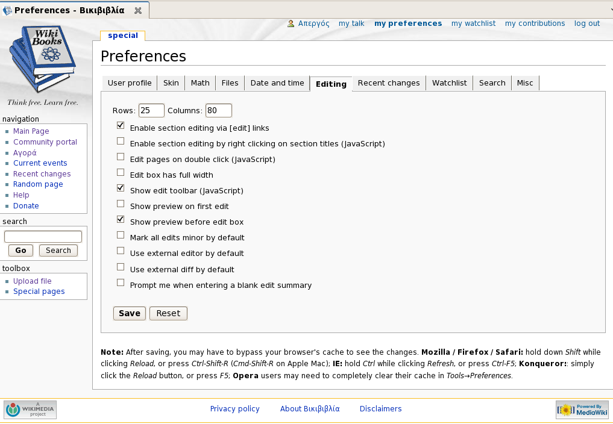
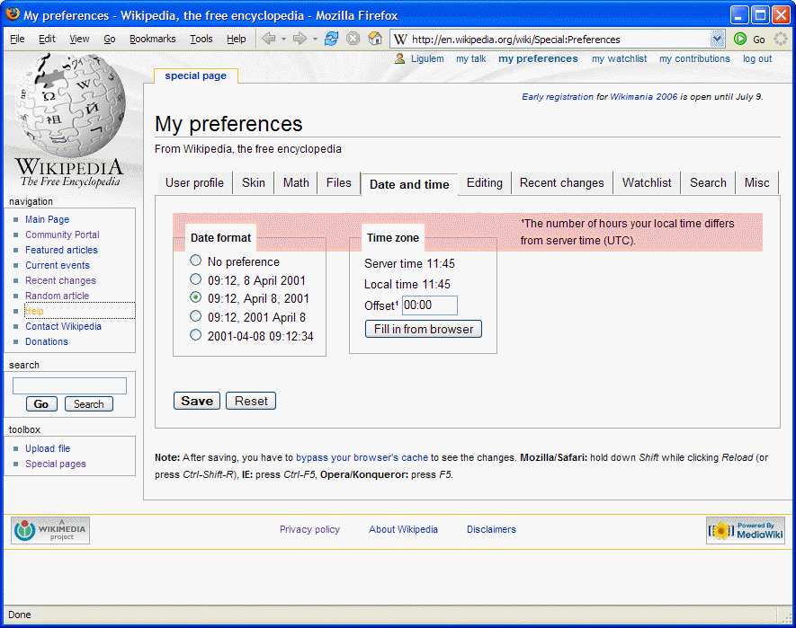
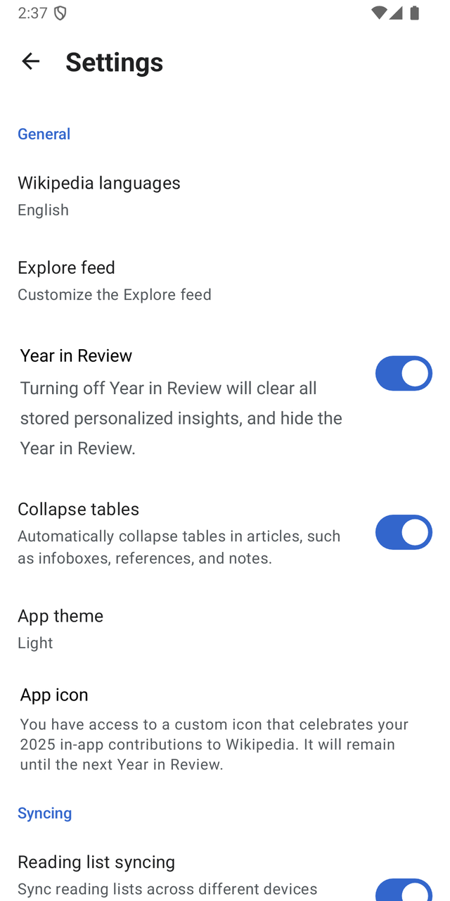
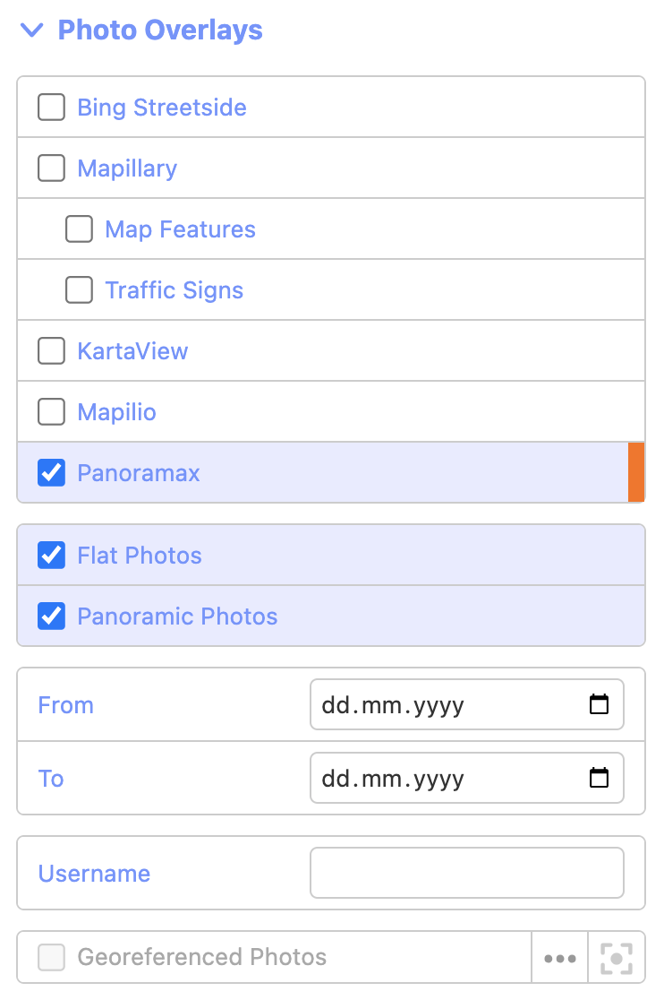
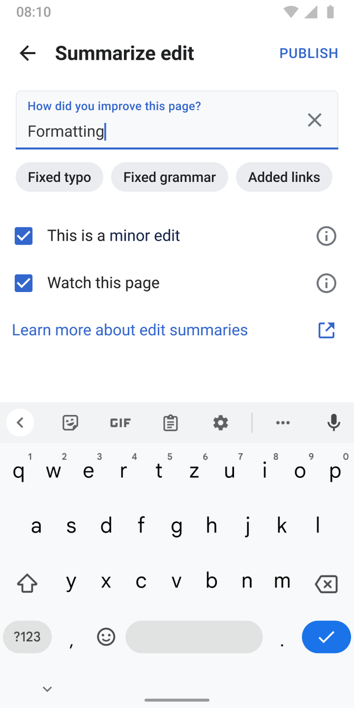
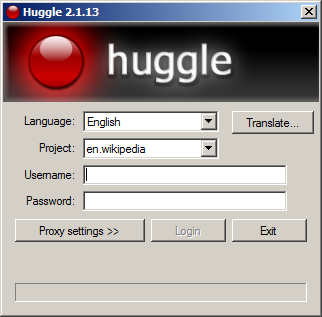
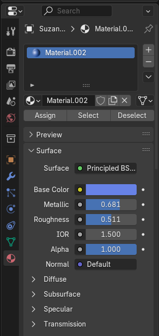
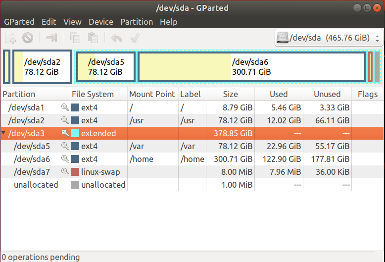
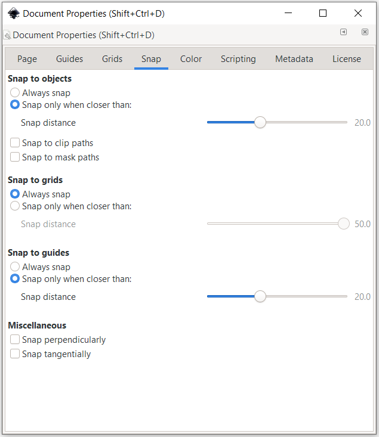
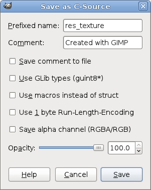

# Interface state decisions

[All families](README.md) · [Methods](../METHODOLOGY.md)

## VB0064

A user wants both 'Show preview on first edit' and 'Show preview before edit box' to be turned on in this preferences tab. What is the minimum change needed before pressing Save?

Rules: Clicking a checkbox toggles it. Do not change any other setting. Ignore the other tabs.

Image 1 credit: [self, CC BY-SA 3.0, via Wikimedia Commons (File:Screenshot Preferences Βικιβιβλία 5.png); credit: www.mediawiki.org (source code), el.wikibooks.org (content)](https://commons.wikimedia.org/wiki/File%3AScreenshot_Preferences_%CE%92%CE%B9%CE%BA%CE%B9%CE%B2%CE%B9%CE%B2%CE%BB%CE%AF%CE%B1_5.png), [CC BY-SA 3.0](https://creativecommons.org/licenses/by-sa/3.0/). See the [asset manifest](../data/assets.jsonl) for preparation notes.

Options:

- 1: Tick 'Show preview on first edit' only
- 2: Tick both 'Show preview on first edit' and 'Show preview before edit box'
- 3: Untick 'Show preview before edit box' and tick 'Show preview on first edit'
- 4: Nothing needs to change on this tab
- 5: Tick 'Show preview before edit box' only

## VB0065

A user wants dates written in the all-numeric style that begins with the year (like 2001-04-08 09:12:34) and does not want any time-zone change. Which action on this page achieves that?

Rules: Pressing Save stores the visible choices. Do not change fields that the goal does not mention.

Image 1 credit: [Original uploader was Ligulem at meta Wikimedia Foundation Governance Wiki, CC BY-SA 4.0, via Wikimedia Commons (File:Date-preferences-Screenshot.png); credit: Transferred from meta.wikimedia to Commons.](https://commons.wikimedia.org/wiki/File%3ADate-preferences-Screenshot.png), [CC BY-SA 4.0](https://creativecommons.org/licenses/by-sa/4.0/). See the [asset manifest](../data/assets.jsonl) for preparation notes.

Options:

- 1: Select '09:12, 2001 April 8', then Save
- 2: The required date-format action is not established by this screenshot
- 3: Click 'Fill in from browser', then Save
- 4: Select the radio button beside '2001-04-08 09:12:34', then Save
- 5: Keep the current selection and click Save

## VB0066

A user wants to keep 'Year in Review' as it is but does not want tables in articles to be collapsed automatically. What is the smallest change to make on this screen?

Rules: A switch with its knob on the right and a blue track is on; a switch with its knob on the left is off. Tapping a switch flips it. Make no other change.

Image 1 credit: [SChekfa-WMF, CC BY 4.0, via Wikimedia Commons (File:Android settings screen year in review.png); credit: Wikimedia Foundation Design](https://commons.wikimedia.org/wiki/File%3AAndroid_settings_screen_year_in_review.png), [CC BY 4.0](https://creativecommons.org/licenses/by/4.0/). See the [asset manifest](../data/assets.jsonl) for preparation notes.

Options:

- 1: No change is needed
- 2: Tap the 'Collapse tables' switch once
- 3: Tap the 'Year in Review' switch once
- 4: Tap 'App theme' and choose another theme
- 5: Tap both the 'Year in Review' and 'Collapse tables' switches

## VB0067

A mapper wants to see only the flat (non-panoramic) photos from the Panoramax overlay and keep every other overlay setting unchanged. What is the smallest change to make?

Rules: A ticked box means the item is shown. A greyed-out item cannot be changed.

Image 1 credit: [Pajbr, CC0, via Wikimedia Commons (File:Panoramax in iD editor 20241002.png); credit: Own work](https://commons.wikimedia.org/wiki/File%3APanoramax_in_iD_editor_20241002.png), [CC0](https://creativecommons.org/publicdomain/zero/1.0/). See the [asset manifest](../data/assets.jsonl) for preparation notes.

Options:

- 1: Untick 'Panoramic Photos'
- 2: Untick 'Flat Photos'
- 3: Tick 'Georeferenced Photos'
- 4: Tick 'Mapillary'
- 5: Untick 'Panoramax'

## VB0068

The edit summary 'Formatting' is correct, but the user's change is not a minor edit and they still want to watch the page. What must be changed before tapping PUBLISH?

Rules: A box with a blue fill and a white check mark is ticked. Make the smallest possible change.

Image 1 credit: [ARamadan-WMF, CC BY-SA 4.0, via Wikimedia Commons (File:Edit-summary in Wikipedia mobile app.png); credit: Own work](https://commons.wikimedia.org/wiki/File%3AEdit-summary_in_Wikipedia_mobile_app.png), [CC BY-SA 4.0](https://creativecommons.org/licenses/by-sa/4.0/). See the [asset manifest](../data/assets.jsonl) for preparation notes.

Options:

- 1: Untick 'Watch this page'
- 2: Clear the summary with the X button
- 3: Nothing; tap PUBLISH now
- 4: Tap the 'Added links' suggestion
- 5: Untick 'This is a minor edit'

## VB0069

The user wants to log in to de.wikipedia while keeping the program's menus in English. Apart from entering credentials, what is the smallest required change from the visible state?

Rules: Project selects the wiki site. Language selects the program's menu language. Leave unrelated settings unchanged.

Image 1 credit: [Addshore at English Wikipedia, Public domain, via Wikimedia Commons (File:Huggle Login Form.png); credit: Transferred from en.wikipedia to Commons by IngerAlHaosului using CommonsHelper.](https://commons.wikimedia.org/wiki/File%3AHuggle_Login_Form.png), [Public domain](https://commons.wikimedia.org/wiki/File%3AHuggle_Login_Form.png). See the [asset manifest](../data/assets.jsonl) for preparation notes.

Options:

- 1: Change Project only
- 2: Neither Project nor Language needs changing
- 3: Change Language only
- 4: Change both Project and Language

## VB0181

The goal is Metallic at least0.80, Roughness at most0.40, and Alpha exactly1.00, leaving all other parameters unchanged. Which displayed parameters need changing?

Rules: Use the values currently displayed in this property panel. Changing one parameter does not automatically change the other two. Select the complete minimum set; no live application action is requested.

Image 1 credit: [UnnecessaryDecision, CC0, via Wikimedia Commons (File:Blender 4.3.2 screenshot.png); credit: Own work](https://commons.wikimedia.org/wiki/File%3ABlender_4.3.2_screenshot.png), [CC0](https://creativecommons.org/publicdomain/zero/1.0/). See the [asset manifest](../data/assets.jsonl) for preparation notes.

Options:

- 1: Metallic and Roughness only
- 2: Metallic only
- 3: Roughness only
- 4: Metallic, Roughness and Alpha

## VB0190

Select a partition row whose file system is ext4, whose total Size is at most 100 GiB, and whose Unused space is at least 60 GiB. Which offered row satisfies all three requirements?

Rules: Use the table, not the relative widths of the colored blocks. This is a read-only selection question, not a request to change any disk. An extended container is not an ext4 file system.

Image 1 credit: [Pbmacsodak; File:Gparted screen showing partition.png; CC BY-SA 4.0; via Wikimedia Commons](https://commons.wikimedia.org/wiki/File:Gparted_screen_showing_partition.png), [CC BY-SA 4.0](https://creativecommons.org/licenses/by-sa/4.0/). See the [asset manifest](../data/assets.jsonl) for preparation notes.

Options:

- 1: Select /dev/sda6
- 2: Select /dev/sda5
- 3: Select /dev/sda2
- 4: Keep the highlighted /dev/sda3 row

## VB0191

The goal is Always snap for objects, grids and guides, leaving all other settings unchanged. In which groups must the selected radio option change?

Rules: A blue filled circle marks the selected radio option. Each group permits one selected option. Choose the complete minimum set of groups that need changing from the pictured state.

Image 1 credit: [Stilfehler; File:Inkscape Document Properties Snap.png; CC BY-SA 4.0; via Wikimedia Commons](https://commons.wikimedia.org/wiki/File:Inkscape_Document_Properties_Snap.png), [CC BY-SA 4.0](https://creativecommons.org/licenses/by-sa/4.0/). See the [asset manifest](../data/assets.jsonl) for preparation notes.

Options:

- 1: Guides only
- 2: Objects, grids and guides
- 3: Objects and guides only
- 4: Objects only

## VB0192

Starting from the pictured state, export with run-length encoding and an alpha channel, without saving a comment. Which complete set of checkboxes needs toggling?

Rules: An empty checkbox is off. A comment is saved only when Save comment to file is on, even if the Comment text field contains text. Leave all unrelated options and field values unchanged.

Image 1 credit: [Gimp team; File:OpenGL Tutorial Gimp export as C.png; CC BY-SA 4.0; via Wikimedia Commons](https://commons.wikimedia.org/wiki/File:OpenGL_Tutorial_Gimp_export_as_C.png), [CC BY-SA 4.0](https://creativecommons.org/licenses/by-sa/4.0/). See the [asset manifest](../data/assets.jsonl) for preparation notes.

Options:

- 1: Run-Length-Encoding and Save alpha channel only
- 2: Save alpha channel only
- 3: Run-Length-Encoding only
- 4: The required checkbox changes are not established by this screenshot
