# Inspection against a reference

[All families](README.md) · [Methods](../METHODOLOGY.md)

## VB0088

Image 1 is a reference photograph of four candles. In Image 2, which candle has a clearly visible cluster of dark particles on its wax surface above the wick, unlike the reference candles?

Rules: Identify a visible surface difference only; do not infer product safety or hidden damage. Positions refer to the two-by-two arrangement in Image 2.

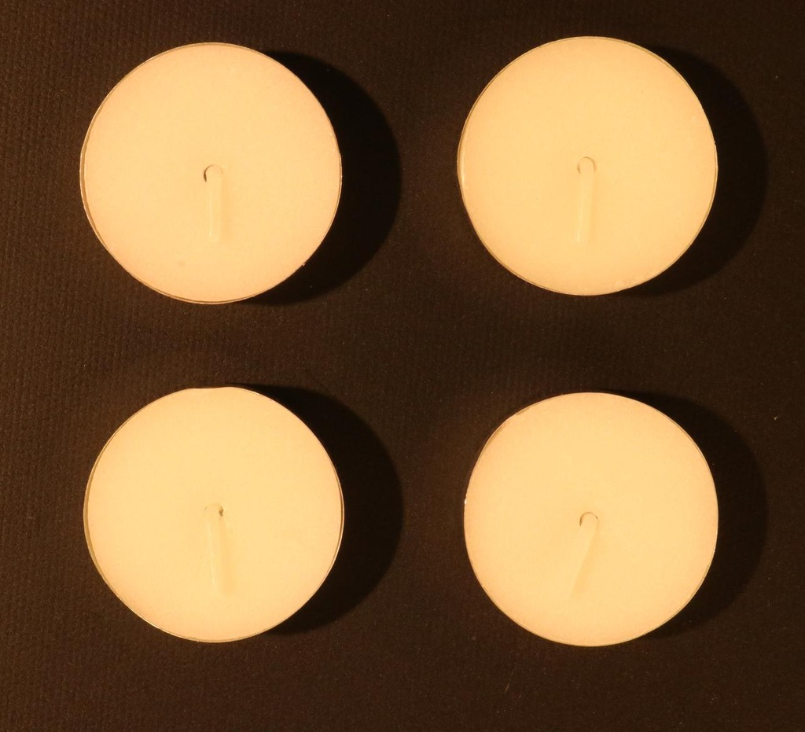

Image 1 credit: [Zou et al., Spot-the-Difference Self-Supervised Pre-training for Anomaly Detection and Segmentation (VisA Dataset), Amazon Science, CC BY 4.0](https://github.com/amazon-science/spot-diff), [CC BY 4.0](https://creativecommons.org/licenses/by/4.0/). See the [asset manifest](../data/assets.jsonl) for preparation notes.

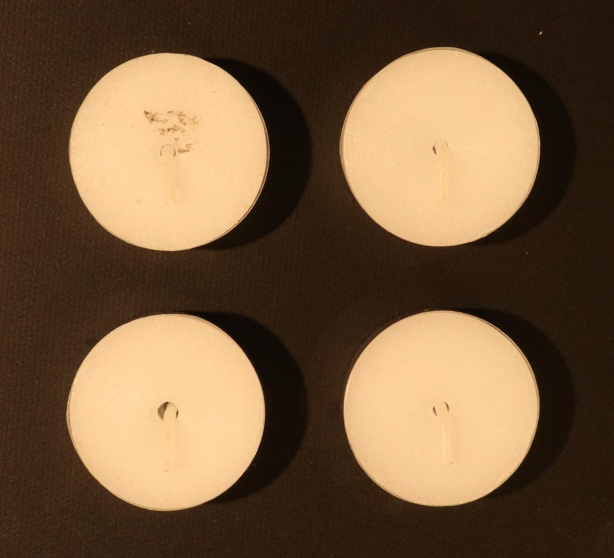

Image 2 credit: [Zou et al., VisA Dataset, Amazon Science, CC BY 4.0](https://github.com/amazon-science/spot-diff), [CC BY 4.0](https://creativecommons.org/licenses/by/4.0/). See the [asset manifest](../data/assets.jsonl) for preparation notes.

Options:

- 1: Top-left
- 2: Top-right
- 3: Bottom-left
- 4: Bottom-right

## VB0097

Compared with the soft shadows around the reference capsules in Image 1, which capsule in Image 2 has an irregular, sharply bounded black patch extending around its lower edge?

Rules: Identify the visible pattern only. Do not infer leakage, chemical contents or product safety.

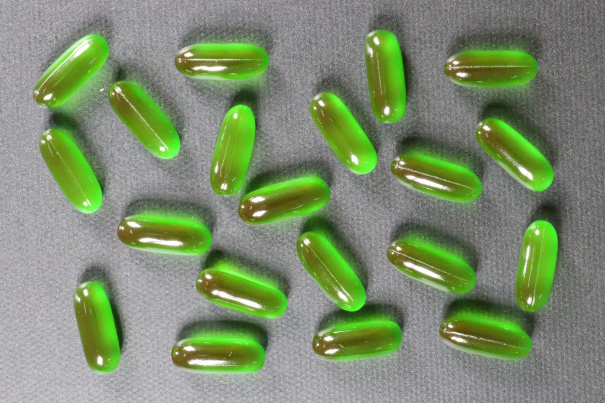

Image 1 credit: [VisA dataset, Yang Zou, Jongheon Jeong, Latha Pemula, Dongqing Zhang and Onkar Dabeer, 2022](https://github.com/amazon-science/spot-diff), [CC BY 4.0](https://creativecommons.org/licenses/by/4.0/). See the [asset manifest](../data/assets.jsonl) for preparation notes.

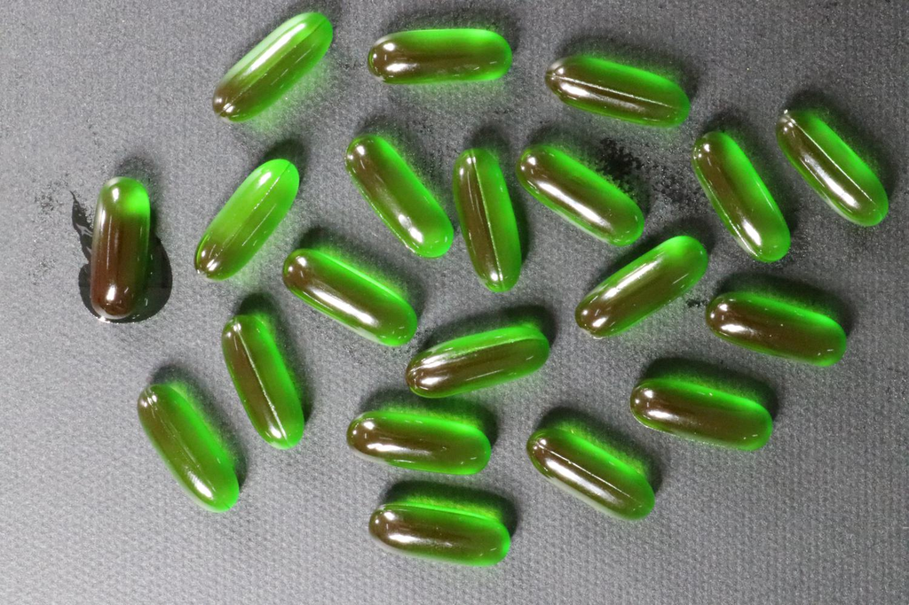

Image 2 credit: [VisA dataset, Yang Zou, Jongheon Jeong, Latha Pemula, Dongqing Zhang and Onkar Dabeer, 2022](https://github.com/amazon-science/spot-diff), [CC BY 4.0](https://creativecommons.org/licenses/by/4.0/). See the [asset manifest](../data/assets.jsonl) for preparation notes.

Options:

- 1: The far-left nearly upright capsule
- 2: The nearly upright capsule near the center
- 3: The uppermost horizontal capsule
- 4: No capsule has such a patch

## VB0098

After matching the printed T and R labels between the two photographs, which visible part is missing in Image 2 compared with Image 1?

Rules: The board orientations differ. Match the labels, not just the image-left and image-right positions. Do not infer electrical function.

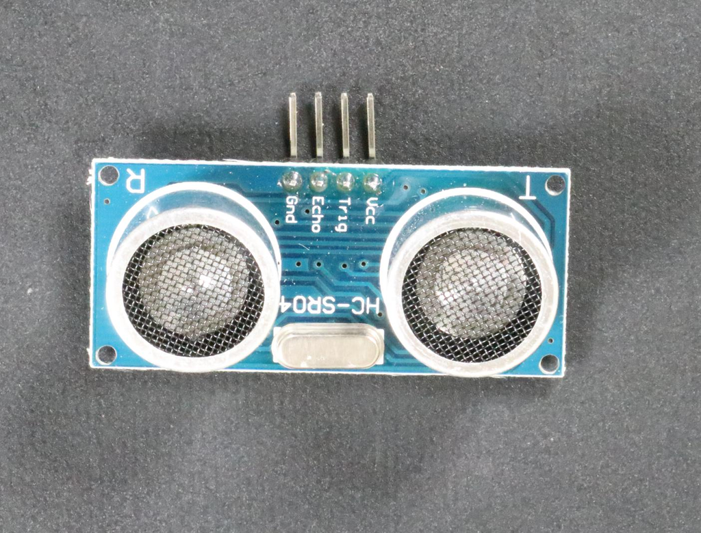

Image 1 credit: [VisA dataset, Yang Zou, Jongheon Jeong, Latha Pemula, Dongqing Zhang and Onkar Dabeer, 2022](https://github.com/amazon-science/spot-diff), [CC BY 4.0](https://creativecommons.org/licenses/by/4.0/). See the [asset manifest](../data/assets.jsonl) for preparation notes.

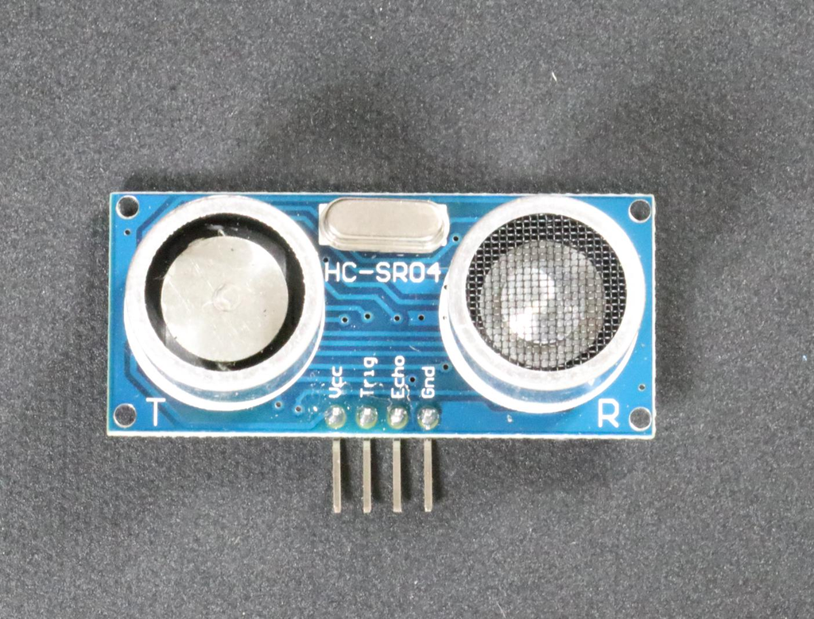

Image 2 credit: [VisA dataset, Yang Zou, Jongheon Jeong, Latha Pemula, Dongqing Zhang and Onkar Dabeer, 2022](https://github.com/amazon-science/spot-diff), [CC BY 4.0](https://creativecommons.org/licenses/by/4.0/). See the [asset manifest](../data/assets.jsonl) for preparation notes.

Options:

- 1: The outer metal ring of the R-labeled circular unit
- 2: The mesh cover of the T-labeled circular unit
- 3: The mesh cover of the R-labeled circular unit
- 4: The outer metal ring of the T-labeled circular unit

## VB0099

Which region of the object in Image 2 has a rough pit that is not present on the smooth reference object in Image 1?

Rules: Judge the visible surface, not a proposed cause or whether the object is safe to use.

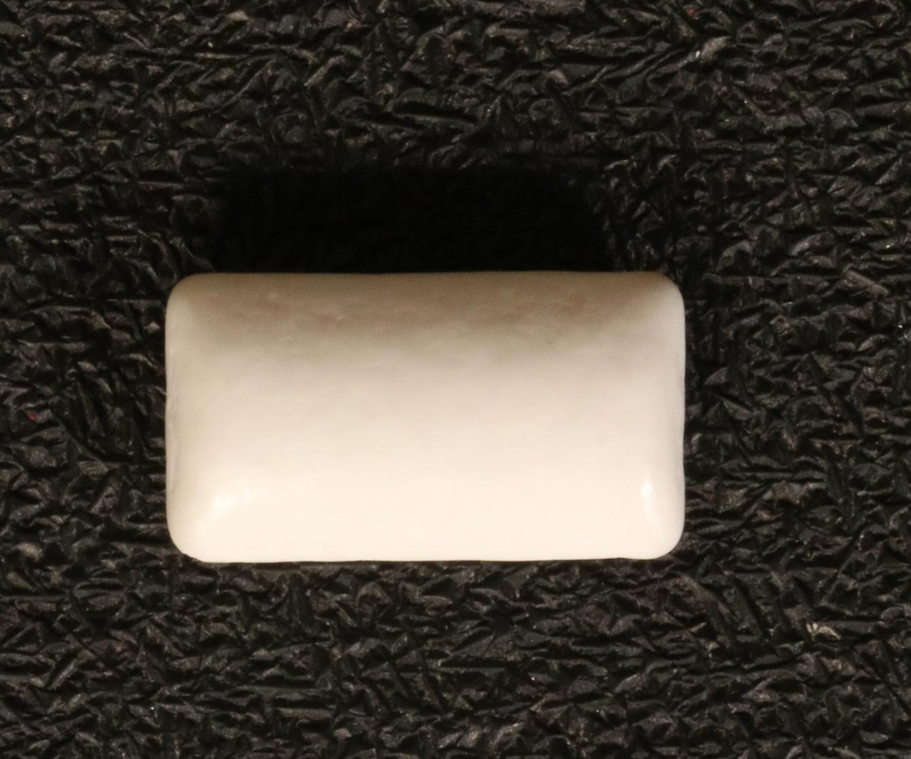

Image 1 credit: [VisA dataset, Yang Zou, Jongheon Jeong, Latha Pemula, Dongqing Zhang and Onkar Dabeer, 2022](https://github.com/amazon-science/spot-diff), [CC BY 4.0](https://creativecommons.org/licenses/by/4.0/). See the [asset manifest](../data/assets.jsonl) for preparation notes.

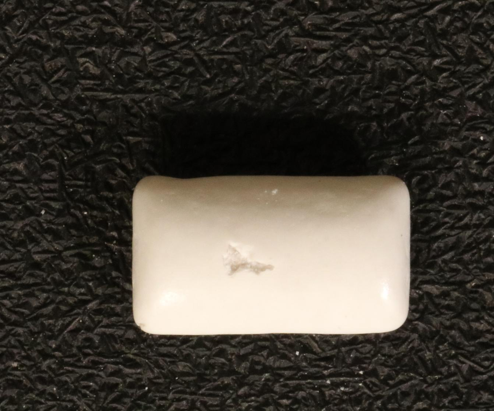

Image 2 credit: [VisA dataset, Yang Zou, Jongheon Jeong, Latha Pemula, Dongqing Zhang and Onkar Dabeer, 2022](https://github.com/amazon-science/spot-diff), [CC BY 4.0](https://creativecommons.org/licenses/by/4.0/). See the [asset manifest](../data/assets.jsonl) for preparation notes.

Options:

- 1: The central area of the broad face
- 2: Only the far-left outside edge
- 3: No rough pit is visible
- 4: Only the far-right outside edge

## VB0100

For Image 2, which pair of observations is supported when compared with the reference wheel in Image 1?

Rules: Check these separately: whether the outside rim has a break, and whether an additional fragment crosses the openings inside the wheel. Ignore ordinary rotation.

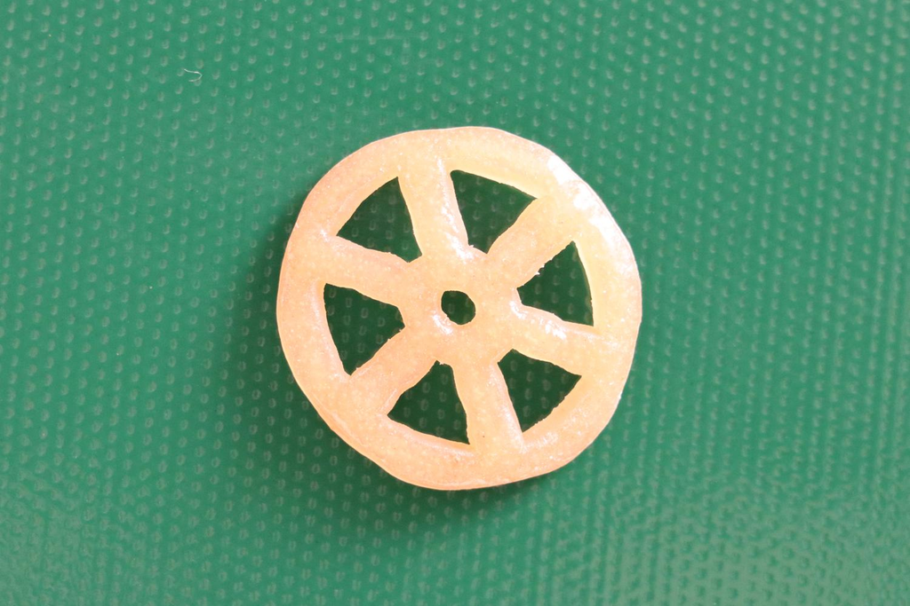

Image 1 credit: [VisA dataset, Yang Zou, Jongheon Jeong, Latha Pemula, Dongqing Zhang and Onkar Dabeer, 2022](https://github.com/amazon-science/spot-diff), [CC BY 4.0](https://creativecommons.org/licenses/by/4.0/). See the [asset manifest](../data/assets.jsonl) for preparation notes.

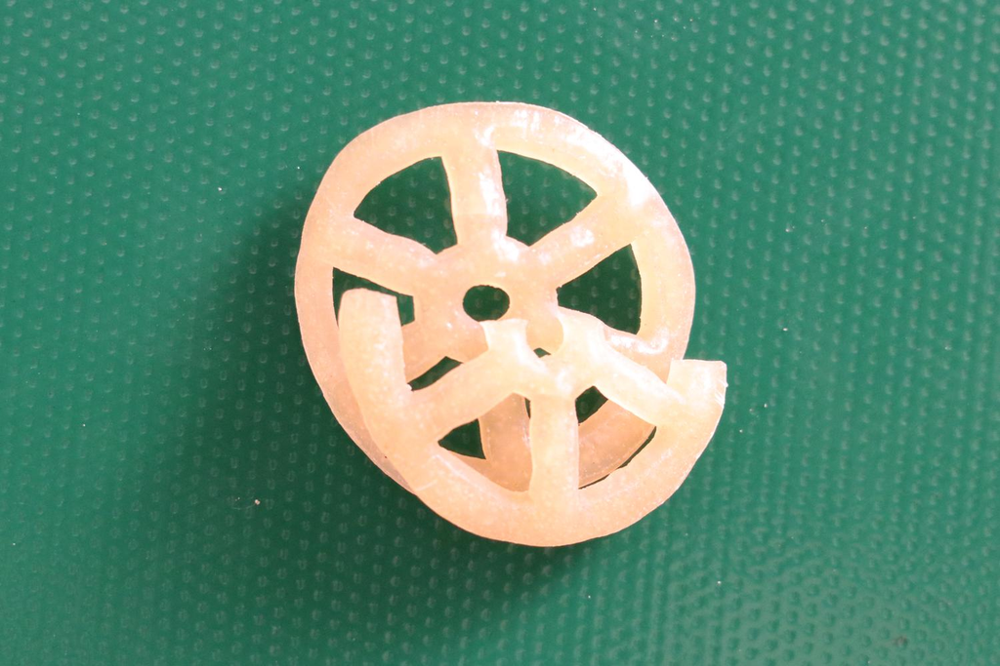

Image 2 credit: [VisA dataset, Yang Zou, Jongheon Jeong, Latha Pemula, Dongqing Zhang and Onkar Dabeer, 2022](https://github.com/amazon-science/spot-diff), [CC BY 4.0](https://creativecommons.org/licenses/by/4.0/). See the [asset manifest](../data/assets.jsonl) for preparation notes.

Options:

- 1: Rim broken; additional fragment crosses openings
- 2: Rim intact; additional fragment crosses openings
- 3: Rim intact; no additional fragment
- 4: Rim broken; no additional fragment

## VB0101

Which pasta piece in Image 2 has a clear pale fracture line crossing its curved body, unlike the unfractured reference pieces in Image 1?

Rules: Positions refer to the two-by-two arrangement in Image 2. A change in orientation alone is not a fracture.

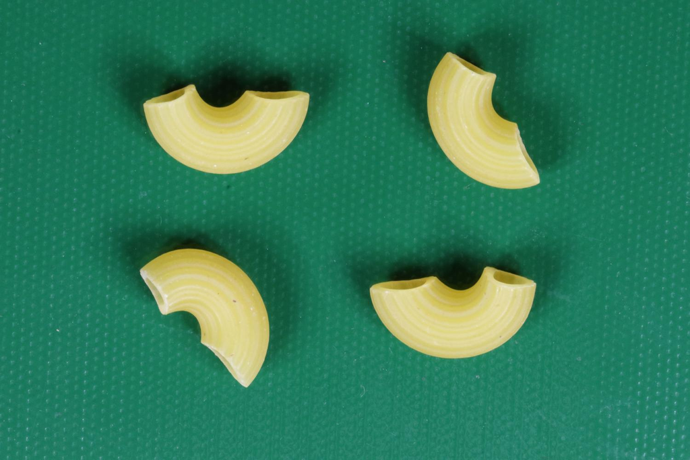

Image 1 credit: [VisA dataset, Yang Zou, Jongheon Jeong, Latha Pemula, Dongqing Zhang and Onkar Dabeer, 2022](https://github.com/amazon-science/spot-diff), [CC BY 4.0](https://creativecommons.org/licenses/by/4.0/). See the [asset manifest](../data/assets.jsonl) for preparation notes.

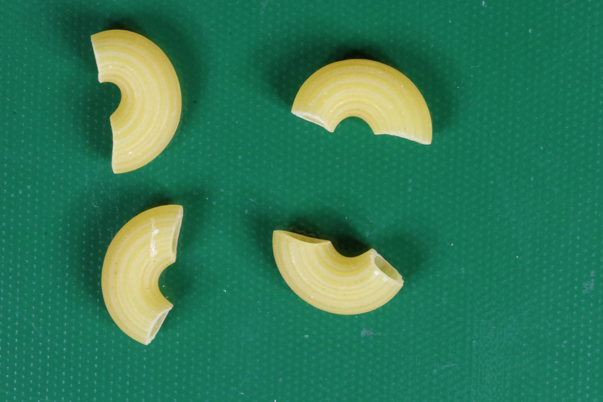

Image 2 credit: [VisA dataset, Yang Zou, Jongheon Jeong, Latha Pemula, Dongqing Zhang and Onkar Dabeer, 2022](https://github.com/amazon-science/spot-diff), [CC BY 4.0](https://creativecommons.org/licenses/by/4.0/). See the [asset manifest](../data/assets.jsonl) for preparation notes.

Options:

- 1: Top-left
- 2: Bottom-left
- 3: Top-right
- 4: Bottom-right

## VB0102

Which component has changed orientation relative to the circuit board in Image 2?

Rules: Match the blue square adjuster and the three-pin header first. Compare component directions relative to the board, not the camera. Do not infer electrical performance.

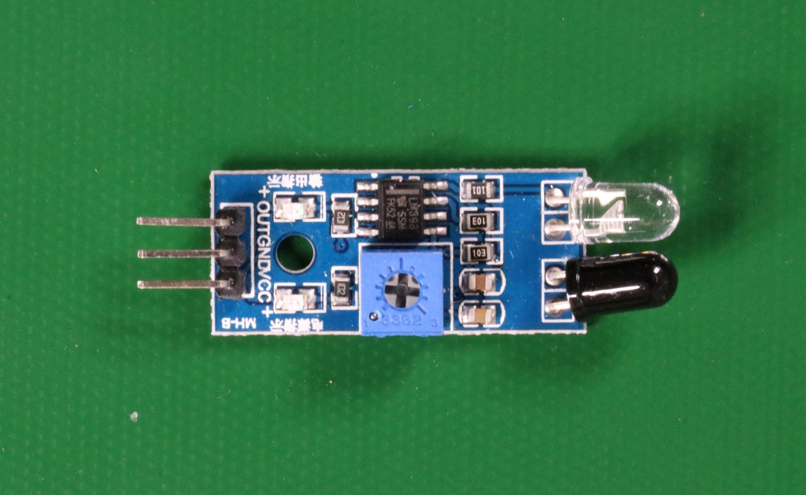

Image 1 credit: [VisA dataset, Yang Zou, Jongheon Jeong, Latha Pemula, Dongqing Zhang and Onkar Dabeer, 2022](https://github.com/amazon-science/spot-diff), [CC BY 4.0](https://creativecommons.org/licenses/by/4.0/). See the [asset manifest](../data/assets.jsonl) for preparation notes.

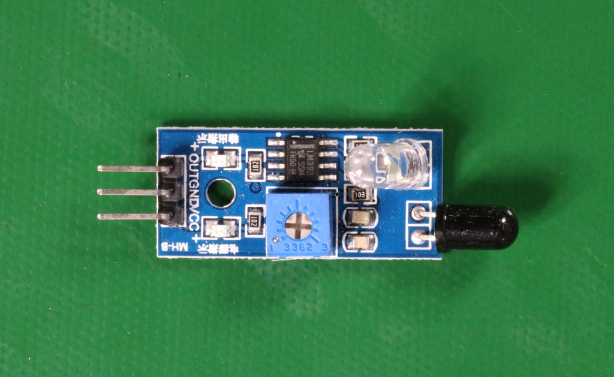

Image 2 credit: [VisA dataset, Yang Zou, Jongheon Jeong, Latha Pemula, Dongqing Zhang and Onkar Dabeer, 2022](https://github.com/amazon-science/spot-diff), [CC BY 4.0](https://creativecommons.org/licenses/by/4.0/). See the [asset manifest](../data/assets.jsonl) for preparation notes.

Options:

- 1: The three-pin header
- 2: The lower black LED
- 3: The blue square adjuster
- 4: The upper clear LED

## VB0103

Which pair of parts is present in the reference board in Image 1 but absent in Image 2?

Rules: Align the boards using the USB connector and the IN+/IN- labels. Count visible components, not their empty solder pads.

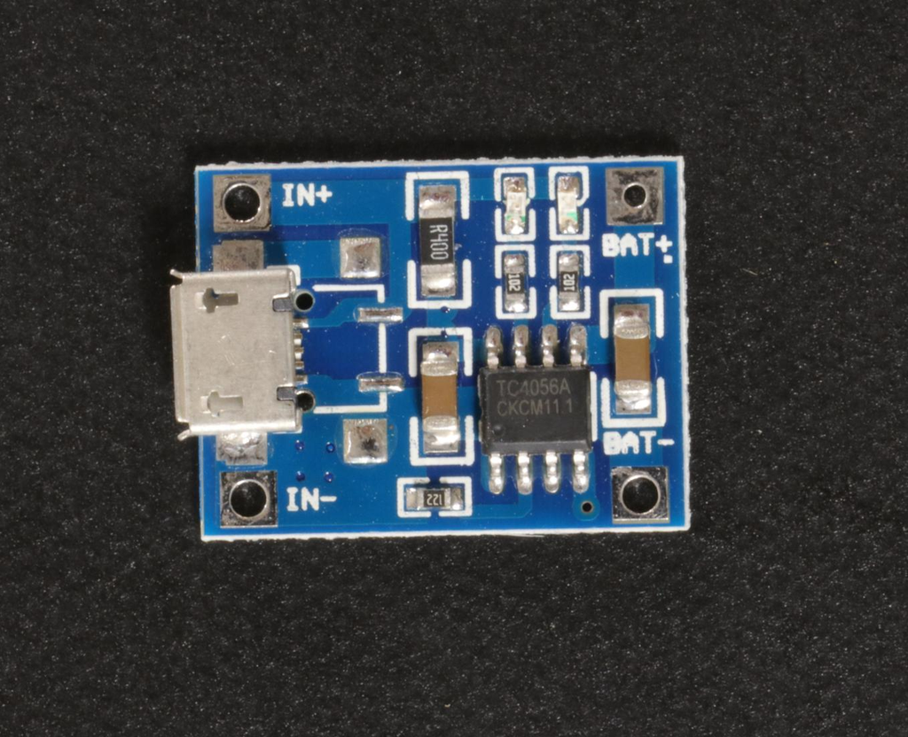

Image 1 credit: [VisA dataset, Yang Zou, Jongheon Jeong, Latha Pemula, Dongqing Zhang and Onkar Dabeer, 2022](https://github.com/amazon-science/spot-diff), [CC BY 4.0](https://creativecommons.org/licenses/by/4.0/). See the [asset manifest](../data/assets.jsonl) for preparation notes.

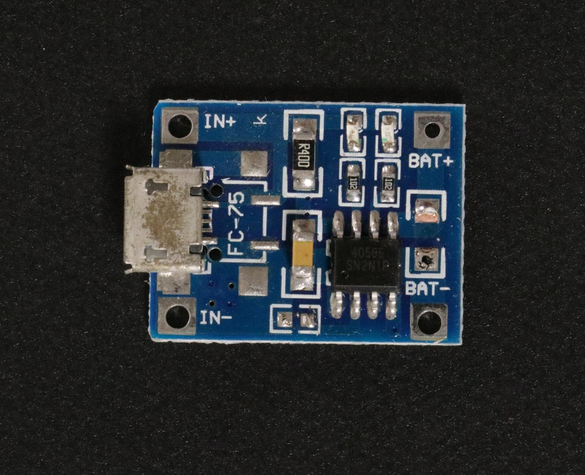

Image 2 credit: [VisA dataset, Yang Zou, Jongheon Jeong, Latha Pemula, Dongqing Zhang and Onkar Dabeer, 2022](https://github.com/amazon-science/spot-diff), [CC BY 4.0](https://creativecommons.org/licenses/by/4.0/). See the [asset manifest](../data/assets.jsonl) for preparation notes.

Options:

- 1: The right-hand tan rectangular component and the small bottom resistor marked 221 in Image 1
- 2: The USB connector and the upper R400 resistor
- 3: The eight-pin black chip and the right-hand tan rectangular component
- 4: The left-hand tan rectangular component and the USB connector

## VB0104

Which wall difference is visible in Image 2 compared with the reference tube in Image 1?

Rules: Inspect the visible sidewall only. Do not infer hidden damage or how the opening was made.

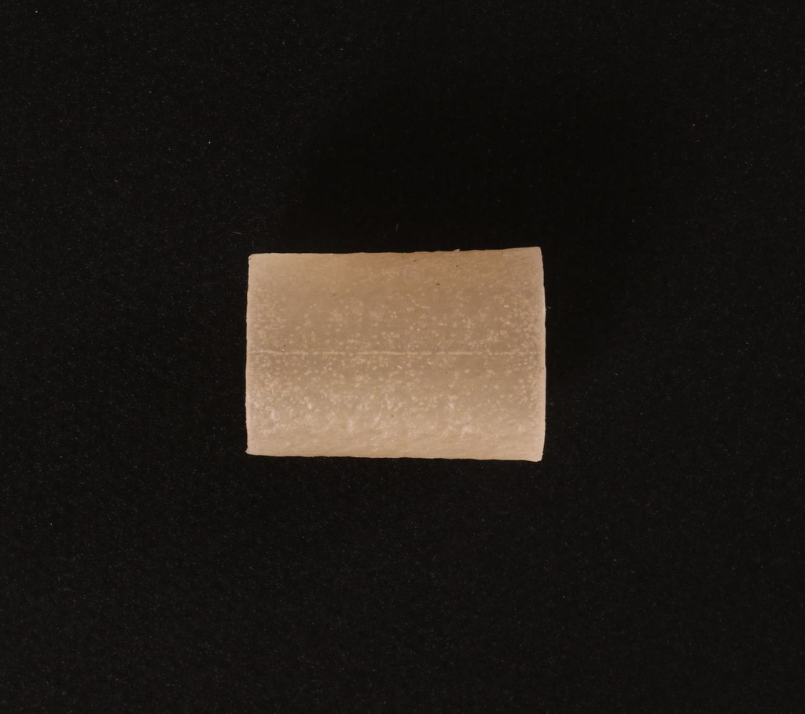

Image 1 credit: [VisA dataset, Yang Zou, Jongheon Jeong, Latha Pemula, Dongqing Zhang and Onkar Dabeer, 2022](https://github.com/amazon-science/spot-diff), [CC BY 4.0](https://creativecommons.org/licenses/by/4.0/). See the [asset manifest](../data/assets.jsonl) for preparation notes.

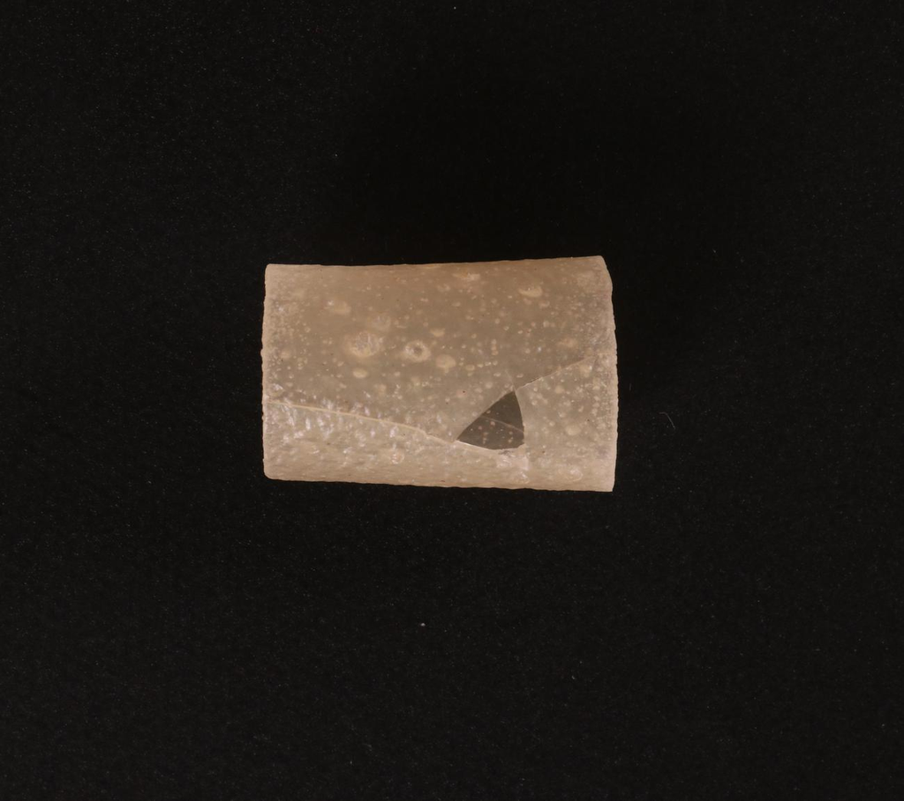

Image 2 credit: [VisA dataset, Yang Zou, Jongheon Jeong, Latha Pemula, Dongqing Zhang and Onkar Dabeer, 2022](https://github.com/amazon-science/spot-diff), [CC BY 4.0](https://creativecommons.org/licenses/by/4.0/). See the [asset manifest](../data/assets.jsonl) for preparation notes.

Options:

- 1: Only a circular dark surface spot, with no opening
- 2: A triangular opening with a lifted flap near the lower-right sidewall
- 3: No visible difference beyond position
- 4: A complete end-to-end split into two separate tube halves

## VB0112

Which pair of pieces in Image 2 both has conspicuous dark purple or black spots on the broad curved surfaces, unlike the reference pieces in Image 1?

Rules: Compare visible surface marks. Do not count background texture, shadows or the dark hollow cut ends. Positions refer to Image 2.

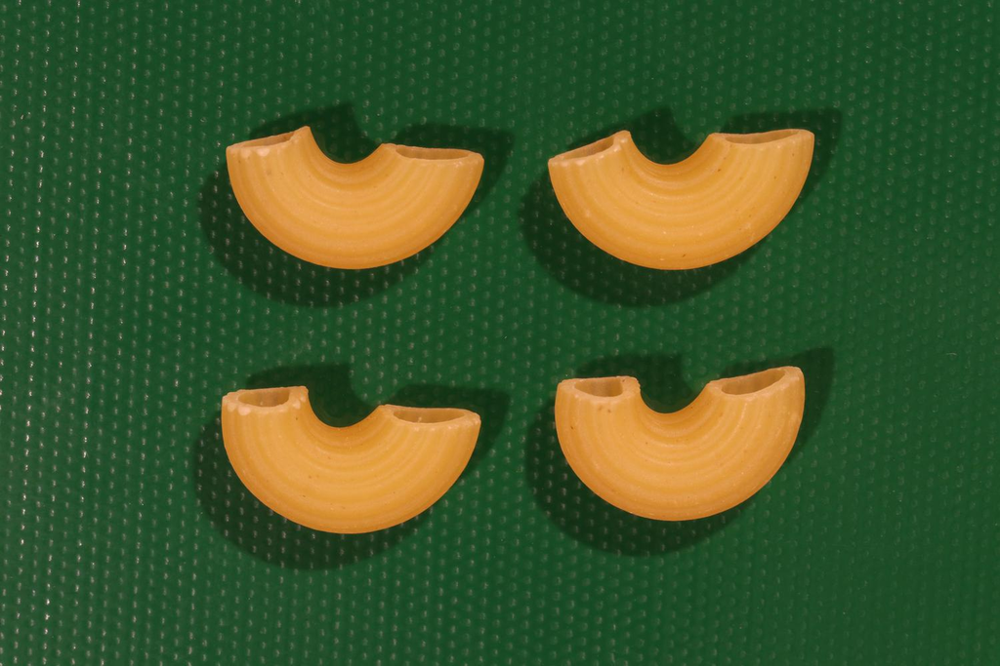

Image 1 credit: [VisA dataset, Yang Zou, Jongheon Jeong, Latha Pemula, Dongqing Zhang and Onkar Dabeer, 2022](https://github.com/amazon-science/spot-diff), [CC BY 4.0](https://creativecommons.org/licenses/by/4.0/). See the [asset manifest](../data/assets.jsonl) for preparation notes.

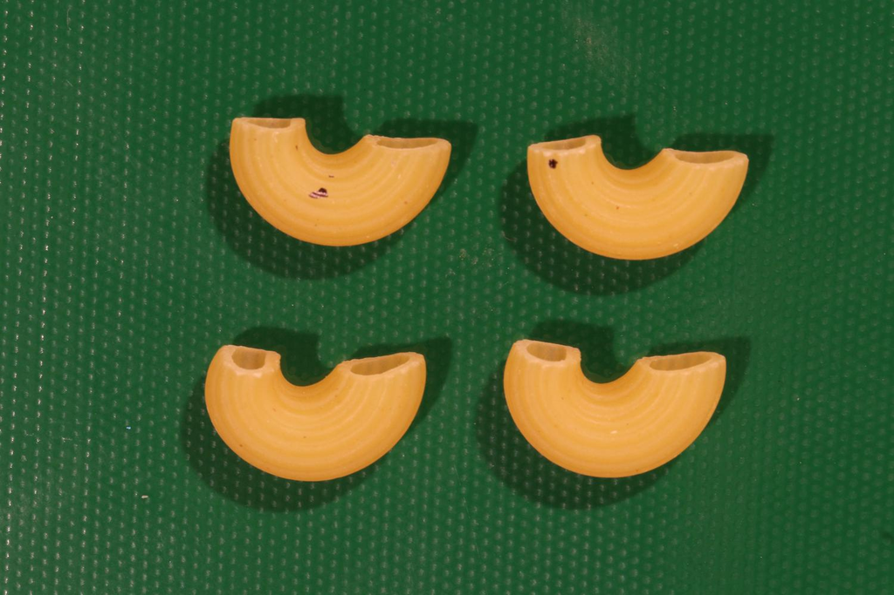

Image 2 credit: [VisA dataset, Yang Zou, Jongheon Jeong, Latha Pemula, Dongqing Zhang and Onkar Dabeer, 2022](https://github.com/amazon-science/spot-diff), [CC BY 4.0](https://creativecommons.org/licenses/by/4.0/). See the [asset manifest](../data/assets.jsonl) for preparation notes.

Options:

- 1: The left column
- 2: The bottom row
- 3: The right column
- 4: The top row
